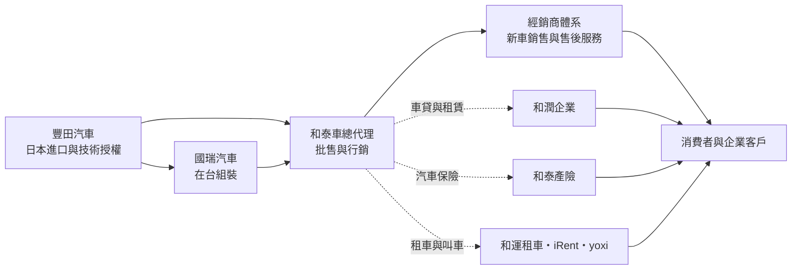
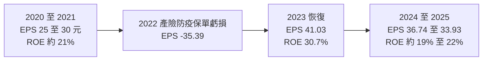
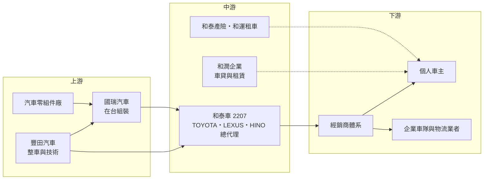

# 2207 和泰車

> 上市｜[[產業索引-汽車工業|汽車工業]]｜上市（櫃）日期 1997/02/25

# 第一章：企業模式與商業藍圖

> [!info] 撰寫說明
> 本文由 Claude 依公開資料整理，架構比照 [[2330台積電]] 的四章研究，資料截至 2026-10-08。財務數字來源：Goodinfo 經營績效、現金流量、股利政策頁（年度合併報表）、MoneyDJ 理財網年度財務比率（負債比率）、證交所開放資料（基本資料、股利）、工商時報與經濟日報財報報導、豐存股財務摘要；產業描述為整理性內容，尚未逐條比對原始文件。#待校對

在評估單一個股的長期投資價值時，首要步驟是拆解企業的底層獲利邏輯。本章針對和泰汽車（股票代號：2207，以下簡稱和泰車）的商業模式進行定性分析，說明一家「不製造汽車」的代理商，如何靠品牌代理權、經銷網路、車貸與保險，建立台灣汽車市場最穩固的獲利結構。

## 一、核心定位：TOYOTA 在台總代理與汽車生態系經營者

和泰車成立於 1955 年，1997 年上市，是日本豐田汽車在台灣的[[總代理]]，代理 TOYOTA、LEXUS 與商用車品牌 HINO（日野）。依公司公布的資料，2025 年三品牌合計市占率約 38.6%，長年是台灣市占第一的汽車集團，市占率約為第二名的數倍。

和泰車的商業模式可以分成三層。第一層是代理與批售：向豐田在台組裝廠國瑞汽車與日本採購整車，批售給各區經銷商，再由經銷商賣給消費者。第二層是經銷與[[售後服務]]：透過轉投資的經銷商體系提供新車銷售、保養維修與零件，售後服務的收入比新車銷售更穩定，也不受景氣影響太大。第三層是汽車金融與移動服務：[[汽車融資]]與租賃（[[6592和潤企業]]）、汽車保險（和泰[[產險]]）、租車與[[共享汽車]]（和運租車、iRent），以及叫車平台 yoxi，形成從買車、用車到換車的完整生態系。

這三層結構讓和泰車不只是「賣車的公司」，而是一家掌握台灣三分之一以上車主生命週期的服務平台。同一位客戶在買車時貸款、投保，用車期間回廠保養，數年後再透過和泰體系換車，每個環節都能貢獻收入。

## 二、終端應用板塊：車種與事業結構

和泰車未公開各事業的營收比重，因此本節不畫圓餅圖，改以定性描述。

- **新車銷售：** 營收主體。TOYOTA 的轎車與休旅車涵蓋各價位，LEXUS 則在豪華車市場與德系品牌競爭。新車銷售的毛利率不高，但它是後續所有服務收入的入口。
- **油電與電動車：** 豐田以[[油電混合車]]為全球主力，和泰車在台灣也以油電車型作為節能與減碳的主要訴求，並逐步導入[[純電車]]與插電式油電車。油電車在台灣的高接受度，是和泰車在電動化過渡期維持市占的重要原因。
- **商用車：** HINO 卡車與 TOYOTA 小貨車等商用車型，在台灣商用車市場長年居領先地位，客戶以物流與營建業者為主。
- **金融與保險：** 和潤企業的車貸、租賃與分期業務，以及和泰產險的車險與投資收益，是集團獲利的重要來源，但也帶來與汽車本業不同的風險。
- **中國事業：** 透過轉投資經營中國的豐田與 LEXUS 經銷據點，近年在中國車市價格戰下持續虧損，規模相對集團不大。

## 三、資本轉化邏輯：輕資產代理加金融放大

- **代理模式的輕資產特性：** 和泰車不負擔車輛研發與大部分製造資本支出，主要成本是向豐田與國瑞採購整車，因此代理本業的資本報酬率遠高於一般車廠。車款開發的風險由豐田承擔，和泰車專注在行銷、通路與服務。
- **金融放大效果：** 消費者買車時同時辦理車貸與保險，和泰車在一台車上能收取銷售利潤、利差與保費，客戶黏著度也因此提高。但金融業務需要大量借款支撐放款，使合併報表的[[負債比率]]大幅上升。依 MoneyDJ 資料，和泰車合併負債比率長年在 70% 至 83% 之間。
- **售後與再銷售：** 保養維修、零件、中古車與租賃車到期後的再出售，延長了單一客戶的貢獻週期。車隊規模越大，未來的售後收入就越穩定。

## 四、企業長期藍圖：守住市占、擴大移動服務與電動化

- **守住市占：** 和泰車的核心任務是在進口車關稅調整、中國與歐美電動車品牌進入台灣的環境下，維持約四成的市占率。豐田全球產品力與台灣在地服務網路，是它守住市占的兩大支柱。
- **電動化：** 在豐田「多元動力」的全球策略下，以油電混合為主、逐步導入純電與插電式油電車型。這個策略降低了押錯技術路線的風險，但若純電普及速度快於預期，也可能讓和泰車在純電市場落後。
- **移動服務：** iRent 共享汽車與 yoxi 叫車平台，是和泰車把客戶關係從「買車」延伸到「用車」的布局。年輕世代的擁車意願若下降，移動服務可以保住和泰車與這群客戶的連結。

# 第二章：護城河深度與競爭優勢

在長期價值投資中，「護城河」指企業抵禦競爭、維持超額利潤的保護機制。本章分析和泰車的護城河構成、主要競爭對手，以及這些優勢在[[進口車關稅]]調整與電動化浪潮下能守住多少。

## 一、護城河的核心組成要素

和泰車擁有台灣汽車業最深的護城河，屬於「寬護城河」，由三個要素組成：

- **獨家代理權與品牌：** TOYOTA 與 LEXUS 在台灣的代理權由和泰車長期持有，雙方合作超過半世紀。豐田品牌在妥善率、低維修成本與中古車保值性上的口碑深植消費者心中，這是競爭對手難以在短時間內複製的無形資產。
- **經銷與服務網路：** 全台密集的經銷與保修據點，讓 TOYOTA 車主的保養便利性與二手車殘值都優於多數品牌。新品牌即使產品有競爭力，也很難在短時間內建立同等規模的服務網，這是汽車業典型的「網路效應」。
- **金融生態系：** 和潤車貸、和泰產險與租賃業務形成交叉銷售，客戶從買車、保險、保養到換車都留在和泰體系內。客戶熟悉的貸款與保險流程、累積的保修紀錄，都讓轉換品牌的成本提高。

## 二、主要競爭對手格局

| 對手 | 定位 | 對和泰車的威脅 |
|---|---|---|
| [[2204中華]] | 三菱代理與自製商用車 | 商用車與[[國產車]]市場競爭 |
| [[2201裕隆]] | 日產代理與自有品牌，集團含車貸業務 | 國產轎車與休旅車競爭 |
| [[2227裕日車]] | NISSAN 在台銷售 | 國產休旅與轎車競爭 |
| [[9941裕融]] | 裕隆集團車貸公司 | 汽車金融市場直接競爭 |
| 汎德永業等進口車代理 | BMW、賓士、福斯等進口品牌 | 進口車關稅調降後價格更具競爭力 |
| Tesla、中國與韓國電動車品牌 | 純電車 | 電動化加速時搶奪年輕與科技族群 |

## 三、優勢轉化：哪些守得住、哪些守不住

- **守得住：** 主流家用車、油電混合車與商用車市場。即使在市場觀望進口車關稅的年份，TOYOTA 與 LEXUS 合計市占率仍維持在接近四成，顯示品牌與服務網路的黏著度。
- **守不住：** 中國市場的經銷業務。在中國車市價格戰中，代理經銷沒有護城河，和泰車的中國據點長期虧損，說明它的優勢高度依賴台灣市場的特殊條件。另一個守不住的是產險的保險風險：2022 年和泰產險因防疫保單大量理賠，使集團當年轉為虧損（年度 EPS -35.39 元，虧損原因依記憶整理，待校對），顯示金融子公司可能在短時間內吞掉本業數年的獲利。
- **觀察重點：** 進口車關稅調整後國產車與進口車的價差變化、純電車市占提升速度、豐田新車型的產品週期，以及金融子公司的放款品質與保險風險控管。

# 第三章：財務體質與盈利規模

資料日期：2026-10-08。年度數字取自 Goodinfo 經營績效、現金流量與股利政策頁；2026 年上半年數字取自財報新聞報導；表格是撰寫當時的快照，最新月營收、毛利率、累計 EPS 由自動排程寫在本筆記的屬性欄位（月營收、毛利率、累計EPS 等）。#待校對

財務報表是檢驗護城河是否真實存在的最終標準。和泰車的合併報表同時包含汽車代理、車貸租賃與產險，本章用多年度資料檢視它的獲利品質，並特別說明金融子公司對各項指標的影響。

## 一、獲利能力的基石：三率

| 年度 | 營收（億元） | [[毛利率]] | [[營業利益率]] | EPS（元） | [[ROE]] |
|---|---|---|---|---|---|
| 2020 | 2,304 | 15.4% | 9.21% | 25.36 | 20.7% |
| 2021 | 2,453 | 16.6% | 10.1% | 29.68 | 21.9% |
| 2022 | 2,437 | 0.76% | -5.86% | -35.39 | -19.2% |
| 2023 | 2,771 | 18.1% | 11.3% | 41.03 | 30.7% |
| 2024 | 2,795 | 18.1% | 11.1% | 36.74 | 22.3% |
| 2025 | 2,795 | 17.7% | 10.7% | 33.93 | 18.9% |
| 2026 上半年 | 約 1,609 | 21.62% | 14.24% | 21.57 | 未查得 |

（2026 年上半年毛利率與營業利益率取自財報新聞，計算口徑可能與 Goodinfo 不同，不宜直接比較。）

- **穩定的本業獲利：** 除了 2022 年，和泰車的營業利益率長年穩定在 9% 至 11% 之間，以汽車通路業來說相當高，反映代理權帶來的定價力與金融業務的利差收入。
- **2022 年的教訓：** 2022 年毛利率跌到 0.76%、營業利益率 -5.86%，EPS -35.39 元。依記憶，主因是和泰產險在疫情期間銷售的防疫保單理賠金額遠超過預期（待校對）。這次虧損說明，和泰車的合併獲利不只是汽車景氣的函數，金融子公司的風險管理同樣重要。
- **溫和成長：** 2020 至 2025 年營收由 2,304 億元增至 2,795 億元，年複合成長率約 3.9%（推算），成長主要來自車價上漲、LEXUS 與油電車款比重提高，以及金融業務擴張。台灣新車市場規模每年約四十多萬輛，總量成長有限。

## 二、[[ROE]]：資本效率

2021 至 2025 年和泰車的五年平均 ROE 約 14.9%（推算），但若扣除 2022 年的產險虧損，其餘四年平均約 23.5%（推算）。和泰車的高 ROE 有兩個來源：代理本業的輕資產特性，以及金融子公司帶來的財務槓桿。依 MoneyDJ 資料，合併負債比率在 2022 年高達約 83%，2025 年約 76%，大部分負債是和潤企業支撐放款與租賃資產的借款。因此，和泰車的 ROE 有一部分是「借錢放款」的槓桿成果，品質不如純代理本業的 ROE 那麼高。

## 三、資本支出與自由現金流

- **[[自由現金流]]：** 依 Goodinfo（以營業現金流加投資現金流計算），2020 至 2025 年自由現金流分別為 -68.4、-258、-704、-438、10.1 與 213 億元。2021 至 2023 年大幅為負，主要是和潤企業放款與租賃資產快速成長（在會計上放款增加會減少營業現金流），加上 2022 年產險大量理賠。2024 至 2025 年放款成長放緩後，自由現金流轉正。
- **[[CapEx]]：** 代理本業的資本支出以經銷據點、物流中心與租賃車隊為主。和潤的租賃車隊與和運的租車車隊屬於資本支出，金額隨租賃業務規模成長。
- **股利：** 依 Goodinfo 股利政策頁，2019 至 2025 年度現金股利分別為 14、17、20、2、20、20 與 20 元。2022 年度因虧損只配 2 元，其餘年份穩定提高到每股 20 元。以 2025 年 EPS 33.93 元計算，[[配發率]]約 59%（推算）。

## 四、[[ROIC]] 與 [[WACC]]：價值創造利差

- **ROIC：** 以 2025 年營收 2,795 億元、營業利益率 10.7% 計算，營業利益約 299 億元，扣除 20% 稅率後約 239 億元。和泰車 2025 年歸屬母公司淨利約 189 億元、ROE 約 18.9%，推算平均權益約 1,000 億元，合併權益（含非控制權益）假設約 1,100 億元；有息負債未查得，假設主要為和潤企業借款約 2,000 億元，投入資本約 3,100 億元，合併 ROIC 約 7.7%（推算）。若只看汽車代理本業，投入資本小得多，ROIC 推估遠高於 20%。
- **WACC：** 以 [[CAPM]] 推估，無風險利率 1.75%、市場風險溢酬 6%、β 假設 0.6（汽車通路與防禦型股票常見值，未查得來源數字），權益成本約 5.35%。稅前負債成本假設 2%、稅後約 1.6%，合併資本結構假設權益 35%、負債 65%，WACC 約 2.9%（推算）。
- **解讀：** 合併 ROIC 約 7.7%，高於約 2.9% 的 WACC，代表和泰車長期創造價值。不過合併數字混合了兩種生意：代理本業以極少的資本賺取高報酬，是真正的價值來源；金融業務則以大量借款賺取較薄的利差，創造的超額報酬較低，也帶來 2022 年那種尾端風險。投資人評估和泰車時，應把兩者分開看待。

# 第四章：總體風險與地緣政治

任何企業都無法脫離宏觀環境獨立存在。本章分析和泰車未來必須面對的地緣政治、產業週期與營運風險。

## 一、地緣政治與貿易政策

- **進口車關稅：** 台灣與美國、歐盟、日本的貿易談判都可能涉及進口車關稅調降。若進口車關稅大幅下降，國產車的價格優勢縮小，TOYOTA 國產車型面臨進口車競爭；LEXUS 等進口車型則可能受惠。關稅政策是和泰車產品組合與定價的長期變數。
- **日圓匯率：** 進口車與零件以日圓計價，日圓升值會推高成本，貶值則有利毛利率。
- **中國市場：** 中國車市價格戰激烈，本土電動車品牌快速崛起，和泰車在中國的經銷據點長期虧損，未來可能持續收縮。

## 二、產業週期與市場結構

- **台灣車市規模有限：** 台灣每年新車銷量約四十多萬輛，市場成熟，總量成長有限。和泰車的成長只能來自市占、車價與服務收入，而不是市場擴大。
- **電動化轉型：** 若純電車普及速度快於預期，豐田以油電混合為主的產品線可能失去部分市占，特別是在年輕與高所得族群。
- **利率：** 和潤企業的車貸與租賃業務受利率變化影響利差，利率快速上升時，借款成本上升的速度可能快於放款利率調整。

## 三、營運環境的隱性風險

- **產險與投資收益波動：** 和泰產險的保險理賠與投資收益，會讓集團獲利出現與汽車本業無關的波動，2022 年就是極端案例。
- **供應與交車：** 新車型的交車速度取決於豐田全球產能與國瑞組裝進度，車用晶片短缺等供應鏈事件會延遲交車。
- **代理權集中：** 和泰車的核心價值建立在豐田代理權。雙方合作數十年、關係緊密，但代理條件的任何變化，或豐田改變海外市場的經營方式，都會直接衝擊獲利。

## 四、法規與技術演進

- **碳排與電動化法規：** 台灣規劃 2040 年新售車輛全面電動化，車輛碳排與能效標準逐步加嚴，代理商必須跟隨原廠導入更多純電與插電式油電車型，並投資充電與維修能力。
- **軟體定義汽車與移動服務：** 汽車價值逐漸轉向軟體、電池與線上服務，直營模式的電動車品牌可能繞過傳統經銷體系；共享汽車與叫車平台也可能降低年輕族群的購車意願。和泰車的 iRent 與 yoxi 是它面對這個趨勢的布局。

# 專有名詞解析

## 金融

- **[[汽車融資]]**：提供購車貸款、分期付款與租賃的金融服務，賺取利差與手續費。
- **[[產險]]**：財產保險，包含車險、火險等，保險公司以保費收入與投資收益獲利。
- **[[配發率]]**：現金股利除以每股盈餘，代表公司把多少比例的獲利發給股東。
- **[[負債比率]]**：總負債除以總資產，衡量公司運用借款的程度；含金融子公司的集團負債比率通常偏高。
- **[[ROE]]**：股東權益報酬率，稅後淨利除以股東權益，衡量公司運用股東資本賺錢的效率。
- **[[ROIC]]**：投入資本報酬率，稅後營業利益除以股東權益加有息負債，衡量本業運用全部資本的效率。
- **[[WACC]]**：加權平均資金成本，股東與債權人要求報酬率的加權平均，ROIC 高於它才算創造價值。
- **[[CAPM]]**：資本資產定價模型，以無風險利率加上 β 乘以市場風險溢酬，推估股東要求的報酬率。

## 產業

- **[[總代理]]**：取得國外品牌在特定國家的獨家進口與銷售權，負責行銷、通路與售後服務的公司。
- **[[售後服務]]**：新車售出後的保養、維修、零件與配件銷售，收入比新車銷售更穩定。
- **[[國產車]]**：在台灣組裝生產的汽車，與整車進口的進口車相比，關稅與價格結構不同。
- **[[進口車關稅]]**：對整車進口課徵的關稅，稅率變化會改變國產車與進口車的價差。
- **[[油電混合車]]**：同時搭載引擎與電動馬達的汽車，以電力輔助降低油耗，豐田是主要推動者。
- **[[純電車]]**：完全以電池與馬達驅動、需要外部充電的汽車。
- **[[共享汽車]]**：以手機應用程式按時租用的汽車服務，讓使用者不必擁有車輛也能用車。

# 核心供應鏈

## 1. 上游：原廠與組裝
- 原廠：豐田汽車（日本，整車與技術授權）
- 在台組裝：國瑞汽車
- 汽車零組件：供應國瑞組裝線的國內外零組件廠（具體名單未查得）

## 2. 中游：和泰車與集團企業
- 汽車總代理：和泰車
- 汽車融資與租賃：[[6592和潤企業]]
- 汽車保險：和泰產險
- 租車與移動服務：和運租車、iRent、yoxi

## 3. 下游：通路與客戶
- 各區 TOYOTA、LEXUS、HINO 經銷商
- 個人車主、企業車隊與物流業者

## 4. 同業
- 汽車代理與製造：[[2204中華]]、[[2201裕隆]]、[[2227裕日車]]
- 汽車金融：[[9941裕融]]

## 最新新聞
<!-- news:start（自動產生，請勿手動編輯此範圍） -->
- 2026-10-12 📰 媒體 18:50｜營收速報 - 和泰車(2207)9月營收267.59億元年增率高達26.16％｜[鉅亨網](https://news.cnyes.com/news/id/6628374)

完整紀錄：[[2207和泰車 新聞]]
<!-- news:end -->

## 相關連結
- [公開資訊觀測站](https://mopsov.twse.com.tw/mops/web/t05st03?step=1&firstin=1&co_id=2207)
- [Goodinfo](https://goodinfo.tw/tw/StockDetail.asp?STOCK_ID=2207)
- [Yahoo 股市](https://tw.stock.yahoo.com/quote/2207)
- [鉅亨網新聞](https://www.cnyes.com/twstock/2207/news)
