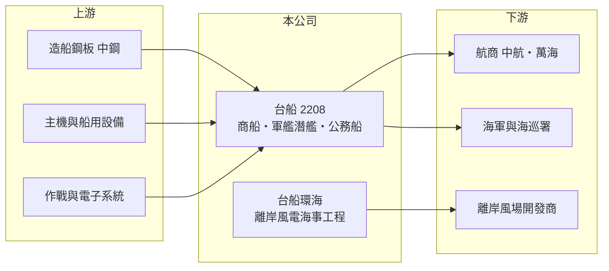

# 2208 台船

> 上市｜[[產業索引-航運業|航運業]]｜上市（櫃）日期 2008/12/22

# 第一章：企業模式與商業藍圖

> [!info] 撰寫說明
> 精簡版，由 Claude 依公開資料整理，架構比照 [[2330台積電]] 的四章研究，資料截至 2026-10-08。財務數字來源：Goodinfo 年度經營績效頁、優分析轉載的 2026 年 2 月台船媒體座談會報導、富果研究整理的中航 2026 年 9 月法說會摘要（新船訂單）、證交所開放資料（基本資料、2026 年第二季資產負債與綜合損益、營益分析）；船塢規模等細節憑既有知識撰寫，已標「待校對」。#待校對

在評估單一個股的長期價值時，首要步驟是拆解企業的獲利來源。本章說明台灣國際造船（股票代號：2208，以下簡稱台船）作為台灣最大造船廠，如何同時承擔商船、[[國艦國造]]與[[離岸風電]]三條業務線，以及造船業的合約特性如何影響它的獲利。

- **核心業務：** 台船前身為 1973 年成立的中國造船公司，2008 年上市，總部位於高雄小港，董事長為陳政宏，實收資本額約 127.5 億元，官股仍是重要股東（持股比例未查得）。主要廠區為高雄廠與基隆廠，高雄廠擁有大型船塢，可建造大型貨櫃船與散裝船。#待校對
- **三大事業：** 依 2026 年 2 月座談會，台船以國艦國造、商船與離岸風電為三大事業。國艦國造方面，潛艦後續艦排程已到 2038 年，七艘後續艦總預算約 2,840 億元，首批兩艘合約已於 2025 年簽訂，另有救難艦、補給艦、兩棲船塢運輸艦等四型五艘潛在商機約 500 至 600 億元。商船手持訂單排到 2030 年第一季，主要客戶包括 [[2612中航]] 與 [[2615萬海]]；中航訂造的 8 艘 21 萬載重噸[[海岬型散裝船]]中有 4 艘由台船承造。公務船則鎖定海巡署 4,000 噸級巡護船的後續訂單。
- **離岸風電：** 轉投資的台船環海負責離岸風電的海事工程，已連續兩年獲利，稅後盈餘約 18 至 21 億元，依持股比例每年可貢獻母公司逾 9 億元，訂單排至 2027 年。這部分讓台船的獲利來源不再只靠造船本業。
- **長期方向：** 國防預算與自製潛艦、軍艦政策提供長達十年以上的訂單能見度，是台船最重要的長期支撐；商船則讓產能維持運轉。公司表示會依產能擇優承攬訂單，重點從「搶單」轉向「訂單品質」。

# 第二章：護城河深度與競爭優勢

本章分析台船的競爭優勢與限制。造船業的護城河來自國防角色與大型船塢，但這些優勢不一定轉化為獲利。

- **競爭優勢：** 台船是台灣唯一具備建造潛艦與大型軍艦能力的船廠，國防自主政策讓它在國艦國造案中幾乎沒有國內對手，加上大型船塢與數十年的建造經驗，形成很高的進入門檻。離岸風電海事工程也需要專業船舶與施工實績，台船環海已累積在地案例。
- **限制與弱點：** 造船合約多為固定價格，簽約到交船常需二至三年，期間鋼材、設備與人工成本上漲或匯率變動，都由船廠承擔。台船 2020 年以來除 2021 年外年年虧損，2025 年虧損約 22 億元，其中約三分之一為匯兌損失，說明它的定價能力不足以抵抗成本與匯率風險。首艘潛艦海鯤號也因測試調整延工，逾期罰款已提列損失。
- **主要對手：** 商船方面為中國、韓國與日本大型船廠（如中國船舶集團、韓國現代重工），國內則有 [[6753龍德造船]] 等中小型船廠。
- **觀察重點：** 第一，2026 年能否如公司目標轉虧為盈，且獲利來自本業而非業外；第二，潛艦原型艦交艦與後續艦執行進度；第三，新簽商船合約的價格是否已反映成本。

# 第三章：財務體質與盈利規模

資料日期：2026-10-08，表格是撰寫當時的快照；最新月營收、毛利率、累計 EPS 由自動排程寫在本筆記的屬性欄位（月營收、毛利率、累計EPS 等）。#待校對

本章用多年度三率、ROE 與資本報酬，檢視台船長期虧損的原因與財務狀況。

| 年度 | 營收（新台幣） | [[毛利率]] | [[營業利益率]] | EPS（元） | [[ROE]] |
|---|---|---|---|---|---|
| 2020 | 253 億 | -5.57% | -7.54% | -3.38 | -27.9% |
| 2021 | 191 億 | 2.9% | -0.02% | 0.02 | 0.1% |
| 2022 | 220 億 | -14.1% | -17.1% | -3.78 | -30.8% |
| 2023 | 215 億 | -11.2% | -13.2% | -4.32 | -49.1% |
| 2024 | 145 億 | -21.1% | -25.7% | -2.20 | -35.5% |
| 2025 | 218 億 | -10.2% | -13.6% | -1.77 | -28.0% |
| 2026 上半年 | 95.9 億 | -5.91% | -9.53% | 0.28 | 未查得 |

註：2020 至 2025 年取自 Goodinfo，2026 上半年取自證交所營益分析與綜合損益表。

- **營收規模：** 營收在 145 億至 253 億元之間擺盪，取決於當年交船與工程進度認列。2020 至 2025 年營收年複合成長率約 -2.9%（推算）。
- **獲利結構：** 毛利率連續多年為負，代表多數合約在成本面就已虧損，問題不在費用控制，而在接單價格與成本超支。2026 年上半年營業虧損約 9.1 億元，但業外收入約 12.8 億元（包含台船環海的投資收益等），使稅後轉為小幅獲利。
- **長期指標：** 2021 至 2025 年平均 ROE 約 -28.7%（推算），2025 年度未配發股利，累積虧損約 52.8 億元。
- **財務特色：** 2026 年第二季底總資產約 533.4 億元，負債約 458.1 億元，權益僅約 75.4 億元，負債比約 86%，每股淨值約 5.96 元（證交所開放資料）。負債中包含大量合約負債（預收工程款），但也意味財務緩衝很薄，過去曾多次以增資補充資本。

**[[ROIC]] 與 [[WACC]]：** 2025 年營業利益約 -29.6 億元（218 億 × -13.6%），稅後營業利益為負；投入資本以權益 75.4 億元加上假設占總負債四成的有息負債約 183 億元，合計約 258 億元，ROIC 約 -11.5%（推算）。WACC 以 CAPM 推估：無風險利率 1.75%、市場風險溢酬 6%、β 取重工業常見值 1.1，股東權益成本約 8.35%；負債成本 3.0%、稅後 2.4%；權益約占 29%，WACC 約 4.1%（推算）。ROIC 長期為負且遠低於 WACC，代表台船的造船本業多年來持續消耗資本。它的投資價值不在現有獲利，而在國防訂單的長期能見度，以及新合約能否把毛利率拉回正值。

# 第四章：總體風險與地緣政治

本章分析台船長期面對的風險。

- **產業週期：** 商船訂單跟著航運景氣起伏，航商在運價高峰大量下單，低谷時訂單急凍；新船價格也隨全球船廠產能利用率變動。軍艦訂單雖不受景氣影響，但取決於國防預算與政治決策。
- **營運風險：** 固定價格合約下，鋼板、主機與人工成本上漲直接侵蝕毛利；潛艦等首製艦技術難度高，延工罰款與追加成本難以預估。造船業也面臨技術工人短缺與老化問題。
- **其他風險：** 新台幣升值會造成美元計價合約的匯兌損失；國防案受預算審議與政治爭議影響；離岸風電海事工程則受政府風場開發政策與國產化要求變動影響。

# 專有名詞解析

## 金融

- **[[ROIC]]**：投入資本報酬率，稅後營業利益除以股東權益與有息負債的合計，衡量本業對所有資金提供者的報酬。
- **[[WACC]]**：加權平均資金成本，依股東權益與負債的比重加權計算的資金成本，ROIC 高於它才代表創造價值。

## 產業

- **[[國艦國造]]**：政府推動由國內船廠自行設計與建造軍艦、潛艦的政策，目的在建立國防自主與在地供應鏈。
- **[[離岸風電]]**：在海上設置風力發電機組，需要專業船舶進行基礎與風機的運輸、安裝與運維。
- **[[海岬型散裝船]]**：載重約 15 萬至 21 萬噸的大型散裝船，主要運送鐵礦砂與煤炭，因船身太大無法通過舊巴拿馬運河而得名。

# 核心供應鏈

- 上游：造船鋼板（[[2002中鋼]]）、船用主機與發電機、甲板機械、軍用作戰與電子系統。
- 下游／客戶：航商（[[2612中航]]、[[2615萬海]] 等）、海軍與海巡署、離岸風場開發商。
- 同業：[[6753龍德造船]]，以及中國、韓國、日本的大型船廠。

## 最新新聞
<!-- news:start -->
<!-- news:end -->

## 相關連結
- [公開資訊觀測站](https://mopsov.twse.com.tw/mops/web/t05st03?step=1&firstin=1&co_id=2208)
- [Goodinfo](https://goodinfo.tw/tw/StockDetail.asp?STOCK_ID=2208)
- [Yahoo 股市](https://tw.stock.yahoo.com/quote/2208)
- [鉅亨網新聞](https://www.cnyes.com/twstock/2208/news)
