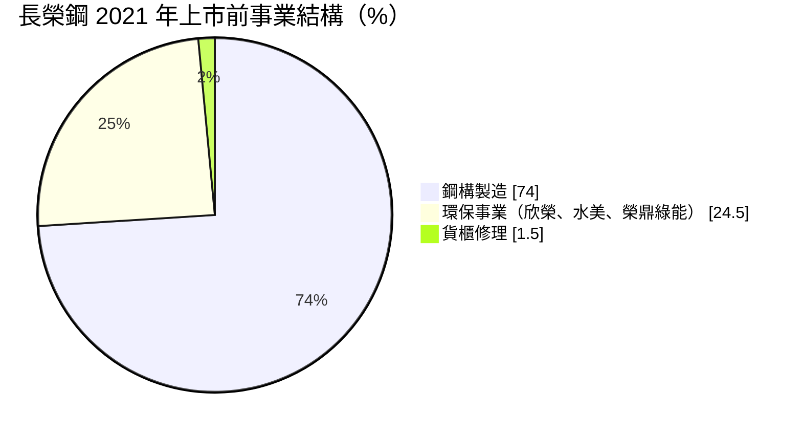
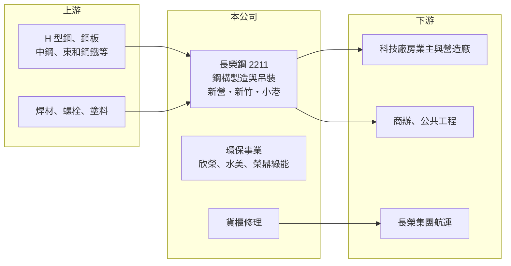

# 2211 長榮鋼

> 上市｜[[產業索引-鋼鐵工業|鋼鐵工業]]｜上市（櫃）日期 2021/04/12

# 第一章：企業模式與商業藍圖

> [!info] 撰寫說明
> 精簡版，由 Claude 依公開資料整理，架構比照 [[2330台積電]]，資料截至 2026-10-08。來源：MoneyDJ 理財網財務比率年表（2018 至 2025 年）與季表；自由時報 2021 年上市前報導（事業結構、廠區、產能）；證交所開放資料快照（基本資料、2026 年上半年資產負債與損益、營益分析、2025 年度股利、本益比淨值比）。營收比重是 2021 年報導的數字，近年比重未查得。#待校對

長榮鋼鐵成立於 1973 年 1 月，是長榮集團旗下的鋼鐵事業，2021 年 4 月在證交所上市，總部位於台北，董事長林耿立、總經理劉邦恩。長榮鋼早年以鋼筋起家，2019 年把新竹鋼筋廠轉型為鋼構廠，如今以[[鋼構]]工程為核心，兼營貨櫃修理與環保事業，是台灣科技廠房與大型建築鋼構的重要供應商。

- **核心業務：** 長榮鋼的主力是鋼構的設計、製造與吊裝，把[[H型鋼]]與鋼板加工成柱、梁等構件，再到工地吊裝組立。2021 年上市前報導指出，鋼構約占營收 74%，貨櫃修理約 1.5%（以集團業務為主），其餘約 24.5% 來自轉投資的環保事業，包括欣榮、水美與榮鼎綠能三家子公司（自由時報）。
- **營收結構：** 依上述 2021 年報導，事業結構如下圖；近年各事業比重未查得。依 MoneyDJ 每股營業額推算，營收由 2023 年約 111 億元成長到 2025 年約 153 億元（推算）。

- **營運據點：** 工廠包括台南新營廠、新竹廠與高雄小港廠；新竹廠 2019 年 9 月由鋼筋廠轉型試產鋼構，使鋼構年產能由 12 萬噸提升到 17 萬噸（自由時報 2021 年報導）。新竹廠鄰近北部科學園區，有利承接半導體與電子廠房工程。
- **長期方向：** 2021 年報導指出需求來自電子業擴廠、台商回流、老屋重建與公共工程，公司也曾評估離岸風電水下基礎，最後判斷風險過高而專注鋼構本業。這顯示經營層偏保守、重視風險控制的資本配置風格，長期成長仰賴台灣科技廠與大型建案的鋼構需求。

# 第二章：護城河深度與競爭優勢

長榮鋼的護城河來自鋼構產能規模、工程實績與長榮集團的財務信用，在國內鋼構業屬於較寬的位置。

- **競爭優勢：** 大型科技廠房與高樓鋼構工程要求工期準確、品質穩定，業主傾向把案子交給有實績、有自有產能的大廠。長榮鋼具備多座鋼構廠與吊裝能力，加上集團信用，在投標時有一定優勢；2021 年報導時在手訂單約 26 萬噸，能見度超過一年。
- **主要對手：** 國內大型鋼構同業包括 [[2013中鋼構]]、[[9958世紀鋼]] 等，以及眾多中小型鋼構廠；在科技廠房領域也會與營造集團旗下的鋼構部門競爭。
- **觀察重點：** 毛利率由 2021 年的 17.3% 升到 2023 年的 35.1%，2024 至 2025 年維持在 27% 左右（MoneyDJ），遠高於一般鋼鐵業，反映鋼構工程的附加價值與接單時點的鋼價差。長期要看接單是否持續集中在科技廠房，以及鋼價大幅波動時合約能否轉嫁成本。

# 第三章：財務體質與盈利規模

資料日期：2026-10-08，表格是撰寫當時的快照；最新月營收、毛利率、累計 EPS 由自動排程寫在本筆記的屬性欄位（月營收、毛利率、累計EPS 等）。#待校對

長榮鋼上市後獲利明顯上一個台階，EPS 由 2021 年的 3.11 元增加到 2025 年的 8.6 元，稅後淨利率長期高於營業利益率，代表業外收益貢獻可觀。

| 年度 | 營收（億元） | [[毛利率]] | [[營業利益率]] | EPS（元） | [[ROE]] |
|---|---|---|---|---|---|
| 2021 | 未查得 | 17.31% | 12.89% | 3.11 | 7.45% |
| 2022 | 約 114（推算） | 25.81% | 20.89% | 6.22 | 12.11% |
| 2023 | 約 111（推算） | 35.13% | 30.07% | 8.80 | 16.41% |
| 2024 | 約 129（推算） | 26.89% | 22.17% | 6.12 | 9.74% |
| 2025 | 約 153（推算） | 27.67% | 23.43% | 8.60 | 12.99% |

營收以 MoneyDJ 每股營業額 × 2026 年股本 4.17 億股推算，2021 年上市前後股本可能不同，故不推算。

- **長期指標：** 2021 至 2025 年平均 ROE 約 11.7%（推算），2020 至 2025 年負債比率維持在 21% 至 30%（MoneyDJ），財務保守。2025 年度配發現金股利 6.5 元，配發率約 76%（證交所資料推算），配息穩定度高。稅後淨利率在 2022、2023、2025 年都高於營業利益率，業外收益的來源（轉投資、金融資產股利或處分利益）未查得。
- **[[ROIC]] 與 [[WACC]]：** 2025 年營業利益約 35.9 億元（營收約 153 億元 × 23.43%），稅後約 28.7 億元。投入資本以 2026 年第二季權益總計 311.0 億元，加上有息負債推估約 21.4 億元（負債總計 107.0 億元的兩成，工程業負債多為合約負債與應付款，官方快照未拆分）計算，2025 年 ROIC 約 8.6%（推算）。這個數字偏低估，因為權益中包含大量轉投資與金融資產，並非全部投入鋼構本業。WACC 約 6.9%（推算：無風險利率 1.75%、市場風險溢酬 6%、β 取鋼鐵同業常見值 0.9，股東權益成本 7.15%；稅前負債成本 2.5%、稅率 20%，以市值約 370 億元與有息負債約 21 億元計算權重約 95：5）。即使用包含轉投資的保守算法，ROIC 仍高於 WACC，代表長期在創造價值。
- **財務特色：** 2026 年第二季總資產 418.0 億元、負債 107.0 億元，負債比率約 26%，每股淨值 66.33 元。2026 年上半年營收 76.7 億元、毛利率 25.73%、營業利益率 20.01%、EPS 3.26 元（證交所資料）。

# 第四章：總體風險與地緣政治

長榮鋼的風險來自科技業資本支出循環、鋼價波動對工程合約的影響，以及工安與工期風險。

- **產業週期：** 鋼構需求高度依賴半導體與電子廠擴建、商辦與公共工程。科技業資本支出放緩時，新案減少、競標價格下降，毛利率會從目前的高水準回落。過去毛利率在 2021 年只有 17%，代表景氣反轉時的下行空間不小。
- **營運風險：** 鋼構合約多在接單時議定價格，若施工期間鋼價大漲，成本可能無法完全轉嫁；反之鋼價下跌時則有額外利潤。大型工程的吊裝涉及工安風險，工期延誤可能產生罰款或成本超支。
- **其他風險：** 業外收益占獲利比重高，轉投資或金融資產價值變動會放大 EPS 波動；環保事業涉及廢棄物處理法規與許可。碳費與歐盟[[CBAM]]等規範，長期可能提高鋼材成本，業主也開始要求低碳鋼構。

# 專有名詞解析

## 金融

- **[[ROIC]]**：投入資本報酬率，稅後營業利益除以股東權益加有息負債，衡量本業運用資本的效率。
- **[[WACC]]**：加權平均資金成本，股東與債權人要求報酬率的加權平均，是 ROIC 要超越的門檻。

## 產業

- **[[鋼構]]**：以鋼材製成柱、梁等構件組成的建築結構，施工快、跨距大，廣泛用於廠房、高樓與橋樑。
- **[[H型鋼]]**：斷面呈 H 字形的熱軋型鋼，強度高、施工方便，是鋼構建築的主要材料。
- **[[CBAM]]**：歐盟碳邊境調整機制，對進口鋼鐵、鋁、水泥等高碳排產品依碳含量收費。

# 核心供應鏈

- 上游：鋼板與型鋼供應商，如 [[2002中鋼]]、[[2006東和鋼鐵]]（實際採購比重未查得）；焊材、高強度螺栓與防火、防蝕塗料。
- 下游／客戶：科技廠房業主與營造廠、商辦與公共工程（具名客戶未查得）；貨櫃修理以長榮集團為主，例如 [[2603長榮]]。
- 同業：[[2013中鋼構]]、[[9958世紀鋼]]；國內中小型鋼構廠。

## 最新新聞
<!-- news:start -->
<!-- news:end -->

## 相關連結
- [公開資訊觀測站](https://mopsov.twse.com.tw/mops/web/t05st03?step=1&firstin=1&co_id=2211)
- [Goodinfo](https://goodinfo.tw/tw/StockDetail.asp?STOCK_ID=2211)
- [Yahoo 股市](https://tw.stock.yahoo.com/quote/2211)
- [鉅亨網新聞](https://www.cnyes.com/twstock/2211/news)
