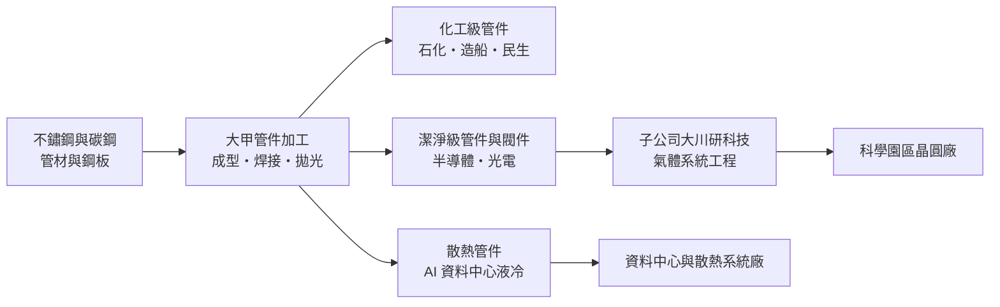
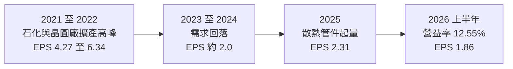
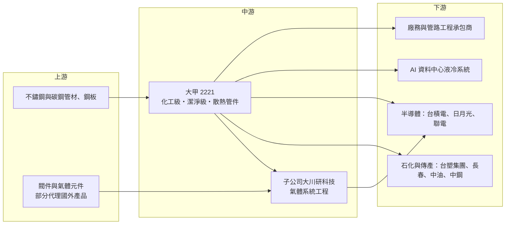

# 2221 大甲

> 上櫃｜[[產業索引-其他業|其他業]]｜上市（櫃）日期 2007/08/01

# 第一章：企業模式與商業藍圖

> [!info] 撰寫說明
> 本文由 Claude 依公開資料整理，架構比照 [[2330台積電]] 的四章研究，資料截至 2026-10-08。財務數字來源：Goodinfo 經營績效、現金流量、股利政策頁（年度合併報表）、櫃買中心開放資料（基本資料、2026 年第二季綜合損益與資產負債）、大甲永和機械 2021 年與 2025 年法人說明會簡報、優分析個股分析文章；產業描述為整理性內容，尚未逐條比對原始文件。#待校對

在評估單一個股的長期投資價值時，首要步驟是拆解企業的底層獲利邏輯。本章針對大甲永和機械工業（股票代號：2221，以下簡稱大甲）的商業模式進行定性分析，說明一家以石化管件起家的小型傳產公司，如何把不鏽鋼加工能力延伸到半導體潔淨管路與資料中心散熱管件，讓營運從石化景氣循環轉向科技業的資本支出循環。

## 一、核心定位：台灣最大的不鏽鋼管件製造商

大甲的歷史可以追溯到 1943 年，1977 年正式設立公司，2007 年在櫃買中心掛牌，總部與工廠位於台中大甲幼獅工業區與台中工業區。公司實收資本額約 4.23 億元，是一家規模很小的上櫃公司，但依 2025 年法說會簡報，它自稱是台灣最大的不鏽鋼管件製造商，含子公司員工約 621 人。

管件是管路系統中的彎頭、三通、漸縮管、管帽等連接零件，看起來是不起眼的五金，卻決定了流體輸送系統的安全性。石化廠的管路要承受高溫、高壓與腐蝕性化學品，半導體廠的氣體與化學品管路則要求極高的潔淨度，任何微粒或洩漏都可能造成停工或良率損失。因此，客戶在選擇管件供應商時，重視的是材質、焊接品質與過去的使用紀錄，而不只是價格。

依 2021 年法說會簡報，大甲在化工級管件的國內市占率超過 40%，是國內最大供應商，外徑可做到 48 英吋，是國內少數能供應全系列尺寸的廠商；當時七成以上產量外銷日本，美國與東南亞則以庫存商與工程案訂單為主。

## 二、終端應用與產品板塊：化工級、潔淨級與散熱管件

大甲的產品可以分成三大類，各自對應不同的終端產業與景氣循環：

- **化工級管件：** 不鏽鋼與碳鋼焊接管件，用於石化、化纖、造紙、造船、食品與民生建築。依 2025 年法說會簡報，主要客戶包括台塑集團、長春集團、中油與中鋼體系。這是大甲的傳統本業，需求跟著石化廠的新建、歲修與擴產週期起伏。
- **潔淨級管件：** 半導體與光電廠使用的潔淨管與管件、微型接頭、膜片閥、球閥與客製模組，需要電解拋光、超潔淨清洗與精密檢測技術。依 2025 年法說會簡報，客戶包括 [[2330台積電]]、[[3711日月光投控]]、[[2303聯電]] 等。潔淨級產品的毛利率高於化工級，也讓大甲搭上晶圓廠擴產的長期趨勢。
- **資料中心散熱管件：** AI 伺服器採用[[液冷散熱]]後，冷卻液需要以不鏽鋼管路在機櫃、[[CDU]] 與冰水系統之間循環。依優分析的報導，資料中心散熱管件在 2026 年已占大甲營運約六成，訂單能見度延伸到 2028 年，是近年營收與毛利率提升的主要原因（比重為媒體報導數字，待校對）。

依優分析的報導，最大客戶占營收比重由 2024 年的 22.83% 升到 2025 年的 26.60%，客戶集中度正在提高。

## 三、資本轉化邏輯：加工能力橫向延伸

- **同一套能力，三個市場：** 管件的成型、焊接、檢測技術在三個市場是共通的，差別在於潔淨度與規格。大甲把石化管件累積的大尺寸、耐壓經驗，延伸到潔淨級與散熱管件，等於用既有的工廠與技術，換到更高成長的市場。
- **子公司延伸到工程服務：** 子公司大川研科技 2012 年設立於新竹科學園區，提供晶圓廠特殊氣體系統的設計、管路材料、設備與工程服務，2024 年營收約 5.51 億元、稅後淨利約 0.31 億元。大川研讓大甲從單純賣零件，延伸到晶圓廠的[[廠務工程]]，也更接近終端客戶的需求。
- **中國子公司收縮：** 安徽大甲在中國當地生產銷售，但依優分析的報導，2025 年營收大幅衰退並出現虧損，中國業務對集團的貢獻已很小。

## 四、企業長期藍圖：從石化週期轉向科技資本支出

大甲的長期方向，是降低對石化景氣的依賴，提高半導體潔淨管件與資料中心散熱管件的比重。依 2025 年法說會簡報，公司預期 AI 晶片需求、台積電擴廠計畫與記憶體、封測廠的擴產，將帶動潔淨級產品與大川研的需求；研發方向包括低軌衛星燃料系統零件、鍍膜設備用加熱鋼瓶模組與小型自動滅火裝置。這些新產品規模仍小，但顯示公司試圖把精密管件技術延伸到更多高附加價值領域。

# 第二章：護城河深度與競爭優勢

在長期價值投資中，「護城河」指企業抵禦競爭、維持超額利潤的保護機制。本章分析大甲的護城河構成、主要競爭對手，以及這些優勢在中國低價管件與工程案週期下能守住多少。

## 一、護城河的核心組成要素

大甲的護城河屬於「窄護城河」，由三個要素組成：

- **品質紀錄與客戶認證：** 石化廠與晶圓廠對管件的材質、耐壓與潔淨度都有嚴格規範，管件一旦失效，造成的停工損失遠大於管件本身的價格。大甲長期供應台塑、中油與晶圓廠，累積的使用紀錄是新進者最難取得的資產。
- **全尺寸與在地服務：** 能供應從小口徑到 48 英吋的全系列尺寸，加上台灣在地生產與快速交期，讓大甲在大型工程案中具有一次備齊料件的優勢。晶圓廠與資料中心建廠時程緊湊，交期往往比單價更重要。
- **潔淨加工與工程整合：** 電解拋光、超潔淨清洗與檢測能力，加上子公司大川研的氣體系統工程經驗，讓大甲能提供從零件到系統的整合服務，提高客戶的轉換成本。

## 二、全球主要競爭對手格局

| 對手 | 定位 | 對大甲的威脅 |
|---|---|---|
| 日本與歐美管件、閥件大廠 | 高階潔淨管件、閥件與氣體系統元件 | 在晶圓廠高階潔淨零件具品牌與技術優勢 |
| 中國不鏽鋼管件廠 | 規模大、價格低 | 以低價搶化工級與一般工程訂單 |
| 國內中小型管件與管路廠 | 地區性供應與工程配合 | 在一般化工管件與小型工程案競爭 |

（具體競爭廠商名單本次未查得，屬整理性描述，待校對。）

## 三、優勢轉化：哪些守得住、哪些守不住

- **守得住：** 需要認證與快速交期的晶圓廠潔淨管件、大型石化與資料中心工程的大尺寸管件。這些訂單重視品質與在地服務，大甲的經驗與產能有明顯優勢。
- **守不住：** 一般規格的化工級管件價格。中國管件廠產能龐大，在價格敏感的工程案中，大甲很難以價格取勝，安徽子公司的衰退也反映中國市場的價格競爭。
- **觀察重點：** 散熱管件能否在 AI 資料中心建置潮後維持高比重；毛利率能否穩定在 20% 以上；最大客戶比重持續提高是否帶來議價力下降；以及大川研能否隨晶圓廠擴產持續成長。

# 第三章：財務體質與盈利規模

資料日期：2026-10-08。年度數字取自 Goodinfo 經營績效、現金流量與股利政策頁，2026 年上半年數字依櫃買中心開放資料計算；表格是撰寫當時的快照，最新月營收、毛利率、累計 EPS 由自動排程寫在本筆記的屬性欄位（月營收、毛利率、累計EPS 等）。#待校對

財務報表是檢驗護城河是否真實存在的最終標準。大甲的營收規模小、受大型工程案影響大，因此本章用多年度資料觀察它在不同景氣下的獲利能力。

## 一、獲利能力的基石：三率

| 年度 | 營收（億元） | [[毛利率]] | [[營業利益率]] | EPS（元） | [[ROE]] |
|---|---|---|---|---|---|
| 2020 | 10.3 | 20.3% | 9.44% | 1.50 | 8.73% |
| 2021 | 16.9 | 25.6% | 15.1% | 4.27 | 21.8% |
| 2022 | 17.4 | 29.0% | 19.8% | 6.34 | 27.2% |
| 2023 | 14.8 | 18.3% | 9.14% | 2.05 | 9.45% |
| 2024 | 14.0 | 18.4% | 8.19% | 2.02 | 8.92% |
| 2025 | 13.6 | 20.2% | 10.0% | 2.31 | 9.10% |
| 2026 上半年 | 8.07 | 21.83% | 12.55% | 1.86 | 未查得 |

- **明顯的資本支出循環：** 2021 至 2022 年石化與半導體廠同時擴產，營收由 10.3 億元跳到 17.4 億元，毛利率衝上 29%、EPS 6.34 元；2023 至 2024 年需求回落，毛利率回到 18% 左右、EPS 約 2 元。大甲的獲利跟著客戶的建廠週期起伏，營運槓桿很大。
- **新循環的開始：** 2025 年起資料中心散熱管件放量，2026 年上半年營收 8.07 億元、營業利益率 12.55%、EPS 1.86 元，已接近 2025 年全年的八成。2020 至 2025 年營收年複合成長率約 5.7%（推算）。
- **產品組合決定毛利率：** 潔淨級與散熱管件的毛利率高於化工級，產品組合往高階移動，是 2025 年以後毛利率回升的主因。

## 二、[[ROE]]：資本效率

2021 至 2025 年大甲的五年平均 ROE 約 15.3%（推算），景氣高峰時超過 20%，低谷時約 9%。依櫃買中心資料，2026 年第二季總資產約 18.5 億元、權益總計約 11.8 億元、負債約 6.7 億元，負債占總資產約 36%，財務結構保守。大甲的 ROE 主要來自本業獲利率，而非財務槓桿，品質相對健康。

## 三、資本支出與自由現金流

- **[[自由現金流]]長期為正：** 依 Goodinfo（以營業現金流加投資現金流計算），2020 至 2025 年自由現金流分別為 0.46、1.86、1.32、0.87、1.96 與 1.92 億元，六年都是正值。
- **[[CapEx]]：** 投資活動現金流出每年只有約 0.2 億至 0.5 億元，管件加工屬於資本支出不高的產業，獲利大部分可以轉成現金。
- **股利：** 依 Goodinfo 股利政策頁，2019 至 2025 年度現金股利分別為 1.5、1.0、3.0、4.0、1.3、1.3 與 1.5 元。以 EPS 計算，2022 年度[[配息率]]約 63%、2025 年度約 65%（推算）。配息金額隨獲利起伏，但配息率大致維持在六成上下。

## 四、[[ROIC]] 與 [[WACC]]：價值創造利差

- **ROIC：** 以 2025 年營收 13.6 億元、營業利益率 10.0% 計算，營業利益約 1.36 億元，扣除 20% 稅率後約 1.09 億元。投入資本以 2026 年第二季權益總計約 11.8 億元加上有息負債估算；有息負債未查得，假設約 1 億元（總負債約 6.7 億元，多為應付款與合約負債），投入資本約 12.8 億元，2025 年 ROIC 約 8.5%（推算）。以 2026 年上半年營業利益約 1.01 億元年化計算，ROIC 約 12.7%（推算）。
- **WACC：** 以 [[CAPM]] 推估，無風險利率 1.75%、市場風險溢酬 6%、β 假設 0.9（小型機械股常見值，未查得來源數字），權益成本約 7.15%。負債比重低，假設權益九成、負債一成，稅前負債成本 2.5%、稅後 2.0%，WACC 約 6.6%（推算）。
- **解讀：** 2023 至 2025 年低谷期 ROIC 約 7% 至 9%，略高於約 6.6% 的 WACC；2021 至 2022 年與 2026 年景氣較好時，ROIC 推算超過 12%。大甲在整個週期中大致能創造價值，但利差的大小高度取決於客戶的擴廠週期。散熱與潔淨管件若能讓營業利益率長期維持在 10% 以上，利差才會穩定擴大。

# 第四章：總體風險與地緣政治

任何企業都無法脫離宏觀環境獨立存在。本章分析大甲未來必須面對的地緣政治、產業週期與營運風險。

## 一、地緣政治

- **台灣晶圓廠的全球布局：** 主要潔淨級客戶在台灣擴產時，大甲直接受惠；若晶圓廠新產能大量移往美國、日本與歐洲，大甲需要跟隨客戶出海或透過工程商供貨，否則可能失去部分訂單。
- **中國價格競爭：** 中國管件廠產能龐大，以低價搶國際工程案，大甲的安徽子公司已因中國市場競爭而萎縮。
- **貿易與關稅：** 過去大甲有相當比重外銷日本與美國，各國對鋼鐵製品的關稅與反傾銷措施，可能影響出口競爭力。

## 二、產業週期與市場結構

- **客戶資本支出循環：** 石化廠擴產、晶圓廠建廠與資料中心建置都屬於資本支出，具有明顯的週期。大型專案結束後，營收可能快速回落，2023 年的獲利下滑就是例子。
- **AI 資料中心投資循環：** 散熱管件已成為主要業務，若雲端業者放緩 AI 資料中心投資，大甲的成長動能會明顯減弱。
- **原料價格：** 不鏽鋼價格受鎳價影響大，原料上漲若無法即時轉嫁，毛利率會被壓縮。

## 三、營運環境的隱性風險

- **客戶集中：** 最大客戶占營收比重超過四分之一，訂單集中度提高，議價力與營收穩定度都會受單一客戶影響。
- **產能與人力：** 公司規模小，訂單快速增加時，產能、焊接與檢測人力可能成為瓶頸，影響交期與品質。
- **小型股流動性：** 股本僅約 4.2 億元，股價波動大，評價容易受題材影響，長期投資人應以獲利與現金流為依據。

## 四、科技或法規演進

- **散熱技術演進：** 液冷散熱的架構仍在快速演變，從冷板式到浸沒式，管路材質與設計都可能改變。若未來改用塑膠或其他材料的管路，或冷卻系統整合度提高，大甲的管件需求可能受影響。
- **潔淨規格提升：** 先進製程對氣體與化學品純度要求更高，管件的表面處理與潔淨度標準持續提升，大甲需要持續投資檢測與加工能力。
- **環保與工安法規：** 管件加工涉及酸洗、拋光廢液與焊接作業，環保與工安規範趨嚴，會增加營運成本。

# 專有名詞解析

## 應用

- **[[液冷散熱]]**：以冷卻液帶走晶片熱量的散熱方式，散熱效率高於風冷，是高功率 AI 伺服器的主流方案。

## 金融

- **[[毛利率]]**：毛利除以營收，反映產品售價扣除直接成本後的獲利空間。
- **[[營業利益率]]**：營業利益除以營收，反映本業扣除營業費用後的獲利能力。
- **[[營運槓桿]]**：固定成本占比高時，營收小幅變動會造成獲利大幅變動的現象。
- **[[自由現金流]]**：營業活動現金流減去資本支出，代表企業可自由用於配息、還債或併購的現金。
- **[[配息率]]**：現金股利除以每股盈餘，代表公司把多少比例的獲利發給股東。
- **[[ROIC]]**：投入資本報酬率，稅後營業利益除以股東權益加有息負債，衡量本業運用全部資本的效率。
- **[[WACC]]**：加權平均資金成本，股東與債權人要求報酬率的加權平均，ROIC 高於它才算創造價值。

## 產業

- **[[金屬管件]]**：彎頭、三通、漸縮管、管帽等連接管路的金屬零件，用於工廠與建築的流體輸送系統。
- **[[不銹鋼]]**：含鉻、鎳等元素的合金鋼，耐腐蝕性高，是化工與潔淨管路的主要材料，價格受鎳價影響。
- **[[電解拋光]]**：以電化學方式把金屬表面拋光到極平滑，減少微粒附著，是半導體潔淨管件的必要製程。
- **[[廠務工程]]**：晶圓廠與工廠的水、氣、化學品供應及排放等基礎設施工程。
- **[[特殊氣體]]**：半導體製程使用的高純度或有毒、易燃氣體，需要潔淨且密封的專用管路系統輸送。
- **[[CDU]]**：冷卻液分配單元，負責在液冷系統中分配、調節冷卻液的流量與溫度。
- **[[低軌衛星]]**：在距地表約數百至兩千公里軌道運行的衛星，用於通訊與觀測，需要輕量耐用的零組件。

# 核心供應鏈

## 1. 上游：鋼材與元件
- 不鏽鋼與碳鋼管材、鋼板（具體供應商未查得）
- 閥件與氣體系統元件：大川研引進代理部分國外產品

## 2. 中游：大甲本身與子公司
- 大甲：化工級、潔淨級與散熱管件製造
- 子公司大川研科技：晶圓廠特殊氣體系統設計與工程
- 中國子公司安徽大甲：當地生產銷售，規模已縮小

## 3. 下游：客戶產業
- 石化與傳產：[[1301台塑]] 等台塑集團企業、長春集團、中油、[[2002中鋼]] 體系（依 2025 年法說會簡報）
- 半導體與封測：[[2330台積電]]、[[3711日月光投控]]、[[2303聯電]]（依 2025 年法說會簡報）
- AI 資料中心液冷系統（具體客戶未揭露）
- 廠務與管路工程承包商（具體名單未查得）

延伸閱讀：[[台積電供應鏈]]

## 最新新聞
<!-- news:start（自動產生，請勿手動編輯此範圍） -->
- 2026-10-15 🏛️ 重訊 14:57｜本公司可轉換公司債大甲一(代號：22211)近期達公布注意 交易資訊標準，故公告相關訊息，以利投資人區別暸解｜[觀測站](https://mops.twse.com.tw/mops/#/web/t05st01)
- 2026-10-07 🏛️ 重訊 10:22｜本公司受邀參加中信證券、合庫證券及富邦證券舉辦之線上法人說明會｜[觀測站](https://mops.twse.com.tw/mops/#/web/t05st01)

完整紀錄：[[2221大甲 新聞]]
<!-- news:end -->

## 相關連結
- [公開資訊觀測站](https://mopsov.twse.com.tw/mops/web/t05st03?step=1&firstin=1&co_id=2221)
- [Goodinfo](https://goodinfo.tw/tw/StockDetail.asp?STOCK_ID=2221)
- [Yahoo 股市](https://tw.stock.yahoo.com/quote/2221)
- [鉅亨網新聞](https://www.cnyes.com/twstock/2221/news)
