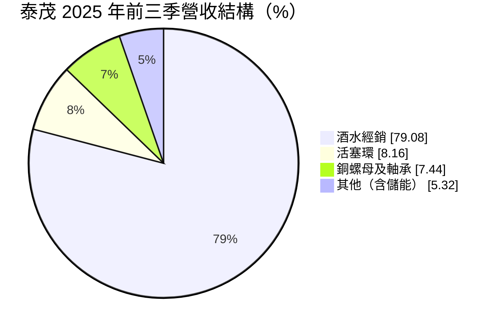
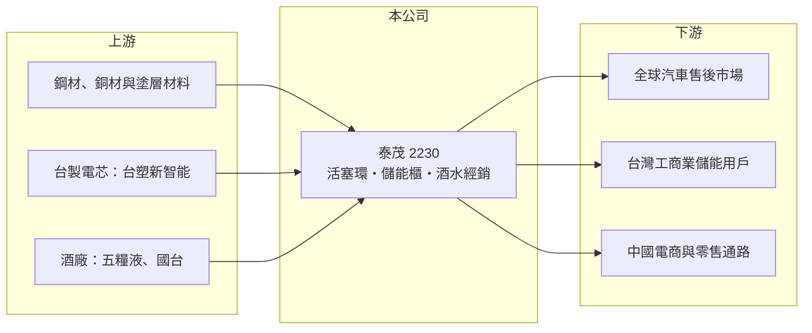

# 2230 泰茂

> 上櫃｜[[產業索引-電機機械|電機機械]]｜上市（櫃）日期 2013/04/18

# 第一章：企業模式與商業藍圖

> [!info] 撰寫說明
> 精簡版，由 Claude 依公開資料整理，架構比照 [[2330台積電]]，資料截至 2026-10-08。來源：櫃買中心開放資料快照（基本資料、2026 年第二季資產負債與損益、本益比殖利率）、Goodinfo 經營績效頁、富果研究 2025 年 12 月法說會摘要。公開資料有限。#待校對

泰茂實業（以下簡稱泰茂）原本是台南的汽車引擎零件廠，近年轉成「汽車零件＋儲能＋中國酒水經銷」的多角化公司。理解它的關鍵在於：營收規模的跳升主要來自毛利很低的酒水經銷，本業的製造能力與合併後的營收數字已經是兩回事。

- **核心業務：** 泰茂成立於 1991 年，2013 年在櫃買中心掛牌，總部位於台南官田工業區。傳統本業是汽車引擎的[[活塞環]]，自有品牌 BLACK DIAMOND 採用[[類鑽碳膜]]（DLC）塗層，訴求降低摩擦、延長引擎壽命，銷往全球超過 110 個國家。另有銅螺母與軸承等零件。
- **營收結構：** 依 2025 年前三季資料，營收 13.07 億元中，酒水經銷占 79.08%、活塞環占 8.16%、銅螺母及軸承占 7.44%。酒水業務由全資子公司中酒（北京）酒業集團經營，取得五糧液的經銷與運營資格，並與國台合資。換句話說，泰茂現在的營收大部分是中國白酒的通路生意。
- **營運據點：** 汽車零件在台南生產；儲能業務在宜蘭建置 5.5MW 的案場；酒水業務的營運中心在北京，並與河南的零售通路合作。三個事業的地點、客戶與商業模式幾乎沒有交集。
- **長期方向：** 公司把汽車零件定位為穩定現金流，把[[儲能系統]]當成第二成長引擎（從 14kWh 到 261kWh 的儲能櫃，並與台塑新智能合作採用台製電芯），把酒水經銷當成第三引擎。依營收變化推估，酒水業務約自 2024 年起併入（推估，確切時點待校對）。多角化能否成功，取決於低毛利的通路業務能否真的賺到錢。

# 第二章：護城河深度與競爭優勢

泰茂的護城河要分事業看：活塞環有一定的利基技術，但新的兩個事業都還在早期，談不上護城河。

- **競爭優勢：** 活塞環是引擎內部的精密耗材，DLC 塗層與品牌通路經營多年，在售後市場有一定辨識度，並有外觀、包裝與製程專利。不過活塞環的營收已不到一成，對整體獲利的影響有限。
- **主要對手：** 活塞環市場由國際大廠與日本、中國廠商主導，泰茂屬於利基品牌。儲能系統方面，台灣有 [[2308台達電]] 等大型電力電子廠與眾多系統整合商；酒水經銷則面對中國龐大的經銷商與電商平台。泰茂在後兩個市場都是小型參與者。
- **觀察重點：** 2024 年營收 19.8 億元、EPS 6.07 元，2025 年營收 20.3 億元卻轉為每股虧損 1.05 元，2026 年上半年毛利幾乎為零、每股虧損 1.48 元。長期最該追蹤的是酒水業務的毛利率能否轉正並穩定，以及管理層是否持續把資本投入非本業。

# 第三章：財務體質與盈利規模

資料日期：2026-10-08，表格是撰寫當時的快照；最新月營收、毛利率、累計 EPS 由自動排程寫在本筆記的屬性欄位（月營收、毛利率、累計EPS 等）。#待校對

泰茂的財務在 2024 年前後是兩家不同的公司：之前是營收 5 億元左右、時賺時賠的零件廠，之後是營收 20 億元、毛利率個位數的經銷商。

| 年度 | 營收（億元） | [[毛利率]] | [[營業利益率]] | EPS（元） | [[ROE]] |
|---|---|---|---|---|---|
| 2021 | 5.65 | 15.9% | −0.06% | −0.08 | −1.64% |
| 2022 | 5.04 | 16.6% | 30.1% | 3.17 | 20.3% |
| 2023 | 6.58 | 33.0% | 19.6% | 2.66 | 16.9% |
| 2024 | 19.8 | 22.8% | 17.0% | 6.07 | 28.7% |
| 2025 | 20.3 | 6.64% | −2.35% | −1.05 | −5.71% |

（來源：Goodinfo 經營績效頁。2022 年營業利益率高於毛利率，推估包含處分資產等非經常性收益，待校對。2026 年上半年依櫃買中心資料，營收 11.6 億元、營業損失 1.05 億元、EPS −1.48 元。）

- **營收規模：** 2020 至 2025 年營收由 4.78 億元增至 20.3 億元，年複合成長率約 33.5%（推算），但幾乎全部來自酒水經銷的併入，並非本業成長。2015 至 2021 年營收一直在 3.6 億元到 5.7 億元之間。
- **獲利：** 2021 至 2025 年平均 ROE 約 11.7%（推算），但波動極大，2022 至 2024 年的高 ROE 推估有一次性收益的成分（推估）。2015 至 2021 年本業 EPS 多在 0.5 元以下甚至虧損，顯示零件本業的獲利能力原本就偏弱。
- **財務特色：** 依 2026 年第二季資料，總資產約 19.4 億元、負債約 8.6 億元、股東權益約 10.8 億元，每股淨值 15.82 元，負債比約 44%。Goodinfo 統計歷年平均現金股利約 0.40 元，配息不穩定。自由現金流是否長期為正未查得。
- **[[ROIC]] 與 [[WACC]]：** 2025 年營業損失約 0.48 億元（20.3 億元 × −2.35%），稅後營業利益約 −0.38 億元，以股東權益 10.8 億元到總資產 19.4 億元為投入資本，ROIC 約 −3.5% 至 −2.0%（推算），為負值。2024 年同法約 14% 至 25%（推算），但含非經常性收益的可能性高。WACC 以 CAPM 推估：無風險利率 1.75%、市場風險溢酬 6%、β 假設 1.0，權益成本約 7.8%；稅後負債成本 2%、負債占三成，WACC 約 6%（推算）。目前 ROIC 低於 WACC，代表轉型後的事業組合尚未創造價值。

# 第四章：總體風險與地緣政治

泰茂的風險主要來自轉型本身：新事業與本業無關、利潤薄，而且集中在中國市場。

- **產業週期：** 中國白酒產業在 2024 年後進入去庫存與價格下跌期（推估，待校對），經銷商的進貨價與售價都受酒廠政策影響，通路商的毛利最先被壓縮。儲能則受政府補助政策牽動，台灣自 2026 年起對表後儲能提供補助，政策一旦調整需求就會變化。
- **營運風險：** 酒水業務占營收近八成，卻幾乎不賺錢，成了拖累整體獲利的來源。管理層同時經營三個不相關的事業，資源分散，執行風險高。
- **其他風險：** 中國子公司的營運與資金匯回受兩岸政策與法規影響；人民幣匯率波動會影響合併報表。活塞環本業則面臨電動車長期減少內燃機需求的結構性壓力。

# 專有名詞解析

## 應用

- **[[活塞環]]**：套在引擎活塞上的金屬環，負責密封燃燒室與控制機油，屬內燃機的消耗性零件。
- **[[儲能系統]]**：以電池儲存電力並在需要時放電的系統，可用於削峰填谷、備援與參與電力輔助服務。

## 產業

- **[[類鑽碳膜]]**：Diamond-Like Carbon，DLC，一種硬度高、摩擦係數低的碳薄膜塗層，用於提升零件耐磨性。

# 核心供應鏈

- 上游：活塞環用鋼材與塗層材料、銅材；儲能用台製電芯（台塑新智能）；酒水來自五糧液、國台等中國酒廠。
- 下游／客戶：全球汽車售後通路、台灣工商業儲能用戶，以及中國的電商平台、即時零售與社區通路。
- 同業：汽車零件業者如 [[1522堤維西]]；儲能與電力設備業者如 [[2308台達電]]、[[1519華城]]。

## 最新新聞
<!-- news:start -->
<!-- news:end -->

## 相關連結
- [公開資訊觀測站](https://mopsov.twse.com.tw/mops/web/t05st03?step=1&firstin=1&co_id=2230)
- [Goodinfo](https://goodinfo.tw/tw/StockDetail.asp?STOCK_ID=2230)
- [Yahoo 股市](https://tw.stock.yahoo.com/quote/2230)
- [鉅亨網新聞](https://www.cnyes.com/twstock/2230/news)
