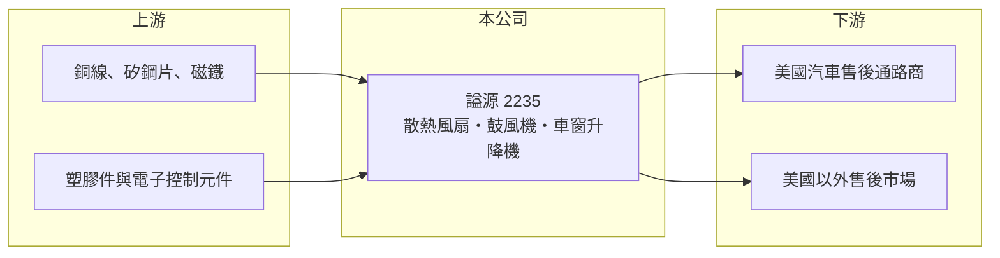

# 2235 謚源

> 上櫃｜[[產業索引-電機機械|電機機械]]｜上市（櫃）日期 2014/12/15

# 第一章：企業模式與商業藍圖

> [!info] 撰寫說明
> 精簡版，由 Claude 依公開資料整理，架構比照 [[2330台積電]]，資料截至 2026-10-08。來源：櫃買中心開放資料快照（基本資料、2026 年第二季資產負債與損益、本益比殖利率）、Goodinfo 經營績效頁、富果研究 2025 年 11 月法說會摘要。公開資料有限。#待校對

謚源實業（以下簡稱謚源）是桃園龜山的汽車電動零件廠，專做散熱風扇、鼓風機與車窗升降機。理解它的關鍵在於：它的核心能力是自己做馬達，而主要舞台是美國的汽車[[售後市場]]。

- **核心業務：** 謚源成立於 1987 年，2014 年在櫃買中心掛牌。主力產品是汽車水箱的電子[[散熱風扇]]、冷氣鼓風機與電動車窗升降機，這三種產品都以小型直流馬達為核心。公司強調從馬達電樞到總成組裝垂直整合，自製率高，能承接少量多樣的維修市場訂單。
- **營收結構：** 營收以汽車售後維修市場為主，主要銷往美國。產品別與地區別的詳細比重未查得。售後市場的需求來自舊車維修，品項多、單批量小，適合有完整料號與彈性產線的中小型廠商。
- **營運據點：** 總部與主要工廠位於桃園龜山。其他生產據點未查得。
- **長期方向：** 公司已導入[[無刷馬達]]逐步取代傳統有刷馬達，並開發純電車專用的散熱風扇與鼓風機。2025 年美國關稅衝擊後，公司把開拓美國以外市場列為 2026 年的首要目標，並透過物料清單優化與模組化設計降低成本。電動車與熱管理需求增加，是謚源長期最有利的趨勢。

# 第二章：護城河深度與競爭優勢

謚源的護城河屬於窄護城河，來自馬達自製與售後市場的品項深度。

- **競爭優勢：** 散熱風扇與鼓風機的關鍵在馬達的壽命、噪音與效率，謚源能自行開發馬達，比只做組裝的同業更能控制品質與成本。售後市場的通路商需要供應商長期維持上千種車型的料號，這種累積也形成一定的進入門檻。
- **主要對手：** 同類產品在原廠市場由國際一階供應商主導，售後市場則有大量中國廠商以低價競爭。台灣的風扇與馬達廠如 [[2421建準]] 在散熱風扇技術上相近，但主攻資訊與工業應用。謚源的直接競爭對手名單未查得。
- **觀察重點：** 長期最該追蹤的是毛利率能否回到兩成以上。2015 至 2016 年毛利率約 32%，2025 年降到 18.4%，2026 年上半年更降到約 14.8%，代表價格競爭與匯率壓力持續。美國以外市場的開拓成果與電動車產品的放量，是扭轉下滑的關鍵。

# 第三章：財務體質與盈利規模

資料日期：2026-10-08，表格是撰寫當時的快照；最新月營收、毛利率、累計 EPS 由自動排程寫在本筆記的屬性欄位（月營收、毛利率、累計EPS 等）。#待校對

謚源的財務是「低負債、獲利率逐年下滑」的型態：資產負債表很健康，但本業的競爭力在過去十年明顯減弱。

| 年度 | 營收（億元） | [[毛利率]] | [[營業利益率]] | EPS（元） | [[ROE]] |
|---|---|---|---|---|---|
| 2021 | 7.05 | 22.4% | 10.1% | 1.42 | 4.07% |
| 2022 | 7.23 | 25.9% | 13.6% | 4.59 | 12.7% |
| 2023 | 5.86 | 24.3% | 13.1% | 2.42 | 6.53% |
| 2024 | 5.91 | 23.5% | 10.7% | 2.67 | 7.35% |
| 2025 | 5.56 | 18.4% | 4.65% | 0.95 | 2.70% |

（來源：Goodinfo 經營績效頁。2026 年上半年依櫃買中心資料，營收 2.90 億元、毛利率約 14.8%、EPS 0.47 元。）

- **營收規模：** 營收在 2016 年達 9.00 億元高點後逐年下滑，2020 至 2025 年由 7.07 億元降到 5.56 億元，年複合成長率約 −4.7%（推算）。這顯示公司在售後市場的份額受到低價競爭侵蝕。
- **獲利：** 2021 至 2025 年平均 ROE 約 6.7%（推算），遠低於 2015 年的 21%。營業利益率由二成以上降到 4.65%。2025 年獲利衰退還受到業外匯兌由盈轉虧影響：2024 年前三季有 1,623 萬元匯兌收益，2025 年同期轉為 1,513 萬元損失。
- **財務特色：** 依 2026 年第二季資料，總資產約 14.4 億元、負債僅約 2.4 億元、股東權益約 12.0 億元，負債比約 17%，每股淨值 33.34 元，非流動資產占比高（推估含土地廠房與長期投資）。Goodinfo 統計的歷年平均現金股利約 2.59 元，近期每股股利 1.50 元，配息率高。
- **[[ROIC]] 與 [[WACC]]：** 以 2025 年營業利益約 0.26 億元（5.56 億元 × 4.65%）、稅率 20% 計算，稅後營業利益約 0.21 億元；公司幾乎沒有有息負債，投入資本以股東權益 12.0 億元到總資產 14.4 億元為區間，ROIC 約 1.4% 至 1.7%（推算），2024 年同法約 3.5% 至 4.2%（推算）。WACC 以 CAPM 推估：無風險利率 1.75%、市場風險溢酬 6%、β 假設 0.7（低負債傳產股常見值），權益成本約 6.0%；資本幾乎全為股東權益，WACC 約 6%（推算）。近年 ROIC 持續低於 WACC，代表帳上資本沒有被有效運用，公司價值主要來自資產與配息，而非本業成長。

# 第四章：總體風險與地緣政治

謚源的風險集中在美國市場與價格競爭，屬於外銷型汽車售後零件廠的典型風險。

- **產業週期：** 汽車售後維修需求相對穩定，但通路商在景氣或政策不明時會降低庫存。2025 年第三季因美國對等關稅不確定，客戶下單保守，單季營收年減 20.81%。
- **營運風險：** 營收高度依賴美國客戶，議價能力有限，2025 年曾為爭取訂單調降部分產品售價。中國低價供應商持續擴大售後市場份額，壓縮台灣廠商的毛利。
- **其他風險：** 新台幣升值同時影響營收換算與匯兌損益；銅、鋼等馬達原料價格波動影響成本。長期來看，電動車改變熱管理系統架構，若未能跟上新規格，傳統產品的維修需求會隨燃油車減少而萎縮。

# 專有名詞解析

## 應用

- **[[售後市場]]**：新車出廠之後的維修、保養與改裝零件市場，英文為 Aftermarket，需求較不受新車銷售影響。
- **[[散熱風扇]]**：裝在汽車水箱或冷凝器後方、以電動馬達驅動的風扇，負責引擎與冷氣系統散熱。

## 產業

- **[[無刷馬達]]**：以電子換向取代碳刷的直流馬達，壽命長、效率高、噪音低，逐漸取代有刷馬達。

# 核心供應鏈

- 上游：馬達用銅線、矽鋼片與磁鐵，以及塑膠扇葉、外殼與電子控制元件供應商。
- 下游／客戶：美國為主的汽車售後零件通路商與維修體系（具體客戶公開資料未點名，#待校對），並開拓美國以外市場。
- 同業：汽車售後零件業者如 [[1522堤維西]]、[[6605帝寶]]、[[1319東陽]]；風扇與馬達技術相近的 [[2421建準]]。

## 最新新聞
<!-- news:start -->
<!-- news:end -->

## 相關連結
- [公開資訊觀測站](https://mopsov.twse.com.tw/mops/web/t05st03?step=1&firstin=1&co_id=2235)
- [Goodinfo](https://goodinfo.tw/tw/StockDetail.asp?STOCK_ID=2235)
- [Yahoo 股市](https://tw.stock.yahoo.com/quote/2235)
- [鉅亨網新聞](https://www.cnyes.com/twstock/2235/news)
