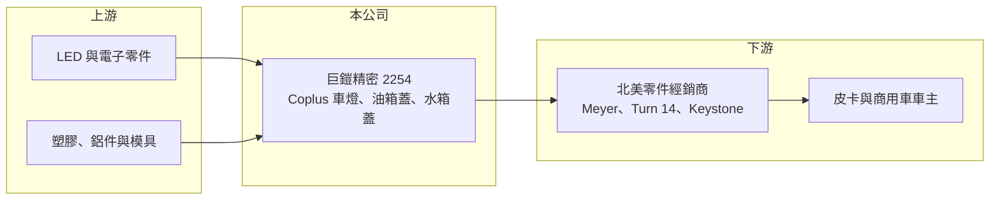

# 2254 巨鎧精密-創

> 創新板｜[[產業索引-汽車工業|汽車工業]]｜上市（櫃）日期 2023/10/20

# 第一章：企業模式與商業藍圖

> [!info] 撰寫說明
> 精簡版，由 Claude 依公開資料整理，架構比照 [[2330台積電]] 的四章研究，資料截至 2026-10-08。來源：Goodinfo 年度經營績效頁、富果 2025 年 6 月法說會備忘錄、證交所開放資料（基本資料、2026 年第二季資產負債與綜合損益、營益分析、股利、每月營收）。創新板／新掛牌，公開資料有限；產品別與地區別營收比重未查得。#待校對

巨鎧精密是一家以北美汽車售後市場為主要戰場的車用零件公司，本章說明它賣什麼、賣給誰，以及公司想走的長期方向。

## 一、核心定位：北美皮卡與商用車的售後零件供應商

巨鎧精密成立於 2013 年，總部位於台南市安南區，2023 年 10 月在證交所[[創新板]]掛牌，實收資本額約 6.4 億元（證交所開放資料）。公司以自有品牌 Coplus 經營，產品包括全 LED 車燈、帶 LED 照明的水箱護罩、商用卡車燈，以及油箱蓋與水箱蓋（富果 2025 年法說會備忘錄）。

* **主攻 [[AM 售後市場]]：** 公司的目標車款是美系與日系品牌的皮卡與商用卡車，透過 Meyer Distributing、Turn 14、Keystone 等北美零件經銷商出貨。售後市場的特性是車主自行改裝或替換，款式多、批量小，重視開發速度與外觀設計，而不是原廠的長期合約。
* **油箱蓋與水箱蓋的利基地位：** 公司自述是美國售後市場第二大的油箱蓋與水箱蓋供應商。這類零件單價不高，但牽涉密封與安全規範，品項多且需要長期累積車型資料，新進者不容易一次補齊。

## 二、市場結構：北美為主、多國分散

北美是公司最主要的市場，其他銷售地區包括歐洲、中國、台灣、澳洲與南美（富果）。具體的地區別與產品別比重未查得。因為客戶集中在北美經銷商，美國的車市景氣、皮卡改裝風氣與關稅政策，都會直接影響公司的接單。

## 三、技術與專利：以設計和專利當作護身符

截至 2024 年 12 月，公司在台灣、美國、中國、日本與歐盟共有 1,107 件有效專利（富果）。售後零件最怕被仿冒與削價，專利組合讓公司在北美通路可以主張外觀與結構的獨特性，也是它與一般代工型零件廠的主要差別。公司已取得 ISO 9001，並規劃取得 [[IATF 16949]] 車用品質認證，目的是為將來切入原廠或更高階客戶鋪路。

## 四、長期藍圖：從車燈零件走向智慧化產品

公司在 2025 年法說會提出三階段計畫：先引進人才與分散產品線，再提高產品的技術與智慧化程度，最後把 AI 功能整合進所有產品並讓 Coplus 品牌國際化。開發中的產品包括矩陣式 [[LED 車燈]]、數位 Mini LED 尾燈、可偵測酒精濃度與心跳的駕駛輔助裝置、具車道偏離與盲點偵測的電子後視鏡，並規劃延伸到懸吊、輪圈與煞車來令片。這條路線能否落地，要看新產品能否在連續虧損期間取得足夠營收。

# 第二章：護城河深度與競爭優勢

售後零件市場的門檻在於設計速度與通路關係，本章分析巨鎧精密的競爭優勢與明顯的弱點。

## 一、護城河的核心組成要素

* **專利與設計：** 上千件專利讓公司的車燈與水箱護罩能在外觀上做出差異，降低被低價仿品直接取代的風險。這是售後市場少數能建立定價空間的方法。
* **北美通路關係：** 進入北美大型零件經銷商的供應名單需要時間與實績，經銷商換供應商也要重新建立料號與庫存。既有通路關係是公司最實際的資產。
* **利基品項的市占：** 油箱蓋與水箱蓋屬於小而穩定的需求，公司在美國售後市場排名第二，代表在這個品項上已具備規模。

## 二、主要競爭對手

| 對手 | 定位 | 對巨鎧精密的威脅 |
|---|---|---|
| [[1524耿鼎]] | 台灣售後車燈大廠 | 同樣主攻北美售後車燈，產品線更完整 |
| [[6605帝寶]] | 台灣車燈廠，售後與原廠皆有 | 規模大、模具與量產能力強 |
| 中國售後車燈與零件廠 | 低價、大量 | 在一般款式上以價格競爭 |

## 三、守得住與守不住

* **守得住：** 有專利保護、需要車型資料累積的利基品項，例如油箱蓋、水箱蓋與特定皮卡車燈。
* **守不住：** 一般款式的車燈與外觀件。2023 年起毛利率從 30% 以上一路降到 2025 年的 22%（Goodinfo），顯示價格與成本壓力明顯。
* **觀察重點：** 2026 年上半年營收大幅縮水、毛利轉為負值（證交所），原因未查得；營收能否回到 5 億元以上、毛利率能否轉正，是判斷公司能否延續經營模式的關鍵。

# 第三章：財務體質與盈利規模

資料日期：2026-10-08，表格是撰寫當時的快照；最新月營收、毛利率、累計 EPS 由自動排程寫在本筆記的屬性欄位（月營收、毛利率、累計EPS 等）。#待校對

本章用多年度數據檢視巨鎧精密從高獲利轉為連續虧損的過程。

## 一、多年度三率與 ROE

| 年度 | 營收（新台幣） | [[毛利率]] | [[營業利益率]] | EPS（元） | [[ROE]] |
|---|---|---|---|---|---|
| 2021 | 11.6 億 | 38.4% | 26.9% | 9.47 | 54.0% |
| 2022 | 9.29 億 | 36.0% | 18.6% | 2.46 | 21.1% |
| 2023 | 5.50 億 | 28.5% | -7.33% | -0.78 | -5.43% |
| 2024 | 6.33 億 | 26.2% | -12.1% | -1.06 | -6.27% |
| 2025 | 4.78 億 | 22.0% | -8.49% | -0.84 | -4.72% |
| 2026 上半年 | 0.63 億 | -65.23% | -201.54% | -2.12 | 未查得 |

註：2021 至 2025 年取自 Goodinfo；2026 上半年取自證交所營益分析與綜合損益。2019、2020 年營收分別為 4.80 億、7.13 億元，營業利益率 16.7%、19.4%（Goodinfo）。

* **從高峰滑落：** 2021 年營收 11.6 億元、ROE 54%，是疫情期間北美改裝需求旺盛的高峰；之後營收連續萎縮，2025 年只剩 4.78 億元，2021 至 2025 年營收年複合成長率約 -19.9%（推算）。早年的高 EPS 與高 ROE 也與掛牌前股本較小有關。
* **毛利率持續下滑：** 毛利率由 38.4% 降到 22%，營業利益在 2023 年後轉為虧損，代表營收規模已不足以支撐研發與管理費用。
* **2026 年明顯惡化：** 2026 年 1 至 8 月累計營收約 0.70 億元，去年同期約 3.99 億元（證交所每月營收），上半年毛利為負，可能包含存貨或產品調整的一次性因素（推估）。

## 二、股利與財務結構

2025 年下半年與 2026 年上半年皆未配發股利（證交所股利資料）。2026 年第二季底總資產約 21.9 億元、總負債約 12.3 億元（其中非流動負債約 4.7 億元）、權益約 9.7 億元，每股淨值 15.17 元，保留盈餘為 -1.35 億元（證交所資產負債）。有息負債金額未查得。

## 三、[[ROIC]] 與 [[WACC]]

**ROIC 推算：** 2025 年營業利益約 4.78 億 × -8.49% ≈ -0.41 億元（虧損不計稅）。有息負債未查得，假設總負債 12.25 億元的一半約 6.1 億元為有息負債，加上權益 9.67 億元，投入資本約 15.8 億元，ROIC 約 -2.6%（推算）。

**WACC 推算：** 台灣 10 年期公債 1.75%、市場風險溢酬 6%、β 取汽車零件同業常見值 1.0，權益成本約 7.75%；負債成本 3%、稅率 20%，權益占比約 61%，WACC 約 5.7%（推算）。

**結論：** ROIC 為負，代表公司目前投入的資本不但沒有賺到資金成本，還在消耗股東權益。2021、2022 年 ROIC 明顯高於 WACC，證明這個商業模式在景氣好、產品對路時能創造價值；未來能否回到正利差，取決於新產品能否重建營收規模。

# 第四章：總體風險與地緣政治

本章整理巨鎧精密長期面對的市場、營運與政策風險。

## 一、產業週期

* **北美改裝需求的週期性：** 皮卡改裝與零件替換屬於可延後的消費，利率上升或景氣轉弱時需求會先縮減。2021 年高峰後營收連續下滑，就是這種週期的反映。
* **經銷商庫存調整：** 北美經銷商在需求轉弱時會先消化庫存，上游供應商的訂單減少幅度往往比終端需求更大。

## 二、營運風險

* **規模不足：** 營收不到 5 億元，卻要同時開發車燈、電子後視鏡與 AI 駕駛輔助等多條產品線，研發費用難以攤提，虧損可能延續。
* **轉型執行：** 智慧化產品需要電子與軟體能力，與傳統機構件差異大，公司能否在資本有限下完成轉型仍待觀察。

## 三、其他風險

* **美國關稅：** 主要市場在美國，美國對進口汽車零件加徵關稅會直接壓縮售後零件的價格競爭力。
* **匯率：** 以美元計價銷售，新台幣升值會壓低以台幣計算的營收與毛利。

# 專有名詞解析

## 應用

- **[[LED 車燈]]**：以 LED 為光源的車燈，比傳統鹵素燈省電、壽命長，也能做出更多造型與智慧照明功能。

## 金融

- **[[創新板]]**：證交所 2021 年設立的板塊，讓尚未獲利但具技術或創新能力的公司掛牌，初期限合格投資人交易。
- **[[ROIC]]**：投入資本報酬率，衡量企業用股東與債權人投入的資本，每年能產生多少稅後營業利益。
- **[[WACC]]**：加權平均資金成本，股東要求報酬與負債利息依資本結構加權後的平均值，是判斷是否創造價值的門檻。

## 產業

- **[[AM 售後市場]]**：汽車出廠後的替換與改裝零件市場，相對於供應原廠組裝的 OEM 市場，款式多、批量小、重視設計與交期。
- **[[IATF 16949]]**：國際汽車業的品質管理系統標準，是供應車廠與一階供應商的基本門票。

# 核心供應鏈

- 上游：LED 光源與車用電子零件、塑膠粒、鋁材與模具加工。
- 下游／客戶：北美汽車零件經銷商 Meyer Distributing、Turn 14、Keystone，最終使用者為美系與日系皮卡、商用卡車（如 Hino、Kenworth）車主。
- 同業：[[1524耿鼎]]、[[6605帝寶]]、[[1522堤維西]]、中國售後車燈與零件廠。

## 最新新聞
<!-- news:start（自動產生，請勿手動編輯此範圍） -->
- 2026-10-14 🏛️ 重訊 16:07｜公告本公司法人董事代表人變動｜[觀測站](https://mops.twse.com.tw/mops/#/web/t05st01)

完整紀錄：[[2254巨鎧精密-創 新聞]]
<!-- news:end -->

## 相關連結
- [公開資訊觀測站](https://mopsov.twse.com.tw/mops/web/t05st03?step=1&firstin=1&co_id=2254)
- [Goodinfo](https://goodinfo.tw/tw/StockDetail.asp?STOCK_ID=2254)
- [Yahoo 股市](https://tw.stock.yahoo.com/quote/2254)
- [鉅亨網新聞](https://www.cnyes.com/twstock/2254/news)
