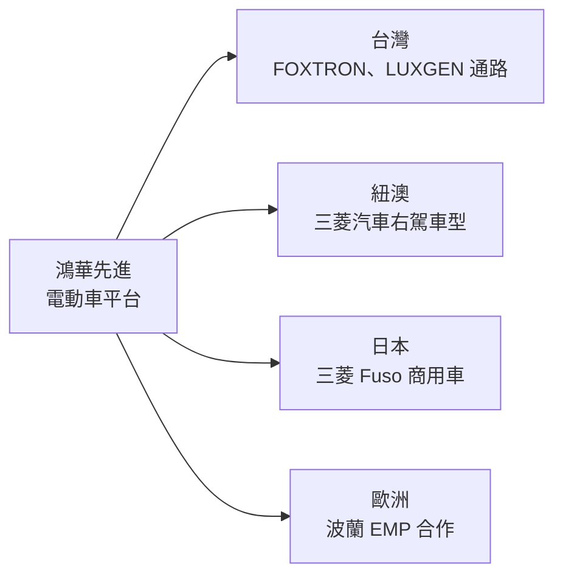
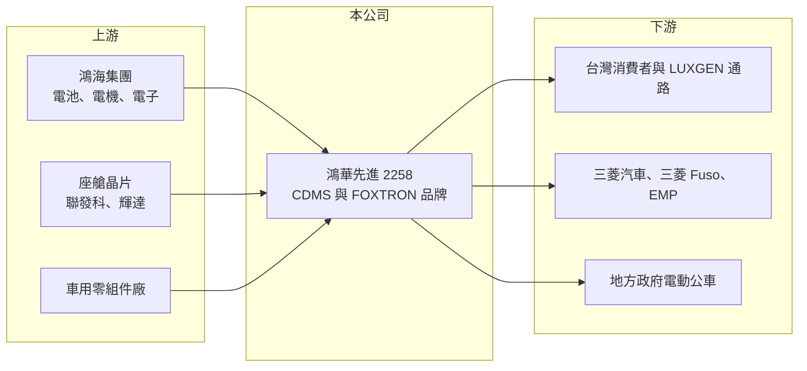

# 2258 鴻華先進-創

> 創新板｜[[產業索引-汽車工業|汽車工業]]｜上市（櫃）日期 2023/11/20

# 第一章：企業模式與商業藍圖

> [!info] 撰寫說明
> 精簡版，由 Claude 依公開資料整理，架構比照 [[2330台積電]] 的四章研究，資料截至 2026-10-08。來源：Goodinfo 年度經營績效頁、富果 2026 年 6 月法說會備忘錄、證交所開放資料（基本資料、2026 年第二季資產負債與綜合損益、營益分析、股利、每月營收）。創新板／新掛牌，公開資料有限；各業務營收比重未查得，股東結構憑記憶撰寫者已標註。#待校對

鴻華先進（Foxtron）是鴻海集團切入電動車整車的主要平台，本章說明它的商業模式、車型布局與長期方向。

## 一、核心定位：替品牌開發電動車的 CDMS 平台

鴻華先進成立於 2020 年，總部在新北市新店，2023 年 11 月在證交所[[創新板]]掛牌，實收資本額約 175 億元（證交所開放資料）。公司由 [[2317鴻海]] 與 [[2201裕隆]] 合資成立（持股比例待校對），核心業務是 [[CDMS]]，也就是替其他品牌提供電動車平台與車型的設計開發、供應鏈管理與生產製造服務（富果）。

* **類似電子業的代工邏輯：** 鴻海把電子代工的模式搬到汽車產業，希望讓沒有造車經驗的品牌或傳統車廠，用較低成本、較短時間推出[[電動車]]。對鴻華來說，客戶越多、共用平台越多，研發與模具成本越能攤薄。
* **自有品牌當作示範：** 2026 年起公司在台灣以 FOXTRON 自有品牌銷售，並把台灣當作從設計、製造到銷售、售後的全價值鏈示範市場，再把經驗複製到海外客戶。

## 二、車型與業務板塊

公司目前的主要產品包括：乘用車 BRIA（B 級距，2026 年 2 月開始交車）、CAVIRA（C 級距，2026 年 5 月預售訂單逾 1,000 台）、早期以納智捷 n7 名義銷售的 Model C（對應關係待校對），以及電動巴士 MODEL T（富果）。

* **電動巴士：** 高雄橋頭新廠 2026 年 5 月投產，解決過去年產約百台的產能瓶頸，並取得基隆市政府電動公車汰換案（首批 30 台）。電池與電機採用鴻海集團產品。
* **通路整合：** 2026 年 4 月收購 LUXGEN 公司及其通路，使公司從開發製造延伸到品牌、銷售與售後服務。這是改變公司長期結構的重要事件，代表鴻華不再只是幕後的開發者。

## 三、海外布局

公司與三菱汽車合作的紐澳右駕車型預計 2026 年第四季開始交付，可借用三菱在當地超過 200 個銷售據點；與三菱 Fuso 合作商用車；2026 年 5 月與波蘭 EMP 簽訂歐洲策略合作。北美則因美國 27.5% 的進口關稅，公司表示會觀望後再進入（富果）。

## 四、長期藍圖

公司在 2026 年 6 月宣布與 [[2454聯發科]]、[[NVDA輝達]] 合作 AI 智慧座艙。長期目標是以 CDMS 模式累積全球客戶，讓 2027 年成為新車型全年銷售、海外市場開始收成的一年。這條路需要龐大且持續的研發投入，能否在現金燒完前達到經濟規模，是投資人最核心的問題。

# 第二章：護城河深度與競爭優勢

電動車產業競爭激烈且資本密集，本章分析鴻華先進的優勢、對手與能守住的範圍。

## 一、護城河的核心組成要素

* **鴻海集團的供應鏈與製造能力：** 電池、電機、電子零件可由集團內部供應，採購規模與製造管理經驗是一般新創車廠沒有的。
* **平台化開發：** 同一個電動車平台可以衍生不同品牌的車型，客戶不必從零開始開發，這是 CDMS 模式對中小車廠的吸引力。
* **國產化條件：** 電動巴士符合政府十項國產化要求，在台灣公共運輸電動化的標案中具備資格優勢。

## 二、主要競爭對手

| 對手 | 定位 | 對鴻華先進的威脅 |
|---|---|---|
| [[2207和泰車]] | 豐田在台總代理，市占最高 | 台灣乘用車市場的主要對手 |
| [[2204中華]] | 三菱商用車與乘用車在台組裝 | 台灣商用車與電動車市場競爭 |
| 特斯拉、比亞迪 | 全球電動車規模領先者 | 價格與技術上設定市場標準 |
| 麥格納（Magna Steyr） | 歐洲整車代工 | 與 CDMS 模式直接競爭品牌客戶 |

## 三、守得住與守不住

* **守得住：** 台灣電動巴士與公部門標案，以及願意採用現成平台的海外傳統車廠。
* **守不住：** 一般消費型乘用車的價格戰。2025 年營收從 85.2 億元降到 41.5 億元（Goodinfo），主因是 Model C 銷售高峰已過、消費者觀望。
* **觀察重點：** 紐澳與歐洲合作能否帶來穩定的開發費與量產營收，以及營業虧損率能否從 -90% 左右明顯收斂。

# 第三章：財務體質與盈利規模

資料日期：2026-10-08，表格是撰寫當時的快照；最新月營收、毛利率、累計 EPS 由自動排程寫在本筆記的屬性欄位（月營收、毛利率、累計EPS 等）。#待校對

本章用多年度數據檢視鴻華先進仍處於投入期的財務狀況。

## 一、多年度三率與 ROE

| 年度 | 營收（新台幣） | [[毛利率]] | [[營業利益率]] | EPS（元） | [[ROE]] |
|---|---|---|---|---|---|
| 2021 | 0.66 億 | 64.0% | -1,592% | -0.51 | -5.29% |
| 2022 | 2.96 億 | 30.3% | -555% | -0.87 | -9.77% |
| 2023 | 10.4 億 | 15.0% | -228% | -1.20 | -11.9% |
| 2024 | 85.2 億 | 18.9% | -31.4% | -1.23 | -11.8% |
| 2025 | 41.5 億 | 20.0% | -94.9% | -2.15 | -24.6% |
| 2026 上半年 | 23.0 億 | 11.49% | -86.30% | -1.15 | 未查得 |

註：2021 至 2025 年取自 Goodinfo；2026 上半年取自證交所營益分析與綜合損益。

* **營收大起大落：** 2024 年因 Model C 開始交車，營收跳到 85.2 億元；2025 年腰斬為 41.5 億元。2026 年 1 至 8 月累計營收約 38.2 億元，年增約 15%（證交所每月營收），主要來自 BRIA 與電動巴士。
* **毛利率偏低：** 毛利率長期在 15% 至 20%，2026 年上半年降到 11.5%，原因是產品組合由單價較高的 n7 轉為單價較低的 BRIA（富果）。
* **虧損擴大：** 2025 年每股虧損 2.15 元、ROE -24.6%，反映研發與新車型開發費用遠大於毛利。

## 二、股利與財務結構

公司尚未配發股利（證交所股利資料）。2026 年第二季底總資產約 213.6 億元、總負債約 99.7 億元、權益約 114.0 億元，保留盈餘為 -121.9 億元，每股淨值 6.51 元，已低於面額 10 元（證交所資產負債）。有息負債金額未查得。

## 三、[[ROIC]] 與 [[WACC]]

**ROIC 推算：** 2025 年營業利益約 41.5 億 × -94.9% ≈ -39.4 億元（虧損不計稅）。假設總負債 99.7 億元的一半約 49.8 億元為有息負債，加上權益 114.0 億元，投入資本約 163.8 億元，ROIC 約 -24%（推算）。

**WACC 推算：** 台灣 10 年期公債 1.75%、市場風險溢酬 6%、β 取電動車新創常見值 1.2，權益成本約 9.0%；負債成本 3%、稅率 20%，權益占比約 70%，WACC 約 7.0%（推算）。

**結論：** ROIC 遠低於 WACC，公司目前處於大量燒錢的投入期，每年虧損都在侵蝕股東權益。若要長期創造價值，需要海外 CDMS 案件進入量產、營收規模擴大數倍，才可能讓營業利益轉正。

# 第四章：總體風險與地緣政治

本章整理鴻華先進長期面對的產業、財務與政策風險。

## 一、產業週期與競爭

* **全球電動車價格戰：** 中國車廠產能過剩、低價外銷，壓縮全球電動車售價，CDMS 客戶也會要求更低的開發與製造成本。
* **台灣市場規模小：** 台灣一年新車銷量有限，自有品牌只靠台灣市場很難達到經濟規模，必須依賴海外客戶。

## 二、營運與財務風險

* **持續虧損與增資需求：** 保留盈餘已累積逾 120 億元虧損，每股淨值低於面額，若虧損延續，未來可能需要增資或減資彌補虧損。
* **客戶集中與執行：** 海外合作集中在少數車廠，任何一案延後或取消，都會影響營收時程。

## 三、其他風險

* **關稅與貿易政策：** 美國對進口車課徵高關稅，限制北美市場的進入時點。
* **補助政策：** 電動巴士需求受政府補助與公車汰換計畫影響，政策調整會改變訂單節奏。

# 專有名詞解析

## 應用

- **[[電動車]]**：以電池與電動馬達驅動的車輛，核心零組件為電池、電機與電控，軟體與電子比重遠高於燃油車。

## 金融

- **[[創新板]]**：證交所 2021 年設立的板塊，讓尚未獲利但具技術或創新能力的公司掛牌，初期限合格投資人交易。
- **[[ROIC]]**：投入資本報酬率，衡量企業用股東與債權人投入的資本，每年能產生多少稅後營業利益。
- **[[WACC]]**：加權平均資金成本，股東要求報酬與負債利息依資本結構加權後的平均值，是判斷是否創造價值的門檻。

## 產業

- **[[CDMS]]**：委託設計開發暨製造服務，替品牌客戶從車型設計、供應鏈到生產製造一條龍處理的電動車代工模式。

# 核心供應鏈

- 上游：[[2317鴻海]]（電池、電機與電子零件）、[[2454聯發科]]、[[NVDA輝達]]（智慧座艙晶片）、車用零組件廠如 [[1533車王電]]、[[2231為升]]（供應關係待校對）。
- 下游／客戶：台灣消費者（FOXTRON 品牌與 LUXGEN 通路）、三菱汽車（紐澳）、三菱 Fuso（日本商用車）、波蘭 EMP、基隆市政府等公車業者。
- 同業：[[2201裕隆]]、[[2207和泰車]]、[[2204中華]]、特斯拉、比亞迪、麥格納。

## 最新新聞
<!-- news:start（自動產生，請勿手動編輯此範圍） -->
- 2026-10-15 🏛️ 重訊 15:59｜公告本公司資訊安全長異動｜[觀測站](https://mops.twse.com.tw/mops/#/web/t05st01)
- 2026-10-05 📰 媒體 18:50｜營收速報 - 鴻華先進-創(2258)9月營收10.69億元年增率高達341.1％｜[鉅亨網](https://news.cnyes.com/news/id/6621905)

完整紀錄：[[2258鴻華先進-創 新聞]]
<!-- news:end -->

## 相關連結
- [公開資訊觀測站](https://mopsov.twse.com.tw/mops/web/t05st03?step=1&firstin=1&co_id=2258)
- [Goodinfo](https://goodinfo.tw/tw/StockDetail.asp?STOCK_ID=2258)
- [Yahoo 股市](https://tw.stock.yahoo.com/quote/2258)
- [鉅亨網新聞](https://www.cnyes.com/twstock/2258/news)
