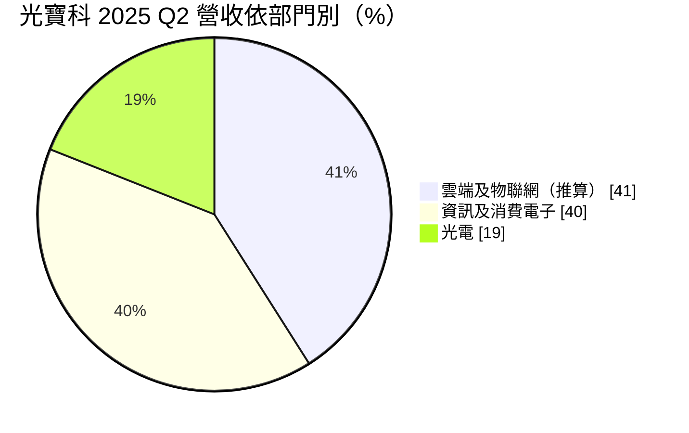
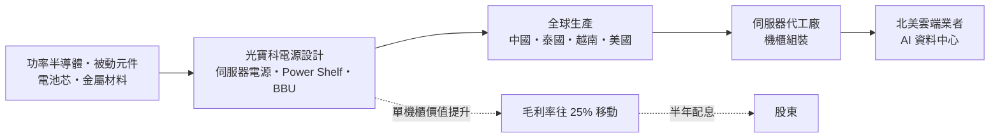
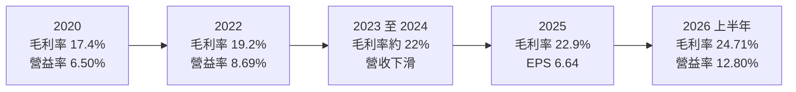
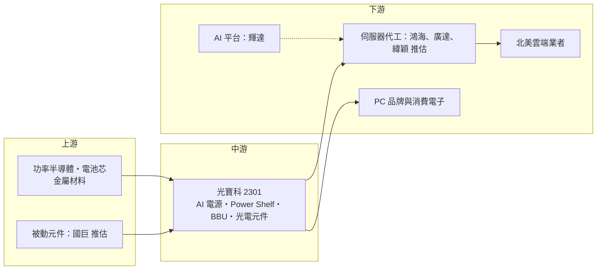

# 2301 光寶科

> 上市｜[[產業索引-電腦及週邊設備業|電腦及週邊設備業]]｜上市（櫃）日期 1995/11/17

# 第一章：企業模式與商業藍圖

> [!info] 撰寫說明
> 本文由 Claude 依公開資料整理，架構比照 [[2330台積電]] 的四章研究，資料截至 2026-10-08。財務數字來源：Goodinfo 經營績效、現金流量、股利政策頁（年度合併報表）、證交所開放資料（基本資料、2026 年第二季綜合損益與資產負債、股利）、優分析與數位時代的光寶科法說會報導；產業描述為整理性內容，尚未逐條比對原始文件。#待校對

在評估單一個股的長期投資價值時，首要步驟是拆解企業的底層獲利邏輯。本章針對光寶科技（股票代號：2301，以下簡稱光寶科）的商業模式進行定性分析，說明一家以 PC 電源與光電元件起家的大型零組件廠，如何把重心移到 AI 資料中心的電力架構，以及這個轉型對它長期獲利結構的意義。

## 一、核心定位：從消費電子零組件轉型為資料中心電力供應商

光寶科 1989 年成立，1995 年上市，是光寶集團的核心公司。經過 2000 年代多次合併，業務涵蓋電源供應器、光電元件、網通與資訊周邊產品，2026 年實收資本額約 232 億元。過去市場對光寶科的印象是「PC 電源、鍵盤與 LED 元件的大型代工廠」，[[毛利率]]長期在 15% 至 20% 之間，營收規模大但成長性有限。

近十年光寶科做了兩件重要的事。第一是瘦身，陸續出售或分拆相機模組、固態硬碟等低毛利或高波動的事業（具體年份與交易細節依記憶整理，待校對）。第二是聚焦，把資源集中到公司所稱的「高價值事業」：雲端與物聯網、光電兩大部門。依法說會報導，2025 年高價值事業占營收比重已提升到約 62%，人工智慧相關營收在 2025 年超過兩成。這個轉型讓光寶科從消費電子供應鏈，變成 [[AI 伺服器]]電源、[[Power Shelf]]（機櫃式電源）、[[BBU]]（備援電池）與 [[HVDC]]（高壓直流）電力架構的重要供應商。

## 二、終端應用與產品板塊：雲端部門已過半

光寶科分為三大事業部門。依數位時代報導，2025 年第二季三大部門的營收比重如下（雲端及物聯網部門比重為 100% 減去另兩部門推算）：

依優分析的法說會報導，到 2026 年上半年，雲端及物聯網部門占營收比重已提升到約 54%，2022 年同期只有約 32%，結構變化速度很快。

- **雲端及物聯網部門：** AI 伺服器電源、機櫃式電源、BBU、網通設備與工業物聯網產品。AI 伺服器的耗電量是傳統伺服器的數倍，電源的功率等級與單價都大幅提高，這個部門是光寶科成長與獲利改善的核心。
- **光電部門：** LED、[[光耦合器]]、光學感測元件與車用照明等。光耦合器用於工業與車用電源的訊號隔離，是光寶科歷史悠久、穩定獲利的利基產品。
- **資訊及消費電子部門：** PC 與筆電電源、轉接器、鍵盤與周邊等。這是光寶科的傳統本業，市場成熟、價格競爭激烈，比重持續下降，公司的策略是維持現金流而非追求成長。

## 三、資本轉化邏輯：從單顆電源到整櫃電力方案

- **單位價值提升：** 傳統伺服器電源一台只有數千瓦，AI 機櫃則需要上百千瓦的 Power Shelf，再加上 BBU 與未來的高壓直流配電設備。光寶科在每個機櫃中的產值因此大幅增加，同樣的客戶關係可以賺到更多營收。
- **客戶驗證是入場券：** 機櫃式電源與 BBU 必須通過 [[CSP]]（雲端服務業者）與伺服器代工廠的長期驗證。依法說會報導，光寶科已打入多家北美大型雲端業者供應鏈，目標是讓每家關鍵客戶的年營收貢獻達到 10 億美元。
- **全球產能布局：** 生產基地長期以中國為主，近年加速分散到泰國、越南等東南亞據點，並宣布在美國德州設立新廠，2026 年動工、預計 2027 年量產。公司目標 2027 年非中國產能比重提升到約七成。這個布局是為了回應美國關稅與客戶對供應鏈地點的要求。

## 四、企業長期藍圖：搶下 800V 高壓直流世代

AI 資料中心的電力架構正從傳統的 54V 或 48V 機櫃供電，走向 800V 高壓直流配電，以減少轉換損耗與銅線用量。光寶科的長期目標是把自己定位為「資料中心電力架構供應商」，而不只是電源零件廠，三個主軸是：800V HVDC 機櫃產品的驗證與量產、BBU 擴產與標配化，以及擴大北美 CSP 客戶的貢獻。依法說會報導，2026 年 [[CapEx]] 上修至約 180 億元，用於設備與全球據點擴建，資本支出規模明顯高於過去的代工廠時期，代表公司正在為下一個十年的資料中心電力需求下注。

# 第二章：護城河深度與競爭優勢

在長期價值投資中，「護城河」指企業抵禦競爭、維持超額利潤的保護機制。本章分析光寶科的護城河構成、主要競爭對手，以及這些優勢在 AI 電源競賽中能守住多少。

## 一、護城河的核心組成要素

光寶科的護城河屬於「窄護城河」，但正在加寬中，由四個要素組成：

- **電源設計與量產規模：** 光寶科是全球主要的電源供應器廠之一，長年為 PC、伺服器、網通設備供應電源，累積大量設計經驗與零組件採購規模。AI 伺服器電源的功率快速提高，需要以[[功率半導體]]實現高效率轉換，並兼顧散熱與可靠度設計，技術門檻與資本門檻同步提高，小型電源廠越來越難跟上。
- **雲端客戶的驗證與綁定：** 機櫃式電源與 BBU 必須通過 CSP 與伺服器代工廠的長期驗證，一旦打入供應鏈，在同一代平台中更換供應商的成本很高。這讓光寶科的雲端訂單具有一定的延續性。
- **電源加電池的整合能力：** 同時做電源與 BBU，可以提供完整的機櫃電力方案。在 800V 高壓直流架構中，電源、電池與配電設備的整合設計更重要，整合能力是光寶科與單純電池模組廠的差異。
- **全球產能分散：** 中國以外產能比重提高，加上美國新廠，有助於爭取對供應鏈地點有要求的美國客戶，也降低關稅風險。

## 二、全球主要競爭對手格局

| 對手 | 定位 | 對光寶科的威脅 |
|---|---|---|
| [[2308台達電]] | 全球電源龍頭，AI 電源與資料中心電力架構最完整 | 最直接的對手，高階技術與規模領先 |
| [[6282康舒]]、[[6412群電]]、[[3015全漢]] | 國內電源同業 | 在伺服器與 PC 電源領域價格競爭 |
| [[6781AES-KY]]、[[3211順達]]、[[6121新普]] | 電池模組廠 | 爭取 AI 伺服器 BBU 訂單 |
| Vertiv、施耐德電機 | 國際資料中心電力與散熱設備商 | 在機房級配電與高壓直流方案競爭 |
| [[2393億光]]、艾邁斯歐司朗 | LED 與光學感測 | 光電部門的主要競爭者 |

## 三、優勢轉化：哪些守得住、哪些守不住

- **守得住：** 已通過驗證的北美 CSP 平台、BBU 擴產後的規模，以及電源與電池的整合方案。光耦合器等光電利基產品也具有長期穩定的客戶關係。
- **守不住：** 台達電在高階電源與電力架構的技術與規模仍領先，光寶科多數時候扮演第二供應商的角色。BBU 市場參與者多，價格競爭可能隨產能擴充而轉趨激烈；PC 電源與周邊則已是成熟的價格戰市場。
- **觀察重點：** 800V HVDC 產品能否順利量產並取得主要平台份額；北美 CSP 客戶能否放大到每家 10 億美元規模；以及毛利率能否穩定在公司所說約 25% 的長期水準，而非只是 AI 熱潮下的短期高點。

# 第三章：財務體質與盈利規模

資料日期：2026-10-08。年度數字取自 Goodinfo 經營績效、現金流量與股利政策頁，2026 年上半年數字依證交所開放資料計算；表格是撰寫當時的快照，最新月營收、毛利率、累計 EPS 由自動排程寫在本筆記的屬性欄位（月營收、毛利率、累計EPS 等）。#待校對

財務報表是檢驗護城河是否真實存在的最終標準。本章用多年度的三率、ROE、現金流與資本報酬，檢視光寶科轉型 AI 電源前後的獲利品質變化。

## 一、獲利能力的基石：三率

| 年度 | 營收（億元） | [[毛利率]] | [[營業利益率]] | EPS（元） | [[ROE]] |
|---|---|---|---|---|---|
| 2020 | 1,571 | 17.4% | 6.50% | 4.31 | 13.2% |
| 2021 | 1,648 | 18.5% | 7.91% | 6.01 | 18.9% |
| 2022 | 1,735 | 19.2% | 8.69% | 6.19 | 18.3% |
| 2023 | 1,483 | 22.0% | 9.79% | 6.36 | 17.5% |
| 2024 | 1,371 | 21.6% | 9.43% | 5.21 | 13.6% |
| 2025 | 1,661 | 22.9% | 10.1% | 6.64 | 16.7% |
| 2026 上半年 | 961.1 | 24.71% | 12.80% | 4.80 | 未查得 |

- **毛利率階梯式上升：** 2020 至 2025 年毛利率由 17.4% 提升到 22.9%，2026 年上半年接近 25%，營業利益率由 6.5% 提升到 12.8%。這不是單一年度的景氣效果，而是連續多年的產品組合改善，反映低毛利消費電子比重下降、雲端電源比重上升。
- **營收不等於成長：** 2020 至 2025 年營收年複合成長率只有約 1.1%（推算），2023 至 2024 年營收甚至下滑，主要是消費電子衰退與出售事業。光寶科的轉型重點在於提升每一元營收的獲利，而不是擴大營收規模；2025 年起雲端業務放量，營收才重新成長。
- **長期水準的判斷：** 管理層曾表示公司長期毛利率約 25% 是較合理的常態水準，投資人不宜把 AI 需求高峰時的單季高毛利率直接外推。

## 二、[[ROE]]：資本效率

2021 至 2025 年光寶科的五年平均 ROE 約 17.0%（推算），即使在 2024 年營收下滑時仍有 13.6%，在大型電子零組件廠中屬於中上水準。依證交所資料，2026 年第二季權益總計約 966 億元、每股淨值約 42.2 元，負債約 1,426 億元，其中流動負債約 1,371 億元，主要是應付帳款等營運負債，長期借款很少。光寶科的 ROE 主要來自獲利率提升與高周轉，而非長期負債槓桿。需要注意的是，擴產與策略性備料會增加存貨與固定資產，周轉率下降可能部分抵銷獲利率改善對 ROE 的貢獻。

## 三、資本支出與自由現金流

- **[[自由現金流]]長期為正：** 依 Goodinfo（以營業現金流加投資現金流計算），2020 至 2025 年自由現金流分別為 181、90.6、206、239、75.7 與 71.4 億元，六年都是正值，代表本業長期能產生足夠現金支應投資與配息。
- **[[CapEx]]轉趨積極：** 過去光寶科的投資現金流出每年只有數十億元，2026 年資本支出上修到約 180 億元，用於美國新廠、BBU 擴產與全球據點。資本支出明顯高於過去，未來折舊會增加，自由現金流可能暫時低於獲利成長的幅度（推估）。
- **股利：** 光寶科採半年配息，依 Goodinfo 股利政策頁，2019 至 2025 年度現金股利分別為 3.20、3.40、4.50、4.50、4.506、4.507 與 5.00 元，現金股利長期穩定且逐步提高。以 2025 年 EPS 6.64 元計算，[[配息率]]約 75%（推算）。

## 四、[[ROIC]] 與 [[WACC]]：價值創造利差

- **ROIC：** 以 2025 年營收 1,661 億元、營業利益率 10.1% 計算，營業利益約 168 億元，扣除 20% 稅率後約 134 億元。投入資本以 2026 年第二季權益總計約 966 億元加上有息負債估算；有息負債未查得，假設約 100 億至 200 億元（總負債約 1,426 億元，大部分為應付款），投入資本約 1,066 億至 1,166 億元，ROIC 約 11.5% 至 12.6%（推算）。若以 2026 年上半年營業利益約 123 億元年化計算，ROIC 約 17% 至 18%（推算）。帳上現金若扣除，實際營運資本的報酬率會更高。
- **WACC：** 以 [[CAPM]] 推估，無風險利率 1.75%、市場風險溢酬 6%、β 假設 1.0（大型電子零組件股常見值，未查得來源數字），權益成本約 7.75%。稅前負債成本假設 2.5%、稅後約 2.0%，資本結構假設權益 85%、負債 15%，WACC 約 6.9%（推算）。
- **解讀：** 2025 年 ROIC 約 12%，比約 6.9% 的 WACC 高出約 5 個百分點，2026 年上半年利差進一步擴大，代表光寶科的轉型確實提升了資本報酬。不過 180 億元的資本支出與存貨增加會同時推高投入資本，若 800V 產品放量延後或 AI 資本支出放緩，新增資本的報酬率可能暫時偏低。長期而言，利差能否維持，取決於光寶科在資料中心電力架構中的份額。

# 第四章：總體風險與地緣政治

任何企業都無法脫離宏觀環境獨立存在。本章分析光寶科未來必須面對的地緣政治、產業週期與營運風險。

## 一、地緣政治

- **中國產能比重：** 光寶科過去以中國生產為主，美國對中國製電子產品加徵關稅，是推動公司加速移往東南亞與美國的主要原因。非中國產能比重的提升進度，是影響客戶訂單分配的關鍵。
- **美國在地生產：** 美國新廠可以滿足客戶在地化需求，但美國的人工、營運與建廠成本較高，若無法轉嫁，可能壓縮毛利率。
- **台灣與兩岸風險：** 研發與總部在台灣，與其他台灣科技業相同面臨兩岸風險，客戶可能要求更多非台灣、非中國的備援產能。

## 二、產業週期與市場結構

- **AI 資本支出循環：** 雲端部門已占營收過半，若北美雲端業者放緩 AI 資料中心投資，成長動能會明顯減弱，過去電子業的經驗顯示，資本支出循環的轉折往往很快。
- **消費電子長期衰退：** PC 與周邊需求成熟，資訊及消費電子部門的營收可能長期下滑，拖累整體營收成長。
- **匯率：** 營收多以美元計價，新台幣升值會壓縮帳面獲利。

## 三、營運環境的隱性風險

- **原物料與庫存：** 金屬材料價格波動與記憶體等零件缺貨，可能迫使公司提高庫存；若需求反轉，可能出現存貨跌價損失。
- **擴產執行：** BBU 擴產、美國新廠與 800V 產品量產同時進行，任何一項延誤都可能影響未來幾年的成長。
- **價格競爭：** 電源與 BBU 同業積極擴產，一旦供給追上需求，報價可能下滑，毛利率回到過去代工廠的水準。

## 四、科技或法規演進

資料中心電力架構正從 48V 走向 800V 高壓直流，未來甚至可能出現[[固態變壓器]]等新方案，把變電、整流與配電整合成新的設備。電力架構每一次改變，都會重新洗牌供應商的地位：若光寶科在新架構的驗證進度落後於台達電與國際電力設備商，可能失去下一代平台的市占；反之，若能率先推出整合方案，就能從零件供應商升級為系統供應商。此外，各國對資料中心能效（[[PUE]]）的要求提高，高效率電源與配電方案的需求將持續增加，這對擁有電源技術的光寶科是長期利多。

# 專有名詞解析

## 半導體

- **[[功率半導體]]**：負責電能轉換與開關的半導體元件，如 MOSFET、碳化矽與氮化鎵元件，是電源效率的關鍵。

## 應用

- **[[CSP]]**：雲端服務供應商，例如微軟、谷歌、亞馬遜、Meta，是 AI 資料中心的主要投資者。
- **[[光耦合器]]**：以光傳遞電訊號、讓電路兩端電氣隔離的元件，常用於電源與工業控制以防止高壓干擾。
- **[[AI 伺服器]]**：搭載 GPU 等加速晶片、用於訓練與推論 AI 模型的伺服器，耗電量遠高於傳統伺服器。

## 金融

- **[[毛利率]]**：毛利除以營收，反映產品本身的定價能力與成本控制。
- **[[營業利益率]]**：營業利益除以營收，反映扣除研發、管銷費用後的本業獲利能力。
- **[[CapEx]]**：資本支出，用於購置廠房、設備等長期資產的支出。
- **[[自由現金流]]**：營業活動現金流減去資本支出，代表企業可自由用於配息、還債或併購的現金。
- **[[配息率]]**：現金股利除以每股盈餘，代表公司把多少比例的獲利發給股東。
- **[[ROIC]]**：投入資本報酬率，稅後營業利益除以股東權益加有息負債，衡量本業運用全部資本的效率。
- **[[WACC]]**：加權平均資金成本，股東與債權人要求報酬率的加權平均，ROIC 高於它才算創造價值。

## 產業

- **[[BBU]]**：備援電池模組（Battery Backup Unit），在市電中斷時短暫供電，保護 AI 伺服器運算不中斷。
- **[[HVDC]]**：高壓直流供電，資料中心以 800V 等高壓直流配電，減少交直流轉換損耗並降低銅線用量。
- **[[Power Shelf]]**：機櫃式電源，把多個電源模組集中在機櫃的一層，統一供電給整櫃伺服器。
- **[[PUE]]**：電力使用效率，資料中心總耗電除以 IT 設備耗電，越接近 1 代表能源效率越高。
- **[[固態變壓器]]**：以功率半導體取代傳統鐵芯線圈的變壓器，體積小、可直接輸出直流，被視為下一代資料中心電力架構的選項。

# 核心供應鏈

## 1. 上游：零組件與原料
- 功率半導體、電池芯與金屬材料：具體供應商未查得
- 被動元件：[[2327國巨]]（推估為業界主要供應來源之一）

## 2. 中游：光寶科本身
- AI 伺服器電源、機櫃式電源、BBU、光電元件、PC 電源與周邊

## 3. 下游：雲端與伺服器客戶
- AI 平台：[[NVDA輝達]]
- 北美雲端服務業者：[[MSFT微軟]]、[[GOOGL谷歌]]、[[AMZN亞馬遜]]、[[META臉書]]（具體客戶名單公司未揭露，屬推估）
- 伺服器代工：[[2317鴻海]]、[[2382廣達]]、[[6669緯穎]]（推估）
- PC 品牌：[[2357華碩]]、[[2353宏碁]]（推估）

## 4. 同業
- 電源：[[2308台達電]]、[[6282康舒]]、[[6412群電]]、[[3015全漢]]
- BBU：[[6781AES-KY]]、[[3211順達]]、[[6121新普]]
- 光電：[[2393億光]]

## 最新新聞
<!-- news:start（自動產生，請勿手動編輯此範圍） -->
- 2026-10-19 🏛️ 重訊 15:06｜光寶科技115年第三季法人說明會｜[觀測站](https://mops.twse.com.tw/mops/#/web/t05st01)
- 2026-10-16 📰 媒體 12:09｜北富銀主辦 光寶科首筆永續連結聯貸案360億元完成簽約｜[鉅亨網](https://news.cnyes.com/news/id/6631944)
- 2026-10-09 🏛️ 重訊 09:23｜代子公司LITE-ON, INC.公告以自地委建 美國 McKinney廠簽訂新建工程統包合約｜[觀測站](https://mops.twse.com.tw/mops/#/web/t05st01)
- 2026-10-06 🏛️ 重訊 14:09｜公告處分ams-OSRAM AG普通股股票｜[觀測站](https://mops.twse.com.tw/mops/#/web/t05st01)
- 2026-10-06 📰 媒體 12:10｜鉅亨速報 - Factset 最新調查：光寶科(2301-TW)EPS預估上修至10.53元，預估目標價為292.5元｜[鉅亨網](https://news.cnyes.com/news/id/6622607)

完整紀錄：[[2301光寶科 新聞]]
<!-- news:end -->

## 相關連結
- [公開資訊觀測站](https://mopsov.twse.com.tw/mops/web/t05st03?step=1&firstin=1&co_id=2301)
- [Goodinfo](https://goodinfo.tw/tw/StockDetail.asp?STOCK_ID=2301)
- [Yahoo 股市](https://tw.stock.yahoo.com/quote/2301)
- [鉅亨網新聞](https://www.cnyes.com/twstock/2301/news)
