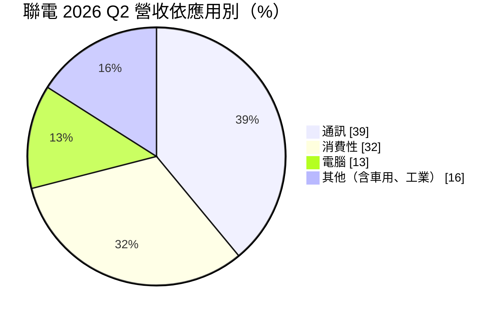
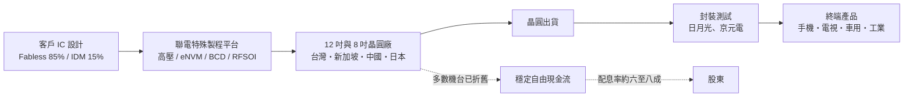
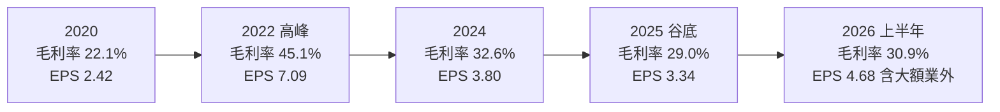
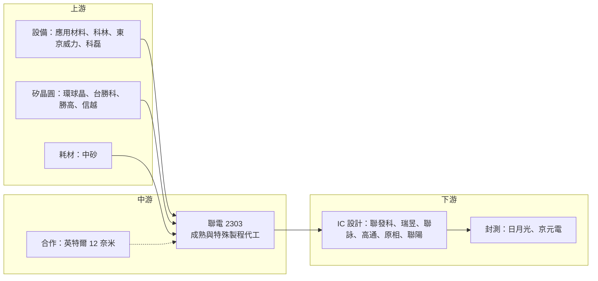

# 2303 聯電

> 上市｜[[產業索引-半導體業|半導體業]]｜上市（櫃）日期 1985/07/16

# 第一章：企業模式與商業藍圖

> [!info] 撰寫說明
> 本文由 Claude 依公開資料整理，架構比照 [[2330台積電]] 的四章研究，資料截至 2026-10-08。財務數字來源：Goodinfo 經營績效、股利政策與現金流量頁（2020 至 2025 年度）、證交所與櫃買中心開放資料快照（2026 年第二季資產負債與綜合損益、2025 年度股利、公司基本資料）、聯電 2025 年第四季與 2026 年第二季法說會新聞稿（Business Wire、優分析、科技新報、自由時報）；產業描述為整理性內容，尚未逐條比對原始文件。#待校對

在評估單一個股的長期投資價值時，首要步驟是拆解企業的底層獲利邏輯。本章針對聯華電子（股票代號：2303，以下簡稱聯電）的商業模式進行定性分析，說明它為何在 2018 年選擇退出先進製程競賽，以及如何在[[成熟製程]]市場中，靠特殊製程、已折舊產能與多地生產建立自己的定價基礎。

## 一、核心定位：專注成熟與特殊製程的純晶圓代工

聯電成立於 1980 年 5 月，是台灣第一家半導體公司，由工研院電子所衍生而來，1985 年上市，1990 年代中期轉型為純[[晶圓代工]]（轉型時間依公司沿革整理，待校對）。和 [[2330台積電]] 一樣，聯電不賣自有品牌晶片，只替 [[Fabless]] 與 [[IDM]] 客戶代工；2026 年第二季營收中 Fabless 客戶占 85%、IDM 占 15%。這種「不與客戶競爭」的中立身分，是晶圓代工能同時服務多家互相競爭的設計公司的前提。

聯電與台積電最大的差別在於技術路線。2018 年聯電宣布不再投入 12 奈米以下的先進製程，把資源集中在 14 至 28 奈米與 8 吋製程。這個決策改變了公司的長期財務性格，背後有兩層商業意義：

* **以資本紀律換取現金流：** 先進製程每一代都需要上百億美元的研發與設備投入，而且只有市占第一的廠商能穩定回收。聯電放棄這場競賽後，資本支出占營收比重大幅下降，經營重心從「追趕技術」轉為「讓既有產能賺錢」，自由現金流因此能支撐每年高比例的現金股利。
* **以特殊製程取代線寬競賽：** 成熟製程的邏輯晶片同質性高，容易陷入價格戰。聯電的差異化改由[[特殊製程]]平台建立，也就是在同一個線寬上疊加高壓、嵌入式記憶體、射頻、電源管理等功能。客戶一旦在某個平台完成設計，就很難換到其他晶圓廠，這讓聯電在成熟製程中仍保有一定的議價空間。

## 二、終端應用板塊：通訊與消費性為主，車用工業為策略重點

聯電的營收結構反映了成熟製程晶片的主要用途。2026 年第二季的晶圓營收依應用別如下：

* **通訊：** 包括手機與網通設備中的射頻開關（[[RFSOI]]）、Wi-Fi 與藍牙晶片、電源管理晶片，客戶包括 [[2454聯發科]]、[[2379瑞昱]]、[[QCOM高通]]。這類晶片不需要最先進的線寬，但需要穩定的射頻與類比特性，是成熟特殊製程最大的單一市場。
* **消費性：** 以電視、手機與筆電面板的顯示驅動 IC（[[DDI]]）為代表，主要客戶為 [[3034聯詠]]。驅動 IC 需要高壓製程，聯電在這個領域累積了長期的量產經驗。
* **電腦：** PC 與周邊的介面、電源與控制晶片，需求跟隨 PC 換機週期起伏。
* **其他（車用、工業）：** 車用與工業用的 [[MCU]]、[[BCD]] 電源管理、[[eNVM]] 與感測器。這塊目前比重不高，卻是聯電刻意拉高的板塊，因為車用與工業晶片的產品週期長、驗證門檻高，訂單穩定度遠高於消費性產品。

依製程別，2026 年第二季 22/28 奈米占晶圓營收 37%，其中 22 奈米單獨占 17.5%。22 奈米是聯電目前主力的高附加價值節點，比重持續提升，代表產品組合正往單價較高的製程移動，這是觀察聯電能否擺脫低價競爭的長期指標。

## 三、資本轉化邏輯：已折舊產能的現金機器

* **多地產能分散：** 聯電的晶圓廠分布在台灣（新竹 8 吋、台南 12A）、新加坡（12i）、中國（廈門聯芯 12 吋、蘇州和艦 8 吋）與日本（三重 USJC 12 吋），2026 年第二季產能約 130.5 萬片約當 12 吋晶圓（依出貨量與利用率推估為單季產能口徑，待校對）。客戶可以把同一顆晶片分散到不同國家生產，這在美中科技衝突升溫後成為重要的接單賣點，也是聯電相對於中國同業最明確的差異。
* **折舊攤提完的成本優勢：** 8 吋與 28 奈米以上的多數機台已攤提完畢，[[產能利用率]]一旦回升，增加的營收大部分直接轉為利潤。2026 年第二季利用率從約 80% 升到 85%，單季毛利率就從 29.2% 升到 32.5%，說明聯電的獲利對利用率非常敏感。這種結構在景氣好時放大獲利，在景氣差時也會放大衰退，投資人應以「整個週期的平均報酬」而非單一年度來評價它。

## 四、企業長期藍圖：借力英特爾、跨入先進封裝與矽光子

聯電的長期策略可以歸納為一句話：在不重回先進製程軍備競賽的前提下，找到成熟製程以外的成長來源。目前有三條主線：

* **英特爾 12 奈米合作：** 2024 年 1 月聯電宣布與 [[INTC英特爾]] 共同開發 12 奈米 [[FinFET]] 平台，在英特爾美國亞利桑那廠生產。依 2026 年 5 月報導，技術轉移已完成，預計 2027 年下半年量產。這項合作讓聯電不必自建先進廠，就能取得比 14 奈米更先進的節點與美國本土產能，也讓英特爾的閒置產能有了外部客戶，是一種雙方互補的資本輕量化安排。
* **[[先進封裝]]與[[矽光子]]：** 聯電提供中介層（[[Interposer]]）與晶圓對晶圓混合鍵合（[[Hybrid Bonding]]）等技術，並在 2026 年第二季宣布 12 吋光子 IC 已量產出貨。AI 資料中心的傳輸需求帶動光通訊升級，成熟製程廠可以在這些不需要最先進線寬、卻需要特殊整合能力的環節分到一部分價值。
* **12 吋擴產：** 新加坡 P4 擴充與台南新廠建設是 2025 至 2027 年的主要投資，2026 年 [[CapEx]] 上修至 20 億美元，其中 90% 投入 12 吋。擴產方向集中在 22/28 奈米與特殊製程，而不是新的線寬，延續了 2018 年以來的資本紀律。

# 第二章：護城河深度與競爭優勢

在長期價值投資中，「護城河」指企業抵禦競爭、維持超額利潤的保護機制。本章分析聯電的護城河構成、全球主要競爭對手，以及這些優勢在成熟製程供給持續增加的環境下能守住多少。

## 一、聯電護城河的核心組成要素

聯電的護城河不如台積電深，屬於「窄護城河」。它無法像台積電一樣靠技術領先定價，但能靠以下三個要素，讓自己在成熟製程中維持高於同業平均的報酬：

* **1. 特殊製程的轉換成本：** 驅動 IC、電源管理、eNVM 這類晶片的電路設計和晶圓廠的製程參數高度綁定，換廠等於重新設計與驗證。車用晶片在一座晶圓廠完成[[車規驗證]]往往需要 2 至 3 年，客戶一旦導入，產品生命週期內很少轉單。這種黏著度讓聯電在景氣下行時，流失的主要是價格敏感的一般消費性訂單，而不是核心客戶。
* **2. 折舊完畢產能的成本優勢：** 同樣是 28 奈米，新建廠商要負擔高額折舊，聯電則以攤提完的機台報價，在價格戰中有較大的毛利緩衝。這項優勢會隨著新產能投入與舊機台老化而逐漸遞減，因此聯電必須持續把產品組合往 22 奈米與特殊製程推進。
* **3. 多地生產與中立性：** 聯電不做自有品牌，產能分布在台灣、新加坡、日本、中國，並透過英特爾合作取得美國產能。國際客戶要求「台灣加一」或「中國以外」的供應時，聯電是少數能同時提供多個國家產能的成熟製程代工廠，這項優勢在地緣政治緊張的時期特別有價值。

## 二、全球主要競爭對手格局

| 對手 | 定位 | 對聯電的威脅 |
|---|---|---|
| [[2330台積電]] | 先進與成熟製程皆有，28 奈米產能大 | 綁定先進製程客戶，可整包接單；但台積電近年把資源集中在先進製程，成熟製程擴產有限 |
| 格羅方德（GlobalFoundries） | 退出先進製程、專攻特殊製程，握有美國與歐洲產能 | 定位最接近，搶同一批歐美 IDM 與車用客戶 |
| 中芯國際、華虹 | 中國政策扶植，大舉擴充 28 奈米以上 | 以低價搶中國客戶，長期壓低全球成熟製程報價 |
| [[5347世界先進]]、[[6770力積電]] | 台灣 8 吋與電源、驅動製程 | 在 8 吋與驅動 IC、電源管理直接競爭 |

全球成熟製程的競爭格局，可以理解為「中國產能擴張」與「非中國產能需求」兩股力量的拉鋸。前者壓低報價，後者讓擁有非中國產能的廠商得到溢價，聯電與格羅方德屬於後者的主要受益者。

## 三、優勢轉化：哪些市場守得住、哪些守不住

* **守得住：** 驗證週期長的車用、工業與高壓製程，以及需要非中國產能的國際客戶。這些訂單看重穩定交期、認證與供應安全，價格敏感度較低，是聯電毛利率的底部支撐。
* **守不住：** 一般消費性晶片在 28/40 奈米的報價。這類產品設計簡單、容易轉單，中國晶圓廠擴產後首先受影響的就是這塊。聯電毛利率由 2022 年高峰 45.1% 一路降到 2025 年的 29.0%，除了景氣循環，也反映中國同業的價格壓力與新產能折舊。
* **觀察重點：** 第一，22 奈米與特殊製程的營收占比能否持續提升；第二，英特爾 12 奈米能否如期在 2027 年量產並帶來新客戶；第三，矽光子與先進封裝能否成為有規模的營收來源。這三點決定聯電能否從「成熟製程週期股」轉型為「特殊製程平台」，進而讓長期毛利率中樞維持在三成以上。

# 第三章：財務體質與盈利規模

資料日期：2026-10-08。年度數字取自 Goodinfo 經營績效與現金流量頁，2026 年上半年與資產負債取自證交所開放資料快照，表格是撰寫當時的快照；最新月營收、毛利率、累計 EPS 由自動排程寫在本筆記的屬性欄位（月營收、毛利率、累計EPS 等）。#待校對

財務報表是檢驗護城河是否真實存在的最終標準。本章用多年度的三率、ROE、現金流與資本報酬，檢視聯電在一個完整成熟製程週期（2020 年復甦、2022 年高峰、2023 至 2025 年下行）中的獲利品質。

## 一、獲利能力的基石：三率

| 年度 | 營收（億元） | [[毛利率]] | [[營業利益率]] | EPS（元） | [[ROE]] |
|---|---|---|---|---|---|
| 2020 | 1,768 | 22.1% | 12.4% | 2.42 | 12.3% |
| 2021 | 2,130 | 33.8% | 24.3% | 4.57 | 21.3% |
| 2022 | 2,787 | 45.1% | 37.4% | 7.09 | 28.5% |
| 2023 | 2,225 | 34.9% | 26.0% | 4.93 | 17.7% |
| 2024 | 2,323 | 32.6% | 22.2% | 3.80 | 12.8% |
| 2025 | 2,376 | 29.0% | 18.5% | 3.34 | 11.0% |
| 2026 上半年 | 1,298 | 30.9% | 20.2% | 4.68 | 未查得（Goodinfo 年化約 28%） |

* **營收成長：** 2020 至 2025 年營收從 1,768 億元增加到 2,376 億元，年複合成長率約 6.1%（推算）。成長幅度不大，主要來自 2021 至 2022 年疫情期間的缺貨漲價，以及 22/28 奈米產品組合改善，顯示聯電是「隨週期起伏、長期溫和成長」的公司，而不是高成長股。
* **[[毛利率]]：** 成熟製程的毛利率主要由產能利用率與報價決定。2022 年利用率接近滿載、價格處於高點，毛利率達 45.1%；2025 年利用率約八成、價格受中國同業壓抑，毛利率降到 29.0%。同一家公司在三年內毛利率相差 16 個百分點，說明營運槓桿非常大。
* **[[營業利益率]]：** 研發與管理費用相對固定，營收回升時營業利益率擴張比毛利率更快，下跌時也更快，從 2022 年 37.4% 降到 2025 年 18.5%。
* **[[淨利率]]與業外：** 聯電持有多家上市公司股權，業外收益有時相當可觀。2026 年上半年營業利益約 262 億元，但營業外收入約 356 億元，使稅後淨利率達 45%，其中第二季約 302 億元來自業外投資與股利收入。這類收益不具持續性，評估本業時應以營業利益為準。

## 二、[[ROE]]：資本效率

聯電 2021 至 2025 年平均 ROE 約 18.3%（推算），高峰 2022 年 28.5%、低谷 2025 年 11.0%。這個區間有兩個特點：一是即使在 2025 年的成熟製程低谷，ROE 仍維持在一成以上，代表已折舊產能提供了相當厚的獲利底部；二是 ROE 主要來自營業利潤而非財務槓桿。2026 年第二季底股東權益約 4,439 億元、負債總額約 2,220 億元，負債比約 33%（推算），財務結構保守。

股利方面，聯電 2020 至 2025 年度的現金股利分別為 1.6、3.0、3.6、3.0、2.85、2.6 元，以當年 EPS 計算的配息率約 51% 至 78%（推算），2024 與 2025 年度都在七成五以上。公司章程規定現金股利占股利總額 20% 至 100%，實務上近年全數以現金發放。配息金額隨景氣起伏，但沒有中斷，屬於「穩定配息、金額隨週期浮動」的類型。

## 三、資本支出與自由現金流

| 年度 | 營業現金流（億元） | 投資現金流（億元） | 自由現金流（億元） |
|---|---|---|---|
| 2020 | 657 | -401 | 256 |
| 2021 | 904 | -622 | 282 |
| 2022 | 1,459 | -544 | 914 |
| 2023 | 860 | -978 | -118 |
| 2024 | 939 | -859 | 79 |
| 2025 | 999 | -532 | 467 |

（自由現金流依 Goodinfo 定義為營業現金流加投資現金流，投資現金流包含金融資產買賣，不等於純資本支出。）

* **[[自由現金流]]：** 六年中有五年為正，唯一為負的 2023 年是新加坡 P3 等擴產支出高峰。營業現金流即使在 2023 至 2025 年的低谷期也維持在 860 億元以上，足以支應每年約 330 至 450 億元的現金股利，這是聯電「現金機器」定位的財務證據。
* **[[CapEx]]：** 2025 年約 16 億美元，2026 年上修為 20 億美元，九成用於 12 吋。資本支出上修代表 2027 年起折舊將回升，需要靠 22 奈米與特殊製程的產品組合改善來抵銷，否則毛利率會受壓。

## 四、[[ROIC]] 與 [[WACC]]：價值創造利差

企業長期創造價值的條件，是投入資本報酬率（ROIC）高於加權平均資金成本（WACC）。

**ROIC（推算）：** 公開資料未直接揭露聯電的 ROIC，本文以「稅後營業利益 ÷（股東權益＋有息負債）」推算。2025 年營業利益約 2,376 億元 × 18.5% ≈ 440 億元，以稅率 20% 計算稅後營業利益約 352 億元。投入資本方面，有息負債明細未查得，以 2026 年第二季非流動負債約 1,157 億元作為有息負債的近似上限，加上股東權益約 4,439 億元，投入資本約 5,596 億元，ROIC 約 6.3%（推算）。由於股東權益中含有大量轉投資股權與評價利益，這些資產並不產生營業利益，若扣除，本業 ROIC 約在 7% 至 8%（推算）。對照 2022 年高峰，稅後營業利益約 834 億元，以當時較小的資本基數推估 ROIC 超過 20%（推算）。

**WACC（推算）：** 以 CAPM 推估股東權益成本：無風險利率取台灣 10 年期公債約 1.75%，市場風險溢酬 6%，β 假設 1.1（半導體同業常見值約 1.0 至 1.2，非來源數字），權益成本約 1.75% + 1.1 × 6% = 8.35%。負債成本假設稅前 2%、稅率 20%，稅後 1.6%。以帳面資本結構（權益 79%、負債 21%）計算，WACC 約 6.9%；若以市值計算（股價淨值比約 4.2 倍，權益權重超過九成），WACC 接近 8%（推算）。

**結論：** 聯電在 2021 至 2023 年的高利用率期間，ROIC 明顯高於 WACC，是創造價值的階段；2025 年的成熟製程低谷，ROIC 約 6% 至 8%，大致與 WACC 打平，代表這一年本業只是賺回資金成本。以 2026 年上半年營業利益年化計算，ROIC 約 7.5%（推算），利差仍小。長期來看，聯電能否持續創造價值，取決於景氣低谷時 ROIC 能否守在 WACC 之上，而這又取決於特殊製程占比與新擴產的報酬率。

# 第四章：總體風險與地緣政治

任何企業都無法脫離宏觀環境獨立存在。本章分析聯電未來必須面對的地緣政治、產業週期、營運與技術風險。這些風險多數是成熟製程代工業的共同課題，但聯電的多地產能布局讓它對其中幾項的曝險與同業不同。

## 一、地緣政治風險

* **中國產能的雙面刃：** 廈門聯芯與蘇州和艦讓聯電能就近服務中國客戶，但也讓它暴露在美國出口管制與中國本土化政策之下。中國政府鼓勵客戶優先採用本土晶圓廠，長期可能侵蝕聯電在中國的市占；反過來，若美國進一步限制中國產能，聯電的中國廠也可能面臨設備與技術升級的限制。
* **美國關稅與在地化要求：** 美國對半導體進口的關稅與「美國製造」政策，會讓國際客戶偏好有美國產能的供應商。英特爾 12 奈米合作提供美國本土產能，是聯電對沖這項風險的主要布局，但產能規模與成本競爭力仍有待驗證。
* **台灣集中風險：** 主要 12 吋產能仍在台灣，面臨與其他台灣半導體廠相同的兩岸風險。新加坡與日本產能提供部分分散效果。

## 二、產業週期與市場結構風險

* **成熟製程供過於求：** 中國大舉擴充 28 奈米以上產能，是未來數年成熟製程價格的最大壓力來源。即使需求回升，新增供給也可能讓報價難以回到 2022 年的高點。
* **[[長鞭效應]]與庫存週期：** 消費性與通訊合計約占營收七成，手機、PC、電視的需求變化會沿供應鏈逐級放大。終端需求小幅下滑時，IC 設計公司會先大幅削減投片，直接反映在聯電的產能利用率與毛利率。
* **匯率：** 聯電營收以美元計價為主，成本中有相當部分以新台幣支付，新台幣升值會壓縮以台幣計算的毛利率。

## 三、營運環境的隱性風險

* **新產能折舊：** 新加坡 P4、台南新廠與資本支出上修，會讓未來數年的折舊費用回升。已折舊產能是聯電的成本優勢，新產能比重提高後，這項優勢會被稀釋。
* **合作執行風險：** 英特爾 12 奈米若延後量產，或英特爾的代工策略改變，合作效益會打折。這項合作牽涉兩家公司的製程整合與客戶導入，執行難度不低。
* **水電與人才：** 與台灣同業相同，面臨供電穩定、綠電取得與工程人才競爭。國際客戶對供應鏈減碳的要求提高，也會增加成熟製程廠的營運成本。

## 四、科技演進風險

聯電主動不走 12 奈米以下的路線，好處是省下巨額研發與資本支出，代價是無法參與 AI 先進製程最大的一塊市場。如果半導體產業的價值持續往先進製程與先進封裝集中，成熟製程在整體產值中的比重會逐漸下降，聯電能分到的主要是周邊晶片（電源、驅動、連網、光通訊）。另一方面，汽車電動化、工業自動化與 AI 資料中心的電源與光通訊需求，會讓特殊製程的應用持續擴大。矽光子、先進封裝與英特爾合作能否成為新的成長來源，是判斷聯電十年後定位的關鍵。

# 專有名詞解析

## 半導體

- **[[晶圓代工]]**：替其他公司製造晶片、本身不賣自有品牌晶片的商業模式，代表廠商為台積電、聯電。
- **[[成熟製程]]**：一般指 28 奈米及更大線寬的製程，技術成熟、設備多已折舊，主要用於電源、驅動、車用與物聯網晶片。
- **[[特殊製程]]**：在成熟線寬上加入高壓、嵌入式記憶體、射頻等特殊功能的製程平台，差異化程度高於一般邏輯製程。
- **[[FinFET]]**：鰭式場效電晶體，把電晶體通道做成立體鰭片以降低漏電，是 16/14 奈米到 3 奈米的主流架構。
- **[[eNVM]]**：嵌入式非揮發性記憶體，把斷電後仍能保存資料的記憶體做進同一顆晶片，常見於 MCU 與智慧卡。
- **[[BCD]]**：Bipolar-CMOS-DMOS 製程，把類比、數位與高功率元件整合在同一晶片，主要用於電源管理 IC。
- **[[RFSOI]]**：在絕緣層上覆矽（SOI）晶圓製作射頻元件的製程，用於手機的天線開關與前端模組。
- **[[DDI]]**：顯示驅動 IC，負責控制面板每個像素的電壓，需要高壓製程，聯詠、奇景為主要設計公司。
- **[[先進封裝]]**：把多顆晶片以中介層、混合鍵合等方式高密度整合的封裝技術，例如 CoWoS、SoIC。
- **[[Interposer]]**：中介層，放在晶片與載板之間、內含細微線路的矽片，用來連接並排的多顆晶片。
- **[[Hybrid Bonding]]**：混合鍵合，以銅對銅直接接合兩片晶圓或晶片，不需凸塊，可大幅提高連接密度。
- **[[矽光子]]**：在矽晶片上製作光學元件，以光取代電傳輸資料，可降低 AI 資料中心的傳輸耗電。

## 應用

- **[[車規驗證]]**：車用晶片須通過 AEC-Q100 等可靠度測試與車廠認證，流程常需 2 至 3 年，因此轉換成本高。

## 金融

- **[[產能利用率]]**：實際投片量占總產能的比例，晶圓代工廠的毛利率高度取決於此數字。
- **[[自由現金流]]**：營業活動現金流減去資本支出，代表企業可自由用於配息、還債或併購的現金。
- **[[ROIC]]**：投入資本報酬率，稅後營業利益除以股東權益加有息負債，衡量公司投入營運的全部資本能賺多少。
- **[[WACC]]**：加權平均資金成本，股東與債權人要求報酬率的加權平均，是 ROIC 的比較基準。
- **[[長鞭效應]]**：終端需求的小幅變動，沿供應鏈往上游傳遞時被逐級放大，造成上游庫存與訂單劇烈波動。

# 核心供應鏈

## 1. 上游：設備、材料與矽晶圓
- 半導體設備：[[AMAT應用材料]]、[[LRCX科林研發]]、[[8035東京威力科創]]、[[KLAC科磊]]
- 矽晶圓：[[6488環球晶]]、[[3532台勝科]]、[[3436勝高]]、[[4063信越化學]]
- 研磨耗材：[[1560中砂]]

## 2. 中游：聯電本身與合作夥伴
- 12 奈米合作開發與美國產能：[[INTC英特爾]]
- 轉投資的 ASIC 設計服務：[[3035智原]]
- 成熟製程同業：[[2330台積電]]、[[5347世界先進]]、[[6770力積電]]、格羅方德、中芯國際、華虹

## 3. 下游：主要 IC 設計客戶
- 手機與連網晶片：[[2454聯發科]]、[[QCOM高通]]
- 驅動 IC：[[3034聯詠]]
- 網通與音訊晶片：[[2379瑞昱]]
- 影像與感測晶片：[[3227原相]]、[[3014聯陽]]

## 4. 下游：封裝測試
- [[3711日月光投控]]、[[2449京元電子]]

延伸閱讀：[[聯發科供應鏈]]

## 供應鏈關係
- 供應給 [[2454聯發科]]：成熟製程主力 (電源管理、Wi-Fi 晶片)（聯發科供應鏈 › 中游：晶圓代工生產夥伴 (Foundry)）

## 最新新聞
<!-- news:start（自動產生，請勿手動編輯此範圍） -->
- 2026-10-21 📰 媒體 07:53｜三大法人買賣超 – 外資買超(2330)台積電、(6770)力積電，投信買超(1303)南亞、(2303)聯電，法人合計買超214.77億元｜[永豐金證券](https://news.google.com/rss/articles/CBMiqgVBVV95cUxNUmE4LS0zR2dzXzBPajRsZHFRdmlyZzIwYWJxemVqQ0J5REw1bkhXV2Z2RFg0NW82Ri1EUlotS0JVYXlqRzUzOXhENEV2V1JVX3k4LUR5S2I2VDJWVHo2OXlhU3k5U3NVSXNSRDM3ejRGM25pUnowa1F3QVhNMTQzc2hVc2lOSVJEdkYzb3ljekl5SVRJNlVfUDBjS0hld293OVYyZVRqNUZyVjVsd1c3YVNNcTlzV2hpMWpFYThrTXVqTm1sZktha2dIdmVJRzdiOFJpX0RFektTazdRN05pNm0zODEzSHhIdlR6Rk1oQjducWpmMTRjNnpzSlMxUGR3SWNkR282ZGRPa0tWZks1TS1NWjlRRWNpc3NfcVgxcVQweW1iY1pueG9tQ2JETlE3LTBacDJUdDdUU2pQWERPeTlZcmRzZ0w1YkdGMlRKN0hWTlZhSUpySnBRQTlYRlhRNnNaQURmUGpNOFZkcTBoMl85cl94OWFOUTJBYXJsTXl0OW5NYl9TY1Iza1Y3aUljNXhOZXl2ZERQVnRkRW5TSDlUTWZQOF9JYW15cF83b1RoYThXMW9HVVpFZGExU0FmaDNzT2dqeTZMTkxoM2NSLVBuLTlXWEdJc1ZfMjhhS05BaElKMzJlUThKcmxRdUI0U3dxSHlGQ0ZIa2RaN1FDb2pwUTliWGhZY3pPS2F4MmFSR2NtWmVpa04tR3hxb0wwcUdqZkYtLVpqS0tsZW16cElsX2pRZ0wyY19JTUY5NHAtQ1ZzaE1pYTh3LWhZLTlodG1aZ1BkOWVJNDZVdzZjM1FtbThSYUtPdVVyUWh6U3NIdVFDVzlMN0tRU2kzd0pIZjdocWFVZWoyWEpDSnZneXdZQVp6VlNXRGxJdzFNM3h1bE9RWmI3ajln?oc=5)
- 2026-10-21 📰 媒體 07:31｜《台北股市》投信20日賣超股：聯電、台塑化、長榮航｜[富聯網](https://news.google.com/rss/articles/CBMiiAFBVV95cUxQd2Z3LU9fanFUTkx5SnBVTjQzSWVfaElVTFN6enFPNWJJTDdYVGs1Nm0xR2g1b19tSUhPajdZSlJlVnRoZUZCaG9Zbkwya0JRdDRDbnFuMTJsVDhrZnpYd2hyUDJTTVlOallQZ1ZXLUt5VWpNZnZ1R1MwTktaby1wYzlUUDdEdXA3?oc=5)
- 2026-10-21 📰 媒體 07:31｜《台北股市》三大法人20日賣超股：聯電、友達、台新新光金｜[富聯網](https://news.google.com/rss/articles/CBMiiAFBVV95cUxQc1pScVVELWFWam4zcUhqMUp6em90R3lnQmRpMkIyR3VBQ2FjY3dGWG5XY0JmcHBKU0dEM1dQVFJyYnpGaDZoeFRkNlU1YXVpUkJORldMTXR1YlgtSGw5R2lQY05qOGliUHNGRGNHSnl1VmMxdXY5TWlFQTBHM3E3M0x4TV9ualpL?oc=5)
- 2026-10-21 📰 媒體 06:48｜成熟製程3雄誰最猛？聯電目標價喊155元、明年EPS上看7.69元 法人短線卻更愛「這檔」｜[FTNN 新聞網](https://news.google.com/rss/articles/CBMiS0FVX3lxTFBmWVU0QjFGSXFsSHNwS1doVkxJRkxXdHg1UkhlcUxWaGM5MkdndS1vODNoVWNYYTRmbThfWmd5Z1hRMjBmbk9kUE9uTQ?oc=5)
- 2026-10-20 📰 媒體 21:30｜排名恐退前段班！「這檔金融」9月獲利月減36%遭賣聯電布局矽光子、CPO仍被三大法人狂砍40億淪主要提款機｜[FTNN 新聞網](https://news.google.com/rss/articles/CBMiS0FVX3lxTE53eVN1V3BYUl9CRXVVSjlqczJMMUZMRzRLZDFoWDVubGlscUNtRnpOWXdQSmFiMllFcWVfX0ZhaXFKVC0yQnNNcVRrZw?oc=5)

完整紀錄：[[2303聯電 新聞]]
<!-- news:end -->

## 相關連結
- [公開資訊觀測站](https://mopsov.twse.com.tw/mops/web/t05st03?step=1&firstin=1&co_id=2303)
- [Goodinfo](https://goodinfo.tw/tw/StockDetail.asp?STOCK_ID=2303)
- [Yahoo 股市](https://tw.stock.yahoo.com/quote/2303)
- [鉅亨網新聞](https://www.cnyes.com/twstock/2303/news)
