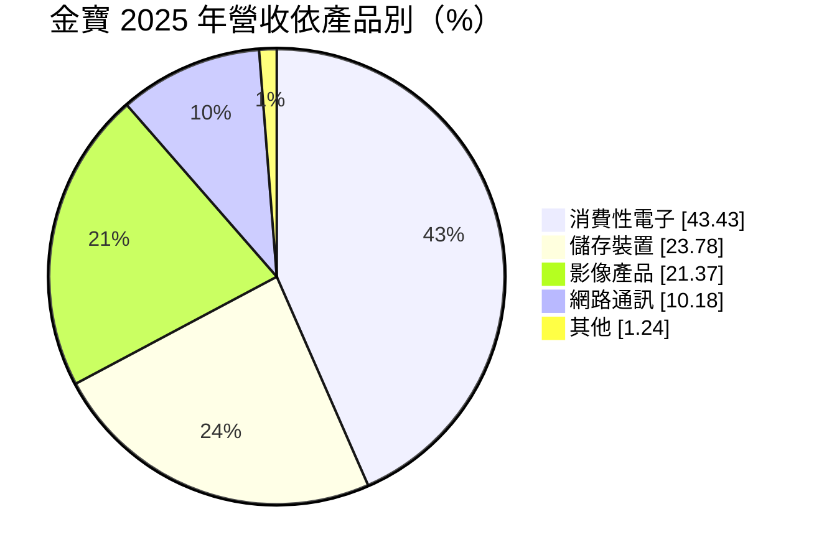
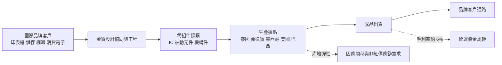
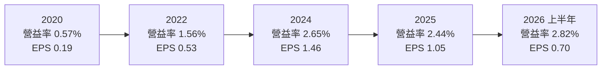
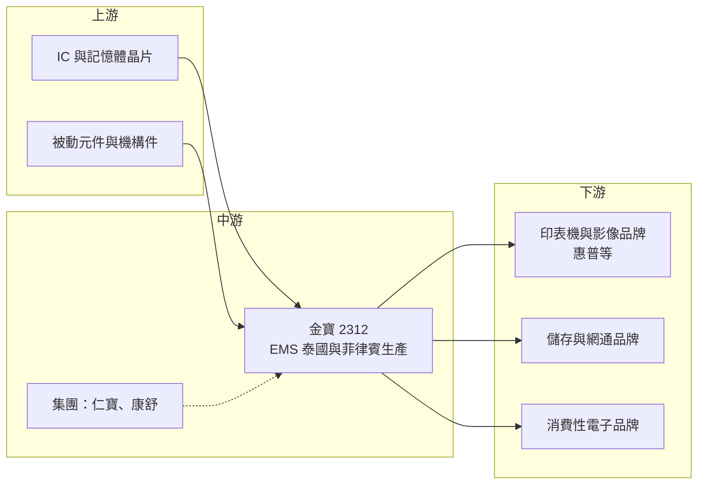

# 2312 金寶

> 上市｜[[產業索引-其他電子業|其他電子業]]｜上市（櫃）日期 1989/11/07

# 第一章：企業模式與商業藍圖

> [!info] 撰寫說明
> 本文由 Claude 依公開資料整理，架構比照 [[2330台積電]] 的四章研究，資料截至 2026-10-08。財務數字來源：Goodinfo 經營績效、股利政策與現金流量頁（2020 至 2025 年度）、證交所開放資料快照（2026 年第二季資產負債與綜合損益、2025 年度股利、公司基本資料）、富果研究金寶 2026 年 3 月與 6 月法說會整理、經濟日報 2025 年 11 月法說報導、優分析 2026 年 1 月報導；產業描述為整理性內容，尚未逐條比對原始文件。#待校對

在評估單一個股的長期投資價值時，首要步驟是拆解企業的底層獲利邏輯。本章針對金寶電子（股票代號：2312，以下簡稱金寶）的商業模式進行定性分析，說明一家營收超過 1,600 億元、毛利率卻只有 6% 上下的[[EMS]]代工廠，如何靠東南亞產能布局維持客戶，以及它從代工製造轉向設計製造的長期嘗試。

## 一、核心定位：以東南亞產能為核心的中型 EMS 廠

金寶成立於 1973 年，1989 年上市，早期以計算機等消費電子起家，是金仁寶集團的核心公司之一，與筆電代工廠 [[2324仁寶]] 同屬一個集團。金寶的商業模式是替國際品牌代工印表機、消費性電子、儲存裝置與網通設備，本身不經營自有品牌的主力產品。

金寶與一般 EMS 廠最大的差別，在於很早就把生產重心放在泰國。集團旗下的泰國子公司（泰金寶，在泰國掛牌，並以存託憑證在台上市）長期經營大型生產基地，這讓金寶在美中貿易衝突後，比許多同業更早具備「中國以外」的產能。依 2025 年 11 月法說，中國產能占集團製造比重已降到約 5%，菲律賓與泰國合計接近八成。

金寶的財務結構有一個重要特徵：2026 年第二季底權益總計約 386 億元，其中非控制權益約 143 億元，比重接近四成（推算）。這反映泰國子公司等重要營運實體並非百分之百持有，部分獲利歸屬於其他股東，因此金寶合併營收很大，歸屬母公司的淨利卻相對有限。

## 二、終端應用板塊：消費電子、儲存與影像三足鼎立

2025 年全年營收依產品別如下：

* **消費性電子：** 包括穿戴裝置、手持裝置、行動支付終端（mobile POS）等。這是金寶占比最大的產品線，但產品週期短、客戶出貨節奏變化大，季度波動明顯。2026 年第一季比重降到約 37.65%，公司也表示會逐步降低消費性電子的權重。
* **儲存裝置：** 以固態硬碟（[[SSD]]）與硬碟相關產品的代工為主，是近年的主要成長來源。金寶在泰國的 SSD 產線持續擴充，2026 年夏季新樓層量產後，產能預計約倍增。
* **影像產品：** 印表機、事務機與標籤印表機，是金寶歷史最久的代工業務之一，國際印表機品牌（如惠普）為重要客戶。2025 年因應美國對等關稅，印表機生產從中國移到泰國，移轉期間比重下降，2025 年底完成搬遷。
* **網路通訊：** 網通設備與行動無線電等，比重逐年上升，2025 年 4 月子公司整併韓國子公司後，網通業務規模擴大。

## 三、資本轉化邏輯（營運模式）：薄利、高周轉與產地彈性

* **薄利、高周轉的獲利結構：** EMS 的毛利主要來自組裝與供應鏈管理服務，零組件成本占營收比重很高，因此毛利率長期只有 6% 上下。獲利的關鍵不在價格，而在產能利用率、良率與營運資金周轉。2026 年第一季存貨天數升到 66 天，但應付帳款天數延長到 81 天，現金轉換循環維持在 67 天左右，顯示公司管理營運資金的能力。
* **產地彈性就是競爭力：** 金寶在泰國、菲律賓、墨西哥、美國、巴西都有生產據點，可以依客戶的關稅與地緣政治需求移轉產線。2025 年將印表機產線移出中國，就是這項能力的實際運用。對品牌客戶而言，[[非紅供應鏈]]產能已是選擇代工廠的重要條件。
* **客戶交易模式的影響：** 2026 年起一家主要儲存客戶把交易模式從「買賣」改為「客供料」，由客戶自行提供 SOC 晶片。這會讓帳面營收下降，但不影響實際獲利，反而會讓毛利率看起來較高。閱讀金寶的營收數字時，應注意這類會計口徑的變化。

## 四、企業長期藍圖：從 OEM 走向 ODM 與新事業

金寶管理層的長期方向，是從單純代工製造（OEM）轉向設計製造（[[ODM]]），提高附加價值與毛利率。具體作法包括：

* **研發投入加倍：** 公司表示未來數年研發費用要倍增，2026 年第一季研發費用年增約 15%。設計能力是從 OEM 升級到 ODM 的前提，也是拉開與純組裝廠差距的方法。
* **伺服器與電源：** 在墨西哥生產伺服器主機板，並計畫在泰國從 L2 主機板組裝延伸到 L10 機櫃級組裝。同時與同集團的 [[6282康舒]] 合作，把電動車充電樁的電源技術延伸到 [[HVDC]] 與高階伺服器電源，量產時程依公司說法最快在 2027 至 2028 年。
* **衛星與量子：** 衛星通訊從[[低軌衛星]]延伸到中、高軌的地面接收設備與天線；量子運算方面與合作夥伴開發量子位元控制系統。這兩項目前規模很小，屬長期選擇權，短期內不會明顯貢獻營收。
* **車用電子：** 規劃座艙平台、雷達感測與駕駛監控等產品，並在泰國與墨西哥擴充車用電子產能。
* **資本支出：** 公司表示 2020 至 2025 年平均每年資本支出約 30 億元以上，未來至少維持這個水準。

# 第二章：護城河深度與競爭優勢

在長期價值投資中，「護城河」指企業抵禦競爭、維持超額利潤的保護機制。EMS 產業的進入門檻在於規模、客戶認證與全球產能，而非技術專利，因此金寶的護城河相對窄。本章分析它的競爭優勢、主要對手，以及這些優勢在低毛利產業中能轉化為多少報酬。

## 一、護城河的核心組成要素

金寶屬於「窄護城河」甚至「無明顯護城河」的類型，它的優勢主要來自以下三點：

* **1. 東南亞產能的先發優勢：** 金寶在泰國經營大型生產基地數十年，當地供應鏈、人力與管理經驗都已成熟。美中貿易衝突後，許多同業才開始在東南亞建廠，金寶的先發優勢讓它能在客戶移轉產能時優先承接訂單。不過這項優勢會隨同業逐漸完成布局而遞減。
* **2. 印表機與儲存的製造經驗：** 印表機的機構件多、組裝工序複雜，SSD 則需要高精度的表面黏著與測試能力。金寶在這兩個領域累積多年量產經驗，客戶要轉單需要重新驗證產線，形成一定的轉換成本。
* **3. 集團資源：** 與仁寶、康舒同屬金仁寶集團，在採購、電源技術與客戶資源上有一定的互補，例如與康舒合作充電樁與伺服器電源。

## 二、全球主要競爭對手格局

| 對手 | 定位 | 對金寶的威脅 |
|---|---|---|
| [[2317鴻海]] | 全球最大 EMS 廠 | 規模與垂直整合遠大於金寶，可整包承接大客戶 |
| Jabil、偉創力（Flex） | 美系大型 EMS 廠 | 在網通、儲存與消費電子都有布局，與歐美客戶關係深 |
| [[2324仁寶]] | 同集團筆電與消費電子代工 | 部分產品線重疊，但集團內有分工 |
| [[4938和碩]] | 消費電子與網通代工 | 在網通與消費電子產品直接競爭 |
| 中國中小型 EMS 廠 | 以低價承接消費電子訂單 | 在不需要非紅供應鏈的產品上以價格競爭 |

## 三、優勢轉化：守得住、守不住與觀察重點

* **守得住：** 需要非中國產能、且組裝工序複雜的產品，例如印表機與 SSD。這些客戶看重產地與量產經驗，價格敏感度相對較低。
* **守不住：** 消費性電子的訂單與定價。這類產品週期短、客戶議價力強，同業眾多，金寶很難靠技術差異化取得較高的利潤。2020 至 2025 年毛利率始終在 5.9% 至 6.4% 之間，說明它在整體上並沒有定價權。
* **觀察重點：** 第一，研發加倍投入能否讓 ODM 比重提高，並反映在營業利益率上（目前約 2.5% 至 2.8%）；第二，泰國 SSD 與伺服器機櫃產能擴充後的利用率；第三，ROE 能否從過去五年平均約 4% 提升到資金成本以上。

# 第三章：財務體質與盈利規模

資料日期：2026-10-08。年度數字取自 Goodinfo 經營績效與現金流量頁，2026 年上半年與資產負債取自證交所開放資料快照，表格是撰寫當時的快照；最新月營收、毛利率、累計 EPS 由自動排程寫在本筆記的屬性欄位（月營收、毛利率、累計EPS 等）。#待校對

財務報表是檢驗護城河是否真實存在的最終標準。本章用多年度的三率、ROE、現金流與資本報酬，檢視金寶的低毛利代工模式能否為股東創造足夠的報酬。

## 一、獲利能力的基石：三率

| 年度 | 營收（億元） | [[毛利率]] | [[營業利益率]] | EPS（元） | [[ROE]] |
|---|---|---|---|---|---|
| 2020 | 1,282 | 6.21% | 0.57% | 0.19 | 0.95% |
| 2021 | 1,398 | 6.41% | 0.88% | 0.16 | 0.87% |
| 2022 | 1,814 | 5.90% | 1.56% | 0.53 | 3.52% |
| 2023 | 1,598 | 6.15% | 1.88% | 0.52 | 2.64% |
| 2024 | 1,644 | 6.25% | 2.65% | 1.46 | 6.64% |
| 2025 | 1,635 | 6.32% | 2.44% | 1.05 | 5.79% |
| 2026 上半年 | 751 | 6.88% | 2.82% | 0.70 | 未查得（Goodinfo 年化約 7.9%） |

* **營收成長：** 2020 至 2025 年營收從 1,282 億元增加到 1,635 億元，年複合成長率約 5.0%（推算），主要成長發生在 2022 年，之後大致持平。2025 年以美元計營收成長約 3%，但新台幣升值使台幣營收微幅衰退。
* **[[毛利率]]：** 六年來都在 5.9% 至 6.9% 之間，幾乎沒有變化，這是 EMS 產業的結構特徵。2026 年上半年升到 6.88%，部分來自產品組合調整，部分來自客供料使帳面營收下降。
* **[[營業利益率]]：** 從 2020 年的 0.57% 逐步改善到 2024 年的 2.65%，2026 年上半年 2.82%。在毛利率持平的情況下，營業利益率改善主要來自關閉中國工廠、精簡費用與產品組合優化，代表過去幾年的結構調整有實際成效。
* **[[淨利率]]與少數股權：** 2026 年上半年稅後淨利約 14.9 億元，其中歸屬母公司約 10.5 億元、非控制權益約 4.5 億元。合併淨利有約三成歸屬子公司的其他股東，是評估金寶 EPS 時必須注意的結構。

## 二、[[ROE]]：資本效率

金寶 2021 至 2025 年平均 ROE 約 3.9%（推算），最高為 2024 年的 6.64%。這個水準明顯偏低，說明金寶過去多數年份的獲利不足以補償股東承擔的風險。2026 年第二季底，歸屬母公司股東權益約 243 億元，每股淨值約 16.1 元；負債總額約 1,057 億元，負債比約 73%（推算），高負債比主要來自 EMS 業務的應付帳款等營運負債。

股利方面，2020 至 2025 年度現金股利分別為 0.29、0.20、0.30、0.30、0.60、0.60 元。2022 年以後配息率約 41% 至 58%（推算），2020 與 2021 年度的股利則超過當年 EPS。公司章程規定現金股利不低於股利總額的 10%，實務上近年全數以現金發放，金額隨獲利提高而增加，但絕對水準不高。

## 三、資本支出與自由現金流

| 年度 | 營業現金流（億元） | 投資現金流（億元） | 自由現金流（億元） |
|---|---|---|---|
| 2020 | 32.8 | -37.0 | -4.2 |
| 2021 | -34.8 | -16.3 | -51.2 |
| 2022 | -37.3 | -49.0 | -86.3 |
| 2023 | 161 | -34.7 | 126 |
| 2024 | 44.6 | -13.4 | 31.2 |
| 2025 | 62.1 | -25.1 | 36.9 |

（自由現金流依 Goodinfo 定義為營業現金流加投資現金流。）

* **[[自由現金流]]：** 2020 至 2022 年連續三年為負，2021 與 2022 年營業現金流甚至轉負，原因是零組件缺料期間大量備料，存貨占用大量資金；2023 年景氣反轉、存貨去化，營業現金流回升到 161 億元。這說明 EMS 廠的現金流主要由營運資金週期決定，而不是由獲利決定。2023 至 2025 年自由現金流連續為正，是財務體質改善的訊號。
* **[[CapEx]]：** 每年約 30 億元上下，相對 1,600 億元營收約 2%，屬輕資本密集。泰國 SSD 與伺服器產線擴充，以及多國據點建置，是未來主要的資本支出項目。

## 四、[[ROIC]] 與 [[WACC]]：價值創造利差

企業長期創造價值的條件，是投入資本報酬率（ROIC）高於加權平均資金成本（WACC）。

**ROIC（推算）：** 本文以「稅後營業利益 ÷（股東權益＋有息負債）」推算。2025 年營業利益約 39.9 億元，以稅率 20% 計算稅後營業利益約 31.9 億元。有息負債明細未查得，以 2026 年第二季非流動負債約 239 億元作為近似，加上權益總計約 386 億元，投入資本約 624 億元，ROIC 約 5.1%（推算）。EMS 廠通常有短期銀行借款列在流動負債，若計入，實際 ROIC 可能更低，約 4% 至 5%（推估）。以 2026 年上半年營業利益約 21.1 億元年化計算，ROIC 約 5.4%（推算）。2020 至 2023 年營業利益率不到 2%，推估當時 ROIC 只有 1% 至 3%（推估）。

**WACC（推算）：** 以 CAPM 推估股東權益成本：無風險利率取台灣 10 年期公債約 1.75%，市場風險溢酬 6%，β 假設 0.9（EMS 同業常見值，非來源數字），權益成本約 7.15%。負債成本假設稅前 2.5%、稅率 20%，稅後 2.0%。以帳面資本結構（權益 62%、負債 38%）計算，WACC 約 5.2%（推算）。

**結論：** 金寶 2025 年的 ROIC 約 4% 至 5%，大致與 5.2% 的 WACC 打平或略低；2020 至 2023 年則明顯低於資金成本。換句話說，金寶過去多年的規模並沒有轉化為股東價值，近兩年的結構調整讓利差從明顯為負改善到接近零。未來若 ODM 轉型與新事業能把營業利益率推升到 3.5% 以上，ROIC 才有機會穩定高於 WACC。

# 第四章：總體風險與地緣政治

任何企業都無法脫離宏觀環境獨立存在。本章分析金寶未來必須面對的地緣政治、產業週期、營運與技術風險。對低毛利的代工廠而言，外部環境的小幅變化，就可能吃掉大部分的利潤。

## 一、地緣政治

* **美國關稅政策：** 金寶多數客戶是美國品牌，美國對等關稅的稅率與適用國家變化，會直接影響客戶選擇生產地點。泰國、菲律賓、墨西哥的關稅待遇若出現差異，金寶需要再次移轉產線，搬遷期間的營收與效率都會受影響，2025 年印表機搬遷就是例子。
* **海外據點的營運風險：** 泰國、菲律賓、墨西哥、巴西等地的政治、勞工法規與匯率變化，都會影響營運成本。分散生產降低單一國家風險，但也增加管理的複雜度。

## 二、產業週期與市場結構

* **消費電子與印表機需求成熟：** 印表機屬長期萎縮的市場，消費電子則受景氣與換機週期影響，品牌客戶的庫存調整會沿供應鏈放大，形成[[長鞭效應]]。
* **記憶體價格循環：** SSD 代工量與記憶體晶片的供應與價格有關。記憶體供應吃緊時，客戶可能因缺料而減少出貨，公司也提到記憶體供應是 2026 年下半年的主要風險。
* **客戶議價力：** EMS 客戶多為大型國際品牌，議價力強，代工廠很難轉嫁成本上漲。

## 三、營運環境的隱性風險

* **低毛利的放大效應：** 毛利率約 6%、營業利益率不到 3%，產品組合、產能利用率或良率的小幅變化，就會明顯影響獲利。
* **營運資金：** 備料與存貨增加時，營業現金流可能轉負，2021 至 2022 年的經驗說明這項風險真實存在。
* **新事業的不確定性：** 量子、衛星、伺服器機櫃等新事業需要持續投入研發，回收時間長，也可能最終無法形成規模。
* **匯率：** 營收以美元為主，成本涉及泰銖、披索等多種貨幣，新台幣升值會壓縮台幣計價的營收與獲利。

## 四、科技或法規演進

* **自動化與 AI 製造：** 代工產業逐步導入自動化與智慧製造，若金寶的投入速度落後大型同業，成本優勢會被拉開。
* **ESG 與供應鏈法規：** 國際品牌對供應鏈的碳排、勞動條件與衝突礦產要求日益嚴格，合規成本會持續增加，這對利潤率本來就很薄的 EMS 廠影響更大。

# 專有名詞解析

## 應用

- **[[SSD]]**：固態硬碟，以快閃記憶體取代傳統硬碟的儲存裝置，速度快、耗電低。
- **[[低軌衛星]]**：運行在約 500 至 2,000 公里高度的通訊衛星群，延遲較低，需大量地面接收設備，代表業者為 Starlink。

## 金融

- **[[毛利率]]**：毛利除以營收，反映產品或服務本身的獲利能力。
- **[[ROE]]**：股東權益報酬率，稅後淨利除以股東權益，衡量公司運用股東資本賺錢的效率。
- **[[ROIC]]**：投入資本報酬率，稅後營業利益除以股東權益加有息負債，衡量公司投入營運的全部資本能賺多少。
- **[[WACC]]**：加權平均資金成本，股東與債權人要求報酬率的加權平均，是 ROIC 的比較基準。
- **[[自由現金流]]**：營業活動現金流減去資本支出，代表企業可自由用於配息、還債或併購的現金。
- **[[長鞭效應]]**：終端需求的小幅變動，沿供應鏈往上游傳遞時被逐級放大，造成上游庫存與訂單劇烈波動。

## 產業

- **[[EMS]]**：電子製造服務，替品牌客戶組裝電子產品並管理供應鏈的代工模式，鴻海、和碩為代表。
- **[[ODM]]**：原廠委託設計製造，代工廠除了生產也負責產品設計，品牌商只提出規格。
- **[[非紅供應鏈]]**：生產據點設在中國以外的供應鏈，用來分散地緣政治與關稅風險。
- **[[HVDC]]**：高壓直流供電，資料中心以 400V 或 800V 直流直接配電，可減少交直流轉換損耗與銅材用量。

# 核心供應鏈

## 1. 上游：零組件
- IC、記憶體與被動元件供應商（具體名單公司未公開，推估）
- 機構件與塑膠件供應商（推估）

## 2. 中游：金寶本身與集團
- 同集團：[[2324仁寶]]、[[6282康舒]]（充電樁與伺服器電源合作）
- EMS 同業：[[2317鴻海]]、[[4938和碩]]、Jabil、偉創力

## 3. 下游：主要客戶
- 印表機與影像：惠普等國際印表機品牌
- 儲存：SSD 與硬碟品牌（公司未具名）
- 網通與消費電子：國際品牌（公司未具名）

## 最新新聞
<!-- news:start（自動產生，請勿手動編輯此範圍） -->
- 2026-10-06 🏛️ 重訊 17:22｜代子公司-泰金寶科技股份有限公司依「公開發行公司 資金貸與及背書保證處理準則」第二十五條第一項第四款規定公告｜[觀測站](https://mops.twse.com.tw/mops/#/web/t05st01)

完整紀錄：[[2312金寶 新聞]]
<!-- news:end -->

## 相關連結
- [公開資訊觀測站](https://mopsov.twse.com.tw/mops/web/t05st03?step=1&firstin=1&co_id=2312)
- [Goodinfo](https://goodinfo.tw/tw/StockDetail.asp?STOCK_ID=2312)
- [Yahoo 股市](https://tw.stock.yahoo.com/quote/2312)
- [鉅亨網新聞](https://www.cnyes.com/twstock/2312/news)
