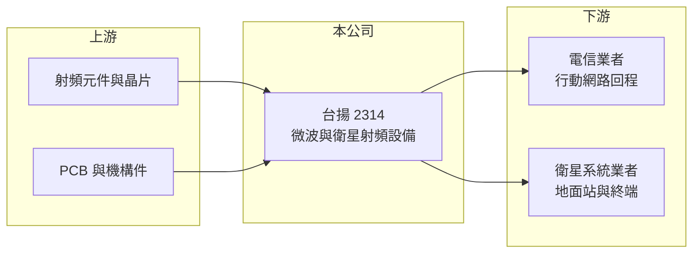

# 2314 台揚

> 上市｜[[產業索引-通信網路業|通信網路業]]｜上市（櫃）日期 1990/08/08

# 第一章：企業模式與商業藍圖

> [!info] 撰寫說明
> 精簡版，由 Claude 依公開資料整理，架構比照 [[2330台積電]] 的四章研究，資料截至 2026-10-08。來源：證交所開放資料（基本資料、綜合損益、資產負債、營益分析、股利、每月營收）、Goodinfo 年度經營績效、nStock 公司簡介。公開資料有限，產品與客戶描述多為整理性內容，尚未逐條比對原始文件。#待校對

本章說明台揚科技（股票代號：2314，以下簡稱台揚）靠什麼賺錢，以及它為何從老牌微波通訊廠走到需要轉型的處境。

- **核心業務：** 台揚成立於 1983 年，1990 年在台灣證券交易所上市，總部位於新竹科學園區。依公司登記的營業項目，台揚設計、生產及銷售[[微波通訊]]與[[衛星通訊]]產品，並依客戶規格承製相關產品。這類產品是電信網路與衛星地面站的射頻設備，負責把訊號在高頻段發射與接收，技術門檻在於高頻電路設計與穩定量產。
- **營收結構：** 公開資料未提供產品別營收比重。以業務性質來看，營收大致來自兩塊：一是電信業者行動網路回程用的點對點微波設備，二是衛星地面站與終端的射頻收發模組（待校對）。由於屬於專案與客製化出貨，單一客戶的訂單節奏對年度營收影響很大。
- **營運據點：** 公司總部與主要研發、生產集中在新竹科學園區，銷售對象以海外電信與衛星系統業者為主（待校對）。2011 年 1 月 1 日台揚與子公司連揚通訊合併，台揚為存續公司，這是公司近年少數有明確年份的組織調整。
- **長期方向：** 2023 年 10 月財經媒體報導台揚調整營運步伐、以[[低軌衛星]]為發展方向。低軌衛星需要大量地面閘道站與使用者終端，對射頻設備的需求是結構性的，但台揚能否在這個市場取得穩定的量產訂單，是決定公司能否走出長年虧損的關鍵。

# 第二章：護城河深度與競爭優勢

護城河指企業抵禦競爭、維持超額利潤的能力。本章評估台揚在射頻設備市場的競爭位置。

- **競爭優勢：** 台揚累積四十年的微波與衛星射頻設計經驗，具備高頻電路、天線介面與通訊系統整合的工程能力。這類產品需要長時間的客戶驗證，取得認證後客戶通常不會輕易更換供應商，這是台揚僅存的技術資產。不過從財務數字看，這項經驗並沒有轉化成定價能力，屬於「無護城河或極窄護城河」。
- **主要對手：** 微波通訊市場由 Ericsson、Nokia、華為等系統大廠主導，它們把微波設備與整套行動網路方案綁在一起銷售，台揚這類獨立設備廠很難在價格與規模上競爭。衛星射頻領域則有國際專業廠商與台灣的 [[3491昇達科]]、[[2313華通]] 等供應鏈公司在低軌衛星市場布局（對手名單為產業常識整理，待校對）。
- **觀察重點：** 第一，低軌衛星地面設備能否成為穩定的量產業務，而非一次性的專案出貨。第二，毛利率能否回到兩成以上，這代表產品是否具備基本的定價能力。第三，資本結構能否重建，因為淨值已降到極低水準，任何新業務都需要先解決財務體質問題。

# 第三章：財務體質與盈利規模

資料日期：2026-10-08。數字取自 Goodinfo 年度經營績效與證交所開放資料，表格是撰寫當時的快照；最新月營收、毛利率、累計 EPS 由自動排程寫在本筆記的屬性欄位（月營收、毛利率、累計EPS 等）。#待校對

財務報表是檢驗護城河是否存在的最終標準。台揚的數字清楚呈現一家連續虧損、規模持續縮小的設備廠。

| 年度 | 營收（新台幣） | [[毛利率]] | [[營業利益率]] | EPS（元） | [[ROE]] |
|---|---|---|---|---|---|
| 2020 | 39.5 億 | 18.7% | -3.47% | -0.42 | -3.76% |
| 2021 | 39.3 億 | 13.1% | -12.1% | -1.97 | -20.5% |
| 2022 | 44.8 億 | 14.0% | -9.34% | -2.06 | -24.1% |
| 2023 | 33.5 億 | 12.9% | -15.7% | -2.60 | -31.3% |
| 2024 | 16.7 億 | -8.25% | -64.8% | -4.55 | -85% |
| 2025 | 16.8 億 | -1.52% | -44.0% | -6.11 | -137% |
| 2026 上半年 | 8.29 億 | 9.51% | -29.84% | -1.69 | 未查得 |

註：2020 至 2025 年取自 Goodinfo 合併報表；2026 上半年取自證交所營益分析與綜合損益開放資料。

- **營收規模：** 營收從 2022 年的 44.8 億元降到 2024、2025 年的約 16.8 億元，五年間（2020 至 2025 年）年複合成長率約 -15.7%（推算）。依證交所每月營收資料，2026 年 1 至 8 月累計營收 9.72 億元，較去年同期成長約 19.7%，但規模仍遠低於 2022 年以前。
- **獲利：** 2020 至 2025 年連續六年虧損，2024 與 2025 年毛利率甚至轉負，代表出貨價格連製造成本都無法覆蓋，可能包含存貨跌價與產能閒置損失（推估）。2025 年稅後淨損 6.49 億元（證交所股利資料），2026 上半年營業損失 2.47 億元，靠業外收益 0.73 億元部分抵銷。
- **財務特色：** 依證交所資料，2026 年第二季底資產總計 30.80 億元、負債總計 30.51 億元，股東權益只剩 0.29 億元，每股淨值 0.27 元，2025 年度不配發股利。淨值偏低使 ROE 的分母極小，近年 ROE 數字因此失真，參考價值有限。
- **[[ROIC]] 與 [[WACC]]：** 以 2026 上半年營業損失 2.47 億元年化約 -4.95 億元（虧損不計稅盾），投入資本以股東權益 0.29 億元加非流動負債 7.92 億元（代替有息負債，官方快照未拆出借款）約 8.21 億元計算，ROIC 約 -60%（推算）；以 2025 年營業損失約 7.4 億元計算更低。WACC 以 CAPM 推估：台灣 10 年期公債約 1.75%、市場風險溢酬 6%、β 取 1.2（推估，虧損中小型通信設備股常見偏高值），權益成本約 9%；稅前負債成本假設 3%，稅後 2.4%，因權益極薄、以負債為主，帳面加權後 WACC 約 3% 至 4%，市值加權則接近 9%（推算）。不論採哪一種口徑，ROIC 都遠低於 WACC，代表公司長期在侵蝕股東與債權人投入的資本。

# 第四章：總體風險與地緣政治

本章整理台揚面對的產業與財務風險，其中財務體質是最直接的風險。

- **產業週期：** 微波與衛星設備屬於電信資本支出的下游，電信業者的網路建設週期與衛星星系的部署節奏決定需求，訂單常呈現大起大落。低軌衛星雖然是長期趨勢，但地面設備標準與供應商名單仍在變動，中小型設備廠容易在規格更替中被淘汰。
- **營運風險：** 營收規模縮小後固定費用占比升高，2025 年營業費用遠大於毛利，形成「營收越少、虧損率越高」的負循環。若無法盡快把新產品導入量產，產能利用率偏低會持續拖累毛利。
- **其他風險：** 淨值已接近零，依證交所資料保留盈餘在 2026 年第二季底仍為 -8.16 億元，未來可能需要減資彌補虧損或增資引進資金，股權稀釋與交易制度上的監理措施都是需要留意的風險（待校對）。營收以外幣計價為主，新台幣升值也會壓縮本已偏低的毛利。

# 專有名詞解析

## 應用

- **[[微波通訊]]**：以數 GHz 到數十 GHz 的電波在兩點之間傳輸資料，常用於基地台回程與偏遠地區連線。
- **[[衛星通訊]]**：透過地球軌道上的衛星中繼訊號，地面需要閘道站與使用者終端的射頻設備。
- **[[低軌衛星]]**：運行在約 500 至 2,000 公里高度的通訊衛星群，延遲較低，需大量地面接收設備，代表業者為 Starlink。

## 金融

- **[[ROIC]]**：投入資本報酬率，稅後營業利益除以股東權益與有息負債的合計，衡量本業對所有資金提供者的報酬。
- **[[WACC]]**：加權平均資金成本，依股東權益與負債的比重加權計算的資金成本，ROIC 高於它才代表創造價值。

# 核心供應鏈

- 上游：射頻晶片與化合物半導體元件（如 [[3105穩懋]] 供應鏈）、印刷電路板與機構件，供應商名單公司未公開（待校對）。
- 下游／客戶：海外電信業者與衛星系統業者，客戶名稱公開資料未查得。
- 同業：[[3491昇達科]]、[[2313華通]]（低軌衛星供應鏈）、[[2485兆赫]]、[[2424隴華]]；國際系統大廠 Ericsson、Nokia。

## 最新新聞
<!-- news:start -->
<!-- news:end -->

## 相關連結
- [公開資訊觀測站](https://mopsov.twse.com.tw/mops/web/t05st03?step=1&firstin=1&co_id=2314)
- [Goodinfo](https://goodinfo.tw/tw/StockDetail.asp?STOCK_ID=2314)
- [Yahoo 股市](https://tw.stock.yahoo.com/quote/2314)
- [鉅亨網新聞](https://www.cnyes.com/twstock/2314/news)
