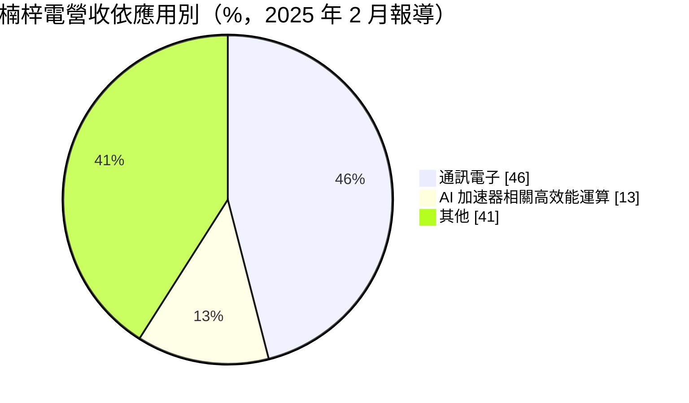
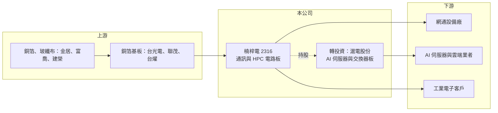

# 2316 楠梓電

> 上市｜[[產業索引-電子零組件業|電子零組件業]]｜上市（櫃）日期 1991/02/05

# 第一章：企業模式與商業藍圖

> [!info] 撰寫說明
> 精簡版，由 Claude 依公開資料整理，架構比照 [[2330台積電]]，資料截至 2026-10-08。來源：證交所開放資料快照（基本資料、2026 年第二季資產負債與損益、股利）、Goodinfo 經營績效頁、優分析 2025 年 2 月報導。與滬電股份的持股比例、會計處理與生產據點為憑記憶整理，#待校對。

楠梓電子（以下簡稱楠梓電）是台灣老牌[[PCB]]廠，但它最重要的特徵不是自己的工廠，而是對中國 PCB 大廠滬電股份（滬士電子，深圳上市 002463）的長期持股。理解楠梓電，必須同時看「本業 PCB」與「轉投資滬電」兩條線。

- **核心業務：** 楠梓電成立於 1978 年，1991 年上市，總部在高雄，生產用於通訊設備、工業電子與高效能運算的多層印刷電路板。本業營收由 2021 年約 53.5 億元降到 2024 年約 33.3 億元，規模在台灣 PCB 廠中屬於中小型。公司正把產品轉向 AI 與[[高效能運算]]相關的高階板，以提高單價與毛利。
- **營收結構：** 依優分析 2025 年 2 月報導，通訊電子約占 46%，AI 加速器相關高效能運算約 13%，公司預期高效能運算比重可再提升 5 至 6 個百分點。其餘為工業電子等應用（圓餅圖「其他」為推算）。
- **營運據點：** 公司登記地址在高雄，生產據點包括台灣與中國（具體廠區憑記憶為高雄楠梓與中國江蘇一帶，#待校對）。真正規模龐大的產能其實在轉投資的滬電，滬電在江蘇昆山、黃石等地設廠，是全球 AI 伺服器與高速交換器主機板的重要供應商（#待校對）。
- **長期方向：** 楠梓電的長期價值高度取決於滬電的成長，而滬電受惠 AI 伺服器、高速網通對高層數板的需求。本業方面則是把產品組合往高效能運算移動，減少本業虧損。對投資人而言，楠梓電較接近「滬電的控股公司加上一個小型 PCB 本業」。

# 第二章：護城河深度與競爭優勢

楠梓電的護城河主要不在本業，而在它持有的滬電股權；本業則屬於規模不足、需要轉型的競爭者。

- **競爭優勢：** 楠梓電透過長期持股與滬電維持密切的集團關係（持股約兩成，#待校對），能分享滬電在高階通訊板與 AI 伺服器板的技術與客戶成果。滬電是全球高速網通與伺服器 PCB 的主要廠商之一，這份股權是楠梓電最核心的資產。本業本身在通訊板領域累積了數十年經驗，但規模有限。
- **主要對手：** 本業競爭者包括 [[2368金像電]]、[[2313華通]]、[[3044健鼎]]、[[3037欣興]]、2355敬鵬 等台灣 PCB 廠，它們在伺服器與網通板的規模都遠大於楠梓電。中國的深南電路、生益電子等也在高階通訊板與滬電、楠梓電競爭。
- **觀察重點：** 長期最重要的是滬電獲利能否延續 AI 伺服器與交換器的成長，以及楠梓電本業能否擺脫連續多年的營業虧損。2023 至 2025 年本業毛利率為負，代表本業規模不足以涵蓋成本；高效能運算比重提高後毛利能否轉正，是本業轉型成敗的指標。

# 第三章：財務體質與盈利規模

資料日期：2026-10-08，表格是撰寫當時的快照；最新月營收、毛利率、累計 EPS 由自動排程寫在本筆記的屬性欄位（月營收、毛利率、累計EPS 等）。#待校對

楠梓電的財報呈現「本業虧損、業外大賺」的鮮明對比，分析時必須把兩者拆開看。

| 年度 | 營收（億元） | [[毛利率]] | [[營業利益率]] | EPS（元） | [[ROE]] |
|---|---|---|---|---|---|
| 2020 | 47.8 | 3.98% | -4.29% | 2.14 | 5.67% |
| 2021 | 53.5 | 8.26% | 0.18% | 2.94 | 7.10% |
| 2022 | 51.3 | 3.53% | -4.82% | 2.81 | 6.49% |
| 2023 | 35.2 | -7.82% | -18.8% | 4.61 | 9.87% |
| 2024 | 33.3 | -4.76% | -16.9% | 4.28 | 8.27% |
| 2025 | 37.4 | -0.47% | -13.2% | 13.38 | 21.6% |

（來源：Goodinfo 經營績效頁。2025 年業外損益約 37.1 億元、營業損失約 4.93 億元。）

- **營收規模：** 2020 至 2025 年本業營收年複合成長率約 -4.8%（推算）。2025 年營收回升到 37.4 億元，2026 年 1 至 8 月累計營收年增約四成，公司說明是終端客戶需求增加，顯示產品轉型開始帶來成長。
- **獲利：** 近五年（2021 至 2025）平均 ROE 約 10.7%（推算），但本業營業利益幾乎每年都是負的。EPS 的來源主要是[[轉投資收益]]，2025 年 EPS 13.38 元、ROE 21.6%，反映的是滬電在 AI 伺服器板的高獲利，而不是楠梓電自身工廠。
- **財務特色：** 2026 年第二季總資產約 212 億元，其中非流動資產約 135 億元，多數是轉投資；股東權益約 144 億元，每股淨值約 79.6 元，保留盈餘約 112 億元。公司章程採剩餘股利政策，2025 年度現金股利 2.0 元，配息率約 15%（推算），2024 年度為 0.5 元，配息偏保守，大部分盈餘留在公司。自由現金流未查得。
- **[[ROIC]] 與 [[WACC]]：** 以本業計算，2025 年營業利益約 -4.93 億元，虧損不計稅；有息負債未查得，以權益約 144 億元為投入資本下限，ROIC 約 -3.4%（推算），本業明顯未賺回資金成本。若把轉投資收益視為報酬，整體資本報酬接近 ROE 的 21.6%。WACC 以 CAPM 推估：無風險利率 1.75%、市場風險溢酬 6%、β 假設 1.0（PCB 族群常見值），權益成本約 7.75%；稅後負債成本 2%、負債占 15%，WACC 約 6.9%（推算）。結論是：楠梓電整體創造的價值幾乎全部來自滬電股權，本業則長期侵蝕價值。

# 第四章：總體風險與地緣政治

楠梓電的風險同時來自滬電所在的中國與 AI 供應鏈，以及自身本業的轉型。

- **產業週期：** PCB 需求隨通訊、伺服器與消費電子週期波動，AI 伺服器雖帶來強勁需求，但資本支出循環一旦放緩，高階板報價與稼動率會快速回落。楠梓電的獲利高度依賴滬電，等於把 AI 伺服器週期的波動直接放大到自己的 EPS。
- **營運風險：** 本業規模小、連年虧損，若高效能運算產品無法放量，本業虧損將持續拖累整體獲利。轉投資收益波動大，可能使 EPS 在不同年度出現數倍差距。
- **其他風險：** 滬電在中國生產並在深圳上市，受美中科技管制、關稅與兩岸政策影響；投資收益與股利匯回也受人民幣匯率影響。銅箔基板、銅等原物料價格上漲則會壓縮本業毛利。

# 專有名詞解析

## 應用

- **[[高效能運算]]**：HPC，指 AI 伺服器、資料中心等需要大量運算的系統，對高層數、高速傳輸的電路板需求高。

## 金融

- **[[轉投資收益]]**：公司持有其他公司股權所認列的獲利或股利，屬業外收入，波動取決於被投資公司的表現。

## 產業

- **[[PCB]]**：印刷電路板，用銅線路連接電子元件的基板，是所有電子產品的骨架。

# 核心供應鏈

- 上游：銅箔基板 [[2383台光電]]、[[6213聯茂]]、[[6274台燿]]；銅箔 8358金居；玻纖布 1815富喬、5340建榮。
- 下游／客戶：網通設備與工業電子客戶；轉投資滬電的主要客戶為 AI 伺服器與高速交換器廠商，例如 [[NVDA輝達]] 供應鏈與 [[CSCO思科]]（#待校對）。
- 同業：[[2368金像電]]、[[2313華通]]、[[3044健鼎]]、[[3037欣興]]、2355敬鵬、[[2367燿華]]，以及中國的滬電股份、深南電路。

## 最新新聞
<!-- news:start（自動產生，請勿手動編輯此範圍） -->
- 2026-10-20 🏛️ 重訊 16:06｜代重要子公司昆山先創電子有限公司公告取得及處分理財產品｜[觀測站](https://mops.twse.com.tw/mops/#/web/t05st01)
- 2026-10-19 🏛️ 重訊 17:01｜公告本公司國內第一次無擔保轉換公司債收足債款｜[觀測站](https://mops.twse.com.tw/mops/#/web/t05st01)

完整紀錄：[[2316楠梓電 新聞]]
<!-- news:end -->

## 相關連結
- [公開資訊觀測站](https://mopsov.twse.com.tw/mops/web/t05st03?step=1&firstin=1&co_id=2316)
- [Goodinfo](https://goodinfo.tw/tw/StockDetail.asp?STOCK_ID=2316)
- [Yahoo 股市](https://tw.stock.yahoo.com/quote/2316)
- [鉅亨網新聞](https://www.cnyes.com/twstock/2316/news)
