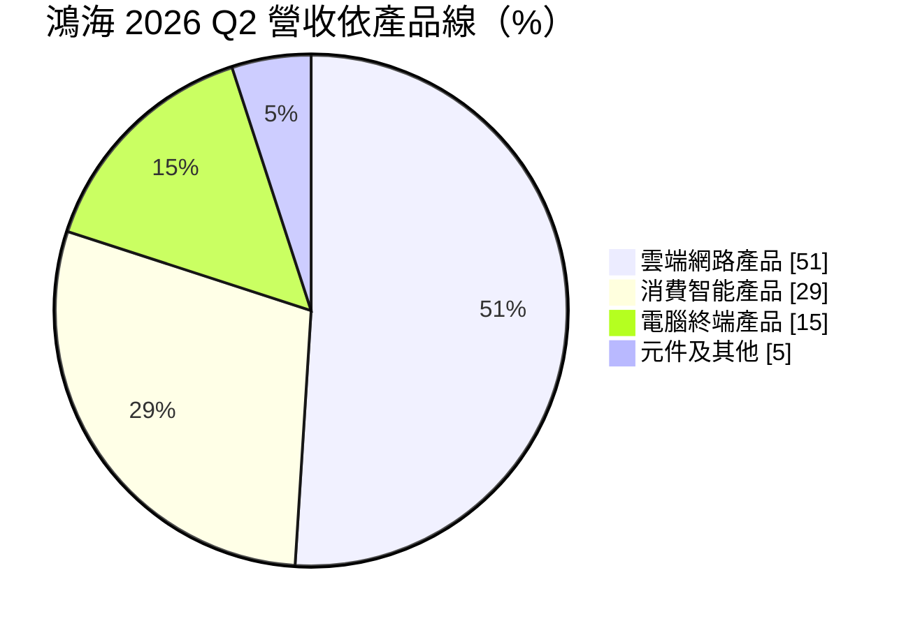
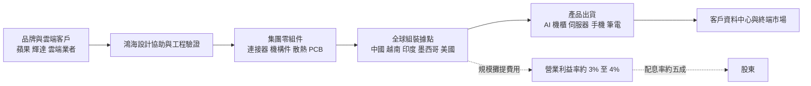
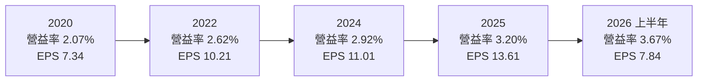
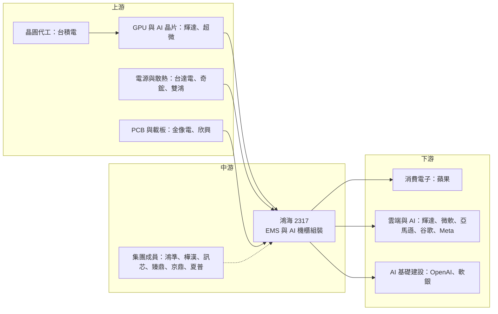

# 2317 鴻海

> 上市｜[[產業索引-其他電子業|其他電子業]]｜上市（櫃）日期 1991/06/18

# 第一章：企業模式與商業藍圖

> [!info] 撰寫說明
> 本文由 Claude 依公開資料整理，架構比照 [[2330台積電]] 的四章研究，資料截至 2026-10-08。財務數字來源：Goodinfo 經營績效、股利政策與現金流量頁（2020 至 2025 年度）、證交所開放資料快照（2026 年第二季資產負債與綜合損益、2025 年度股利、公司基本資料）、鴻海 2025 年第四季與 2026 年第一、二季法說會內容（自由時報、富果研究、INSIDE、理財周刊、工商時報整理）；產業描述為整理性內容，尚未逐條比對原始文件。#待校對

在評估單一個股的長期投資價值時，首要步驟是拆解企業的底層獲利邏輯。本章針對鴻海精密（股票代號：2317，國際名稱 Foxconn / Hon Hai Technology Group，以下簡稱鴻海）的商業模式進行定性分析，說明一家毛利率只有 6% 上下的代工廠，如何靠規模與垂直整合累積每年近 2,000 億元的淨利，以及它正在從「蘋果代工廠」轉向「AI 資料中心硬體供應商」的過程。

## 一、核心定位：全球最大的電子代工服務廠，正轉型為 AI 基礎建設供應商

鴻海成立於 1974 年，從生產黑白電視旋鈕的塑膠零件起家，1991 年上市，逐步發展為全球規模最大的電子代工服務（[[EMS]]）廠。它的商業模式是替品牌客戶提供設計協助、零組件垂直整合與大規模組裝，以「規模、垂直整合、全球製造據點」換取極低的單位成本。

鴻海不賣自有品牌的主力終端產品，因此能同時服務彼此競爭的品牌客戶，這和 [[2330台積電]] 不賣自有品牌晶片的邏輯類似。兩者的差別在於附加價值：台積電靠製程技術收取高毛利，鴻海則是在極薄的毛利上靠周轉與規模賺錢。這種模式有兩個長期特徵：

* **以量取勝的獲利結構：** 2025 年營收約 8.1 兆元新台幣，[[毛利率]]約 6%、[[營業利益率]]約 3%。毛利率很難大幅提升，但營收每成長一成，就是數百億元的營業利益增量。因此鴻海的投資邏輯不在於利潤率擴張，而在於能否持續找到「下一個超大量的產品」。
* **身分隨客戶需求轉換：** 2000 年代起，鴻海最為人熟知的身分是 [[AAPL蘋果]] iPhone 的主要組裝廠；2023 年 AI 伺服器需求爆發後，它憑藉從零組件、主機板、伺服器到整座機櫃的垂直整合能力，成為 [[NVDA輝達]] GB200、GB300 等 [[AI 機櫃]]的主要組裝夥伴。2026 年第二季雲端網路產品占營收比重首次突破五成，代表鴻海的主要身分已從消費電子代工轉為 AI 基礎建設供應商。

## 二、終端應用板塊：雲端網路首度過半

鴻海將營收分為四大產品線，2026 年第二季比重如下：

比重變化比單季數字更能說明轉型速度：

| 產品線 | 2024 | 2025 | 2026 Q1 | 2026 Q2 |
|---|---|---|---|---|
| 雲端網路產品 | 30% | 40% | 48% | 51% |
| 消費智能產品 | 46% | 38% | 33% | 29% |
| 電腦終端產品 | 未查得 | 15% | 14% | 15% |
| 元件及其他 | 未查得 | 7% | 5% | 5% |

* **雲端網路產品：** 一般伺服器、AI 伺服器、AI 機櫃、交換器與網通設備。客戶涵蓋美系雲端服務商（[[MSFT微軟]]、[[AMZN亞馬遜]]、[[GOOGL谷歌]]、[[META臉書]] 等）與輝達。除了輝達 GPU 機櫃，鴻海也承接雲端業者自研 [[ASIC]] 晶片的伺服器專案，讓它不必完全押注單一 AI 晶片供應商。
* **消費智能產品：** 智慧型手機、穿戴裝置、智慧家庭等，以蘋果為最大客戶。營收規模仍大，但手機市場已成熟，比重兩年內從 46% 降到 29%，從成長引擎轉為穩定的現金來源。
* **電腦終端產品：** 筆電、桌機、平板等，比重穩定在一成半上下，跟隨 PC 換機週期起伏。
* **元件及其他：** 連接器、機構件、半導體與電動車相關業務等，也包括集團旗下子公司的零組件業務。

## 三、資本轉化邏輯：垂直整合的規模機器

* **垂直整合降低成本與交期：** 鴻海集團旗下有連接器、機構件、散熱、PCB、模組到整機組裝的能力。AI 機櫃牽涉 GPU 板卡、交換器、[[液冷]]、電源、線纜與整櫃測試，自家掌握越多環節，越能縮短驗證時間、控制[[良率]]。在新平台導入初期，能最快把良率拉上來的代工廠，通常也拿到最多的訂單。
* **全球據點分散：** 鴻海在中國（深圳、鄭州、成都等）、越南、印度、墨西哥、美國、捷克、匈牙利等地都設有工廠。近年加速在印度擴充 iPhone 產能，並在墨西哥與美國德州擴建 AI 伺服器廠。蘋果於 2025 年宣布與鴻海在德州休士頓合作建置 AI 伺服器組裝廠，供應自家資料中心。
* **[[營運槓桿]]：** 毛利率大致持平，但營收放大後研發與管理費用被攤薄，營業利益率從 2020 年的 2.07% 逐年升到 2025 年的 3.20%、2026 年上半年的 3.67%。對代工業而言，一個百分點以上的改善，就是產品結構轉型最直接的成績單。

## 四、企業長期藍圖：「3+3」策略與 AI 基礎建設

董事長劉揚偉在 2019 年接任後提出「3+3」策略：三大新興產業為電動車、數位健康、機器人；三大新技術為人工智慧、半導體、新世代通訊。實際執行上，AI 伺服器已成為最主要的成長引擎，電動車與半導體仍在投入期。

* **AI 伺服器與機櫃：** 媒體估計鴻海在 AI 伺服器組裝市場的市占率約四成以上，公司目標在 ASIC 伺服器也取得四成以上市占。AI 機櫃單價高、整合難度高，讓鴻海得以把規模優勢延伸到新一代產品。
* **與 OpenAI、軟銀的合作：** 2025 年下半年起，鴻海證實與 OpenAI 合作在美國打造 AI 基礎設施硬體，涵蓋多個世代的資料中心機櫃與零組件，並在俄亥俄州生產；同時與軟銀合作建置模組化資料中心。這代表鴻海的客戶從「品牌與雲端業者」延伸到「AI 模型公司與資料中心開發商」。
* **電動車：** 透過鴻華先進等平台推動 MIH 開放電動車平台與委託設計製造（[[CDMS]]），目前對營收與獲利的貢獻仍小，屬長期布局。
* **併購與轉投資：** 鴻海在 2016 年取得日本 [[6753夏普]] 的控股權（金額與持股比例待校對），是台灣企業規模最大的海外併購之一。集團旗下另有 [[2354鴻準]]、6414樺漢、[[4958臻鼎-KY]] 等上市公司，構成垂直整合的基礎。
* **擴產：** 2026 年上半年 [[CapEx]] 809 億元，公司預期全年年增三成以上，主要用於伺服器、機櫃、液冷與測試產能。

# 第二章：護城河深度與競爭優勢

在長期價值投資中，「護城河」指企業抵禦競爭、維持超額利潤的保護機制。代工產業毛利率低、客戶議價能力強，鴻海的護城河不是來自定價權，而是來自別人難以複製的規模與整合能力。本章分析這些優勢的構成、全球主要競爭對手，以及它們在 AI 伺服器分食戰中能守住多少。

## 一、鴻海護城河的核心組成要素

* **1. 規模經濟與採購議價力：** 2025 年營收約 8.1 兆元，龐大的採購量讓鴻海在零組件、物流與產能調度上具備成本優勢。能在短時間內把新產品拉到數百萬台、數萬座機櫃的規模，全世界只有少數廠商做得到，這種「量產爬坡能力」是品牌客戶最看重的條件之一。
* **2. 垂直整合：** 從連接器、機構件、散熱、PCB 到整機組裝，集團內就能完成大部分環節。AI 機櫃的液冷、電源與高速互連整合難度高，垂直整合讓鴻海更能掌握交期與良率，也能在零組件短缺時優先供應自家組裝線。
* **3. 全球製造據點：** 中國、越南、印度、墨西哥、美國等多地產能，讓客戶在關稅與地緣政治變化下能快速移轉生產地點。這項能力需要數十年的投資與當地營運經驗，新進者很難在短期內複製。
* **4. 與核心客戶的長期關係：** 與蘋果合作超過二十年、與輝達在 AI 機櫃上的早期合作，讓鴻海常能拿到新平台的首批訂單。代工客戶最怕新產品上市延誤，長期合作累積的信任是重要的轉換成本。

## 二、全球主要競爭對手格局

| 對手 | 定位 | 對鴻海的威脅 |
|---|---|---|
| [[2382廣達]] | AI 伺服器 [[ODM]] 龍頭，與雲端業者關係深 | ASIC 伺服器與直接出貨雲端業者的模式具優勢 |
| [[3231緯創]]、[[6669緯穎]] | 緯創做輝達 GPU 基板，緯穎專注美系雲端 | 分食 GPU 基板與雲端伺服器訂單 |
| [[2356英業達]]、[[2376技嘉]] | 伺服器代工與品牌伺服器 | 在中小型雲端與企業伺服器競爭 |
| [[4938和碩]]、立訊精密 | 消費電子組裝 | 立訊受中國支持，持續爭取蘋果訂單 |
| Jabil、Flex、Celestica | 美系 EMS 業者 | 在網通與部分雲端伺服器專案上競爭 |

鴻海的競爭格局有兩個戰場。在 AI 伺服器，對手是廣達、緯創、緯穎等台灣 ODM，彼此各有擅長的客戶與產品；在消費電子，主要對手是中國的立訊精密，它在蘋果供應鏈的份額逐年提高。

## 三、優勢轉化：哪些市場守得住、哪些守不住

* **守得住：** 大規模 AI 機櫃的整櫃組裝與交期。這類產品對資金、產能與供應鏈整合要求極高，鴻海的規模優勢明顯，2024 至 2026 年雲端網路產品比重從 30% 升到 51% 就是證明。
* **守不住：** 鴻海本質仍是代工，2020 至 2025 年毛利率始終在 5.6% 至 6.3% 之間。客戶通常會刻意維持兩家以上供應商，雲端業者也會把 ASIC 伺服器分給廣達、緯穎等對手，市占很難無限擴大；消費電子方面，立訊精密持續侵蝕蘋果訂單份額（定性描述）。
* **觀察重點：** 第一，營業利益率能否在 AI 營收占比上升下持續改善，站穩 3.5% 至 4%；第二，ASIC 伺服器四成市占目標能否達成，降低對輝達單一平台的依賴；第三，美國、墨西哥新廠投產後的獲利表現，能否不被較高的在地成本吃掉。

# 第三章：財務體質與盈利規模

資料日期：2026-10-08。年度數字取自 Goodinfo 經營績效與現金流量頁，2026 年上半年與資產負債取自證交所開放資料快照，表格是撰寫當時的快照；最新月營收、毛利率、累計 EPS 由自動排程寫在本筆記的屬性欄位（月營收、毛利率、累計EPS 等）。#待校對

財務報表是檢驗護城河是否真實存在的最終標準。本章用多年度的三率、ROE、現金流與資本報酬，檢視鴻海「薄利多銷」模式的穩定度，以及 AI 營收快速放大後的獲利品質。

## 一、獲利能力的基石：三率

| 年度 | 營收（億元） | [[毛利率]] | [[營業利益率]] | EPS（元） | [[ROE]] |
|---|---|---|---|---|---|
| 2020 | 53,580 | 5.65% | 2.07% | 7.34 | 7.96% |
| 2021 | 59,942 | 6.04% | 2.49% | 10.05 | 10.1% |
| 2022 | 66,270 | 6.04% | 2.62% | 10.21 | 9.37% |
| 2023 | 61,622 | 6.30% | 2.70% | 10.25 | 9.28% |
| 2024 | 68,596 | 6.25% | 2.92% | 11.01 | 9.71% |
| 2025 | 81,031 | 6.15% | 3.20% | 13.61 | 11.3% |
| 2026 上半年 | 46,454 | 6.15% | 3.67% | 7.84 | 未查得（Goodinfo 年化約 12.4%） |

* **營收成長：** 2020 至 2025 年營收從 5.36 兆元增加到 8.10 兆元，年複合成長率約 8.6%（推算）。2023 年曾因消費電子需求疲弱而衰退，2024 年起在 AI 伺服器帶動下重回成長，2025 年年增 18%。
* **[[毛利率]]：** 六年來都在 5.65% 至 6.30% 之間，幾乎沒有變化。AI 機櫃中 GPU 等高價料件占成本比重高，拉高營收但不一定拉高毛利率，這是代工業的結構限制，也說明鴻海的毛利率不是觀察重點。
* **[[營業利益率]]：** 從 2020 年 2.07% 一路升到 2025 年 3.20%，2026 年上半年 3.67%，五年間幾乎每年都在改善。在毛利率持平的情況下，營業利益率上升代表費用攤提效益與產品組合改善，這是鴻海轉型最重要的財務證據。
* **[[淨利率]]：** 2025 年稅後淨利 1,894 億元，淨利率約 2.3%（推算），仍是典型的薄利多銷結構。

## 二、[[ROE]]：資本效率

鴻海 2021 至 2025 年平均 ROE 約 10.0%（推算），2021 至 2024 年穩定在 9% 至 10%，2025 年提升到 11.3%。代工業毛利率低，ROE 主要靠高資產周轉率支撐，而不是高利潤率；營業利益率每提升 0.1 個百分點，在 8 兆元的營收基礎上就是約 80 億元的營業利益增量。

2026 年第二季底，歸屬母公司股東權益約 1.91 兆元，權益總計約 2.12 兆元，每股淨值約 136 元；負債總額約 3.50 兆元，主要是應付帳款等營運負債。依法說資料，帳上現金加定存約 1.52 兆元，淨現金約 2,198 億元，財務結構穩健。

股利方面，2020 至 2025 年度現金股利分別為 4.0、5.2、5.3、5.4、5.8、7.2 元，以當年 EPS 計算的配息率都在 52% 至 55% 之間（推算），是台股大型權值股中配息政策最穩定的公司之一。股利金額六年間成長約八成，與 EPS 成長幅度相當。

## 三、資本支出與自由現金流

| 年度 | 營業現金流（億元） | 投資現金流（億元） | 自由現金流（億元） |
|---|---|---|---|
| 2020 | 3,776 | 346 | 4,122 |
| 2021 | -982 | -921 | -1,903 |
| 2022 | 1,097 | -454 | 643 |
| 2023 | 4,456 | -1,379 | 3,077 |
| 2024 | 1,660 | -3,000 | -1,340 |
| 2025 | 2,269 | -3,047 | -778 |

（自由現金流依 Goodinfo 定義為營業現金流加投資現金流；鴻海的投資現金流包含定存與金融資產的進出，波動很大。）

* **[[自由現金流]]：** 鴻海的自由現金流波動非常大，六年中有三年為負。主要原因是[[營運資金]]：代工廠的存貨與應收帳款隨出貨量大幅變動，2021 年零組件缺料時大量備料，營業現金流甚至轉負。2024 至 2025 年的負值則同時反映 AI 機櫃出貨放大占用的營運資金，以及投資現金流中的資本支出與金融資產配置。評估鴻海時，應看多年累計的現金流，而不是單一年度。
* **[[CapEx]]：** 相對 8 兆元營收，資本支出占營收比例很低，鴻海屬於輕資本密集的組裝業。2026 年預期年增三成以上，主要用於 AI 伺服器、液冷與測試產能。

## 四、[[ROIC]] 與 [[WACC]]：價值創造利差

企業長期創造價值的條件，是投入資本報酬率（ROIC）高於加權平均資金成本（WACC）。

**ROIC（推算）：** 本文以「稅後營業利益 ÷（股東權益＋有息負債）」推算。2025 年營業利益約 81,031 億元 × 3.20% ≈ 2,593 億元，以稅率 20% 計算稅後營業利益約 2,074 億元。有息負債以法說資料的現金約 1.52 兆元減淨現金約 2,198 億元推算，約 1.30 兆元（推算）；加上權益總計約 2.12 兆元，投入資本約 3.42 兆元，ROIC 約 6.1%（推算）。若扣除帳上現金、只計算營運實際占用的資本（約 1.90 兆元），ROIC 約 10.9%（推算）。以 2026 年上半年營業利益約 1,705 億元年化計算，兩種口徑分別約 8.0% 與 14%（推算）。

**WACC（推算）：** 以 CAPM 推估股東權益成本：無風險利率取台灣 10 年期公債約 1.75%，市場風險溢酬 6%，β 假設 1.0（大型權值股常見值，非來源數字），權益成本約 7.75%。鴻海有相當比例的美元借款，負債成本假設稅前 3%、稅率 20%，稅後 2.4%（推估）。以帳面資本結構（權益 62%、負債 38%）計算，WACC 約 5.7%；以市值計算（股價淨值比約 1.9 倍，負債權重約 27%），WACC 約 6.3%（推算）。

**結論：** 鴻海的 ROIC 約 6% 至 11%，略高於 5.7% 至 6.3% 的 WACC，屬於「薄而穩」的價值創造。2020 至 2024 年 ROE 約一成、營業利益率不到 3%，利差更薄。AI 營收占比提高後，若營業利益率能站穩 3.5% 至 4%，利差有機會擴大；反之若新廠投產初期效率不佳、營運資金占用增加，利差會被壓縮。

# 第四章：總體風險與地緣政治

任何企業都無法脫離宏觀環境獨立存在。本章分析鴻海未來必須面對的地緣政治、產業週期與營運風險，以及 AI 平台快速換代帶來的技術挑戰。作為全球最大的電子代工廠，鴻海幾乎暴露在所有的國際貿易與科技政策變化之下。

## 一、地緣政治風險

* **中國生產基地：** 鴻海大量產能仍在中國，美中科技與貿易衝突可能影響出口、人員與供應鏈。中國對特定產業的人才與設備外移限制，也會增加產能移轉的難度與成本。
* **美國關稅與在地製造：** 美國對進口電子產品與伺服器的關稅政策變動頻繁，鴻海以墨西哥、德州、俄亥俄州等據點因應。但美國新廠的人力與營運成本較高，在毛利率僅約 6% 的結構下，成本差異可能明顯壓縮利潤。
* **印度擴產：** 印度是 iPhone 產能分散的重點，但當地基礎建設、法規與勞工管理仍存在執行風險。

## 二、產業週期與市場結構風險

* **AI 資本支出週期：** 雲端網路產品已占營收五成以上，若美系雲端業者或 AI 模型公司放緩資料中心投資，鴻海營收成長會明顯受影響。這是鴻海過去以消費電子為主時所沒有的週期曝險。
* **客戶集中：** 蘋果、輝達與少數雲端業者占營收比重高，單一客戶的產品策略、供應商分配或自身營運變化，對鴻海影響很大。
* **[[長鞭效應]]：** 雲端業者調整建置節奏時，訂單變化會沿伺服器、零組件一路放大，代工廠的存貨與產能利用率首當其衝。
* **消費電子成熟：** 智慧型手機與 PC 市場成熟，消費智能產品營收成長有限，未來主要扮演現金來源的角色。

## 三、營運環境的隱性風險

* **低毛利的放大效應：** 毛利率約 6%，任何零組件缺料、良率問題或新平台轉換延遲，都可能吃掉大部分利潤。AI 機櫃的液冷與高功耗設計複雜度高，量產初期容易出現調校問題。
* **營運資金與匯率：** AI 機櫃單價高，存貨與應收帳款大幅增加，需注意現金周轉與匯率避險。鴻海營收以美元為主，新台幣升值會影響以台幣計算的獲利。
* **新事業投入：** 電動車與半導體仍在投入期，若長期無法獲利，會拖累整體報酬率；夏普等轉投資的經營狀況，也會透過業外損益影響鴻海。

## 四、科技演進與法規風險

* **AI 平台世代交替快：** 輝達每年推出新平台，代工廠必須不斷投入新產線與測試設備，若在某一世代失去主要份額，後續追趕成本高。
* **雲端業者自研晶片：** ASIC 伺服器的設計與供應商選擇主要由雲端業者決定，代工廠議價力有限。
* **ESG 與勞動法規：** 大型組裝廠長期面臨勞動條件、用電與碳排的監督壓力，國際客戶對供應鏈減碳的要求持續提高，可能增加營運成本。

# 專有名詞解析

## 半導體

- **[[ASIC]]**：特定應用積體電路，為單一用途客製的晶片，例如雲端業者自研的 AI 加速器。
- **[[良率]]**：合格產品占總產出的比例，組裝業的良率直接影響重工成本與交期。

## 金融

- **[[營運槓桿]]**：固定費用占比高時，營收小幅成長即可帶動營業利益大幅成長的現象。
- **[[營運資金]]**：支應存貨、應收帳款等日常營運所需的資金，出貨規模放大時占用會同步增加。
- **[[ROE]]**：股東權益報酬率，稅後淨利除以股東權益，衡量公司運用股東資本賺錢的效率。
- **[[ROIC]]**：投入資本報酬率，稅後營業利益除以股東權益加有息負債，衡量公司投入營運的全部資本能賺多少。
- **[[WACC]]**：加權平均資金成本，股東與債權人要求報酬率的加權平均，是 ROIC 的比較基準。
- **[[自由現金流]]**：營業活動現金流減去資本支出，代表企業可自由用於配息、還債或併購的現金。
- **[[長鞭效應]]**：終端需求的小幅變動，沿供應鏈往上游傳遞時被逐級放大，造成上游庫存與訂單劇烈波動。

## 產業

- **[[EMS]]**：電子代工服務，替品牌客戶進行零組件採購、組裝與測試，本身不賣自有品牌產品，代表廠商為鴻海。
- **[[ODM]]**：原廠委託設計製造，代工廠除了生產也負責產品設計，品牌商只提出規格，廣達、緯穎屬此類。
- **[[AI 機櫃]]**：把多台 GPU 伺服器、交換器、電源與散熱整合在一座機櫃內整櫃出貨的產品，例如輝達 GB200 NVL72。
- **[[液冷]]**：以冷卻液取代風扇帶走晶片熱量的散熱方式，AI 機櫃功耗動輒上百千瓦，逐漸成為標配。
- **[[CDMS]]**：委託設計製造服務，鴻海用於電動車業務的模式，替車廠從設計到量產一手包辦。

# 核心供應鏈

## 1. 上游：晶片與關鍵零組件
- GPU 與 AI 晶片：[[NVDA輝達]]、[[AMD超微]]
- 晶圓代工：[[2330台積電]]
- 電源與散熱：[[2308台達電]]、[[3017奇鋐]]、[[3324雙鴻]]
- PCB 與載板：[[2368金像電]]、[[3037欣興]]

## 2. 中游：鴻海本身與集團成員
- 機構件與散熱：[[2354鴻準]]
- 工業電腦與系統整合：6414樺漢
- 系統級封裝模組：[[6451訊芯-KY]]
- PCB：[[4958臻鼎-KY]]
- 半導體設備零組件：[[3413京鼎]]
- 日本子公司：[[6753夏普]]

## 3. 下游：主要客戶
- 消費電子：[[AAPL蘋果]]
- AI 與雲端伺服器：[[NVDA輝達]]、[[MSFT微軟]]、[[AMZN亞馬遜]]、[[GOOGL谷歌]]、[[META臉書]]
- AI 基礎建設合作：OpenAI、軟銀

## 4. 同業：伺服器與電子代工
- [[2382廣達]]、[[3231緯創]]、[[6669緯穎]]、[[2356英業達]]、[[4938和碩]]

延伸閱讀：[[台積電供應鏈]]

## 最新新聞
<!-- news:start（自動產生，請勿手動編輯此範圍） -->
- 2026-10-21 📰 媒體 17:17｜外資中止連10賣！台股期現貨齊翻多 買超友達、鴻海及南亞各逾2萬張｜[鉅亨網](https://news.cnyes.com/news/id/6635076)
- 2026-10-20 📰 媒體 14:06｜高盛再上調AI伺服器展望 點名鴻海、緯穎等供應鏈受惠｜[鉅亨網](https://news.cnyes.com/news/id/6634126)
- 2026-10-17 📰 媒體 20:00｜美啟動337專利調查，廣達、鴻海、台達電危險了？法人：真正的利空根本不是專利！「這場危機」才可怕！｜[鉅亨網](https://news.cnyes.com/news/id/6632760)
- 2026-10-16 📰 媒體 19:23｜鴻海擬斥236億元取得三菱電機移動50%股權 共同經營汽車設備事業｜[鉅亨網](https://news.cnyes.com/news/id/6632272)
- 2026-10-16 🏛️ 重訊 18:30｜代子公司利億國際投資股份有限公司公告取得Mitsubishi Electric Mobility Corporation股份｜[觀測站](https://mops.twse.com.tw/mops/#/web/t05st01)

完整紀錄：[[2317鴻海 新聞]]
<!-- news:end -->

## 相關連結
- [公開資訊觀測站](https://mopsov.twse.com.tw/mops/web/t05st03?step=1&firstin=1&co_id=2317)
- [Goodinfo](https://goodinfo.tw/tw/StockDetail.asp?STOCK_ID=2317)
- [Yahoo 股市](https://tw.stock.yahoo.com/quote/2317)
- [鉅亨網新聞](https://www.cnyes.com/twstock/2317/news)
