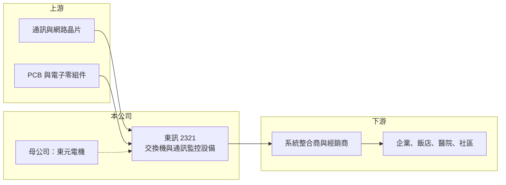

# 2321 東訊

> 上市｜[[產業索引-通信網路業|通信網路業]]｜上市（櫃）日期 1991/11/08

# 第一章：企業模式與商業藍圖

> [!info] 撰寫說明
> 精簡版，由 Claude 依公開資料整理，架構比照 [[2330台積電]] 的四章研究，資料截至 2026-10-08。來源：證交所開放資料（基本資料、綜合損益、資產負債、營益分析、股利、每月營收）、Goodinfo 年度經營績效、nStock 公司簡介。公開資料有限，產品描述多為整理性內容，尚未逐條比對原始文件。#待校對

本章說明東訊（股票代號：2321）的商業模式：一家隸屬東元集團、以企業電話交換機起家的通訊設備公司。

- **核心業務：** 東訊成立於 1980 年，1991 年在台灣證券交易所上市，總部位於新竹科學園區。依公司登記的營業項目，東訊與子公司從事[[交換機系統]]及其組件與周邊設備，以及智慧機電健康管理系統與監控設備的研發、製造與銷售。交換機系統就是企業內部的電話總機，負責分配內線、外線與語音服務，是辦公室、飯店、醫院等場所的基礎通訊設備。
- **營收結構：** 公開資料未提供產品別營收比重。依業務描述，營收主要來自企業通訊（電話交換機與 IP 語音系統）與社區、建築的通訊監控設備，近年再加上設備健康管理的 [[IoT]]（物聯網）應用（待校對）。這類產品的銷售多透過系統整合商與經銷商，屬於中小量、多樣化的專案型生意。
- **營運據點：** 總部與研發位於新竹科學園區。依 nStock 揭露，東元電機持有東訊 63.52% 股權，是東訊的最終母公司，因此東訊在通路、客戶與資源上可與 [[1504東元]] 集團互補（持股比例可能因 2026 年股本變動而改變，待校對）。
- **長期方向：** 傳統電話交換機市場因雲端通訊與手機普及而逐年萎縮，東訊的長期課題是從「賣硬體總機」轉向「賣整合方案」，例如 IP 化語音、建築通訊與設備監控。依證交所資料，股本從登記的 1.66 億元增至 2026 年第二季底的 3.03 億元，顯示公司在 2026 年有一次增資，增資目的與對象待校對。

# 第二章：護城河深度與競爭優勢

本章評估東訊在企業通訊這個成熟市場中，能守住多少利潤。

- **競爭優勢：** 東訊的優勢在於長期耕耘國內企業與建築市場的安裝基礎：一套交換機裝好後會使用十年以上，後續的維修、擴充與升級帶來穩定的服務收入。加上母公司東元集團的機電與建築通路，讓東訊在大型建案與工廠專案中有入場機會。毛利率長期維持在 25% 至 35%，說明產品仍有一定的定價能力，但規模太小，屬於窄護城河。
- **主要對手：** 企業語音市場的國際品牌包括 Avaya、Panasonic、NEC 等，雲端通訊服務與 Microsoft Teams 這類協作軟體則從根本上取代實體總機的需求；國內電信業者 [[2412中華電]] 也提供企業雲端總機服務（對手名單為產業常識整理，待校對）。
- **觀察重點：** 第一，營收能否止跌回升，2025 年營收 7.33 億元較 2020 年的 10.8 億元明顯縮小。第二，2026 年上半年營業利益率轉正到 6.5%，能否延續成為全年獲利。第三，增資後的資金用途與新業務（設備健康管理、監控）能否形成新的收入來源。

# 第三章：財務體質與盈利規模

資料日期：2026-10-08。數字取自 Goodinfo 年度經營績效與證交所開放資料，表格是撰寫當時的快照；最新月營收、毛利率、累計 EPS 由自動排程寫在本筆記的屬性欄位（月營收、毛利率、累計EPS 等）。#待校對

東訊的財務呈現「毛利率尚可、但規模撐不起費用」的典型小型設備廠樣貌。

| 年度 | 營收（新台幣） | [[毛利率]] | [[營業利益率]] | EPS（元） | [[ROE]] |
|---|---|---|---|---|---|
| 2020 | 10.8 億 | 17.0% | -4.97% | -0.90 | -6.35% |
| 2021 | 10.7 億 | 22.6% | 0.68% | 0.12 | 3.76% |
| 2022 | 10.1 億 | 25.7% | 2.04% | 0.66 | 6.84% |
| 2023 | 8.04 億 | 26.0% | -2.73% | -2.60 | -4.30% |
| 2024 | 6.31 億 | 30.2% | -3.55% | -1.09 | -3.72% |
| 2025 | 7.33 億 | 30.1% | -0.85% | -0.76 | -1.27% |
| 2026 上半年 | 3.72 億 | 34.96% | 6.50% | 0.27 | 未查得 |

註：2020 至 2025 年取自 Goodinfo 合併報表；2026 上半年取自證交所開放資料。Goodinfo 部分年度 ROE 與 EPS 幅度不一致（例如 2023 年），可能與股本變動或資料口徑有關，待校對。

- **營收規模：** 2020 至 2025 年營收年複合成長率約 -7.5%（推算）。2026 年 1 至 8 月累計營收 4.96 億元，與去年同期的 4.88 億元大致持平。
- **獲利：** 毛利率從 2020 年的 17% 逐步拉高到 2026 上半年的 35%，代表產品組合往較高附加價值的方案移動；但營業費用相對營收偏高，過去六年只有 2021、2022 年小幅獲利。2026 上半年稅後淨利 0.08 億元，EPS 0.27 元。
- **財務特色：** 依證交所資料，2026 年第二季底股東權益 1.89 億元、負債總計 7.67 億元，保留盈餘為 -1.29 億元，2025 年度未配發股利。負債占資產比重約六成，財務彈性有限，母公司支持是重要的穩定因素。
- **[[ROIC]] 與 [[WACC]]：** 以 2026 上半年營業利益 0.24 億元年化並扣 20% 稅後約 0.39 億元，投入資本以股東權益 1.89 億元加非流動負債 3.83 億元（代替有息負債）約 5.72 億元計算，ROIC 約 6.8%（推算）；但以 2025 年營業虧損計算則為負值。WACC 以 CAPM 推估：無風險利率 1.75%、市場風險溢酬 6%、β 取 1.0（推估，通信設備同業常見值），權益成本約 7.75%；稅前負債成本假設 2.5%，稅後 2%，依帳面結構加權後 WACC 約 4% 至 6%（推算）。過去五年 ROIC 多數年度為負、低於 WACC，2026 上半年首次接近或略高於資金成本，能否持續是判斷東訊是否重新創造價值的關鍵。

# 第四章：總體風險與地緣政治

本章整理東訊面對的長期風險，核心問題是產品所在市場正在被新技術取代。

- **產業週期：** 實體電話交換機屬於成熟甚至衰退的市場，企業的通訊預算逐漸轉向雲端服務與軟體。東訊的需求與建築、商辦的新建與翻修週期有關，景氣下行時專案延後會直接反映在營收。
- **營運風險：** 營收規模小、產品線多，研發與售後服務的固定成本難以攤提。若轉型的新產品無法放量，營業費用率會持續壓縮獲利。
- **其他風險：** 2026 年增資後股本約倍增，獲利若沒有同步成長，每股盈餘會被稀釋。營業項目包含設備監控與健康管理，涉及資安與資料保護法規，產品需要持續投入資安認證。

# 專有名詞解析

## 應用

- **[[IoT]]**：物聯網，讓設備透過網路連線並交換資料，工業物聯網用於設備監控與自動化。

## 金融

- **[[ROIC]]**：投入資本報酬率，稅後營業利益除以股東權益與有息負債的合計，衡量本業對所有資金提供者的報酬。
- **[[WACC]]**：加權平均資金成本，依股東權益與負債的比重加權計算的資金成本，ROIC 高於它才代表創造價值。

## 產業

- **[[交換機系統]]**：企業內部的電話總機，負責內線互撥、外線轉接與語音服務，正從實體設備轉向 IP 與雲端。

# 核心供應鏈

- 上游：通訊與網路晶片（例如 [[2379瑞昱]] 一類的網通晶片供應商，實際供應商未公開，待校對）、印刷電路板與電子零組件。
- 下游／客戶：系統整合商、經銷商，終端為企業、飯店、醫院與社區建築；母公司 [[1504東元]] 集團的機電與建築專案。
- 同業：國際企業語音品牌 Avaya、Panasonic、NEC；雲端通訊服務業者與 [[2412中華電]] 的企業通訊服務。

## 最新新聞
<!-- news:start -->
<!-- news:end -->

## 相關連結
- [公開資訊觀測站](https://mopsov.twse.com.tw/mops/web/t05st03?step=1&firstin=1&co_id=2321)
- [Goodinfo](https://goodinfo.tw/tw/StockDetail.asp?STOCK_ID=2321)
- [Yahoo 股市](https://tw.stock.yahoo.com/quote/2321)
- [鉅亨網新聞](https://www.cnyes.com/twstock/2321/news)
