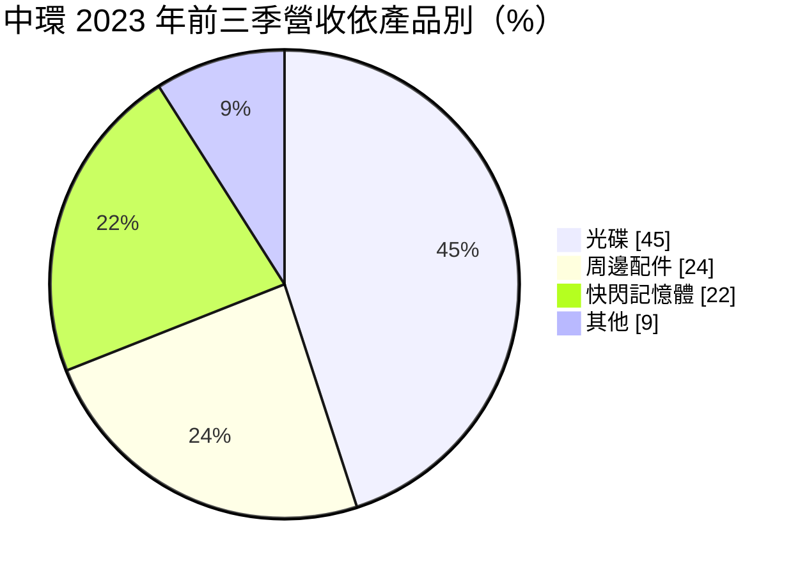
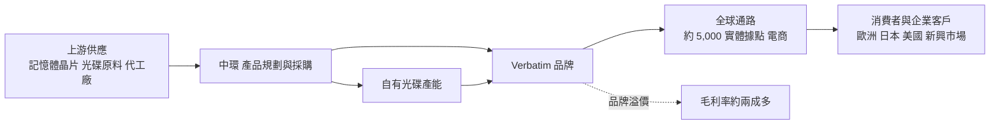
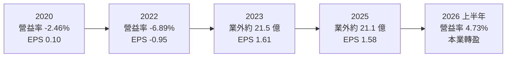
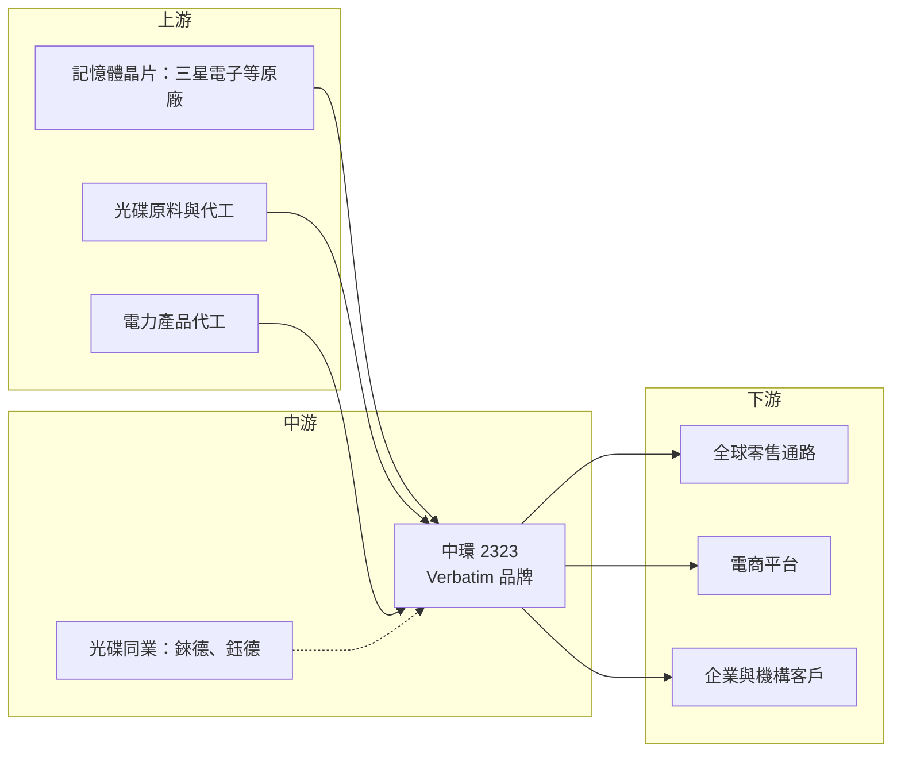

# 2323 中環

> 上市｜[[產業索引-光電業|光電業]]｜上市（櫃）日期 1992/02/17

# 第一章：企業模式與商業藍圖

> [!info] 撰寫說明
> 本文由 Claude 依公開資料整理，架構比照 [[2330台積電]] 的四章研究，資料截至 2026-10-08。財務數字來源：Goodinfo 經營績效、股利政策與現金流量頁（2020 至 2025 年度）、證交所開放資料快照（2026 年第二季資產負債與綜合損益、2025 年度股利、公司基本資料）、富果研究中環法說整理、科技新報 2019 年 Verbatim 併購報導、新頭殼 2026 年 3 月報導、經濟日報、自由時報 2026 年 8 月報導；產業描述為整理性內容，尚未逐條比對原始文件。#待校對

在評估單一個股的長期投資價值時，首要步驟是拆解企業的底層獲利邏輯。本章針對中環股份有限公司（股票代號：2323，以下簡稱中環）的商業模式進行定性分析，說明一家曾是全球最大光碟片製造商的公司，如何在光碟市場長期萎縮後，透過併購國際品牌 Verbatim，轉型為儲存與電力周邊產品的品牌商。

## 一、核心定位：從光碟代工廠轉為國際儲存品牌商

中環成立於 1978 年，1992 年上市，早年以製造錄音帶、磁片起家，之後成為全球主要的光碟片（CD、DVD、藍光）製造商。依 2019 年科技新報報導，中環當時在全球光碟市場的占有率超過五成。光碟市場因雲端儲存、串流影音與快閃記憶體普及而長期萎縮，中環也經歷了多年的虧損，2019 年曾以 32.8% 的減資比例彌補虧損。

2019 年中環宣布向日本三菱化學收購 Verbatim 品牌，並於當年底前完成（交易金額未查得）。Verbatim 是擁有超過五十年歷史的國際儲存媒體品牌，產品涵蓋光碟、隨身碟、記憶卡與 [[SSD]]，在超過 120 個國家透過約 5,000 個實體零售據點銷售。這筆併購是中環商業模式的轉捩點：

* **從代工轉為品牌：** 過去中環替其他品牌生產光碟片，訂單與價格由客戶決定；併購 Verbatim 後，中環擁有自己的品牌與全球通路，可以主動決定產品組合與定價，從「接單生產」轉為「主動行銷」。
* **從光碟擴張到快閃記憶體與電力產品：** 品牌與通路一旦建立，就能銷售更多品類。中環以「S'n'P」（Storage and Power）為策略，把產品線從光碟延伸到快閃記憶體儲存與行動電源、充電器等電力周邊，降低對萎縮中的[[光儲存媒體]]的依賴。

## 二、終端應用板塊：光碟比重下降、快閃記憶體上升

依富果整理的法說資料，2023 年前三季營收依產品別如下：

* **光碟：** 2019 年光碟占集團營收 86%，2023 年降到 45%，顯示轉型的速度。光碟屬長期萎縮的成熟市場，但藍光光碟作為[[冷儲存]]媒體，在衛星影像等大量資料的長期保存上仍有需求；2026 年記憶體缺貨帶動部分資料備份需求轉向光碟，光碟報價出現約十年來首次調漲。
* **快閃記憶體：** Verbatim 品牌的隨身碟、記憶卡、外接式 SSD 與高速 SSD。依 2026 年 3 月報導，快閃記憶體產品占營收比重 2025 年為 32%、2026 年前兩月升到 43%，已成為最大的成長來源。
* **周邊配件與電力產品：** 包括行動電源、氮化鎵充電器等電力產品，以及電腦周邊配件，是「S'n'P」策略中 Power 的部分。
* **其他：** 中環另有娛樂事業（與威秀影城相關的投資）與資產活化收益，例如出租不動產。

## 三、資本轉化邏輯（營運模式）：品牌與通路的槓桿

* **品牌商的毛利結構：** 中環的毛利率在 2020 至 2025 年維持在 19% 至 24% 之間，2026 年上半年約 25.9%，明顯高於一般電子代工廠。這是品牌與通路帶來的溢價，但也伴隨較高的行銷與通路費用，使營業利益長期在虧損邊緣。
* **輕資產與外部採購：** 快閃記憶體產品的晶片向記憶體原廠採購，中環主要負責產品設計、品牌行銷與通路管理，資本支出需求低；光碟仍有自有產能。這種模式的獲利關鍵在於採購成本與售價之間的價差，因此記憶體晶片報價的變化，會直接影響毛利。
* **資產活化與業外收益：** 中環持有不動產與股權投資，2023 年處分資產的預期利益約 11.3 億元，2023 與 2025 年的業外收益都超過 20 億元，是這兩年獲利的主要來源。

## 四、企業長期藍圖：S'n'P 與資本結構調整

* **S'n'P 策略：** 以 Verbatim 品牌持續推出高速 SSD、外接式儲存、行動儲存、半固態行動電源與氮化鎵充電器等新品，讓快閃記憶體與電力產品成為主力，光碟成為穩定但比重遞減的業務。
* **通路擴張：** 在歐洲與日本既有通路的基礎上，透過亞馬遜等電商開拓新興市場。
* **資本結構調整：** 2026 年中環辦理 10% [[現金減資]]，每股退還 1 元，加上 0.2 元現金股利，股東每股共可領回 1.2 元；減資後實收資本額從約 108.9 億元降到約 98.0 億元，8 月完成變更登記。公司表示目的在於回饋股東與提高 [[ROE]]，這是管理層對資本配置的明確表態。

# 第二章：護城河深度與競爭優勢

在長期價值投資中，「護城河」指企業抵禦競爭、維持超額利潤的保護機制。中環的護城河主要來自 Verbatim 這個老牌國際品牌與其通路，而非製造技術。本章分析這項優勢的強度、主要競爭對手，以及品牌能否轉化為穩定的本業獲利。

## 一、護城河的核心組成要素

中環屬於「窄護城河」，主要來自以下要素：

* **1. Verbatim 的品牌與通路：** 在儲存媒體這種規格標準化的產品上，品牌主要帶來的是通路上架與消費者信任。Verbatim 經營半世紀、遍布 120 多國的零售網絡，是新品牌難以在短期內複製的資產，也讓中環能以較低的成本推出新品類。
* **2. 光碟產業的殘存者優勢：** 光碟市場萎縮後，大部分製造商已退出，供給集中在少數業者手上。需求小幅回升時（例如 2026 年的資料備份需求），殘存的供應商擁有較強的定價能力。這項優勢的前提是市場仍有需求，屬於「夕陽產業中的寡占」。
* **3. 藍光冷儲存的利基：** 全球能生產大容量歸檔光碟的業者很少，依 2019 年報導全球只有五家，其中兩家在台灣。在需要長期、低成本、低耗能保存資料的場景，光碟仍有利基。

## 二、全球主要競爭對手格局

| 對手 | 定位 | 對中環的威脅 |
|---|---|---|
| [[2349錸德]] | 台灣光碟製造商，轉型儲能 | 光碟領域的直接競爭者 |
| [[3050鈺德]] | 台灣光碟製造商 | 光碟代工競爭 |
| 金士頓、SanDisk、三星 | 國際記憶體品牌 | 在隨身碟、記憶卡、SSD 零售通路是主要對手，規模遠大於 Verbatim |
| [[3260威剛]]、[[2451創見]]、[[8271宇瞻]] | 台灣記憶體模組品牌 | 在記憶體周邊產品與通路上競爭 |
| Anker 等電力周邊品牌 | 行動電源與充電器 | 電力產品線的主要對手 |

中環在光碟市場是領導者，但在快閃記憶體與電力周邊市場是追趕者。後兩個市場的品牌競爭激烈、產品同質性高，Verbatim 的品牌能否延伸到這些新品類，是轉型成敗的關鍵。

## 三、優勢轉化：守得住、守不住與觀察重點

* **守得住：** 光碟市場的寡占地位與藍光冷儲存利基。市場雖小，但競爭者少，價格調漲時能直接反映在毛利。
* **守不住：** 快閃記憶體與電力周邊的定價權。這兩個市場有大量國際與中國品牌，Verbatim 的規模優勢不明顯，毛利容易受記憶體晶片成本與通路價格戰擠壓。2020 至 2025 年營業利益率每年都是負值，說明品牌溢價還不足以覆蓋營運費用。
* **觀察重點：** 第一，本業能否穩定轉盈，2026 年上半年營業利益率 4.73% 能否延續；第二，快閃記憶體比重上升後，毛利率能否維持在兩成五附近；第三，未來獲利是否仍高度依賴業外收益。

# 第三章：財務體質與盈利規模

資料日期：2026-10-08。年度數字取自 Goodinfo 經營績效與現金流量頁，2026 年上半年與資產負債取自證交所開放資料快照，表格是撰寫當時的快照；最新月營收、毛利率、累計 EPS 由自動排程寫在本筆記的屬性欄位（月營收、毛利率、累計EPS 等）。#待校對

財務報表是檢驗護城河是否真實存在的最終標準。中環的財報呈現「本業長期虧損、業外不定期大賺」的特徵，分析時必須把兩者拆開看。本章用多年度數據檢視中環轉型的實際成效。

## 一、獲利能力的基石：三率

| 年度 | 營收（億元） | [[毛利率]] | [[營業利益率]] | EPS（元） | [[ROE]] |
|---|---|---|---|---|---|
| 2020 | 94.0 | 21.3% | -2.46% | 0.10 | 0.64% |
| 2021 | 87.1 | 22.9% | -1.49% | 0.14 | 0.69% |
| 2022 | 76.9 | 19.0% | -6.89% | -0.95 | -5.87% |
| 2023 | 73.8 | 22.5% | -4.68% | 1.61 | 9.44% |
| 2024 | 74.4 | 22.0% | -5.22% | -0.27 | -1.70% |
| 2025 | 71.8 | 24.0% | -1.29% | 1.58 | 9.15% |
| 2026 上半年 | 39.6 | 25.9% | 4.73% | 0.99 | 未查得（Goodinfo 年化約 10.9%） |

* **營收規模：** 2020 至 2025 年營收從 94.0 億元降到 71.8 億元，年複合成長率約 -5.2%（推算），反映光碟市場的萎縮速度快於新品類的成長。2026 年上半年營收 39.6 億元、年增約 16%，是多年來首次明顯回升。
* **[[毛利率]]：** 長期維持在 19% 至 24%，2026 年上半年升到 25.9%，品牌商的毛利結構相當穩定，主要受記憶體晶片成本與光碟價格影響。
* **[[營業利益率]]：** 2020 至 2025 年每年都是負值，代表品牌行銷與通路費用超過毛利。2026 年上半年營業利益約 1.87 億元、營業利益率 4.73%，是本業轉型多年後首次出現有意義的盈餘。
* **[[業外收益]]：** 2023 年業外損益約 21.5 億元、2025 年約 21.1 億元，是這兩年 EPS 超過 1.5 元的主要原因；2023 年包含處分資產利益，2025 年的主要來源本次未查得。2026 年上半年業外約 13.0 億元，仍占稅前淨利八成以上。這類收益不具持續性，評估中環的長期價值，應以本業營業利益為準。

## 二、[[ROE]]：資本效率

中環 2021 至 2025 年平均 ROE 約 2.3%（推算），而且年度間在 -5.9% 到 9.4% 之間大幅擺盪，主要由業外收益決定。2026 年第二季底，歸屬母公司股東權益約 200.5 億元，每股淨值約 18.4 元；負債總額約 116.8 億元，負債比約 36%（推算），財務結構保守，帳上有相當的流動資產與投資。

股利方面，2020 至 2025 年度現金股利分別為 0.7、0.1、0、0.68、0.3、0.2 元，配發與否與金額高度取決於當年是否有業外收益，穩定度低。公司章程規定股利總額不低於當年度可分配盈餘的 10%。2026 年的 10% 現金減資，則是另一種把資本退還股東的方式，搭配股利後股東每股可領回 1.2 元。

## 三、資本支出與自由現金流

| 年度 | 營業現金流（億元） | 投資現金流（億元） | 自由現金流（億元） |
|---|---|---|---|
| 2020 | 2.33 | 5.85 | 8.18 |
| 2021 | -9.09 | 1.26 | -7.84 |
| 2022 | -4.42 | -2.30 | -6.72 |
| 2023 | 6.91 | -2.28 | 4.63 |
| 2024 | -8.68 | -3.26 | -11.9 |
| 2025 | -13.3 | 12.5 | -0.77 |

（自由現金流依 Goodinfo 定義為營業現金流加投資現金流。）

* **[[自由現金流]]：** 六年中有四年為負，營業現金流在 2021、2022、2024、2025 年都是負值。品牌商需要為通路備貨，記憶體晶片價格上漲時更需提前採購，營運資金占用大；本業長期虧損也讓營業現金流難以轉正。2025 年投資現金流轉正，推估與處分資產或投資有關。
* **[[CapEx]]：** 快閃記憶體與電力產品多為外部採購，資本支出需求低，中環的現金流問題主要來自營運資金與本業獲利，而非投資。

## 四、[[ROIC]] 與 [[WACC]]：價值創造利差

企業長期創造價值的條件，是投入資本報酬率（ROIC）高於加權平均資金成本（WACC）。

**ROIC（推算）：** 本文以「稅後營業利益 ÷（股東權益＋有息負債）」推算。2025 年營業利益約 71.8 億元 × -1.29% ≈ -0.93 億元，為虧損，ROIC 為負值（推算）。以 2026 年上半年營業利益約 1.87 億元年化約 3.74 億元、稅率 20% 計算，稅後營業利益約 3.0 億元；有息負債明細未查得，以 2026 年第二季非流動負債約 44.6 億元作為近似，加上權益總計約 204.1 億元，投入資本約 248.7 億元，ROIC 約 1.2%（推算）。

**WACC（推算）：** 以 CAPM 推估股東權益成本：無風險利率取台灣 10 年期公債約 1.75%，市場風險溢酬 6%，β 假設 0.8（中小型品牌與光碟股常見值，非來源數字），權益成本約 6.55%。負債成本假設稅前 2%、稅率 20%，稅後 1.6%。以帳面資本結構（權益 82%、負債 18%）計算，WACC 約 5.7%（推算）。

**結論：** 以本業計算，中環 2020 至 2025 年的 ROIC 都是負值，2026 年上半年轉正後也只有約 1%，明顯低於約 5.7% 的資金成本，本業長期侵蝕價值。若把業外收益視為報酬，2023 與 2025 年的 ROE 約 9%，高於權益成本，但這類收益無法持續。中環要真正創造價值，必須讓本業營業利益率穩定在 5% 以上，並把投入資本中報酬偏低的資產持續活化或退還股東。

# 第四章：總體風險與地緣政治

任何企業都無法脫離宏觀環境獨立存在。本章分析中環未來必須面對的地緣政治、產業週期、營運與技術風險。中環同時面對光碟市場的長期萎縮與記憶體價格循環兩種結構性力量。

## 一、地緣政治

* **海外銷售比重高：** Verbatim 的主要市場在歐洲、日本與美國，各國關稅、貿易政策與消費景氣的變化，會直接影響銷售。
* **記憶體供應鏈：** 快閃記憶體晶片主要來自少數國際原廠，地緣政治或產能調配導致供應吃緊時，品牌商通常是最後拿到貨、成本最高的一方。

## 二、產業週期與市場結構

* **光碟長期萎縮：** 光碟屬於長期萎縮的成熟市場，2026 年的漲價屬於供給收縮與短期需求回流帶來的變化，不代表市場重新成長。長期而言，光碟業務的營收規模預期持續下降。
* **記憶體價格循環：** 快閃記憶體產品的成本跟隨 [[NAND Flash]] 與 [[DRAM]] 報價循環。晶片價格上漲初期，品牌商可以調漲售價並享受庫存跌價回升的利益；價格下跌時，則面臨庫存跌價與售價下滑的雙重壓力。快閃記憶體比重越高，中環的獲利波動就越大。
* **零售通路變化：** 實體零售通路萎縮、電商比重提高，會改變品牌商的通路費用結構與議價能力。

## 三、營運環境的隱性風險

* **本業獲利的持續性：** 2020 至 2025 年營業利益率每年為負，2026 年上半年轉盈是否能延續仍待觀察。若漲價效應消退，本業可能回到虧損。
* **對業外收益的依賴：** 業外收益占稅前淨利的比重很高，資產處分與投資收益每年差異大，使 EPS 與股利難以預測。
* **匯率：** 營收以歐元、日圓、美元計價為主，匯率變動會影響以台幣計算的營收與獲利。

## 四、科技或法規演進

* **儲存技術替代：** 雲端儲存、串流與快閃記憶體持續取代光碟；外接式儲存也逐步被雲端取代，消費性儲存周邊的長期需求可能下滑。
* **冷儲存技術的競爭：** 在長期資料保存市場，磁帶與新型儲存技術也在發展，藍光光碟能否在冷儲存市場保有成本與耐久度優勢，是光碟業務長期存續的關鍵。
* **電池安全法規：** 行動電源等電力產品涉及電池安全，各國法規與航空運輸規定日益嚴格，會增加產品認證成本。

# 專有名詞解析

## 半導體

- **[[NAND Flash]]**：斷電後仍能保存資料的快閃記憶體，用於 SSD、記憶卡與隨身碟，價格循環明顯。
- **[[DRAM]]**：動態隨機存取記憶體，電腦與手機的主記憶體，報價隨供需大幅波動。

## 應用

- **[[SSD]]**：固態硬碟，以快閃記憶體取代傳統硬碟的儲存裝置，速度快、耗電低。
- **[[光儲存媒體]]**：以雷射讀寫資料的光碟類媒體，包括 CD、DVD、藍光，市場因雲端與串流長期萎縮。
- **[[冷儲存]]**：針對很少讀取、但需長期保存的資料所設計的儲存方式，重視單位成本與耐久度，而非讀取速度。

## 金融

- **[[現金減資]]**：公司減少股本並把對應現金退還股東，可提高每股盈餘與淨值報酬率。
- **[[業外收益]]**：本業以外的收益，例如投資、處分資產或匯兌利益，通常不具持續性。
- **[[ROE]]**：股東權益報酬率，稅後淨利除以股東權益，衡量公司運用股東資本賺錢的效率。
- **[[ROIC]]**：投入資本報酬率，稅後營業利益除以股東權益加有息負債，衡量公司投入營運的全部資本能賺多少。
- **[[WACC]]**：加權平均資金成本，股東與債權人要求報酬率的加權平均，是 ROIC 的比較基準。
- **[[自由現金流]]**：營業活動現金流減去資本支出，代表企業可自由用於配息、還債或併購的現金。

# 核心供應鏈

## 1. 上游：晶片與原料
- 記憶體晶片：[[005930三星電子]] 等國際原廠（實際採購名單公司未公開）
- 光碟原料與代工、電力產品代工廠（推估）

## 2. 中游：中環本身與同業
- 光碟同業：[[2349錸德]]、[[3050鈺德]]
- 記憶體周邊品牌同業：[[3260威剛]]、[[2451創見]]、[[8271宇瞻]]、金士頓

## 3. 下游：通路與客戶
- 歐洲、日本、美國等地的零售通路與電商平台
- 企業與機構的資料保存需求

## 最新新聞
<!-- news:start（自動產生，請勿手動編輯此範圍） -->
- 2026-10-12 📰 媒體 17:52｜營收速報 - 中環(2323)9月營收8.60億元年增率高達34.46％｜[鉅亨網](https://news.cnyes.com/news/id/6628264)
- 2026-10-06 🏛️ 重訊 17:55｜公告本公司處分有價證券｜[觀測站](https://mops.twse.com.tw/mops/#/web/t05st01)
- 2026-10-06 🏛️ 重訊 17:53｜公告本公司取得有價證券｜[觀測站](https://mops.twse.com.tw/mops/#/web/t05st01)

完整紀錄：[[2323中環 新聞]]
<!-- news:end -->

## 相關連結
- [公開資訊觀測站](https://mopsov.twse.com.tw/mops/web/t05st03?step=1&firstin=1&co_id=2323)
- [Goodinfo](https://goodinfo.tw/tw/StockDetail.asp?STOCK_ID=2323)
- [Yahoo 股市](https://tw.stock.yahoo.com/quote/2323)
- [鉅亨網新聞](https://www.cnyes.com/twstock/2323/news)
