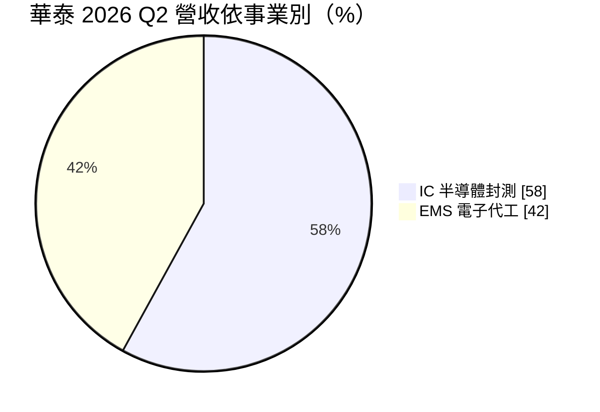
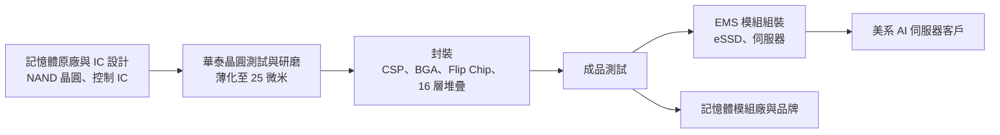
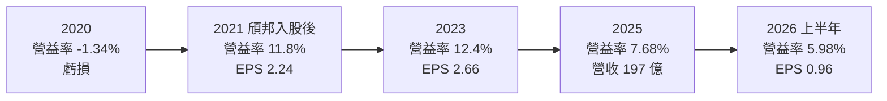
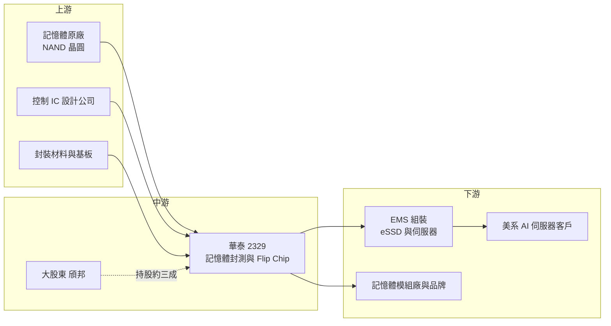

# 2329 華泰

> 上市｜[[產業索引-半導體業|半導體業]]｜上市（櫃）日期 1994/04/20

# 第一章：企業模式與商業藍圖

> [!info] 撰寫說明
> 本文由 Claude 依公開資料整理，架構比照 [[2330台積電]] 的四章研究，資料截至 2026-10-08。財務數字來源：Goodinfo 經營績效、股利政策與現金流量頁（2020 至 2025 年度）、證交所開放資料快照（2026 年第二季資產負債與綜合損益、2025 年度股利、公司基本資料）、富果研究華泰 2026 年法說會整理、中央社 2020 年 12 月頎邦與華泰合作報導、旺得富報導、nStock 與 winvest 公司資料；產業描述為整理性內容，尚未逐條比對原始文件。#待校對

在評估單一個股的長期投資價值時，首要步驟是拆解企業的底層獲利邏輯。本章針對華泰電子（股票代號：2329，以下簡稱華泰）的商業模式進行定性分析，說明一家以記憶體封測起家的高雄老廠，如何在 2020 年引進頎邦作為策略股東後轉虧為盈，並同時經營半導體封測與 AI 伺服器的 [[EMS]] 代工兩種性質不同的事業。

## 一、核心定位：NAND Flash 封測平台加上伺服器代工

華泰 1971 年 6 月在高雄設立，1994 年上市，是台灣最早的電子代工與封裝業者之一，實收資本額約 65.9 億元。2020 年 12 月，驅動 IC 封測廠 [[6147頎邦]] 以現金收購加換股的方式取得華泰近三成股權，成為最大股東，雙方以覆晶封裝（[[Flip Chip]]）為策略合作重點。這筆交易是華泰近年最重要的結構性事件：華泰 2020 年仍處虧損，2021 年起轉為穩定獲利。

華泰的業務分成兩大塊，2026 年第二季營收比約 58 比 42：

* **IC 半導體封測：** 以 [[NAND Flash]] 記憶體封裝與測試為主，記憶體產品占這個事業約 72%，邏輯 IC 約 16%。封裝技術涵蓋 CSP、BGA 與覆晶封裝，晶圓研磨可薄化到 25 微米、支援 16 層晶片堆疊。客戶包括記憶體原廠與國內 [[eMMC]] 控制 IC 業者，2025 年以來已有兩家記憶體原廠進入前十大客戶。
* **EMS 電子代工：** 為伺服器、[[SSD]]、工業產品做系統組裝。依富果整理的法說資料，一家美系 AI 伺服器客戶占 EMS 營收七成以上，法說中提到的關鍵夥伴是美超微（Supermicro）。

華泰的定位不是先進封裝技術的領先者，而是「記憶體供應鏈中，從晶圓測試到模組組裝的一站式平台」。這個定位讓它能服務需要彈性與完整流程的中型客戶，而不必和大型封測廠在規模上正面競爭。

## 二、終端應用／產品板塊：記憶體封測與伺服器組裝

* **記憶體封測：** NAND Flash 晶片的薄化、堆疊、封裝與測試，終端是手機、PC、伺服器的儲存裝置。記憶體景氣決定這塊的產能利用率，也是華泰毛利率的主要來源。
* **邏輯 IC 封測：** 包括 eMMC 控制器等，公司把「邏輯 IC 委外訂單」列為長期成長支柱之一，目的是降低對記憶體單一週期的依賴。
* **EMS：** AI 伺服器與企業級固態硬碟（[[eSSD]]）模組組裝。EMS 營收規模大、毛利率低，能提供穩定的營業利益，但也讓華泰的整體毛利率被拉低到一成多。公司把 eSSD 模組定位為未來的成長動能，因為它正好串起華泰的記憶體封測與系統組裝兩項能力。

## 三、資本轉化邏輯（營運模式）：從晶圓到模組的一條龍

* **一站式服務：** 華泰的目標是從晶圓測試、封裝、成品測試一路做到模組組裝。客戶可以減少在不同供應商之間轉運的時間與成本，兩個事業也能互相導流，這是華泰與純封測廠或純 EMS 廠最大的差異。
* **稼動率決定封測獲利：** 封測屬固定成本高的行業，機台與廠房折舊不隨產量變動，[[產能利用率]]每提升一段，毛利率就跟著改善。2026 年第一季半導體產能利用率約七成，公司預期逐季提升。
* **EMS 的低毛利、高周轉：** EMS 需要的資本支出較少，但需要大量營運資金支應存貨與應收帳款。兩種事業的資本性質不同，使華泰同時具有資本密集與營運資金密集的特徵。

## 四、企業長期藍圖：Flip Chip 擴產與 AI 儲存

* **新廠擴產：** 新廠預計 2027 年第二季啟用，主要擴充 Flip Chip 產能。這是頎邦入股時雙方合作的主軸，也是華泰從傳統打線封裝升級到較高單價封裝的關鍵投資。
* **四大成長支柱：** 公司把記憶體原廠滲透、eSSD 服務、低容量 eMMC、邏輯 IC 委外訂單列為四大成長支柱，方向是提高封測事業的客戶廣度與產品單價。
* **資本支出：** 2024 至 2025 年每年約 20 億元，2026 年逾 20 億元，主要用於新廠與 Flip Chip 產能。相對約 200 億元的年營收，資本支出約占一成，是華泰近年最大規模的投資週期。

# 第二章：護城河深度與競爭優勢

在長期價值投資中，「護城河」指企業抵禦競爭、維持超額利潤的保護機制。本章分析華泰在記憶體封測與 EMS 兩個市場的競爭位置，以及它作為中型封測廠能守住多少利潤。

## 一、護城河的核心組成要素

華泰的護城河屬於「窄護城河」，主要來自製程經驗、客戶認證與整合能力：

* **1. 記憶體封裝的薄化與堆疊經驗：** NAND Flash 需要把晶片磨到極薄再多層堆疊，良率控制是關鍵。華泰能做到 25 微米研磨與 16 層堆疊，在中型封測廠中具一定技術門檻。記憶體容量持續提升、堆疊層數增加，這項能力的重要性也會隨之提高。
* **2. 記憶體原廠的認證：** 記憶體原廠對外包封測的認證嚴格，通常需要長時間的品質稽核與試產。2025 年以來兩家原廠進入華泰前十大客戶，代表華泰通過了這道門檻，一旦導入，原廠不會輕易更換外包廠。
* **3. 封測加 EMS 的整合能力：** 多數封測廠不做系統組裝，多數 EMS 廠不做晶片封測。華泰同時具備兩者，能提供 eSSD 從晶片到模組的完整服務，這在中小型客戶之間具有差異化。
* **4. 頎邦的策略股東支持：** 頎邦持股約三成，在覆晶封裝技術與財務上提供支撐（推估）。2021 年起華泰獲利明顯改善，與這項合作的時間點一致。

## 二、全球主要競爭對手格局

| 對手 | 定位 | 對華泰的威脅 |
|---|---|---|
| [[6239力成]] | 全球最大記憶體封測廠 | 規模與原廠關係更深，可吸走大單 |
| [[3711日月光投控]] | 全球最大封測集團 | 先進封裝與產能規模領先 |
| [[AMKR艾克爾]] | 美系封測大廠 | 在美系客戶與先進封裝具優勢 |
| [[8150南茂]] | 記憶體與驅動 IC 封測 | 在記憶體封測市場直接競爭 |
| [[2382廣達]]、[[6669緯穎]]、[[2317鴻海]] | AI 伺服器 EMS 與 ODM | 規模遠大於華泰，客戶可隨時轉單 |

在記憶體封測，華泰面對的是規模更大的力成；在 EMS，面對的是營收大上百倍的伺服器代工廠。華泰的生存空間來自「大廠看不上、小廠做不到」的中間市場。

## 三、優勢轉化：守得住、守不住與觀察重點

* **守得住：** 中低容量記憶體與 eMMC 的封測，以及需要彈性交期的中型客戶。這些訂單對大型封測廠而言規模不夠大，華泰較有議價空間。
* **守不住：** EMS 的客戶集中度與定價權。美系 AI 伺服器客戶占 EMS 七成以上，客戶若轉單或自建產能，營收會大幅波動。EMS 毛利率低，也難以建立定價權。
* **觀察重點：** 第一，記憶體封測稼動率能否從七成往八成以上提升；第二，2027 年新廠的 Flip Chip 產能能否順利滿載；第三，eSSD 模組能否成為新的高毛利產品，讓整體毛利率回到 15% 以上。

# 第三章：財務體質與盈利規模

資料日期：2026-10-08。年度數字取自 Goodinfo 經營績效與現金流量頁，2026 年上半年與資產負債取自證交所開放資料快照，表格是撰寫當時的快照；最新月營收、毛利率、累計 EPS 由自動排程寫在本筆記的屬性欄位（月營收、毛利率、累計EPS 等）。#待校對

財務報表是檢驗護城河是否真實存在的最終標準。本章用多年度的三率、ROE、現金流與資本報酬，檢視華泰在頎邦入股後的轉型成果，以及記憶體景氣與 AI 伺服器需求交錯下的獲利品質。

## 一、獲利能力的基石：三率

| 年度 | 營收（億元） | [[毛利率]] | [[營業利益率]] | EPS（元） | [[ROE]] |
|---|---|---|---|---|---|
| 2020 | 139 | 5.03% | -1.34% | -0.48 | -3.89% |
| 2021 | 159 | 18.4% | 11.8% | 2.24 | 18.5% |
| 2022 | 155 | 16.2% | 9.23% | 2.02 | 15.5% |
| 2023 | 167 | 19.9% | 12.4% | 2.66 | 17.9% |
| 2024 | 163 | 15.1% | 7.11% | 1.71 | 10.8% |
| 2025 | 197 | 15.1% | 7.68% | 2.45 | 12.4% |
| 2026 上半年 | 103 | 13.0% | 5.98% | 0.96 | 未查得（Goodinfo 年化約 9.3%） |

（2025 年 EPS 2.45 元為 Goodinfo 與 winvest 揭露的基本每股盈餘；以稅後淨利約 14.1 億元除以目前股數約 6.59 億股約為 2.14 元，差異推估與年度加權股數有關，待校對。）

* **營收成長：** 2020 至 2025 年營收從 139 億元增加到 197 億元，年複合成長率約 7.2%（推算），2025 年在 AI 伺服器 EMS 帶動下年增約兩成。
* **[[毛利率]]：** 2020 年僅 5.03%，2021 年跳升到 18.4%，2023 年達 19.9% 的高點，之後隨 EMS 比重上升與記憶體景氣變化回落到 15% 左右，2026 年上半年約 13%。毛利率下降主要是產品組合的結果：低毛利的 EMS 營收增加，拉低了整體平均。
* **[[營業利益率]]：** 2021 至 2023 年在 9% 至 12% 之間，2024 年後降到 6% 至 8%。營業利益的絕對金額仍維持成長，但每一元營收能賺到的利潤變少。
* **[[淨利率]]與其他綜合損益：** 2026 年上半年稅後淨利約 6.4 億元，淨利率約 6.2%；同期其他綜合損益高達約 50.5 億元，推估主要來自持有股權等金融資產的評價利益（來源未查得）。這筆金額不計入損益，但大幅墊高了股東權益，計算 ROE 與 ROIC 時需要留意。

## 二、[[ROE]]：資本效率

華泰 2021 至 2025 年平均 ROE 約 15.0%（推算），2021 至 2023 年在 15% 至 18% 之間，2024 至 2025 年降到 11% 至 12%。ROE 下滑一方面來自營業利益率下降，另一方面來自股東權益持續增加。2026 年第二季底股東權益約 164.1 億元，每股淨值約 24.9 元，其中其他權益約 44.9 億元；負債總額約 102.5 億元，負債比約 38%（推算），財務結構穩健。由於其他權益大幅增加，未來帳面 ROE 可能被稀釋，評估本業效率時宜扣除這部分。

股利方面，2021 至 2025 年度現金股利分別為 1.0、0.85、1.189、1.0、1.0 元，配息率約 41% 至 58%（推算），每年金額相當穩定，2020 年虧損年度未配息。公司章程規定現金股利不低於股利總額的 10%，實務上近年都以現金發放。

## 三、資本支出與自由現金流

| 年度 | 營業現金流（億元） | 投資現金流（億元） | 自由現金流（億元） |
|---|---|---|---|
| 2020 | 7.15 | -6.35 | 0.80 |
| 2021 | 29.8 | -11.5 | 18.3 |
| 2022 | 27.7 | -8.59 | 19.1 |
| 2023 | 26.5 | -10.8 | 15.7 |
| 2024 | 32.7 | -19.7 | 13.1 |
| 2025 | 16.8 | -26.1 | -9.28 |

（自由現金流依 Goodinfo 定義為營業現金流加投資現金流。）

* **[[自由現金流]]：** 2020 至 2024 年連續五年為正，2021 至 2024 年每年都有 13 億元以上，足以支應每年約 6 至 8 億元的現金股利。2025 年轉為負 9.28 億元，原因是營業現金流因 EMS 營運資金增加而下降，同時資本支出提高到約 26 億元。
* **[[CapEx]]：** 2024 至 2026 年每年約 20 億元以上，主要用於新廠與 Flip Chip。新廠 2027 年啟用前，自由現金流可能持續偏弱，這是投資週期的正常現象，但需觀察新產能投產後的報酬率。

## 四、[[ROIC]] 與 [[WACC]]：價值創造利差

企業長期創造價值的條件，是投入資本報酬率（ROIC）高於加權平均資金成本（WACC）。

**ROIC（推算）：** 本文以「稅後營業利益 ÷（股東權益＋有息負債）」推算。2025 年營業利益約 197 億元 × 7.68% ≈ 15.1 億元，以稅率 20% 計算稅後營業利益約 12.1 億元。有息負債明細未查得，以 2026 年第二季非流動負債約 27.1 億元作為近似，加上股東權益約 164.1 億元，投入資本約 191.2 億元，ROIC 約 6.3%（推算）。若扣除主要來自金融資產評價、與本業無關的其他權益約 44.9 億元，投入資本約 146.3 億元，ROIC 約 8.3%（推算）。2021 至 2023 年營業利益率約 9% 至 12%，推估當時 ROIC 超過一成（推估）。

**WACC（推算）：** 以 CAPM 推估股東權益成本：無風險利率取台灣 10 年期公債約 1.75%，市場風險溢酬 6%，β 假設 1.0（封測同業常見值，非來源數字），權益成本約 7.75%。負債成本假設稅前 2%、稅率 20%，稅後 1.6%。以帳面資本結構（權益 86%、負債 14%）計算，WACC 約 6.9%（推算）。

**結論：** 華泰在 2021 至 2023 年的 ROIC 明顯高於 WACC，是頎邦入股後創造價值的階段；2025 年本業 ROIC 約 6% 至 8%，與約 6.9% 的 WACC 大致打平或略高，利差明顯收窄。2027 年新廠投產後，若 Flip Chip 與 eSSD 能把營業利益率拉回 10% 附近，利差可望重新擴大；若稼動率不足，折舊增加會讓 ROIC 短期低於資金成本。

# 第四章：總體風險與地緣政治

任何企業都無法脫離宏觀環境獨立存在。本章分析華泰未來必須面對的地緣政治、產業週期、營運與技術風險。華泰同時暴露在記憶體與 AI 伺服器兩個週期之下，兩者的波動不一定同步。

## 一、地緣政治

* **美系客戶與關稅：** EMS 主要客戶是美系 AI 伺服器業者，美國對伺服器的關稅與在地化政策，可能促使客戶把組裝移往美國或墨西哥，影響台灣 EMS 訂單。華泰目前的生產集中在高雄，缺乏海外據點的分散能力。
* **記憶體供應鏈重組：** 美國對中國記憶體廠的出口管制，可能改變國際記憶體原廠的封測外包策略。原廠若把更多產能移出中國，台灣中型封測廠可能受惠；但若原廠選擇在美國或其他地區自建封測，也可能減少外包。

## 二、產業週期與市場結構

* **記憶體景氣循環：** 記憶體占半導體封測事業七成以上，NAND Flash 報價與原廠稼動率的循環，直接影響華泰的封測訂單。記憶體景氣下行時，原廠會先收回外包產能，外包封測廠的稼動率下降幅度通常大於原廠。
* **AI 伺服器需求波動：** AI 伺服器出貨受雲端業者資本支出影響，一旦放緩，EMS 營收可能快速下滑，並出現[[長鞭效應]]。
* **消費性終端比重：** 依旺得富報導，消費性相關產品占比相對高，手機與 PC 需求轉弱時影響明顯。

## 三、營運環境的隱性風險

* **客戶集中：** 單一美系 AI 伺服器客戶占 EMS 七成以上，客戶本身的營運、治理或供應商策略變化，都會直接傳導到華泰。
* **新廠執行：** 2027 年第二季新廠啟用，若客戶認證或需求不如預期，折舊會先拖累毛利率。
* **股東權益的評價波動：** 其他權益中有大量金融資產評價利益，若相關股價下跌，股東權益與每股淨值會隨之波動，雖不影響本業獲利，但會影響帳面財務指標。

## 四、科技或法規演進

* **記憶體封裝技術升級：** NAND 堆疊層數持續增加，HBM 等先進記憶體需要更複雜的封裝製程。若華泰無法跟上，可能被侷限在中低階市場。
* **[[先進封裝]]集中化：** AI 晶片的封裝價值集中在 [[CoWoS]] 等先進封裝，主要由台積電與大型封測廠承接，中型封測廠能分到的比重有限。華泰的 Flip Chip 擴產是往較高階封裝靠近的一步，但與最先進的封裝技術仍有距離。

# 專有名詞解析

## 半導體

- **[[NAND Flash]]**：斷電後仍能保存資料的快閃記憶體，是 SSD、手機儲存與記憶卡的核心元件。
- **[[Flip Chip]]**：覆晶封裝，把晶片翻面以凸塊直接接到基板，訊號路徑短、散熱好，適合高效能晶片。
- **[[eMMC]]**：把 NAND Flash 與控制器封裝在一起的嵌入式儲存方案，常見於中低階手機與物聯網裝置。
- **[[先進封裝]]**：把多顆晶片以中介層、混合鍵合等方式高密度整合的封裝技術，例如 CoWoS、SoIC。

## 應用

- **[[SSD]]**：固態硬碟，以 NAND Flash 儲存資料，速度遠快於傳統硬碟。
- **[[eSSD]]**：企業級固態硬碟，用於資料中心與伺服器，對耐用度與穩定性要求高於消費級 SSD。

## 金融

- **[[產能利用率]]**：實際產出占總產能的比例，封測廠的毛利率高度取決於此數字。
- **[[ROIC]]**：投入資本報酬率，稅後營業利益除以股東權益加有息負債，衡量公司投入營運的全部資本能賺多少。
- **[[WACC]]**：加權平均資金成本，股東與債權人要求報酬率的加權平均，是 ROIC 的比較基準。
- **[[自由現金流]]**：營業活動現金流減去資本支出，代表企業可自由用於配息、還債或併購的現金。
- **[[長鞭效應]]**：終端需求的小幅變動，沿供應鏈往上游傳遞時被逐級放大，造成上游庫存與訂單劇烈波動。

## 產業

- **[[EMS]]**：電子製造服務，替品牌或系統業者代工組裝電路板與整機，毛利率低但營收規模大。

# 核心供應鏈

## 1. 上游：晶圓與材料
- 記憶體原廠（NAND 晶圓）：[[005930三星電子]] 等國際原廠（實際委外名單公司未公開）
- 控制 IC 設計：國內 eMMC 控制 IC 業者，如 [[8299群聯]]（產業常見合作對象，未經公司證實）
- IC 載板與封裝材料：[[3037欣興]]、[[8046南電]]（產業常見供應來源，未經公司證實）

## 2. 中游：華泰本身與股東
- 大股東：[[6147頎邦]]
- 記憶體封測同業：[[6239力成]]、[[8150南茂]]
- 綜合封測同業：[[3711日月光投控]]、[[AMKR艾克爾]]

## 3. 下游：EMS 與終端客戶
- AI 伺服器：美超微（Supermicro）
- 伺服器 EMS 同業：[[2382廣達]]、[[6669緯穎]]、[[2317鴻海]]
- 終端：資料中心、手機與 PC 儲存裝置

## 最新新聞
<!-- news:start -->
<!-- news:end -->

## 相關連結
- [公開資訊觀測站](https://mopsov.twse.com.tw/mops/web/t05st03?step=1&firstin=1&co_id=2329)
- [Goodinfo](https://goodinfo.tw/tw/StockDetail.asp?STOCK_ID=2329)
- [Yahoo 股市](https://tw.stock.yahoo.com/quote/2329)
- [鉅亨網新聞](https://www.cnyes.com/twstock/2329/news)
