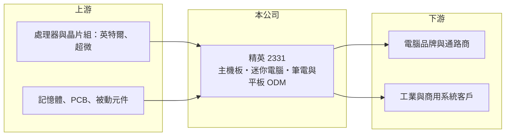

# 2331 精英

> 上市｜[[產業索引-電腦及週邊設備業|電腦及週邊設備業]]｜上市（櫃）日期 1994/09/21

# 第一章：企業模式與商業藍圖

> [!info] 撰寫說明
> 精簡版，由 Claude 依公開資料整理，架構比照 [[2330台積電]]，資料截至 2026-10-08。來源：證交所開放資料快照（基本資料、2026 年第二季資產負債與損益、股利）、Goodinfo 經營績效頁、nStock 公司簡介；歷史沿革與產品轉型的部分描述依記憶整理，已標註待校對。公開資料有限。#待校對

精英電腦（以下簡稱精英）是老牌的[[主機板]]與電腦代工廠，理解它的關鍵在於：它曾是全球主要的主機板供應商之一，但在 PC 產業成熟、品牌與大型代工廠擠壓下，本業長期只賺到微薄的利潤，近年的獲利有相當部分來自本業以外。

- **核心業務：** 精英成立於 1987 年，1994 年在證交所上市。依 nStock 的公司簡介，主要營業項目為個人電腦主機板、桌上型電腦、筆記型電腦、平板電腦、系統及控制介面卡的產銷。精英在 2000 年代曾是全球出貨量名列前茅的主機板廠，並在 2006 年合併筆電廠聯捷（Uniwill）（#待校對）；之後主機板市場集中到 [[2357華碩]]、[[2377微星]]、[[2376技嘉]] 等品牌，精英逐步轉向替客戶設計製造的 [[ODM]] 與系統組裝。
- **營收結構：** 各產品線的營收比重公開資料未查得。精英的產品組合大致可分為消費性與商用主機板、迷你電腦與桌上型系統、筆電與平板，以及工業與嵌入式主機板（#待校對）。2020 至 2022 年營收超過 300 億元，2023 年後降到 200 億元上下，顯示部分大型代工訂單已經縮減。
- **營運據點：** 總部位於台北市中山區，生產基地以中國為主（#待校對）。產能分布與海外新廠的具體內容公開資料未查得。
- **長期方向：** 對一家毛利率約一成的代工廠來說，長期課題是提高產品附加價值，例如工業電腦、伺服器主機板與客製化系統，這些產品量少但毛利較高（#待校對）。同時，面對客戶要求「中國以外」產能，生產據點的分散也是必要的投資方向。

# 第二章：護城河深度與競爭優勢

精英的護城河相當薄，屬於規模與成本競爭的代工產業。

- **競爭優勢：** 精英近四十年的主機板設計經驗，讓它能快速推出符合新平台（新一代處理器與晶片組）的主機板，並承接中小型品牌與通路商的客製需求。與大型代工廠相比，它能接受量較小、規格較雜的訂單，這是它在夾縫中生存的利基。但這種彈性難以轉化為定價權，毛利率長年停在 8% 至 16%。
- **主要對手：** 主機板與系統代工的對手包括 [[2357華碩]]、[[2377微星]]、[[2376技嘉]] 等品牌廠的代工部門，[[2324仁寶]]、[[3231緯創]]、[[2317鴻海]] 等大型代工廠，以及中國本土的主機板廠。在工業電腦領域，則面對 [[2395研華]]、[[6166凌華]] 等專業廠商。
- **觀察重點：** 長期最該追蹤的是營業利益率能否穩定在 2% 以上。2020 至 2025 年營業利益率在 -3% 至 3% 之間擺盪，2025 年只有 0.32%，2026 年上半年也只有 0.32%，本業幾乎只是損益兩平。若要建立長期價值，必須看到高毛利產品占比提升，而不是依賴業外收益。

# 第三章：財務體質與盈利規模

資料日期：2026-10-08，表格是撰寫當時的快照；最新月營收、毛利率、累計 EPS 由自動排程寫在本筆記的屬性欄位（月營收、毛利率、累計EPS 等）。#待校對

精英的財務呈現「營收大、本業薄、業外撐獲利」的特徵，EPS 與營業利益常常對不上，閱讀時需要特別區分本業與業外。

| 年度 | 營收（億元） | [[毛利率]] | [[營業利益率]] | EPS（元） | [[ROE]] |
|---|---|---|---|---|---|
| 2020 | 260 | 10.5% | 0.16% | 0.11 | 0.60% |
| 2021 | 319 | 8.33% | -0.81% | 0.13 | 0.86% |
| 2022 | 314 | 10.3% | 1.07% | 1.57 | 7.92% |
| 2023 | 197 | 16.1% | 2.96% | 1.82 | 8.59% |
| 2024 | 175 | 11.0% | -2.95% | -0.16 | -0.76% |
| 2025 | 201 | 10.8% | 0.32% | 1.41 | 6.99% |

（來源：Goodinfo 經營績效頁。2026 年上半年依證交所資料：營收 107.5 億元、毛利率 8.2%、營業利益率 0.32%、EPS 0.53 元。）

- **營收規模：** 2020 至 2025 年營收由 260 億元降至 201 億元，年複合成長率約 -5%（推算）。2021 至 2022 年疫情帶動的 PC 需求讓營收衝上 300 億元以上，之後隨 PC 景氣回落而大幅下滑，顯示精英的營收高度受 PC 週期與大客戶訂單左右。
- **獲利：** 近五年（2021 至 2025）平均 ROE 約 4.7%（推算），低於一般權益成本。2025 年營業利益只有約 0.64 億元，但 EPS 達 1.41 元（稅後淨利約 7.9 億元），代表大部分獲利來自[[業外收入]]，例如投資收益、利息或處分利益（具體項目未查得）。業外收益的持續性通常不如本業，因此不能把 EPS 直接當成本業的獲利能力。
- **財務特色：** 依 2026 年第二季資料，總資產約 215.4 億元、股東權益約 108.3 億元、負債約 107.2 億元，其中流動負債約 98.8 億元，以應付帳款等營運負債為主（推估）。每股淨值約 19.4 元。公司章程規定每年至少提撥五成可分配盈餘發放股利，但 2025 年度董事會決議不配發（公告的可分配盈餘列為 0，原因未查得）；Goodinfo 統計的歷年平均現金股利約 0.63 元，配息並不穩定。
- **[[ROIC]] 與 [[WACC]]：** 以 2025 年營業利益約 0.64 億元（201 億元 × 0.32%）、稅率 20% 計算，稅後營業利益約 0.51 億元。有息負債未查得，投入資本以股東權益 108.3 億元到「權益加全部負債」215.4 億元為區間，ROIC 只有約 0.2% 至 0.5%（推算）；本業表現最好的 2023 年，同法約 2.2% 至 4.3%（推算）。WACC 以 [[CAPM]] 推估：無風險利率 1.75%、市場風險溢酬 6%、β 假設 0.9（電腦代工股常見值），權益成本約 7.15%；稅後負債成本假設 2%、負債占三成，WACC 約 5.6%（推算）。本業 ROIC 長期遠低於 WACC，代表精英的電腦代工本業並未創造經濟價值，股東報酬主要仰賴業外。

# 第四章：總體風險與地緣政治

精英的風險來自 PC 產業的成熟與集中，以及本業過薄的利潤緩衝。

- **產業週期：** PC 與主機板需求有明顯的換機週期，例如作業系統停止支援、新處理器平台推出時需求上升，之後又回落。2021 至 2022 年的疫情需求與 2023 至 2024 年的庫存調整，讓精英的營收在三年內少了四成，這種[[長鞭效應]]對代工廠的衝擊遠大於品牌廠。
- **營運風險：** 營業利益率接近零，代表任何一次零組件漲價、匯率不利或大客戶砍單，都可能讓本業轉為虧損（2021 年與 2024 年即是如此）。代工客戶集中度高，失去單一大客戶就會造成營收斷層。記憶體與處理器等關鍵零件由少數大廠掌握，價格與供貨都不在精英的控制範圍內。
- **其他風險：** 生產基地若集中在中國，面臨美國關稅與「中國以外」供應鏈要求的壓力，遷廠需要額外資本支出。營收以美元計價、成本部分以人民幣計價，匯率變動影響毛利。業外收益若來自金融資產，也會隨市場波動。

# 專有名詞解析

## 金融

- **[[業外收入]]**：本業營運以外的收入，例如利息、投資收益、處分資產利益，持續性通常低於本業獲利。
- **[[長鞭效應]]**：終端需求的小幅變動，沿供應鏈往上游傳遞時被逐級放大，造成上游庫存與訂單劇烈波動。
- **[[CAPM]]**：資本資產定價模型，以無風險利率加上 β 乘以市場風險溢酬估算股東要求報酬率。

## 產業

- **[[ODM]]**：原廠委託設計製造，代工廠負責產品設計與生產，品牌商負責銷售。
- **[[主機板]]**：電腦中連接處理器、記憶體與各種介面的主要電路板，決定一台電腦能支援的規格。

# 核心供應鏈

- 上游：處理器與晶片組 [[INTC英特爾]]、[[AMD超微]]，記憶體、印刷電路板與被動元件供應商。
- 下游／客戶：國際電腦品牌、區域通路商與系統整合商，以及工業與商用電腦客戶（具體名單公開資料未點名，#待校對）。
- 同業：[[2357華碩]]、[[2377微星]]、[[2376技嘉]]（主機板），[[2324仁寶]]、[[3231緯創]]（電腦代工），[[2395研華]]（工業電腦）。

## 最新新聞
<!-- news:start（自動產生，請勿手動編輯此範圍） -->
- 2026-10-14 🏛️ 重訊 17:31｜代重要子公司興英數位科技(深圳)有限公司公告總經理變更｜[觀測站](https://mops.twse.com.tw/mops/#/web/t05st01)

完整紀錄：[[2331精英 新聞]]
<!-- news:end -->

## 相關連結
- [公開資訊觀測站](https://mopsov.twse.com.tw/mops/web/t05st03?step=1&firstin=1&co_id=2331)
- [Goodinfo](https://goodinfo.tw/tw/StockDetail.asp?STOCK_ID=2331)
- [Yahoo 股市](https://tw.stock.yahoo.com/quote/2331)
- [鉅亨網新聞](https://www.cnyes.com/twstock/2331/news)
