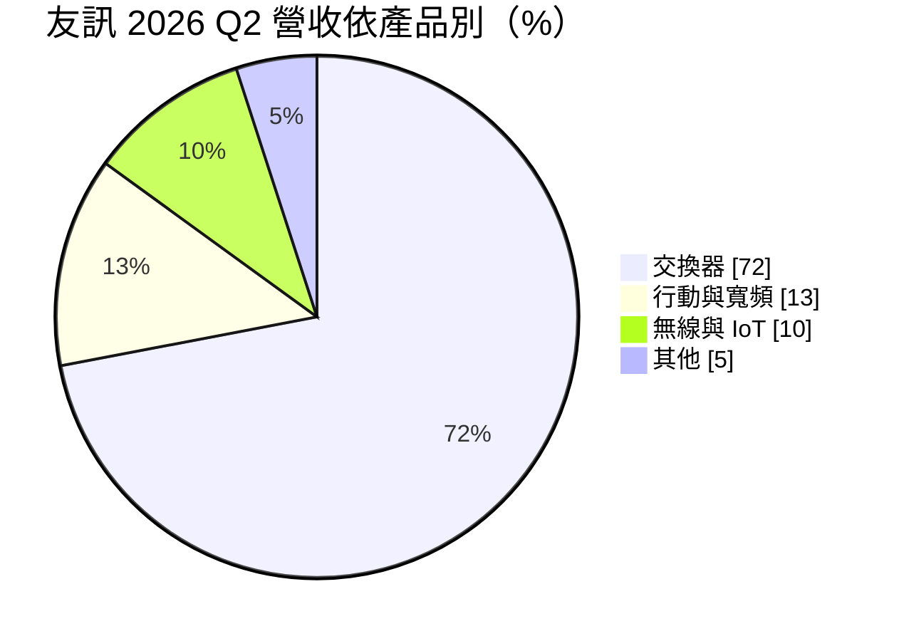
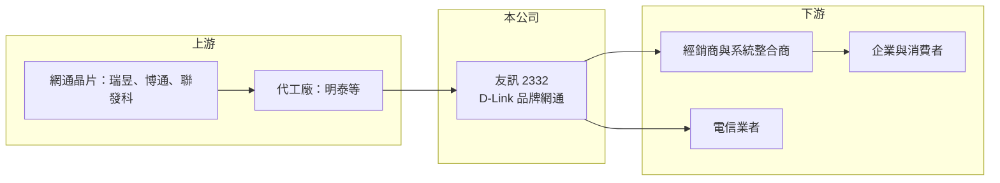

# 2332 友訊

> 上市｜[[產業索引-通信網路業|通信網路業]]｜上市（櫃）日期 1994/10/17

# 第一章：企業模式與商業藍圖

> [!info] 撰寫說明
> 精簡版，由 Claude 依公開資料整理，架構比照 [[2330台積電]] 的四章研究，資料截至 2026-10-08。來源：友訊 2026 年第二季財報說明稿（ir-cloud）、Goodinfo 年度經營績效、證交所開放資料（基本資料、綜合損益、資產負債、營益分析、股利、每月營收）；產業描述為整理性內容，尚未逐條比對原始文件。#待校對

本章說明友訊科技（股票代號：2332，品牌 D-Link，以下簡稱友訊）的商業模式：台灣少數在全球經營網通[[自有品牌]]的公司。

- **核心業務：** 友訊成立於 1987 年，1994 年在台灣證券交易所上市，總部位於台北市內湖區。友訊以 D-Link 品牌銷售[[交換器]]、無線路由器、行動寬頻設備與網路攝影機等網通產品，客戶包括企業、電信業者與一般消費者。與代工廠不同，友訊自己負責產品定義、品牌行銷與全球通路，生產多委外，因此毛利率高於網通代工廠，但需要負擔較高的行銷與通路費用。
- **營收結構：** 依友訊 2026 年第二季財報說明稿，產品別營收中交換器占 72%、行動與寬頻占 13%、無線與 [[IoT]] 占 10%、其他占 5%（公司說明該季把部分其他產品重新歸類到交換器與無線項下）。出貨地區以亞太及其他地區占 74% 最大，歐洲 18%、美洲 8%。交換器占比超過七成，說明友訊的重心已從消費性無線產品轉向企業與電信網路設備。

- **營運據點：** 總部在台北，海外以各區域子公司與經銷體系經營品牌通路，亞太（含印度、東南亞等新興市場）是最大的出貨區域（區域子公司細節待校對）。製造多委由代工夥伴，網通代工廠 [[3380明泰]] 即源自友訊早年的製造部門分割（待校對）。
- **長期方向：** 品牌網通的長期成長來自兩個方向：一是企業與電信市場的交換器與雲端管理方案，客戶黏著度高於零售消費品；二是新興市場的網路基礎建設需求。友訊能否把品牌知名度轉化為企業網路的服務與訂閱收入，決定它能否擺脫「賣硬體、拚價格」的處境。

# 第二章：護城河深度與競爭優勢

本章評估友訊品牌在高度競爭的網通市場中還剩多少護城河。

- **競爭優勢：** D-Link 是經營近四十年的全球網通品牌，在許多新興市場擁有長期的經銷網路與政府、企業標案實績，這是新進者難以短期複製的通路資產。交換器等企業產品一旦導入，客戶的網路架構與管理介面會綁定品牌，帶來一定的轉換成本。但消費性網通產品同質化高，品牌溢價有限，整體屬於窄護城河。
- **主要對手：** 消費與中小企業市場的主要對手是 TP-Link、Netgear、華碩（[[2357華碩]]）等品牌；企業網路市場則有 [[CSCO思科]]、HPE Aruba、Ubiquiti，以及台灣的 [[3704合勤控]]（Zyxel）。TP-Link 以規模與價格優勢在全球市占快速提升，是友訊最直接的壓力來源（對手名單為產業常識整理，待校對）。
- **觀察重點：** 第一，交換器比重持續提高後毛利率能否站穩 25% 以上。第二，營業費用能否隨營收縮減而調整，這決定營業利益率能否回到 2022 年 3% 左右的水準。第三，亞太新興市場的成長能否抵銷歐美市場的萎縮。

# 第三章：財務體質與盈利規模

資料日期：2026-10-08。數字取自 Goodinfo 年度經營績效、友訊財報說明稿與證交所開放資料，表格是撰寫當時的快照；最新月營收、毛利率、累計 EPS 由自動排程寫在本筆記的屬性欄位（月營收、毛利率、累計EPS 等）。#待校對

財務數字顯示友訊是一家毛利率穩定、但營業利益率長期貼近零的品牌公司。

| 年度 | 營收（新台幣） | [[毛利率]] | [[營業利益率]] | EPS（元） | [[ROE]] |
|---|---|---|---|---|---|
| 2020 | 152 億 | 31.5% | 0.53% | 1.90 | 未查得 |
| 2021 | 155 億 | 27.0% | 1.09% | 0.38 | 未查得 |
| 2022 | 171 億 | 25.3% | 3.24% | 0.18 | 未查得 |
| 2023 | 159 億 | 24.1% | 0.79% | 0.95 | 未查得 |
| 2024 | 144 億 | 25.7% | -1.39% | 0.06 | 未查得 |
| 2025 | 134 億 | 24.6% | -2.53% | -0.90 | 約 -6.5%（推算） |
| 2026 上半年 | 71.3 億 | 24.66% | 1.37% | -0.07 | 未查得 |

註：2020 至 2025 年取自 Goodinfo 合併報表。Goodinfo 頁面列出的 ROE 欄位（2025 年 -3.65%）與 EPS 及每股淨值換算不一致，可能是 ROA，因此改列未查得；2025 年 ROE 以 EPS -0.90 元除以每股淨值約 13.8 元推算。2026 上半年取自證交所開放資料。

- **營收規模：** 營收在 2022 年達 171 億元高峰後連續下滑，2020 至 2025 年年複合成長率約 -2.5%（推算）。2026 年第二季營收 36.86 億元、年增 17%，1 至 8 月累計 94.6 億元，較去年同期成長約 8.6%，營收有止跌跡象。
- **獲利：** 毛利率從 2020 年的 31.5% 降到 24% 至 26% 區間後趨於穩定，但營業利益率長期在 -3% 到 3% 之間。2020 與 2023 年的 EPS 明顯高於營業利益所能支撐的水準，顯示部分年度獲利來自業外收益（推估）。2026 年第二季 EPS -0.02 元。
- **財務特色：** 依證交所資料，2026 年第二季底股東權益 82.1 億元、負債總計 52.0 億元，每股淨值 13.76 元，保留盈餘仍有 24.8 億元，財務結構穩健。2025 年度因虧損未配發股利；Goodinfo 顯示歷年平均現金股利約 0.70 元，股利穩定度不高。
- **[[ROIC]] 與 [[WACC]]：** 以 2026 上半年營業利益 0.98 億元年化並扣 20% 稅後約 1.57 億元，投入資本以股東權益 82.1 億元加非流動負債 8.56 億元（代替有息負債）約 90.7 億元計算，ROIC 約 1.7%（推算）；2025 年營業虧損約 3.4 億元，ROIC 為負。WACC 以 CAPM 推估：無風險利率 1.75%、市場風險溢酬 6%、β 取 1.0（推估，網通品牌同業常見值），權益成本約 7.75%；負債比重低，WACC 約 7% 至 7.5%（推算）。ROIC 長期明顯低於 WACC，代表友訊的品牌與通路資產在近年並未創造經濟價值，提升營業利益率是唯一的解方。

# 第四章：總體風險與地緣政治

本章整理友訊面對的長期風險，主要來自價格競爭與市場結構改變。

- **產業週期：** 網通產品需求隨企業 IT 預算、電信建設與消費者換機週期波動，2022 年供應鏈缺料推升出貨後，2023 至 2025 年進入庫存調整，品牌商首當其衝。新一代 Wi-Fi 與高速交換器的換代雖然帶來升級需求，但也加速舊產品跌價。
- **營運風險：** 品牌經營需要在全球維持行銷、售後與通路費用，營收下滑時費用難以等比例縮減，造成營業虧損。生產委外使友訊對代工成本與晶片供應的掌控力較低。
- **其他風險：** 美國與歐洲對中國網通設備的資安審查，一方面打擊中國品牌、對友訊有利，另一方面也提高所有網通品牌的資安合規成本。友訊營收以美元、歐元與新興市場貨幣計價，新興市場匯率劇烈波動會影響獲利。

# 專有名詞解析

## 應用

- **[[IoT]]**：物聯網，讓設備透過網路連線並交換資料，工業物聯網用於設備監控與自動化。

## 金融

- **[[ROIC]]**：投入資本報酬率，稅後營業利益除以股東權益與有息負債的合計，衡量本業對所有資金提供者的報酬。
- **[[WACC]]**：加權平均資金成本，依股東權益與負債的比重加權計算的資金成本，ROIC 高於它才代表創造價值。

## 產業

- **[[自有品牌]]**：企業以自己的商標設計、行銷與銷售產品，掌握定價與通路，毛利通常高於代工。
- **[[交換器]]**：在資料中心或企業網路中轉送資料封包的網路設備，AI 資料中心需要 800G、1.6T 等高速規格。

# 核心供應鏈

- 上游：網通晶片 [[2379瑞昱]]、[[AVGO博通]]、[[2454聯發科]]；代工 [[3380明泰]] 等（實際供應比重未公開，待校對）。
- 下游／客戶：全球經銷商、系統整合商、電信業者，以及企業與消費者。
- 同業：TP-Link、Netgear、[[2357華碩]]、[[3704合勤控]]、[[CSCO思科]]、Ubiquiti。

## 最新新聞
<!-- news:start -->
<!-- news:end -->

## 相關連結
- [公開資訊觀測站](https://mopsov.twse.com.tw/mops/web/t05st03?step=1&firstin=1&co_id=2332)
- [Goodinfo](https://goodinfo.tw/tw/StockDetail.asp?STOCK_ID=2332)
- [Yahoo 股市](https://tw.stock.yahoo.com/quote/2332)
- [鉅亨網新聞](https://www.cnyes.com/twstock/2332/news)
