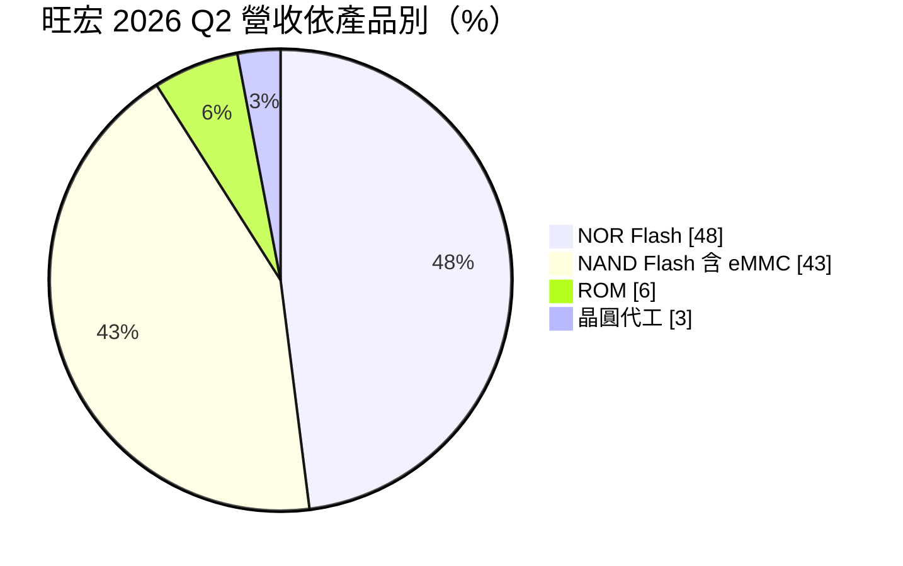
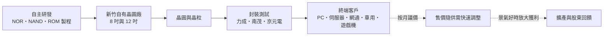
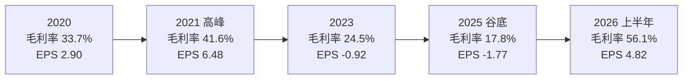
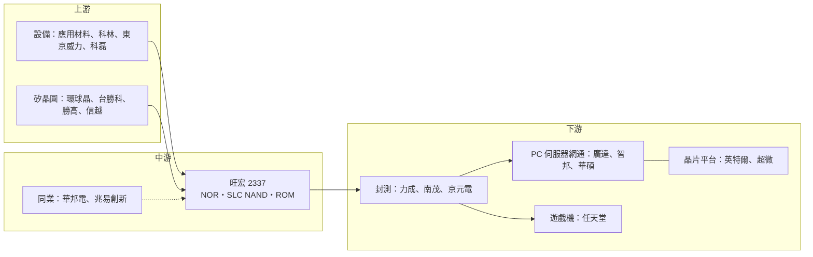

# 2337 旺宏

> 上市｜[[產業索引-半導體業|半導體業]]｜上市（櫃）日期 1995/03/15

# 第一章：企業模式與商業藍圖

> [!info] 撰寫說明
> 本文由 Claude 依公開資料整理，架構比照 [[2330台積電]] 的四章研究，資料截至 2026-10-08。財務數字來源：Goodinfo 經營績效、股利政策與現金流量頁（2019 至 2025 年度）、證交所開放資料快照（2026 年第二季資產負債與綜合損益、2025 年度股利、公司基本資料）、旺宏 2025 年第四季與 2026 年第二季法說會相關報導（優分析、科技新報）；產業描述為整理性內容，尚未逐條比對原始文件。#待校對

在評估單一個股的長期投資價值時，首要步驟是拆解企業的底層獲利邏輯。本章針對旺宏電子（股票代號：2337，以下簡稱旺宏）的商業模式進行定性分析，說明它為何選擇避開 [[DRAM]] 與主流大容量 [[3D NAND]] 的主戰場，以及如何在小容量、高可靠度的[[非揮發性記憶體]]市場中，靠自有技術與自有晶圓廠建立自己的位置。

## 一、核心定位：自有技術的非揮發性記憶體 IDM

旺宏成立於 1989 年 12 月，總部位於新竹科學園區，1995 年上市，創辦人吳敏求至今仍擔任董事長兼執行長。旺宏是台灣少數從技術研發、晶圓製造到銷售一手包辦的記憶體 [[IDM]]，產品集中在斷電後資料不會消失的非揮發性記憶體，主要有三類：[[NOR Flash]]、[[SLC NAND]]（含 [[eMMC]]）與唯讀記憶體（[[ROM]]）。

理解旺宏最好的方式，是看它「不做什麼」。旺宏不生產 DRAM，避開由三星、SK 海力士、美光寡占、每一代都需要巨額資本支出的市場；它也不做固態硬碟與手機儲存用的高層數 3D NAND，那是三星、鎧俠、美光、SK 海力士的規模戰場。旺宏把資源放在容量需求不大、但要求長期供貨與資料穩定的應用，例如 PC 與伺服器的開機韌體、網通設備、車用電子、工業設備，以及遊戲機卡匣。這種定位讓旺宏不必和全球最大的記憶體廠比資本規模，但代價是市場本身較小，而且一樣會受到記憶體價格循環的劇烈影響。

旺宏長期是任天堂遊戲卡匣 ROM 的重要供應商（依產業常見資料整理，待校對）。ROM 在製造時就把資料寫入、之後不能修改，非常適合用來發行遊戲軟體。這項業務讓旺宏的營收帶有遊戲機週期的色彩，也是它和其他記憶體廠最明顯的差異之一。

## 二、終端應用／產品板塊：NOR 與 NAND 並重

依 2026 年第二季法說會報導，旺宏的產品營收結構如下：

* **NOR Flash：** NOR Flash 讀取速度快、可以直接執行程式碼，因此常用來存放開機程式與韌體。旺宏的 NOR 應用以電腦與伺服器為最大宗，其次是通訊設備。AI 伺服器、GPU 加速卡與 PC 的韌體容量持續提高，帶動高容量 NOR 的需求，這是 NOR 這個「老產品」在 AI 時代仍能成長的原因。
* **[[NAND Flash]]（含 eMMC）：** 旺宏以 SLC 與 MLC 等中低容量 NAND 為主，2025 年開始量產 16Gb eMMC，並規劃更大容量的版本。三大 NAND 廠把產能轉向高層數產品與企業級固態硬碟後，中低容量 NAND 與 eMMC 出現供給缺口，旺宏得以補位，這使 NAND 比重在 2026 年快速拉升。
* **ROM：** 主要用於遊戲機卡匣，供應商極少，客戶集中度高。營收隨遊戲機的產品週期起伏，新機推出與熱門遊戲發行時需求較強。
* **晶圓代工：** 利用部分產能替其他客戶代工，比重很小。

從長期角度看，旺宏的營收結構已從過去「NOR 與 ROM 為主」，轉為「NOR 與 NAND 並重」。這個轉變擴大了營收規模，但 NAND 屬於規格化程度更高的商品，也讓旺宏的價格敏感度提高。

## 三、資本轉化邏輯：自有晶圓廠加上價格槓桿

* **IDM 模式的兩面：** 旺宏從製程開發到晶圓製造都自己掌握，可以控制品質與交期，這對要求長期供貨的車用與工業客戶是重要條件。但自有晶圓廠也代表固定成本高，營收下滑時折舊與人事費用無法同步縮減，因此旺宏的獲利會隨營收大幅放大或縮小。
* **價格槓桿：** 記憶體的售價由供需決定，變動速度很快。旺宏 2025 年全年[[毛利率]]只有 17.8%、營業利益率為 -12.8%；到了 2026 年上半年，價格大漲使毛利率回到 56.1%、營業利益率 36.8%。同一家公司在一年多之內獲利能力完全翻轉，說明投資人必須以「整個週期」而非單一年度來理解它。
* **[[月度議價]]：** 依法說會報導，旺宏的 eMMC 與 SLC NAND 已改為按月議價。這讓漲價期的效益更快反映在營收上，但跌價期同樣會更快反映，等於把價格循環的振幅直接傳到損益表。
* **產能：** 旺宏的晶圓廠全部位於新竹科學園區，擁有 8 吋與 12 吋產能。依優分析報導，2026 年初公布的擴產計畫把 12 吋月產能從約 2 萬片提高到 3 萬多片，增幅超過五成。

## 四、企業長期藍圖：補位大廠退出的市場

旺宏的長期策略可以用一句話概括：不追趕三大記憶體廠，而是在大廠退出或不重視的利基市場中，以自有技術與產能補位。具體有三條主線：

* **擴大中低容量 NAND 與 eMMC：** 三大 NAND 廠持續把資源投入高層數 3D NAND 與 [[HBM]] 等高階產品，中低容量產品逐步停產。旺宏以成熟的 SLC 與 MLC 技術承接這些需求，這是 2026 年擴產的主要方向。這條路線的長期價值，取決於大廠是否真的不再回頭；若大廠在需求轉弱時把產能轉回中低容量，價格壓力會立刻出現。
* **高容量、高可靠度 NOR：** 鎖定 AI 伺服器、車用 [[ADAS]] 與工業應用。這些市場要求長期供貨與嚴格的[[車規驗證]]，一旦導入就不容易被替換，是旺宏比較有機會建立長期客戶關係的領域。
* **新世代記憶體技術：** 旺宏持續投入 [[3D NOR]] 等立體堆疊技術，目標是提高單位容量、降低成本（具體量產時程本次未查得）。新技術能否量產並取得成本優勢，是旺宏十年後能否維持競爭力的關鍵。

擴產的時點本身也是一種資本配置選擇。依報導，2026 年初規劃資本支出約 220 億元，第二季法說會再追加約 158 億元，新設備自 2026 年下半年起陸續進駐、2027 年起貢獻產出。這是旺宏近年規模最大的一次投資，也讓它的未來幾年獲利更加依賴記憶體景氣能否延續。

# 第二章：護城河深度與競爭優勢

在長期價值投資中，「護城河」指企業抵禦競爭、維持超額利潤的保護機制。本章分析旺宏的護城河構成、全球主要競爭對手，以及這些優勢在記憶體價格循環中能守住多少。

## 一、旺宏護城河的核心組成要素

旺宏的護城河屬於「窄護城河」。它無法靠規模或技術領先決定價格，但以下四個要素讓它在利基市場中保有一定的位置：

* **1. 自主技術與自有產能：** 旺宏擁有自行開發的 NOR、NAND 與 ROM 製程技術，以及自己的晶圓廠。車用與工業客戶通常要求供應商保證十年以上的供貨與穩定品質，自有產能讓旺宏能做出這種承諾，這是只做設計、委外生產的同業較難提供的條件。
* **2. ROM 與遊戲機的長期合作：** ROM 是全球供應商極少的小眾市場，客戶需要的是穩定、保密與大量交貨的能力。旺宏在這個市場深耕多年，客戶轉換意願低，這塊業務雖然規模不大，卻是旺宏少數接近「獨占型」的護城河。
* **3. 高可靠度市場的客戶關係：** 車用與工業記憶體需要經過長時間的驗證，一旦通過，客戶在產品生命週期內很少更換供應商。這種黏著度讓旺宏在景氣下行時，流失的主要是價格敏感的一般消費性訂單，而不是核心客戶。
* **4. 專利組合：** 旺宏在非揮發性記憶體領域累積大量專利，曾以專利訴訟保護市場地位（依公司沿革整理，待校對）。專利本身不能保證獲利，但能提高新進者的法律與授權成本。

## 二、全球主要競爭對手格局

| 對手 | 主要產品 | 對旺宏的威脅 |
|---|---|---|
| [[2344華邦電]] | 全球最大 NOR Flash 廠，另有 SLC NAND 與利基型 DRAM | 規模大於旺宏，NOR 與 SLC NAND 直接競爭；2026 年宣布收購英飛凌 NOR 事業後規模差距可能擴大 |
| 兆易創新（GigaDevice） | 中國 NOR Flash 與 MCU 廠 | 受國產替代政策支持，在中國市場以價格競爭 |
| 英飛凌（原 Cypress、Spansion 產品線） | 車用與工業 NOR Flash | 在車用高可靠度市場與旺宏競爭；該事業預計併入華邦電 |
| 鎧俠與其他 NAND 大廠 | NAND Flash 舊產品線 | 若產能轉回中低容量，將壓低 SLC NAND 與 eMMC 價格 |
| 遊戲機儲存替代方案 | 其他儲存媒介 | ROM 業務的主要威脅來自技術替代，而非同業 |

NOR Flash 的競爭格局可以理解為「少數幾家分食一個不大的市場」。華邦電、旺宏、兆易創新與英飛凌是主要供應商，大型記憶體廠多已退出。依經濟日報報導，華邦電在 2026 年 9 月宣布以約 11.2 億美元收購英飛凌的 NOR Flash 事業，預計 2027 年下半年完成，完成後 NOR 市場的集中度將進一步提高。對旺宏而言，這代表最大的競爭對手變得更大，但也可能讓整個市場的價格紀律變得更好。

## 三、優勢轉化：哪些市場守得住、哪些守不住

* **守得住：** 供給緊張時，旺宏的 NOR 與 SLC NAND 會成為客戶搶貨的對象。2026 年第二季毛利率衝上約 64%、創公司紀錄（依法說會報導），顯示在供需失衡時旺宏有很強的議價能力。ROM 業務因供應商稀少，也較少面臨價格戰。
* **守不住：** 旺宏的 NOR 規模小於華邦電，在中國市場又面臨兆易創新的價格競爭；SLC NAND 與 eMMC 本質上是商品，價格可能隨供需快速反轉。2023 至 2025 年旺宏連續三年營業虧損，最差的 2024 年營業利益率為 -15.2%，說明景氣低迷時旺宏的抗跌能力有限，護城河擋不住整個產業的價格下跌。
* **觀察重點：** 第一，新增 12 吋產能在 2027 年開出時，記憶體價格是否仍在高檔；第二，高容量 NOR 在 AI 伺服器與車用的比重能否持續提升；第三，3D NOR 等新技術能否量產。這三點決定旺宏 2026 年的高獲利是一次性的景氣紅利，還是能轉化為更高的長期獲利基期。

# 第三章：財務體質與盈利規模

資料日期：2026-10-08。年度數字取自 Goodinfo 經營績效、股利政策與現金流量頁，2026 年上半年與資產負債取自證交所開放資料快照，表格是撰寫當時的快照；最新月營收、毛利率、累計 EPS 由自動排程寫在本筆記的屬性欄位（月營收、毛利率、累計EPS 等）。#待校對

財務報表是檢驗護城河是否真實存在的最終標準。本章用多年度的三率、ROE、現金流與資本報酬，檢視旺宏在一個完整記憶體週期（2020 至 2021 年上升、2022 年見頂、2023 至 2025 年虧損、2026 年強力反彈）中的獲利品質。

## 一、獲利能力的基石：三率

| 年度 | 營收（億元） | [[毛利率]] | [[營業利益率]] | EPS（元） | [[ROE]] |
|---|---|---|---|---|---|
| 2020 | 398 | 33.7% | 14.7% | 2.90 | 15.5% |
| 2021 | 506 | 41.6% | 21.9% | 6.48 | 28.9% |
| 2022 | 435 | 44.2% | 21.5% | 4.85 | 18.1% |
| 2023 | 276 | 24.5% | -8.7% | -0.92 | -3.4% |
| 2024 | 259 | 23.6% | -15.2% | -1.73 | -7.0% |
| 2025 | 289 | 17.8% | -12.8% | -1.77 | -7.4% |
| 2026 上半年 | 296 | 56.1% | 36.8% | 4.82 | 未查得（半年約 15%，推算） |

* **營收：** 2020 至 2025 年營收從 398 億元降到 289 億元，年複合成長率約 -6.2%（推算）。這段期間的起點與終點剛好落在景氣高低兩端，因此數字偏悲觀；但也說明旺宏並不是長期穩定成長的公司，而是營收規模隨價格大幅擺盪的週期股。2026 年上半年營收 296 億元，已超過 2025 年全年。
* **[[毛利率]]：** 2022 年 44.2% 與 2025 年 17.8% 相差超過 26 個百分點，2026 年上半年又回到 56.1%。毛利率的振幅遠大於晶圓代工業者，反映記憶體是價格由供需決定的商品，而旺宏的成本結構又以固定成本為主。
* **[[營業利益率]]：** 2023 至 2025 年連續三年為負，代表在景氣低谷時，旺宏的營收連研發與管銷費用都無法完全覆蓋。2026 年上半年營業利益約 109 億元，是營運槓桿在上升期發揮作用的結果。
* **[[淨利率]]與業外：** 2026 年上半年稅後淨利約 95 億元，營業外收支只有約 3.7 億元，獲利幾乎全部來自本業，品質相對單純。

## 二、[[ROE]]：資本效率

旺宏 2021 至 2025 年平均 ROE 約 5.9%（推算），若改看 2020 至 2024 年則約 10.4%（推算）。兩個數字差距很大，正好說明旺宏的 ROE 沒有穩定的中樞，而是「高峰年 20% 至 30%、低谷年負值」交替出現。2026 年第二季底股東權益約 619 億元、負債總額約 345 億元，負債比約 36%（推算），每股淨值 31.28 元；財務結構不算激進，讓旺宏能撐過三年虧損而不必大幅增資。

股利方面，旺宏 2019 至 2023 年度的現金股利分別為 1.19、1.2、1.8、1.8、0.5 元，2024 與 2025 年度因虧損未配發。以當年 EPS 計算，2019 至 2022 年度配息率約 28% 至 73%（推算），金額與獲利高度連動。公司章程明定「以現金股利為優先」，但也保留因資本密集需要而保留盈餘的彈性，因此旺宏屬於「有賺才配、景氣差時停配」的類型，不適合追求穩定現金流的投資人。

## 三、資本支出與自由現金流

| 年度 | 營業現金流（億元） | 投資現金流（億元） | 自由現金流（億元） |
|---|---|---|---|
| 2020 | 98.6 | -60.4 | 38.1 |
| 2021 | 161 | -26.2 | 135 |
| 2022 | 117 | -103 | 13.2 |
| 2023 | -5.3 | -75.9 | -81.2 |
| 2024 | -1.8 | -51.7 | -53.5 |
| 2025 | 48.4 | -17.2 | 31.1 |

（自由現金流依 Goodinfo 定義為營業現金流加投資現金流，投資現金流包含金融資產買賣，不等於純資本支出。）

* **[[自由現金流]]：** 2020 至 2025 年六年中有四年為正，2023 與 2024 年營業現金流甚至轉負，是虧損加上存貨累積的結果。累計六年自由現金流約 83 億元（推算），遠低於同期景氣好時的獲利，代表旺宏賺到的現金有相當比例又投回產能。
* **[[CapEx]]：** 2026 年規劃的擴產（年初約 220 億元，加上第二季追加約 158 億元）遠高於過去幾年每年數十億元的投資現金流水準。這筆投資若在價格高檔時開出產能，回收速度會很快；若開出時景氣已反轉，折舊將成為 2028 年以後的壓力（推估）。

## 四、[[ROIC]] 與 [[WACC]]：價值創造利差

企業長期創造價值的條件，是投入資本報酬率（ROIC）高於加權平均資金成本（WACC）。

**ROIC（推算）：** 公開資料未直接揭露旺宏的 ROIC，本文以「稅後營業利益 ÷（股東權益＋有息負債）」推算。有息負債明細未查得，以 2026 年第二季非流動負債約 159 億元作為近似值，加上股東權益約 619 億元，投入資本約 779 億元。2026 年上半年營業利益約 109 億元，年化約 218 億元，以稅率 20% 計算稅後約 174 億元，ROIC 約 22%（推算）。2021 年高峰期營業利益約 111 億元（營收 506 億元 × 21.9%），稅後約 89 億元，以當時較小的資本基數推估 ROIC 約在 15% 至 20%（推算）。2023 至 2025 年營業虧損，ROIC 為負值。

**WACC（推算）：** 以 CAPM 推估股東權益成本：無風險利率取台灣 10 年期公債約 1.75%，市場風險溢酬 6%，β 假設 1.3（記憶體股波動高於大盤，同業常見值約 1.2 至 1.5，非來源數字），權益成本約 1.75% + 1.3 × 6% = 9.55%。負債成本假設稅前 2%、稅率 20%，稅後 1.6%。以帳面資本結構（權益約 80%、負債約 20%）計算，WACC 約 7.9%；若以市值計算（股價淨值比約 3.8 倍，權益權重超過九成），WACC 約 9%（推算）。

**結論：** 旺宏在 2020 至 2022 年 ROIC 高於 WACC，是創造價值的階段；2023 至 2025 年 ROIC 為負，三年間持續毀損價值；2026 年價格大漲，ROIC 再度大幅超過 WACC。以整個週期平均來看，旺宏的 ROIC 大致在 WACC 上下徘徊（推估），長期能否創造價值，關鍵在於擴產能否在景氣高點回收、以及低谷期的虧損能否比過去更小。

# 第四章：總體風險與地緣政治

任何企業都無法脫離宏觀環境獨立存在。本章分析旺宏未來必須面對的地緣政治、產業週期、營運與技術風險。這些風險多數是利基型記憶體廠的共同課題，但旺宏產能全部集中在新竹、客戶又包含集中度高的遊戲機市場，使它對其中幾項的曝險更高。

## 一、地緣政治風險

* **中國國產替代：** 中國兆易創新等業者在國產替代政策下擴大 NOR 與 SLC NAND 供給。中國政府鼓勵本土客戶優先採用國產記憶體，長期可能侵蝕旺宏在中國客戶的份額，並在景氣下行時率先以價格搶單。
* **美中貿易與關稅：** 旺宏的客戶多是 PC、網通與消費性電子廠，這些終端產品若受美國關稅衝擊而減少出貨，記憶體需求會連帶下滑。關稅也可能迫使客戶調整供應鏈所在地，增加旺宏的出貨與服務成本。
* **生產集中在台灣：** 旺宏的晶圓廠全部位於新竹，面臨兩岸風險與地震、水電等營運風險。相較在海外有產能的同業，旺宏較難滿足國際客戶「台灣加一」的分散生產要求。

## 二、產業週期與市場結構風險

* **記憶體價格反轉：** 旺宏的獲利對售價極度敏感，2025 年營業利益率 -12.8%，2026 年上半年卻達 36.8%。若三大 NAND 廠或中國業者把產能轉回中低容量產品，價格可能快速回落，而按月議價會讓跌價更快反映在損益上。
* **[[長鞭效應]]：** 記憶體漲價期間，客戶往往提前備貨、重複下單，使表面需求高於實際終端需求；一旦價格見頂，客戶開始去化庫存，訂單會急速萎縮。2023 年旺宏營業現金流轉負，就是上一輪庫存調整的結果。
* **遊戲機週期：** ROM 與部分 NOR 業務與遊戲機的產品週期相關。新機推出時需求強，主機生命週期後段需求下滑，這個節奏不受旺宏控制。

## 三、營運環境的隱性風險

* **擴產時點：** 新產能 2027 年才開始貢獻，若屆時記憶體景氣已轉弱，可能出現產能過剩與折舊壓力。記憶體產業過去多次出現「大家同時在高點擴產、在低點一起虧損」的情況。
* **客戶集中：** ROM 業務的客戶集中度高，若主要客戶改變儲存方案或轉單，營收會受明顯影響。
* **匯率：** 記憶體多以美元報價，成本中有相當部分以新台幣支付，新台幣升值會壓縮以台幣計算的營收與毛利。

## 四、科技演進風險

旺宏的研發與資本規模遠小於三大記憶體廠，新世代記憶體技術能否順利量產並取得成本優勢，是長期最大的不確定性。3D NOR 若成功，可以讓 NOR 進入更大容量的應用；若進度落後，旺宏可能被迫在舊製程上和中國業者比價格。另一方面，AI 帶來的結構變化是雙面的：AI 伺服器提高了高容量 NOR 的需求，是正面因素；但 AI 也讓三大廠把資源集中在 HBM 與高階 NAND，旺宏目前受惠的正是大廠「無暇顧及」的空間。若 AI 投資降溫、大廠產能回流，旺宏所在的利基市場會首當其衝。遊戲機若改採其他儲存技術，ROM 業務也可能逐步萎縮。

# 專有名詞解析

## 半導體

- **[[非揮發性記憶體]]**：斷電後資料仍能保存的記憶體，包括 NOR Flash、NAND Flash 與 ROM，用來儲存程式碼與資料。
- **[[NOR Flash]]**：讀取速度快、可直接執行程式碼的快閃記憶體，容量較小，常用於存放開機程式與韌體。
- **[[NAND Flash]]**：單位容量成本低、適合大量儲存資料的快閃記憶體，用於固態硬碟、手機儲存與記憶卡。
- **[[SLC NAND]]**：每個記憶單元只存 1 位元的 NAND Flash，容量小但耐用度與可靠度高，常用於網通、工業與車用。
- **[[eMMC]]**：把 NAND Flash 與控制晶片封裝在一起的嵌入式儲存方案，常見於電視、機上盒與入門手機。
- **[[ROM]]**：唯讀記憶體，資料在製造時寫入、之後不能修改，遊戲機卡匣是代表性應用。
- **[[DRAM]]**：動態隨機存取記憶體，斷電後資料會消失，作為處理器運算時的主記憶體。
- **[[3D NAND]]**：把記憶單元垂直堆疊數百層以提高容量的 NAND Flash 技術，由三星、鎧俠、美光、SK 海力士主導。
- **[[3D NOR]]**：把 NOR Flash 記憶單元立體堆疊以提高容量、降低單位成本的新世代技術。
- **[[IDM]]**：垂直整合製造商，從晶片設計、晶圓製造到銷售都自己完成的半導體公司。
- **[[HBM]]**：高頻寬記憶體，把多顆 DRAM 垂直堆疊並與 GPU 封裝在一起，是 AI 加速器的關鍵元件。

## 應用

- **[[ADAS]]**：先進駕駛輔助系統，例如車道維持與自動煞車，需要高可靠度的記憶體儲存演算法與韌體。
- **[[車規驗證]]**：車用晶片須通過 AEC-Q100 等可靠度測試與車廠認證，流程常需 2 至 3 年，因此轉換成本高。

## 金融

- **[[月度議價]]**：供應商與客戶每月重新協商售價，價格能更快反映供需變化，漲價期有利、跌價期不利。
- **[[ROIC]]**：投入資本報酬率，稅後營業利益除以股東權益加有息負債，衡量公司投入營運的全部資本能賺多少。
- **[[WACC]]**：加權平均資金成本，股東與債權人要求報酬率的加權平均，是 ROIC 的比較基準。
- **[[長鞭效應]]**：終端需求的小幅變動，沿供應鏈往上游傳遞時被逐級放大，造成上游庫存與訂單劇烈波動。

# 核心供應鏈

## 1. 上游：設備、材料與矽晶圓
- 半導體設備：[[AMAT應用材料]]、[[LRCX科林研發]]、[[8035東京威力科創]]、[[KLAC科磊]]
- 矽晶圓：[[6488環球晶]]、[[3532台勝科]]、[[3436勝高]]、[[4063信越化學]]

## 2. 中游：旺宏本身
- NOR Flash、SLC NAND、eMMC、ROM 設計與製造

## 3. 下游：封測與客戶
- 封裝測試：[[6239力成]]、[[8150南茂]]、[[2449京元電子]]
- 遊戲機：任天堂
- PC、伺服器與網通：[[2382廣達]]、[[2345智邦]]、[[2357華碩]]
- 晶片平台：[[INTC英特爾]]、[[AMD超微]]

## 4. 同業與競爭者
- 國內：[[2344華邦電]]
- 國外：兆易創新、英飛凌、鎧俠

## 最新新聞
<!-- news:start（自動產生，請勿手動編輯此範圍） -->
- 2026-10-15 📰 媒體 12:10｜鉅亨速報 - Factset 最新調查：旺宏(2337-TW)EPS預估下修至18.62元，預估目標價為170元｜[鉅亨網](https://news.cnyes.com/news/id/6631038)
- 2026-10-15 📰 媒體 12:10｜鉅亨速報 - Factset 最新調查：旺宏(2337-TW)目標價調降至170元，幅度約4.49%｜[鉅亨網](https://news.cnyes.com/news/id/6631033)
- 2026-10-07 📰 媒體 19:50｜營收速報 - 旺宏(2337)9月營收83.67億元年增率高達188.24％｜[鉅亨網](https://news.cnyes.com/news/id/6623949)
- 2026-10-07 🏛️ 重訊 17:31｜本公司召開2026年第三季法人說明會｜[觀測站](https://mops.twse.com.tw/mops/#/web/t05st01)

完整紀錄：[[2337旺宏 新聞]]
<!-- news:end -->

## 相關連結
- [公開資訊觀測站](https://mopsov.twse.com.tw/mops/web/t05st03?step=1&firstin=1&co_id=2337)
- [Goodinfo](https://goodinfo.tw/tw/StockDetail.asp?STOCK_ID=2337)
- [Yahoo 股市](https://tw.stock.yahoo.com/quote/2337)
- [鉅亨網新聞](https://www.cnyes.com/twstock/2337/news)
