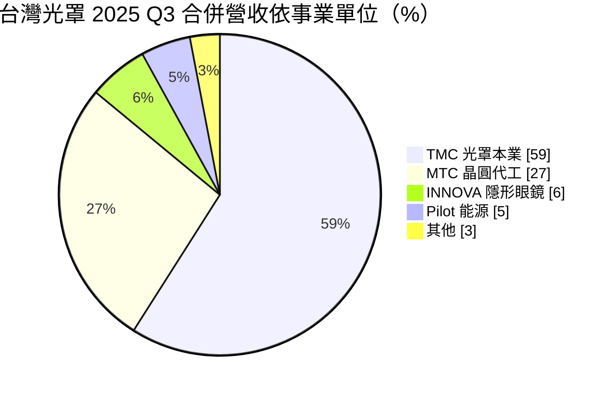
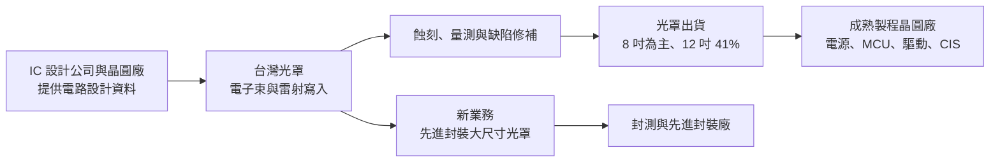
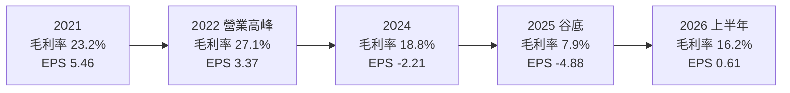
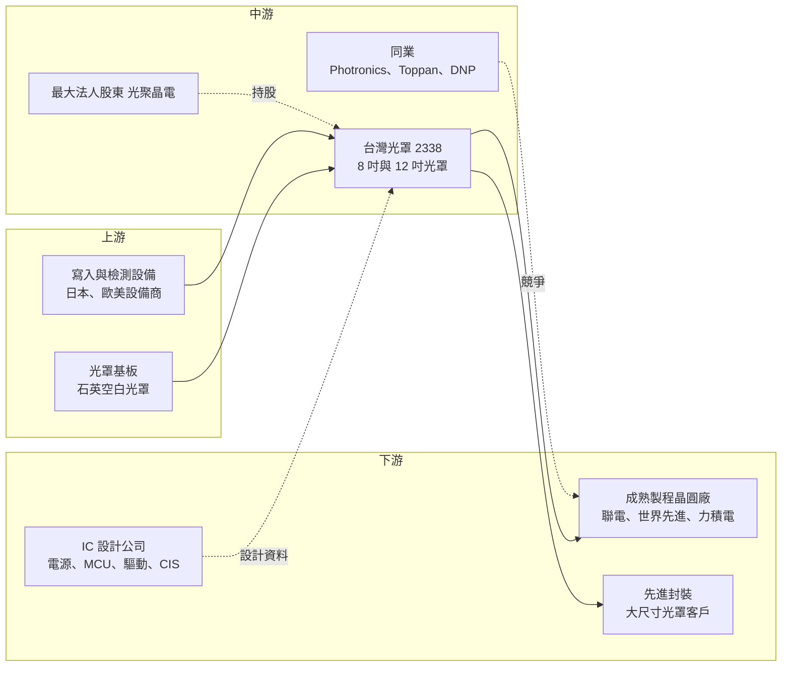

# 2338 光罩

> 上市｜[[產業索引-半導體業|半導體業]]｜上市（櫃）日期 1995/04/17

# 第一章：企業模式與商業藍圖

> [!info] 撰寫說明
> 本文由 Claude 依公開資料整理，架構比照 [[2330台積電]] 的四章研究，資料截至 2026-10-08。財務數字來源：Goodinfo 經營績效、股利政策與現金流量頁（2019 至 2025 年度）、證交所開放資料快照（2026 年第二季資產負債與綜合損益、2025 年度股利、公司基本資料）、poorstock 法說摘要、工商時報、科技新報、優分析、旺得富；產業描述為整理性內容，尚未逐條比對原始文件。#待校對

在評估單一個股的長期投資價值時，首要步驟是拆解企業的底層獲利邏輯。本章針對台灣光罩（股票代號：2338）的商業模式進行定性分析，說明台灣第一家專業[[光罩]]廠如何在多角化失利、連續虧損後回到本業，並嘗試以製程升級與[[先進封裝]]光罩重新建立成長動能。

## 一、核心定位：台灣最早的獨立光罩廠

台灣光罩成立於 1988 年 10 月，1995 年上市，是台灣第一家專業光罩製造商。光罩可以理解為晶片製造的「底片」：晶圓廠每一道微影製程，都要用光罩把電路圖形投影到晶圓上，一顆晶片往往需要數十片光罩。只要有新晶片設計定案、或舊晶片改版，就會產生新的光罩需求。

全球光罩市場分成兩類。第一類是自有光罩廠（captive），台積電、三星、英特爾等大廠自己製作先進製程光罩，幾乎不外包；第二類是獨立光罩廠（merchant），替其他晶圓廠與 IC 設計公司製作光罩。台灣光罩屬於後者，客戶集中在[[成熟製程]]與[[特殊製程]]，產品以 8 吋光罩為主，但 12 吋比重由 2024 年的 34% 提高到 2025 年的 41%（poorstock 法說摘要）。製程能力則從過去主力的 90 奈米，逐步推進到 55、40 與 28 奈米。

台灣光罩的經營權在 2025 年出現結構性變化。依科技新報報導，大宇資（2025 年底更名為 [[6111光聚晶電]]）於 2025 年 7 月宣布透過子公司以私募方式取得台灣光罩約 20% 股權，每股 24.4 元、6,337 萬股，總金額約 15.5 億元，成為最大法人股東；證交所資料顯示目前董事長為凃俊光。新經營團隊的核心訊息是「聚焦光罩本業」，整理過去多角化留下的子公司。

## 二、終端應用／產品板塊：本業光罩占六成

過去十年，台灣光罩旗下陸續發展晶圓代工、隱形眼鏡、能源、儲能、雷射焊接等子公司，使合併營收不只來自光罩。依 poorstock 整理的法說資料，2025 年第三季合併營收依事業單位如下：

光罩本業依客戶的晶片應用，2025 年結構為：電源管理 IC 38%、[[MCU]] 21%、驅動 IC 13%、影像感測器（[[CIS]]）13%、砷化鎵 6%、其他 6%。換句話說，台灣光罩服務的是電源、控制、顯示與感測這些成熟製程晶片，而不是 AI 先進製程。這類晶片的設計案數量多、改版頻繁，是獨立光罩廠的基本盤。

地區上，2025 年台灣占 45%、中國 26%、東北亞 17%、東南亞 12%。中國比重由 2024 年的 35% 降到 26%，反映中國本土光罩廠以補貼與低價搶單；公司因此轉向台灣、東南亞與日本市場。

## 三、資本轉化邏輯（營運模式）：接單即客製、設備決定能力

* **每片光罩都是客製品：** 光罩依客戶的設計一片一片製作，不能預先大量生產。客戶每一次新設計定案（tape-out）或改版，都會帶來新訂單，所以光罩需求與 IC 設計活動的熱度高度相關，而不是與晶圓出貨量直接相關。
* **設備與製程節點決定市場：** 電子束寫入機與檢測設備非常昂貴，光罩廠能做到哪個製程節點，就決定能接哪些客戶。依工商時報 2026 年 6 月報導，台灣光罩 40 奈米已完成客戶驗證，28 奈米關鍵設備已到位、目標年底前完成驗證。製程升級可以提高平均售價（ASP），是本業毛利率回升的主要槓桿。
* **[[產能利用率]]決定獲利：** 光罩廠的成本以設備折舊與人力為主，利用率高時毛利率明顯改善。依旺得富報導，2026 年第一季本業利用率超過九成。

## 四、企業長期藍圖：聚焦本業、活化資產、切入先進封裝

* **製程升級：** 公司目標是成為 28 奈米以上成熟製程光罩的主要供應商，資本支出集中在 40 與 28 奈米（依優分析報導，規劃每年約 10 至 20 億元）。這是回到光罩本業、以技術而非多角化爭取成長的選擇。
* **先進封裝大尺寸光罩：** AI 晶片的先進封裝需要在中介層（[[Interposer]]）與重布線層上製作圖形，使用比傳統更大尺寸的光罩。公司規劃布建 14 吋大光罩產能，這是傳統光罩廠少數能參與 AI 供應鏈的切入點，但目前仍在建置與驗證階段。
* **處分資產與子公司整併：** 依科技新報報導，台灣光罩於 2026 年 6 月通過把竹南六廠出售給 [[3711日月光投控]] 旗下矽品，交易金額約 28 億元、預計處分利益約 18.24 億元。子公司則以分割、整併或引進策略投資人的方式處理，例如儲能與氫能業務分拆、雷射焊接獨立成公司。這些動作的長期意義是把資本從低報酬的多角化事業收回，重新集中在光罩本業。

# 第二章：護城河深度與競爭優勢

在長期價值投資中，「護城河」指企業抵禦競爭、維持超額利潤的保護機制。本章分析台灣光罩在獨立光罩市場的位置、國際與中國競爭者的壓力，以及它的優勢能守住多少。

## 一、護城河的核心組成要素

台灣光罩的護城河屬於「窄護城河」：在台灣本地成熟製程市場有一定地位，但面對國際大廠與中國補貼廠商時，規模與價格都不占優勢。它的護城河主要由三個要素組成：

* **1. 客戶設計資料的信任：** 光罩廠握有客戶完整的電路設計資料，等於握有 IC 設計公司最核心的智慧財產。台灣 IC 設計公司長期與台灣光罩合作，這種信任關係是外來者難以在短期內建立的，也是本地光罩廠最重要的無形資產。
* **2. 地理就近與交期：** 成熟製程晶圓廠與 IC 設計公司集中在台灣，光罩廠就近服務可以縮短改版與重製的時間。晶片開發的時程壓力很大，光罩晚幾天交貨，客戶整個產品上市時間就會延後，交期因此常比價格更重要。
* **3. 製程經驗與修補能力：** 光罩上任何微小缺陷都會複製到每一片晶圓上，缺陷修補與量測需要長期累積的經驗，直接影響客戶晶圓的[[良率]]。這種經驗無法單靠買設備取得。

## 二、全球主要競爭對手格局

| 對手 | 定位 | 對台灣光罩的威脅 |
|---|---|---|
| Photronics（美國，含台灣子公司） | 全球最大獨立光罩廠之一 | 在台灣設廠，直接搶本地客戶，規模與技術節點較廣 |
| Toppan、大日本印刷（DNP） | 日系光罩大廠 | 技術與規模領先，涵蓋較先進節點 |
| 中國光罩廠（清溢光電等） | 政府補貼、低價擴產 | 使台灣光罩中國營收比重由 35% 降至 26% |
| [[2330台積電]]、[[005930三星電子]] 自有光罩廠 | 先進製程光罩自製 | 先進製程光罩幾乎不外包，獨立光罩廠只能在成熟製程競爭 |

全球獨立光罩市場由少數國際大廠主導，台灣光罩的規模相對小，主要競爭力在台灣本地客戶與 8 吋、12 吋中階製程。中國光罩廠在政策支持下快速擴產，是近年台灣光罩獲利惡化的重要外部原因。

## 三、優勢轉化：守得住、守不住與觀察重點

* **守得住：** 台灣本地成熟製程客戶的 8 吋與 12 吋中階光罩。這些客戶重視資料保密、交期與修補能力，2026 年第一季本業利用率超過九成，顯示需求基礎仍在。
* **守不住：** 中國市場與價格敏感的低階光罩。中國光罩廠以補貼與低價競爭，台灣光罩在中國的比重明顯下滑；2025 年合併[[毛利率]]降到 7.9%，是近年最低點。另一個守不住的是多角化事業：多數子公司長期虧損，拖累集團連續七季淨虧損，直到 2026 年第一季才轉盈。
* **觀察重點：** 第一，40 奈米與 28 奈米能否如期量產並提高平均售價；第二，14 吋大尺寸光罩能否取得先進封裝客戶；第三，子公司整併後，合併報表能否回到以光罩本業為主、穩定獲利的結構。

# 第三章：財務體質與盈利規模

資料日期：2026-10-08。年度數字取自 Goodinfo 經營績效、股利政策與現金流量頁，2026 年上半年與資產負債取自證交所開放資料快照，表格是撰寫當時的快照；最新月營收、毛利率、累計 EPS 由自動排程寫在本筆記的屬性欄位（月營收、毛利率、累計EPS 等）。#待校對

財務報表是檢驗護城河是否真實存在的最終標準。本章用多年度的三率、ROE、現金流與資本報酬，檢視台灣光罩從 2021 年的獲利高峰，到 2024 至 2025 年大幅虧損，再到 2026 年聚焦本業的財務軌跡。

## 一、獲利能力的基石：三率

| 年度 | 營收（億元） | [[毛利率]] | [[營業利益率]] | EPS（元） | [[ROE]] |
|---|---|---|---|---|---|
| 2020 | 46.7 | 20.2% | 7.4% | 3.34 | 14.8% |
| 2021 | 60.8 | 23.2% | 7.1% | 5.46 | 20.4% |
| 2022 | 77.4 | 27.1% | 16.1% | 3.37 | 9.6% |
| 2023 | 72.0 | 25.5% | 10.4% | 1.75 | 3.4% |
| 2024 | 75.6 | 18.8% | 2.9% | -2.21 | -17.1% |
| 2025 | 60.4 | 7.9% | -10.1% | -4.88 | -35.1% |
| 2026 上半年 | 30.5 | 16.2% | 0.1% | 0.61 | 未查得（半年約 3%，推算） |

* **營收：** 2020 至 2025 年營收從 46.7 億元增加到 60.4 億元，年複合成長率約 5.3%（推算），但成長主要來自子公司併入，而非光罩本業。2022 年營收 77.4 億元是高點，之後兩年持平、2025 年年減約兩成。
* **[[毛利率]]：** 2022 年 27.1% 後一路下滑到 2025 年的 7.9%，原因包括中國光罩價格競爭、子公司產品毛利偏低，以及新設備折舊。2026 年上半年回到 16.2%，是聚焦本業後的初步改善。
* **[[營業利益率]]與業外：** 2021 年 EPS 5.46 元是近年最高，但當年營業利益率只有 7.1%，獲利有相當部分來自業外收益；2022 年營業利益率最高（16.1%），EPS 反而較低。2026 年上半年營業利益幾乎為零，稅前淨利約 2.1 億元主要來自業外，本業仍在損益兩平附近。
* **處分利益：** 竹南六廠的處分利益約 18.24 億元，屬一次性收益，認列時點依交割而定（未查得）。評估本業時應把它排除。

## 二、[[ROE]]：資本效率

台灣光罩 2021 至 2025 年平均 ROE 約 -3.8%（推算），若改看 2020 至 2024 年約 6.2%（推算）。ROE 從 2021 年 20.4% 一路滑落到 2025 年 -35.1%，五年內從高報酬變成嚴重毀損股東權益。2026 年第二季底股東權益約 62.7 億元、負債總額約 121 億元，負債比約 66%（推算），流動負債約 83.8 億元高於流動資產約 72.6 億元，財務結構明顯偏緊；2025 年度以法定盈餘公積與資本公積彌補虧損，2026 年也完成私募增資，這些都是修補資產負債表的動作。

股利方面，2019 至 2023 年度現金股利分別為 1.0、1.5、2.0、2.5、1.5 元，以當年 EPS 計算配息率約 37% 至 86%（推算）；2024 與 2025 年度因虧損未配發。在資產負債表修復完成前，恢復配息的空間有限（推估）。

## 三、資本支出與自由現金流

| 年度 | 營業現金流（億元） | 投資現金流（億元） | 籌資現金流（億元） | 自由現金流（億元） |
|---|---|---|---|---|
| 2020 | -0.7 | -23.4 | 25.1 | -24.1 |
| 2021 | -12.7 | -19.4 | 48.6 | -32.0 |
| 2022 | 14.1 | -35.8 | 12.2 | -21.6 |
| 2023 | 7.9 | -35.4 | 23.5 | -27.5 |
| 2024 | 19.0 | -23.5 | 5.0 | -4.5 |
| 2025 | 23.8 | -14.9 | -14.5 | 8.8 |

（自由現金流依 Goodinfo 定義為營業現金流加投資現金流。）

* **[[自由現金流]]：** 2019 至 2024 年連續六年為負，2025 年才轉正。這段期間的投資主要來自多角化與擴產，資金缺口則靠增資與借款補足（籌資現金流連年為正）。這是台灣光罩財務體質轉弱的核心原因：投資報酬率低於資金成本，卻持續以外部資金擴張。
* **[[CapEx]]：** 新經營團隊把資本支出集中在光罩本業的 40、28 奈米與大尺寸光罩，金額較過去多角化時期收斂。處分竹南六廠的現金，有助於降低負債與支應本業投資。

## 四、[[ROIC]] 與 [[WACC]]：價值創造利差

**ROIC（推算）：** 公開資料未揭露台灣光罩的 ROIC，本文以「稅後營業利益 ÷（股東權益＋有息負債）」推算。有息負債明細未查得，以 2026 年第二季非流動負債約 37.2 億元作為近似值（流動負債中的短期借款未計入，實際投入資本應更高），加上股東權益約 62.7 億元，投入資本約 100 億元。2025 年營業虧損約 6.1 億元（營收 60.4 億元 × -10.1%），ROIC 為負；2026 年上半年營業利益僅約 0.02 億元，ROIC 接近 0%。回看 2022 年營業利益約 12.5 億元（77.4 億元 × 16.1%），稅後約 10 億元，ROIC 約在一成上下（推算）。

**WACC（推算）：** 以 CAPM 推估股東權益成本：無風險利率取台灣 10 年期公債約 1.75%，市場風險溢酬 6%，β 假設 1.2（半導體中小型股常見值約 1.1 至 1.3，非來源數字），權益成本約 8.95%。考量公司負債比偏高，負債成本假設稅前 2.5%、稅率 20%，稅後 2%。以帳面資本結構（權益約 63%、負債約 37%）計算，WACC 約 6.4%；若以市值計算（股價淨值比約 2.5 倍），WACC 約 7.6%（推算）。

**結論：** 台灣光罩只有在 2022 年前後短暫創造價值，2024 至 2025 年 ROIC 遠低於 WACC，屬於明確的價值毀損期。2026 年聚焦本業後，本業 ROIC 要回到 WACC 之上，需要營業利益率回到一成左右，也就是 40、28 奈米與大尺寸光罩必須真正帶來較高的售價與利用率。

# 第四章：總體風險與地緣政治

任何企業都無法脫離宏觀環境獨立存在。本章分析台灣光罩未來必須面對的地緣政治、產業週期、營運與技術風險。對一家規模小、正在修補財務結構的公司而言，這些風險的影響會比大型同業更明顯。

## 一、地緣政治

* **中國光罩自主化：** 中國以政策扶植本土光罩產業，補貼下的低價競爭已讓台灣光罩的中國營收比重明顯下降。中國若持續擴充成熟製程晶圓廠，也會優先搭配本土光罩供應商，使這塊市場長期萎縮。
* **台灣晶片設計自主：** 光罩握有晶片設計資料，在地緣政治緊張下，台灣與國際客戶更重視光罩供應的安全與保密，這對台灣本地光罩廠是相對有利的結構因素。
* **美國關稅與供應鏈重組：** 成熟製程晶圓廠往東南亞、日本與美國分散時，光罩廠需要跟著提供跨地區服務，台灣光罩的規模可能不足以支撐全球布點。

## 二、產業週期與市場結構

* **成熟製程供過於求：** 中國大舉擴充 28 奈米以上產能，成熟製程晶圓報價承壓，光罩價格也連帶受影響。
* **設計案數量的循環：** 光罩需求與新晶片設計案數量相關。景氣低迷時 IC 設計公司減少新案與改版，光罩訂單會先於晶圓出貨下滑；需求回升時則可能較早反彈。
* **[[長鞭效應]]：** 電源管理、MCU、驅動 IC 屬消費性與工業用途，終端庫存調整會放大到上游的設計與投片活動。

## 三、營運環境的隱性風險

* **財務結構：** 流動負債高於流動資產、負債比約 66%，若本業復甦不如預期，償債與再融資壓力會限制投資能力。
* **子公司整理的執行：** 分割、整併或出售子公司需要時間，過程中可能認列減損或處分損失。
* **經營權與治理：** 2025 年後股權結構改變，2026 年股東會完成董事全面改選，新舊股東之間的策略一致性仍需觀察。

## 四、科技或法規演進

半導體微影技術持續演進，先進製程已使用 [[EUV]] 光罩，且幾乎全部由晶圓大廠自製，獨立光罩廠在先進製程的空間有限。台灣光罩的技術路線是把成熟製程做深（40、28 奈米）並開拓先進封裝的大尺寸光罩；若先進封裝改採其他圖形化技術（例如無光罩直寫），大尺寸光罩的需求可能低於預期（推估）。長期來看，台灣光罩能否擺脫「規模太小、技術落後國際大廠一截」的處境，取決於製程升級的速度與資本是否足以支撐。

# 專有名詞解析

## 半導體

- **[[光罩]]**：刻有電路圖形的石英玻璃板，晶圓廠在微影製程中用它把電路投影到晶圓上，每一層電路需要一片。
- **[[成熟製程]]**：一般指 28 奈米及更大線寬的製程，技術成熟、設備多已折舊，主要用於電源、驅動、車用與物聯網晶片。
- **[[特殊製程]]**：在成熟線寬上加入高壓、嵌入式記憶體、射頻等特殊功能的製程平台，差異化程度高於一般邏輯製程。
- **[[CIS]]**：CMOS 影像感測器，把光線轉成電子訊號，用於手機相機、車用鏡頭與監控設備。
- **[[先進封裝]]**：把多顆晶片以中介層、混合鍵合等方式高密度整合的封裝技術，例如 CoWoS、SoIC。
- **[[Interposer]]**：中介層，放在晶片與載板之間、內含細微線路的矽片，用來連接並排的多顆晶片。
- **[[EUV]]**：極紫外光微影，使用 13.5 奈米波長光源，是 7 奈米以下先進製程的關鍵技術。
- **[[良率]]**：合格產品占總產出的比例，光罩缺陷會直接降低客戶晶圓的良率。

## 應用

- **[[MCU]]**：微控制器，把處理器、記憶體與周邊介面整合在一顆晶片上，用於家電、車用與工業控制。

## 金融

- **[[產能利用率]]**：實際產出占總產能的比例，光罩廠與晶圓廠的毛利率高度取決於此數字。
- **[[自由現金流]]**：營業活動現金流減去資本支出，代表企業可自由用於配息、還債或併購的現金。
- **[[ROIC]]**：投入資本報酬率，稅後營業利益除以股東權益加有息負債，衡量公司投入營運的全部資本能賺多少。
- **[[WACC]]**：加權平均資金成本，股東與債權人要求報酬率的加權平均，是 ROIC 的比較基準。
- **[[長鞭效應]]**：終端需求的小幅變動，沿供應鏈往上游傳遞時被逐級放大，造成上游庫存與訂單劇烈波動。

# 核心供應鏈

## 1. 上游：基板與設備
- 空白光罩基板：日系材料商（名稱未查得）
- 寫入與量測設備：日本與歐美設備商（名稱未查得），檢測設備常見供應商包括 [[KLAC科磊]]

## 2. 中游：台灣光罩本身與同業
- 最大法人股東：[[6111光聚晶電]]（原大宇資）
- 國際獨立光罩廠：Photronics、Toppan、大日本印刷
- 中國光罩廠：清溢光電等
- 晶圓大廠自有光罩：[[2330台積電]]、[[005930三星電子]]

## 3. 下游：主要客戶群
- 成熟製程晶圓廠：[[2303聯電]]、[[5347世界先進]]、[[6770力積電]]（產業常見客戶類型，個別客戶公司未公開）
- 電源管理、MCU、驅動 IC、CIS 設計公司
- 竹南六廠買方：矽品（[[3711日月光投控]]旗下）

## 最新新聞
<!-- news:start（自動產生，請勿手動編輯此範圍） -->
- 2026-10-16 🏛️ 重訊 14:33｜本公司董事會決議擬取得日本熊本市半導體設備 服務公司股權(補充更正115/07/15重大訊息)｜[觀測站](https://mops.twse.com.tw/mops/#/web/t05st01)
- 2026-10-16 🏛️ 重訊 14:33｜公告本公司董事會決議註銷庫藏股及訂定減資基準日｜[觀測站](https://mops.twse.com.tw/mops/#/web/t05st01)

完整紀錄：[[2338光罩 新聞]]
<!-- news:end -->

## 相關連結
- [公開資訊觀測站](https://mopsov.twse.com.tw/mops/web/t05st03?step=1&firstin=1&co_id=2338)
- [Goodinfo](https://goodinfo.tw/tw/StockDetail.asp?STOCK_ID=2338)
- [Yahoo 股市](https://tw.stock.yahoo.com/quote/2338)
- [鉅亨網新聞](https://www.cnyes.com/twstock/2338/news)
