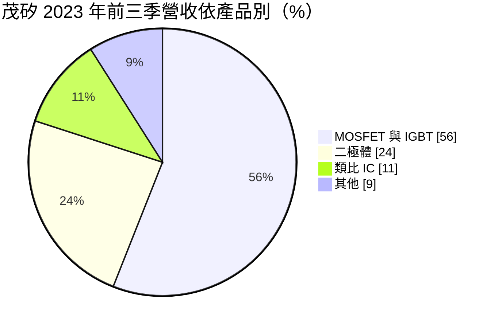
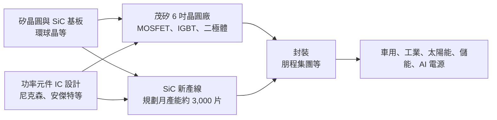
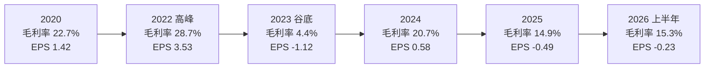
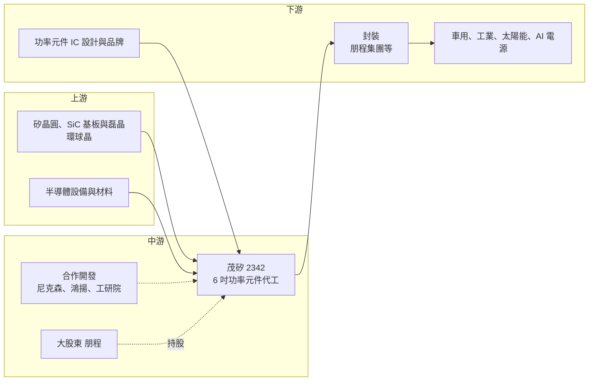

# 2342 茂矽

> 上市｜[[產業索引-半導體業|半導體業]]｜上市（櫃）日期 1995/09/19

# 第一章：企業模式與商業藍圖

> [!info] 撰寫說明
> 本文由 Claude 依公開資料整理，架構比照 [[2330台積電]] 的四章研究，資料截至 2026-10-08。財務數字來源：Goodinfo 經營績效、股利政策與現金流量頁（2019 至 2025 年度）、證交所開放資料快照（2026 年第二季資產負債與綜合損益、股利、公司基本資料）、旺得富、工商時報、理財周刊、富果研究法說整理；公司沿革參考經濟日報黃日燦專欄（2013 年）與理財周刊；產業描述為整理性內容，尚未逐條比對原始文件。#待校對

在評估單一個股的長期投資價值時，首要步驟是拆解企業的底層獲利邏輯。本章針對台灣茂矽電子（股票代號：2342，以下簡稱茂矽）的商業模式進行定性分析，說明一家早年以 DRAM 起家、歷經多次財務危機的公司，如何收斂為小型[[功率半導體]]晶圓代工廠，並在 [[SiC]] 新賽道中尋找下一階段的成長。

## 一、核心定位：專注功率元件的 6 吋晶圓代工

茂矽成立於 1987 年 1 月，1995 年上市，早年是台灣 DRAM 產業的先行者之一。1996 年茂矽與德國西門子的 DRAM 事業（後來的英飛凌）合資成立茂德，由茂矽負責營運。2004 年前後茂矽陷入財務危機，同年兩度大幅減資合計約 332 億元；2010 年轉進太陽能並增資擴產，2012 年太陽能景氣反轉再度嚴重虧損並減資（依經濟日報黃日燦專欄整理）。這段歷史說明茂矽過去多次在景氣高點擴張、在低點受創，也是理解它今天為何規模很小、經營風格趨於保守的背景。

經過多次重整，茂矽今天的實收資本額約 15.7 億元，業務收斂為功率元件與電源管理 IC 的晶圓代工。依理財周刊報導，大股東是車用整流元件廠 [[8255朋程]]，朋程集團承接部分後段封裝，旗下也有 IC 設計子公司。茂矽的產品包括功率 [[MOSFET]]、[[IGBT]]、二極體與類比 IC，應用在電腦、螢幕、電池、工具機、照明與汽車電子。

茂矽的競爭策略可以概括為「做大廠不想做的 6 吋功率元件」。大型晶圓廠已轉向 8 吋與 12 吋，6 吋功率元件的代工需求由茂矽、漢磊等少數業者承接；依理財周刊報導，茂矽月產能約 4.7 萬片。

## 二、終端應用／產品板塊：MOSFET 與 IGBT 過半

依富果整理的法說資料，茂矽 2023 年前三季的產品結構如下（較新的產品別比重未查得）：

* **MOSFET 與 IGBT：** 這是電源開關與馬達驅動的核心元件，車用、工業設備與太陽能逆變器都需要。MOSFET 適合中低電壓、高頻率的電源轉換，IGBT 則適合高電壓、大電流的馬達與逆變器。茂矽正把產品從傳統平面式 MOSFET 升級到 [[FS-IGBT]] 等新一代結構，以提高附加價值。
* **二極體：** 主要用於整流與保護，與大股東朋程的車用整流業務有地緣與客戶上的關聯。
* **類比 IC：** 以電源管理 IC 為主，量少但附加價值較高。
* **應用面：** 依富果整理的法說資料，車用產品在 2023 年前三季占營收約 47%，是最重要的終端市場。車用功率元件需要長期可靠度驗證，訂單穩定度高於消費性產品。

依法說會報導，2025 年新產品占營收 16.8%，近兩年開發 32 家新客戶，其中日韓占 34%、台灣 25%、中國 21%、歐美 18%。客戶地區的分散，是茂矽降低對單一市場依賴的重要努力。

## 三、資本轉化邏輯（營運模式）：已折舊 6 吋廠加上新 SiC 產線

* **舊廠的成本優勢：** 6 吋廠設備大多已折舊，產能利用率高時能維持一定毛利，利用率下降時固定成本壓力也相對有限。依法說會報導，2025 年上半年稼動率逾 90%、下半年約 85%，全年出貨 54 萬片。
* **SiC 新線的投資：** SiC 需要新的高溫製程設備，茂矽與 [[3317尼克森]]、鴻揚半導體、工研院合作開發，SiC 新製程規劃月產能約 3,000 片。新產線在量產前會先帶來折舊與研發費用，這是 2025 年後毛利率偏低的原因之一。
* **代工模式：** 客戶以功率元件設計公司與品牌為主，茂矽負責晶圓製造，封裝交由朋程集團或其他封裝廠完成。代工模式不需承擔終端品牌行銷，但議價能力受制於產能供需。

## 四、企業長期藍圖：國產 SiC 供應鏈與高壓電源

* **納入國產 SiC 供應鏈：** 依理財周刊報導，2026 年 9 月經濟部宣布國產功率半導體供應鏈計畫，茂矽被納入「國產 SiC 供應鏈」負責晶圓代工，目標之一是因應 AI 資料中心 800V 直流供電的發展。政策支持可能帶來研發資源與國內系統廠的試用機會，但能否轉為穩定訂單仍待驗證。
* **產品升級：** 以 FS-IGBT、SiC MOSFET（650V 到 3300V）與 JFET 逐步取代傳統平面式 MOSFET，提高每片晶圓的附加價值。
* **治理調整：** 依 2026 年 5 月報導，吳憲忠接任董事長，董事席次由 7 席減為 6 席。

茂矽的長期藍圖並不是擴大規模，而是在既有 6 吋產能上提高產品層次，並以 SiC 參與第三代半導體的成長。這條路線的關鍵在於：SiC 產品能否以高於矽元件的毛利率放量，否則新投資只會增加折舊。

# 第二章：護城河深度與競爭優勢

在長期價值投資中，「護城河」指企業抵禦競爭、維持超額利潤的保護機制。本章分析茂矽在小型功率元件代工市場的位置，以及 SiC 新賽道的競爭格局。

## 一、護城河的核心組成要素

茂矽的護城河屬於「窄護城河」，甚至在部分市場接近沒有護城河。它的優勢主要來自以下四點：

* **1. 6 吋功率製程的利基：** 6 吋功率元件屬於大廠不願再投資、新進者又難以取得回報的市場。茂矽的舊廠設備已折舊，可以承接小量多樣的訂單，這是大型 8 吋與 12 吋廠不容易提供的彈性。
* **2. 車用認證：** 車用占營收近半，車用功率元件需要長期可靠度驗證，一旦導入，客戶在產品生命週期內較少更換代工廠。這是茂矽訂單穩定度的主要來源。
* **3. 朋程集團的上下游整合：** 大股東朋程承接後段封裝並有 IC 設計子公司，集團內部可形成設計、晶圓、封裝的完整鏈條（推估，實際內部交易比重未查得）。
* **4. 政策支持：** 納入國產 SiC 供應鏈計畫，代表政府希望保有本土功率半導體產能，茂矽可能因此取得研發資源與試產機會。

## 二、全球主要競爭對手格局

| 對手 | 定位 | 對茂矽的威脅 |
|---|---|---|
| [[3707漢磊]] | 台灣功率元件與 SiC、GaN 代工 | 定位最接近，SiC 與 GaN 布局較早 |
| [[5347世界先進]]、[[6770力積電]] | 8 吋功率與電源管理代工 | 規模大，可提供更低單位成本 |
| [[2340台亞]] 旗下積亞 | 台灣 SiC 晶圓代工 | 在 SiC 代工直接競爭 |
| 中國功率元件代工廠（華虹等） | 8 吋與 12 吋功率製程，政策扶植 | 以低價搶中國與新興市場客戶 |
| 英飛凌、意法半導體、onsemi | 功率元件 IDM | 主要自製，也是茂矽客戶的競爭者 |

功率半導體的長期趨勢是往更大的晶圓尺寸與更高的整合度移動，國際 IDM 大廠在 8 吋與 12 吋功率產線上的投資，正逐步壓縮 6 吋產能的成本競爭力。茂矽的生存空間，在於大廠不願承接的小量多樣訂單與需要非中國產地的客戶。

## 三、優勢轉化：守得住、守不住與觀察重點

* **守得住：** 6 吋車用與工業功率元件的長期訂單，以及需要台灣或非中國產地的日韓、歐美客戶。這些客戶看重穩定交期與可靠度，對價格的敏感度相對低。
* **守不住：** 一般消費性 MOSFET 與二極體的代工價格。2025 年毛利率由前一年的 20.7% 降到 14.9%，公司歸因於美國關稅與匯率波動使客戶訂單萎縮，也反映中國低價競爭。過去七年中有三年營業虧損，說明茂矽的護城河無法在景氣下行時保住獲利。
* **觀察重點：** 第一，SiC 何時通過客戶最終驗證並開始放量；第二，國產 SiC 供應鏈計畫能否帶來實際訂單；第三，毛利率能否回到 20% 以上、營業利益轉正並維持。

# 第三章：財務體質與盈利規模

資料日期：2026-10-08。年度數字取自 Goodinfo 經營績效、股利政策與現金流量頁，2026 年上半年與資產負債取自證交所開放資料快照，表格是撰寫當時的快照；最新月營收、毛利率、累計 EPS 由自動排程寫在本筆記的屬性欄位（月營收、毛利率、累計EPS 等）。#待校對

財務報表是檢驗護城河是否真實存在的最終標準。本章用多年度的三率、ROE、現金流與資本報酬，檢視茂矽在功率元件景氣循環與 SiC 轉型期的財務狀況。

## 一、獲利能力的基石：三率

| 年度 | 營收（億元） | [[毛利率]] | [[營業利益率]] | EPS（元） | [[ROE]] |
|---|---|---|---|---|---|
| 2020 | 18.5 | 22.7% | 11.8% | 1.42 | 10.6% |
| 2021 | 19.5 | 25.1% | 13.4% | 1.58 | 11.0% |
| 2022 | 21.5 | 28.7% | 16.7% | 3.53 | 22.1% |
| 2023 | 14.8 | 4.4% | -13.2% | -1.12 | -7.0% |
| 2024 | 18.9 | 20.7% | 2.4% | 0.58 | 3.8% |
| 2025 | 20.4 | 14.9% | -4.3% | -0.49 | -3.2% |
| 2026 上半年 | 10.1 | 15.3% | -4.7% | -0.23 | 未查得（半年約 -1.5%，推算） |

* **營收：** 2020 至 2025 年營收從 18.5 億元到 20.4 億元，年複合成長率約 2%（推算），規模幾乎沒有成長。營收只有約 20 億元，代表單一客戶或單一產品的變化就會明顯影響稼動率與獲利。
* **[[毛利率]]：** 2022 年 28.7% 是近年高點，2023 年驟降到 4.4%，2024 年回到 20.7% 後又下滑。毛利率的大幅波動反映功率元件庫存循環與利用率的變化，也顯示茂矽缺乏穩定的定價能力。
* **[[營業利益率]]：** 2020 至 2025 年有兩年營業虧損，2026 年上半年營業損失約 0.47 億元，本業尚未轉正。
* **業外：** 2022 年淨利率 25.8% 明顯高於營業利益率 16.7%，代表當年有可觀的業外收益（Goodinfo 現金流量頁顯示當年投資活動現金流為正 10.4 億元，推估有資產或投資處分）。評估本業時應以營業利益為準。

## 二、[[ROE]]：資本效率

茂矽 2021 至 2025 年平均 ROE 約 5.3%（推算），其中 2022 年的 22.1% 含業外收益；排除 2022 年後，其餘四年平均只有約 1%（推算）。2026 年第二季底股東權益約 23.2 億元、負債總額約 7.5 億元，負債比約 24%（推算），每股淨值 14.62 元，財務結構保守，這與過去多次財務危機後的經營風格有關。

股利方面，茂矽採半年度盈餘分派，2020 至 2025 年度現金股利分別為 0.5、0.5、2.0、0、0.3、0 元，有獲利的年度配息率約 32% 至 57%（推算）。公司章程規定盈餘分派不低於可分配盈餘的 30%，但也明言屬資本密集產業、需考量資本預算，因此股利隨獲利起伏，不具穩定性。

## 三、資本支出與自由現金流

| 年度 | 營業現金流（億元） | 投資現金流（億元） | 自由現金流（億元） |
|---|---|---|---|
| 2020 | 1.87 | -2.20 | -0.33 |
| 2021 | 3.02 | -10.80 | -7.78 |
| 2022 | 5.43 | 10.40 | 15.80 |
| 2023 | -0.61 | -2.18 | -2.79 |
| 2024 | 0.72 | 0.67 | 1.39 |
| 2025 | 1.08 | -0.26 | 0.82 |

（自由現金流依 Goodinfo 定義為營業現金流加投資現金流，投資現金流包含資產處分與金融資產買賣。）

* **[[自由現金流]]：** 營業現金流規模很小，最好的 2022 年也只有約 5.4 億元，2023 年甚至轉負。2022 與 2024 年自由現金流為正，主要是投資活動有現金流入，而不是本業現金創造能力提升。
* **[[CapEx]]：** 主要投入 SiC 機台設備與新製程，具體年度金額未查得。以茂矽的營業現金流規模，大型擴產需要動用帳上資金或外部融資（推估），因此 SiC 的投資節奏相對保守。

## 四、[[ROIC]] 與 [[WACC]]：價值創造利差

**ROIC（推算）：** 公開資料未揭露茂矽的 ROIC，本文以「稅後營業利益 ÷（股東權益＋有息負債）」推算。有息負債明細未查得，以 2026 年第二季非流動負債約 2.8 億元作為近似值，加上股東權益約 23.2 億元，投入資本約 26 億元。2022 年營業利益約 3.6 億元（21.5 億元 × 16.7%），稅後約 2.9 億元，以當時相近的資本基數計算 ROIC 約 11%（推算）；2024 年營業利益約 0.45 億元，ROIC 約 1.4%（推算）；2023、2025 年與 2026 年上半年營業虧損，ROIC 為負。

**WACC（推算）：** 以 CAPM 推估股東權益成本：無風險利率取台灣 10 年期公債約 1.75%，市場風險溢酬 6%，β 假設 1.2（半導體中小型股常見值，非來源數字），權益成本約 8.95%。負債成本假設稅前 2%、稅率 20%，稅後 1.6%。以帳面資本結構（權益約 89%、負債約 11%）計算，WACC 約 8.2%；以市值計算（股價淨值比約 3.4 倍）約 8.7%（推算）。

**結論：** 近六年中，只有 2020 至 2022 年 ROIC 高於 WACC，其他年度都低於資金成本，長期而言茂矽並未穩定創造價值。目前的市場評價（股價淨值比約 3.4 倍）明顯高於現有獲利能支撐的水準，反映的是對 SiC 與國產供應鏈的預期。要讓 ROIC 長期高於 WACC，茂矽需要營業利益率穩定在一成以上，也就是 SiC 與新產品必須大幅改善產品組合。

# 第四章：總體風險與地緣政治

任何企業都無法脫離宏觀環境獨立存在。本章分析茂矽未來必須面對的地緣政治、產業週期、營運與技術風險。對一家年營收約 20 億元的小型晶圓廠而言，外部衝擊的影響會被放大。

## 一、地緣政治

* **美國關稅：** 公司明確指出 2025 年虧損與美國關稅、匯率波動有關，客戶因關稅不確定性縮減訂單。功率元件廣泛用於出口至美國的工業與消費產品，關稅政策會透過客戶間接影響茂矽。
* **中國功率元件自主化：** 中國以政策扶植功率半導體自主化，華虹等代工廠與本土 IDM 大舉擴產，茂矽在中國客戶的份額可能逐步被本土業者取代。
* **國產化機會：** 國產 SiC 供應鏈計畫反映政府希望建立自主的功率半導體供應，是茂矽在政策面的支撐，也可能讓國內系統廠更願意採用台灣產地的功率元件。

## 二、產業週期與市場結構

* **功率元件庫存循環：** 車用與工業功率元件在 2023 至 2025 年經歷庫存調整，茂矽 2023 年毛利率驟降到 4.4%，就是[[長鞭效應]]放大到上游代工廠的結果。
* **SiC 價格下跌：** 全球 SiC 產能快速擴張，尤其中國業者大量投產，SiC 元件與基板價格明顯下降，新進代工廠在量產時可能面臨比預期更低的售價。

## 三、營運環境的隱性風險

* **規模小：** 年營收約 20 億元，抗風險能力有限，單一大客戶流失就會明顯影響稼動率。
* **舊廠設備老化：** 6 吋廠設備使用年限長，維修與零件取得成本可能上升，部分設備商也逐步停止支援舊機型。
* **新產品認證時程：** SiC 與 FS-IGBT 的客戶驗證若延遲，新產線的折舊會持續拖累獲利。
* **歷史經驗：** 茂矽過去曾在 DRAM 與太陽能兩次大規模擴張後陷入危機，投資人在評估 SiC 投資時，應關注資本支出規模是否與營業現金流相稱。

## 四、科技或法規演進

功率元件產業正從 6 吋轉向 8 吋，SiC 也從 6 吋逐步走向 8 吋。若茂矽長期停留在 6 吋，單位成本可能落後同業。AI 資料中心的 800V 直流供電是 SiC 與 [[GaN]] 共同競逐的新應用；若技術路線偏向 GaN，或由國際 IDM 大廠以垂直整合方式供應，茂矽的 SiC 投資效益可能不如預期（推估）。

# 專有名詞解析

## 半導體

- **[[功率半導體]]**：負責電能轉換與控制的半導體元件，例如 MOSFET、IGBT、二極體，用於電源、馬達與電動車。
- **[[MOSFET]]**：金屬氧化物半導體場效電晶體，用電壓控制電流開關，是電源轉換最常用的功率元件。
- **[[IGBT]]**：絕緣閘雙極電晶體，結合 MOSFET 與雙極電晶體的優點，適合高電壓、大電流的馬達與逆變器。
- **[[FS-IGBT]]**：Field-Stop 結構的 IGBT，以場截止層降低導通損耗與切換損耗，是新一代 IGBT 主流設計。
- **[[SiC]]**：碳化矽，屬第三代半導體材料，耐高壓、耐高溫，用於電動車與高功率電源。
- **[[GaN]]**：氮化鎵，屬第三代半導體材料，開關速度快，常用於快充與資料中心電源。

## 金融

- **[[產能利用率]]**：實際投片量占總產能的比例，晶圓代工廠的毛利率高度取決於此數字。
- **[[自由現金流]]**：營業活動現金流減去資本支出，代表企業可自由用於配息、還債或併購的現金。
- **[[ROIC]]**：投入資本報酬率，稅後營業利益除以股東權益加有息負債，衡量公司投入營運的全部資本能賺多少。
- **[[WACC]]**：加權平均資金成本，股東與債權人要求報酬率的加權平均，是 ROIC 的比較基準。
- **[[長鞭效應]]**：終端需求的小幅變動，沿供應鏈往上游傳遞時被逐級放大，造成上游庫存與訂單劇烈波動。

# 核心供應鏈

## 1. 上游：晶圓與基板
- 矽晶圓、SiC 基板與磊晶層：[[6488環球晶]]

## 2. 中游：茂矽本身與合作夥伴
- 大股東與封裝夥伴：[[8255朋程]]（旗下 IC 設計子公司安傑特）
- SiC 合作開發：[[3317尼克森]]、鴻揚半導體、工研院
- 同業：[[3707漢磊]]、[[5347世界先進]]、[[6770力積電]]、[[2340台亞]]

## 3. 下游：客戶與應用
- 功率元件設計公司與品牌：日韓、台灣、中國、歐美客戶（名稱未查得）
- 終端應用：車用、工業、太陽能、儲能、AI 資料中心 800V 直流供電

## 最新新聞
<!-- news:start（自動產生，請勿手動編輯此範圍） -->
- 2026-10-12 🏛️ 重訊 18:01｜公告本公司研發主管異動｜[觀測站](https://mops.twse.com.tw/mops/#/web/t05st01)

完整紀錄：[[2342茂矽 新聞]]
<!-- news:end -->

## 相關連結
- [公開資訊觀測站](https://mopsov.twse.com.tw/mops/web/t05st03?step=1&firstin=1&co_id=2342)
- [Goodinfo](https://goodinfo.tw/tw/StockDetail.asp?STOCK_ID=2342)
- [Yahoo 股市](https://tw.stock.yahoo.com/quote/2342)
- [鉅亨網新聞](https://www.cnyes.com/twstock/2342/news)
