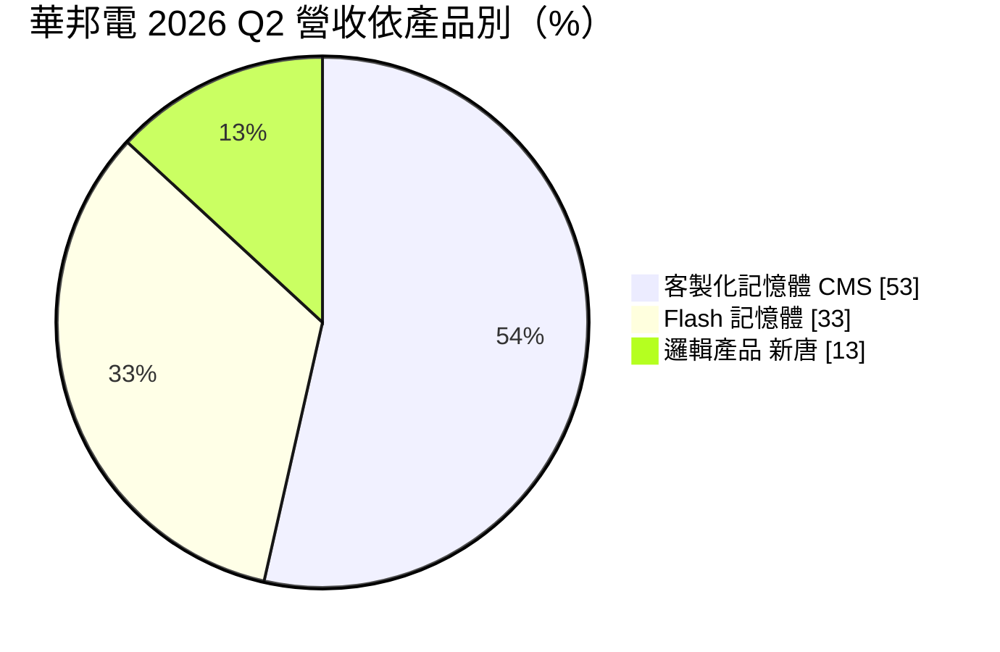
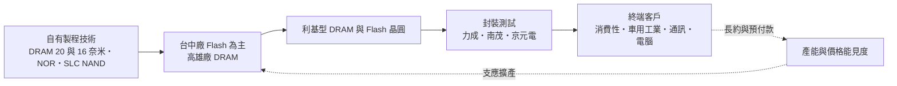
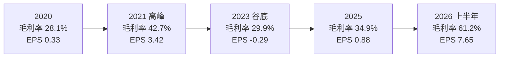
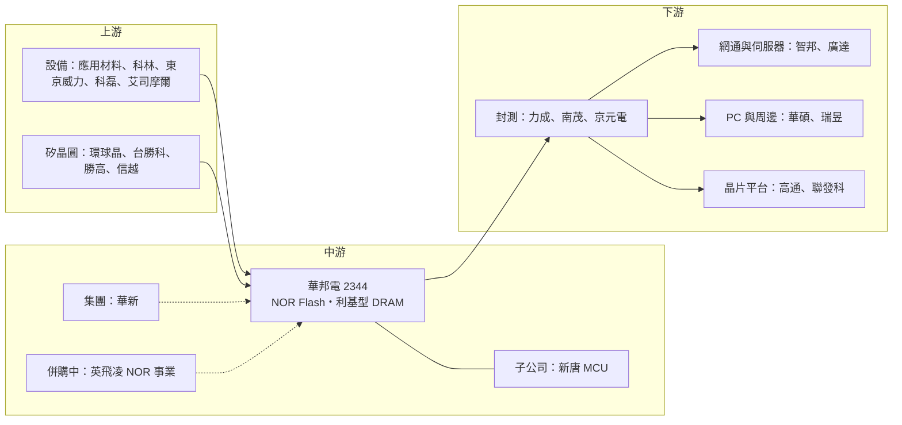

# 2344 華邦電

> 上市｜[[產業索引-半導體業|半導體業]]｜上市（櫃）日期 1995/10/18

# 第一章：企業模式與商業藍圖

> [!info] 撰寫說明
> 本文由 Claude 依公開資料整理，架構比照 [[2330台積電]] 的四章研究，資料截至 2026-10-08。財務數字來源：Goodinfo 經營績效、股利政策與現金流量頁（2019 至 2025 年度）、證交所開放資料快照（2026 年第二季資產負債與綜合損益、股利、公司基本資料）、華邦電 2025 年第四季至 2026 年第二季法說會相關報導（科技新報、優分析、財報狗、ETtoday）、中央社（2017 年高雄廠投資）、經濟日報（2026 年收購英飛凌 NOR 事業）；產業描述為整理性內容，尚未逐條比對原始文件。#待校對

在評估單一個股的長期投資價值時，首要步驟是拆解企業的底層獲利邏輯。本章針對華邦電子（股票代號：2344，以下簡稱華邦電）的商業模式進行定性分析，說明它如何以[[利基型記憶體]]避開三大 DRAM 廠的主戰場、如何成為全球最大的 [[NOR Flash]] 供應商，以及子公司 [[4919新唐]] 在集團中的角色。

## 一、核心定位：全球 NOR Flash 龍頭，兼營利基型 DRAM

華邦電成立於 1987 年 9 月，1995 年上市，隸屬 [[1605華新]]（華新麗華）集團，總部位於台中中部科學園區，現任董事長為焦佑鈞。華邦電是台灣少數同時生產 [[DRAM]] 與 Flash 的記憶體 [[IDM]]，從製程研發、晶圓製造到銷售都自己完成。

華邦電的定位有兩個關鍵。第一，它不與三星、SK 海力士、美光在主流 PC、手機與伺服器 DRAM 正面競爭，而是專注容量較小、規格多樣、生命週期長的利基型記憶體，客戶是網通、工業、車用與消費性電子廠。這些客戶看重長期供貨與規格穩定，而不是最先進的製程。第二，華邦電在 NOR Flash 市場長期居全球第一。NOR Flash 用來儲存開機程式碼與韌體，幾乎所有電子設備都需要，但市場規模不大、多數大廠已退出，規模領先者因此具有成本與供貨上的優勢。

依經濟日報報導，華邦電於 2026 年 9 月宣布以約 11.2 億美元（約新台幣 356 億元）現金收購英飛凌旗下的 NOR Flash 事業（原 Spansion 產品線），預計 2027 年下半年完成。依報導引述的市占數據，華邦電約 23%、英飛凌約 11%，合併後約 34%，將進一步鞏固 NOR 龍頭地位。這是華邦電成立以來規模最大的海外併購，也是改變公司長期結構的事件。

華邦電另持有 IC 設計公司新唐過半股權並併入財報。新唐的前身是華邦電的邏輯 IC 事業，於 2008 年分割獨立（年份依公司沿革整理，待校對），主要產品為 [[MCU]] 與電源、音訊等 IC，構成華邦電合併報表中的「邏輯產品」。

## 二、終端應用／產品板塊：漲價讓 DRAM 躍居最大

依法說會報導，2026 年第二季記憶體漲價使營收結構明顯改變：

對照 2025 年全年，Flash 記憶體占 35%、邏輯產品占 34%、客製化記憶體 CMS 占 29%。一年之內 DRAM 相關的 CMS 比重大幅上升，主要是價格效應，而不是出貨量大增。

* **客製化記憶體（CMS）：** 指利基型 DRAM，包括 DDR3、DDR4、LPDDR4，以及客製化超高頻寬記憶體 [[CUBE]]。利基型 DRAM 的價格在三大廠把產能轉向 [[HBM]] 與 DDR5 後出現供給缺口，這是 2026 年 CMS 營收暴增的原因。
* **Flash 記憶體：** 以 NOR Flash 為主，另有 [[SLC NAND]]。AI 伺服器、網通設備與車用電子帶動高容量 NOR 需求。
* **邏輯產品：** 主要來自新唐的 MCU、電池管理與音訊 IC。這塊業務毛利率低於記憶體，但需求不隨記憶體價格同步波動，具有一定的分散效果。

依 2025 年應用別：消費性電子 29%、車用與工業 27%、通訊 24%、電腦相關 20%。沒有單一終端市場超過三成，這種分散是利基型記憶體廠的典型特徵，也降低了單一產業衰退的衝擊。

## 三、資本轉化邏輯：分散應用加上長約鎖量

* **台中廠：** 以 Flash 與部分 DRAM 為主，保留 NOR 與 NAND 之間彈性調整的空間。依法說會報導，2025 至 2026 年合計投資約 70 億元，月產能由約 5 萬片提升至 5.7 萬至 5.8 萬片。
* **高雄廠：** 依中央社 2017 年報導，華邦電在高雄路竹科學園區規劃 15 年總投資 3,300 億元的 12 吋廠，以 DRAM 為主，當時目標 2020 年量產 25 至 20 奈米製程。高雄廠是華邦電近十年最大的資本承諾，2026 年首批 16 奈米設備進駐，第二期擴建（Module B）規劃 2027 年動工、2029 年投產。
* **[[長約]]與預付款：** 依 ETtoday 報導，約一半產能已以 1 至 2 年合約鎖定，部分客戶洽談 3 至 5 年合約，預付款比例 20% 至 30%。這種模式讓客戶分擔擴產資金，也提高營收能見度，是華邦電試圖降低記憶體價格循環衝擊的新做法。

## 四、企業長期藍圖：NOR 整併、客製化 AI 記憶體與製程推進

* **NOR 整併：** 收購英飛凌 NOR 事業後，華邦電將取得車用與工業 NOR 的高階客戶群、美國研發團隊與 Spansion 品牌，補強它在車用高可靠度市場的布局。若整合順利，NOR 市場的供給集中度提高，有利於長期價格紀律。
* **客製化 AI 記憶體：** 以 CUBE 等超高頻寬客製化 DRAM 切入[[邊緣 AI]] 裝置，避開與三大廠在 HBM 的正面競爭。客製化產品需要與客戶共同設計，轉換成本高於標準品。
* **DRAM 製程推進：** 高雄廠 16 奈米產能開出，提升位元密度與成本競爭力，但仍落後三大廠數個世代，華邦電的策略是以客製化與利基規格彌補製程差距。
* **長約化經營：** 把一部分產能轉為長期合約並收取預付款，嘗試讓獲利從「隨現貨價格擺盪」轉為「較可預測」。這項轉變能否在下一次景氣下行時經得起考驗，是觀察經營層資本配置能力的重點。

# 第二章：護城河深度與競爭優勢

在長期價值投資中，「護城河」指企業抵禦競爭、維持超額利潤的保護機制。本章分析華邦電的護城河構成、國內外主要競爭對手，以及這些優勢在記憶體價格循環中能守住多少。

## 一、華邦電護城河的核心組成要素

華邦電的護城河屬於「窄到中等」，在 NOR Flash 較深、在利基型 DRAM 較淺，由四個要素組成：

* **1. NOR Flash 規模領先：** NOR 市場不大、大廠多已退出，華邦電以最大產能與最完整的容量規格建立成本與供貨優勢。收購英飛凌 NOR 事業後，市占可望超過三成，規模優勢會進一步拉大。在一個成長不快的市場中，龍頭的規模經濟往往是最穩固的護城河。
* **2. 車用與工業的長期驗證：** 車用與工業客戶要求供貨十年以上、品質穩定，華邦電長期經營這些市場，一旦通過[[車規驗證]]就不易被替換。2025 年車用與工業占營收 27%，是穩定訂單的來源。
* **3. 自有晶圓廠與產品彈性：** 同時擁有 DRAM 與 Flash 製程與產能，台中廠可以在 NOR 與 NAND 之間調整，讓華邦電能依市場狀況配置產能。
* **4. 客製化能力：** CMS 與 CUBE 強調依客戶需求設計，與客戶共同開發的產品轉換成本高於標準品，是華邦電在 DRAM 這個商品化市場中建立差異化的主要方式。

## 二、全球主要競爭對手格局

| 對手 | 主要產品 | 對華邦電的威脅 |
|---|---|---|
| [[2337旺宏]] | NOR Flash、SLC NAND、ROM | 高容量與車用 NOR 的主要國內對手 |
| 兆易創新（GigaDevice） | NOR Flash、MCU | 以中國市場與價格競爭，受國產替代政策支持 |
| 英飛凌（NOR 產品線） | 車用與工業 NOR Flash | 原為車用 NOR 主要對手，預計 2027 年併入華邦電 |
| [[2408南亞科]] | 標準型與利基型 DRAM | 在 DDR4、LPDDR4 直接競爭，同樣布局客製化 AI 記憶體 |
| 長鑫存儲（CXMT） | 利基型與標準型 DRAM | 中國政策扶植，大量供應 DDR4 壓低價格 |
| 意法半導體、恩智浦、瑞薩 | MCU | 新唐邏輯產品的國際大廠對手 |

利基型 DRAM 的競爭結構比 NOR 嚴峻。三大廠雖然退出舊規格，但中國長鑫在政策支持下大量投產 DDR4，是華邦電 2023 至 2024 年獲利低迷的重要外部原因。NOR 則是少數幾家分食的市場，華邦電併購英飛凌 NOR 後，主要對手只剩旺宏與兆易創新。

## 三、優勢轉化：哪些市場守得住、哪些守不住

* **守得住：** NOR Flash 的龍頭地位，以及車用、工業的長期客戶。供給緊張時，華邦電的 NOR 與利基型 DRAM 成為客戶搶貨的對象，2026 年第二季記憶體事業毛利率達約 70%、[[產能利用率]]滿載（依法說會報導），議價能力明顯提升。
* **守不住：** 利基型 DRAM 與 SLC NAND 本質上仍是商品，一旦三大廠或長鑫把產能轉回舊規格，價格可能迅速回落。2023 年華邦電營業利益率 -2.2%、2024 年僅 0.6%，說明在 DRAM 低谷時，NOR 的護城河不足以撐起整體獲利。
* **觀察重點：** 第一，英飛凌 NOR 事業的整合與交割進度；第二，高雄廠 16 奈米 DRAM 的[[良率]]與產能爬坡；第三，長約與預付款在價格反轉時是否仍被履行；第四，新唐邏輯事業能否改善獲利。

# 第三章：財務體質與盈利規模

資料日期：2026-10-08。年度數字取自 Goodinfo 經營績效、股利政策與現金流量頁，2026 年上半年與資產負債取自證交所開放資料快照，表格是撰寫當時的快照；最新月營收、毛利率、累計 EPS 由自動排程寫在本筆記的屬性欄位（月營收、毛利率、累計EPS 等）。#待校對

財務報表是檢驗護城河是否真實存在的最終標準。本章用多年度的三率、ROE、現金流與資本報酬，檢視華邦電在一個完整利基型記憶體週期（2021 至 2022 年高峰、2023 至 2024 年低谷、2026 年強力反彈）中的獲利品質。

## 一、獲利能力的基石：三率

| 年度 | 營收（億元） | [[毛利率]] | [[營業利益率]] | EPS（元） | [[ROE]] |
|---|---|---|---|---|---|
| 2020 | 607 | 28.1% | 2.7% | 0.33 | 2.3% |
| 2021 | 996 | 42.7% | 18.5% | 3.42 | 18.7% |
| 2022 | 945 | 45.5% | 17.5% | 3.25 | 15.5% |
| 2023 | 750 | 29.9% | -2.2% | -0.29 | 約 -1.3%（推算） |
| 2024 | 816 | 29.4% | 0.6% | 0.14 | 0.7% |
| 2025 | 894 | 34.9% | 6.2% | 0.88 | 3.0% |
| 2026 上半年 | 981 | 61.2% | 42.3% | 7.65 | 未查得（半年約 21%，推算） |

註：2023 年 ROE 在 Goodinfo 頁面上數值不一致，改以 EPS ÷ 每股淨值（22.08 元）推算。

* **營收：** 2020 至 2025 年營收從 607 億元增加到 894 億元，年複合成長率約 8.1%（推算）。2026 年上半年營收 981 億元，已超過 2025 年全年，主要來自價格大漲。
* **[[毛利率]]：** 2021 至 2022 年在 43% 至 46%，2023 至 2024 年降到約 30%，2026 年上半年衝上 61.2%。合併毛利率包含毛利較低的新唐，記憶體事業單獨的毛利率更高。
* **[[營業利益率]]：** 華邦電的費用率偏高（研發投入大、又合併新唐），因此毛利率約 30% 的年份，營業利益率就接近零。這是華邦電長期 ROE 偏低的關鍵：只有在記憶體價格高檔時，才能賺到明顯高於資金成本的報酬。
* **[[淨利率]]與業外：** 2026 年上半年稅後淨利約 343 億元、營業外收入約 11.8 億元，獲利主要來自本業。

## 二、[[ROE]]：資本效率

華邦電 2021 至 2025 年平均 ROE 約 7.3%（推算），2020 至 2024 年約 7.2%（推算）。七年中只有 2021 與 2022 兩年 ROE 超過 15%，其餘多在 3% 以下。這個紀錄說明：華邦電長期大部分時間的資本效率偏低，獲利集中在少數景氣高峰年。2026 年上半年 ROE 約 21%（半年，推算），年化可能達四成，是公司歷史上少見的高點。

2026 年第二季底股東權益約 1,735 億元（歸屬母公司約 1,650 億元）、負債總額約 1,195 億元，負債比約 41%（推算），每股淨值 36.67 元。流動負債約 921 億元，其中可能包含客戶預付款（推估，明細未查得）。

股利方面，2019 至 2025 年度現金股利分別為 0.1、0.2、1.0、1.0、0、0、0.5 元。以當年 EPS 計算，2021 與 2022 年度配息率約 29% 至 31%，2025 年度約 57%（推算）。華邦電的配息率長期低於台灣科技股平均，原因是高雄廠等擴產需要保留大量資金，屬於「重投資、輕配息」的資本配置風格。

## 三、資本支出與自由現金流

| 年度 | 營業現金流（億元） | 投資現金流（億元） | 自由現金流（億元） |
|---|---|---|---|
| 2020 | 114 | -152 | -37.3 |
| 2021 | 284 | -86 | 198 |
| 2022 | 158 | -445 | -287 |
| 2023 | 36 | -130 | -94.3 |
| 2024 | 111 | -167 | -55.3 |
| 2025 | 112 | -76.6 | 35.2 |

（自由現金流依 Goodinfo 定義為營業現金流加投資現金流。）

* **[[自由現金流]]：** 2020 至 2025 年六年中只有兩年為正，累計約 -241 億元（推算），差額主要由借款與籌資補足。2022 年投資現金流 -445 億元是高雄廠建置的高峰。換句話說，過去幾年華邦電把營業現金流與外部資金幾乎全部投入產能，股東拿到的現金很少。
* **[[CapEx]]：** 依報導，2026 年董事會通過全年資本支出約 421 億元，九成以上用於生產設備；加上英飛凌 NOR 收購約 356 億元，2026 至 2027 年的資金需求很大。2026 年的高獲利與長約預付款，是支應這些投資的主要來源。

## 四、[[ROIC]] 與 [[WACC]]：價值創造利差

**ROIC（推算）：** 公開資料未揭露華邦電的 ROIC，本文以「稅後營業利益 ÷（股東權益＋有息負債）」推算。有息負債明細未查得，以 2026 年第二季非流動負債約 274 億元作為近似值，加上股東權益約 1,735 億元，投入資本約 2,009 億元。2026 年上半年營業利益約 415 億元，年化約 830 億元，稅率 20% 計算稅後約 664 億元，ROIC 約 33%（推算）。2025 年營業利益約 55 億元（894 億元 × 6.2%），稅後約 44 億元，以 2025 年底每股淨值 23.99 元換算股東權益約 1,080 億元，加上少數股權與有息負債估計投入資本約 1,400 億元，ROIC 約 3%（推算）。2023 年營業虧損，ROIC 為負。

**WACC（推算）：** 以 CAPM 推估股東權益成本：無風險利率取台灣 10 年期公債約 1.75%，市場風險溢酬 6%，β 假設 1.3（記憶體股波動高於大盤，同業常見值約 1.2 至 1.5，非來源數字），權益成本約 9.55%。負債成本假設稅前 2%、稅率 20%，稅後 1.6%。以帳面資本結構（權益約 86%、負債約 14%）計算，WACC 約 8.5%；以市值計算（股價淨值比約 4.8 倍）約 9.3%（推算）。

**結論：** 2020 年以來，華邦電只有 2021 至 2022 年與 2026 年 ROIC 高於 WACC，2023 至 2025 年 ROIC 遠低於資金成本。把整個週期平均來看，過去的投資報酬大致只是打平資金成本（推估）。2026 年的超額報酬能否延續，取決於高雄廠新產能與英飛凌 NOR 併購的報酬率，以及長約是否真的讓獲利波動變小。

# 第四章：總體風險與地緣政治

任何企業都無法脫離宏觀環境獨立存在。本章分析華邦電未來必須面對的地緣政治、產業週期、營運與技術風險。

## 一、地緣政治風險

* **中國競爭與市場：** 中國兆易創新、長鑫存儲在國家政策支持下擴產，對 NOR Flash 與利基型 DRAM 價格形成長期壓力；同時中國也是重要的消費性與網通客戶市場，國產替代政策可能讓華邦電逐步失去部分中國客戶。
* **美國出口管制與關稅：** 美國限制對中國供應先進記憶體與設備，一方面延緩中國對手的技術進展，另一方面也可能影響華邦電對中國客戶的出貨。收購英飛凌 NOR 事業屬跨國交易，交割前也需取得相關主管機關的核准（推估）。
* **生產集中在台灣：** 晶圓廠位於台中與高雄，面臨兩岸風險與天災、水電等營運風險。

## 二、產業週期與市場結構風險

* **記憶體價格反轉：** 利基型記憶體價格波動劇烈。2026 年的高獲利來自三大廠把產能轉向 AI 記憶體所造成的供給缺口，若三大廠或中國業者擴產、AI 投資降溫，價格可能快速回落。
* **[[長鞭效應]]：** 記憶體漲價期間客戶提前備貨，訂單可能高於真實需求；價格見頂後，庫存去化會讓訂單快速萎縮。
* **終端需求被排擠：** 記憶體漲價推高消費性電子與網通設備成本，可能導致終端出貨減少，反過來壓抑記憶體需求。

## 三、營運環境的隱性風險

* **擴產與併購同時進行：** 高雄廠擴產、台中廠擴產與英飛凌 NOR 併購同時進行，管理與資金壓力都很大。若良率或時程不如預期，或併購整合出現人才流失，成本會上升。
* **新唐邏輯事業：** 邏輯產品毛利率遠低於記憶體，若 MCU 市場競爭加劇或庫存調整，會拖累合併獲利。
* **長約風險：** 長約在價格上漲期保障出貨，但若價格反轉，客戶可能要求重新議價或延後提貨。
* **匯率：** 記憶體以美元報價為主，新台幣升值會壓縮台幣計價的獲利。

## 四、科技演進風險

華邦電的 DRAM 製程（20 奈米、16 奈米）落後三大廠數個世代，成本競爭力有限，必須靠客製化與利基規格彌補。CUBE 這類客製化方案能否在邊緣 AI 形成規模，仍有不確定性。NOR Flash 方面，部分應用可能以 eMMC、嵌入式記憶體等其他方案取代，長期需留意技術替代（推估）；但 AI 伺服器、車用與工業設備的韌體容量持續增加，目前看來 NOR 的需求仍有成長空間。

# 專有名詞解析

## 半導體

- **[[DRAM]]**：動態隨機存取記憶體，斷電後資料會消失，作為處理器運算時的主記憶體。
- **[[NOR Flash]]**：讀取速度快、可直接執行程式碼的快閃記憶體，容量較小，常用於存放開機程式與韌體。
- **[[SLC NAND]]**：每個記憶單元只存 1 位元的 NAND Flash，容量小但耐用度與可靠度高，常用於網通、工業與車用。
- **[[利基型記憶體]]**：容量較小、規格多樣、產品生命週期長的記憶體，例如 DDR3、DDR4 與 NOR Flash，主要供應工業、車用與網通。
- **[[CUBE]]**：華邦電的客製化超高頻寬 DRAM 方案，以垂直堆疊與寬介面提高頻寬，鎖定邊緣 AI 裝置。
- **[[HBM]]**：高頻寬記憶體，把多顆 DRAM 垂直堆疊並與 GPU 封裝在一起，是 AI 加速器的關鍵元件。
- **[[IDM]]**：垂直整合製造商，從晶片設計、晶圓製造到銷售都自己完成的半導體公司。
- **[[MCU]]**：微控制器，把處理器、記憶體與輸入輸出介面整合在一顆晶片，用於家電、工業與車用控制。
- **[[良率]]**：一片晶圓上合格晶片所占的比例，直接影響每顆晶片的成本。

## 應用

- **[[邊緣 AI]]**：在終端裝置本身執行 AI 運算，而不是把資料傳回雲端處理，可降低延遲與保護隱私。
- **[[車規驗證]]**：車用晶片須通過 AEC-Q100 等可靠度測試與車廠認證，流程常需 2 至 3 年，因此轉換成本高。

## 金融

- **[[長約]]**：供應商與客戶簽訂一年以上的供貨合約，鎖定數量與價格區間，有時附帶預付款。
- **[[產能利用率]]**：實際投片量占總產能的比例，製造業者的毛利率高度取決於此數字。
- **[[自由現金流]]**：營業活動現金流減去資本支出，代表企業可自由用於配息、還債或併購的現金。
- **[[ROIC]]**：投入資本報酬率，稅後營業利益除以股東權益加有息負債，衡量公司投入營運的全部資本能賺多少。
- **[[WACC]]**：加權平均資金成本，股東與債權人要求報酬率的加權平均，是 ROIC 的比較基準。

# 核心供應鏈

## 1. 上游：設備、材料與矽晶圓
- 半導體設備：[[AMAT應用材料]]、[[LRCX科林研發]]、[[8035東京威力科創]]、[[KLAC科磊]]、[[ASML艾司摩爾]]
- 矽晶圓：[[6488環球晶]]、[[3532台勝科]]、[[3436勝高]]、[[4063信越化學]]

## 2. 中游：華邦電本身與子公司
- 記憶體設計、製造與銷售
- 邏輯 IC 子公司：[[4919新唐]]
- 集團母公司：[[1605華新]]
- 併購標的：英飛凌 NOR Flash 事業（預計 2027 年下半年完成）

## 3. 下游：封測與客戶
- 封裝測試：[[6239力成]]、[[8150南茂]]、[[2449京元電子]]
- 網通與伺服器：[[2345智邦]]、[[2382廣達]]
- PC 與周邊：[[2357華碩]]、[[2379瑞昱]]
- 晶片平台客戶：[[QCOM高通]]、[[2454聯發科]]

## 4. 同業與競爭者
- 國內：[[2337旺宏]]、[[2408南亞科]]
- 國外：[[005930三星電子]]、兆易創新、長鑫存儲

延伸閱讀：[[聯發科供應鏈]]

## 最新新聞
<!-- news:start（自動產生，請勿手動編輯此範圍） -->
- 2026-10-19 📰 媒體 08:12｜鉅亨速報 - Factset 最新調查：華邦電(2344-TW)EPS預估上修至25.84元，預估目標價為230元｜[鉅亨網](https://news.cnyes.com/news/id/6633110)
- 2026-10-14 🏛️ 重訊 18:17｜本公司訂購機器設備公告。｜[觀測站](https://mops.twse.com.tw/mops/#/web/t05st01)
- 2026-10-06 📰 媒體 13:00｜華邦電(2344)前三季營收已是去年全年2倍！記憶體還能旺多久？2027下半年可能迎來關鍵轉折｜[鉅亨網](https://news.cnyes.com/news/id/6622630)
- 2026-10-05 📰 媒體 18:50｜營收速報 - 華邦電(2344)9月營收282.49億元年增率高達256.67％｜[鉅亨網](https://news.cnyes.com/news/id/6621907)

完整紀錄：[[2344華邦電 新聞]]
<!-- news:end -->

## 相關連結
- [公開資訊觀測站](https://mopsov.twse.com.tw/mops/web/t05st03?step=1&firstin=1&co_id=2344)
- [Goodinfo](https://goodinfo.tw/tw/StockDetail.asp?STOCK_ID=2344)
- [Yahoo 股市](https://tw.stock.yahoo.com/quote/2344)
- [鉅亨網新聞](https://www.cnyes.com/twstock/2344/news)
