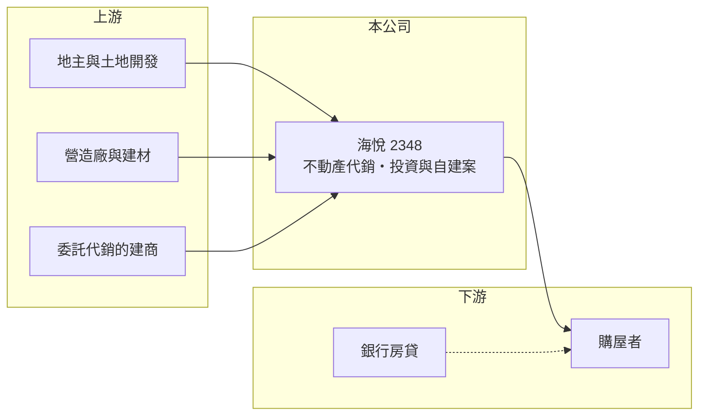

# 2348 海悅

> 上市｜[[產業索引-其他業|其他業]]｜上市（櫃）日期 1996/01/05

# 第一章：企業模式與商業藍圖

> [!info] 撰寫說明
> 精簡版，由 Claude 依公開資料整理，架構比照 [[2330台積電]]，資料截至 2026-10-08。來源：證交所開放資料快照（基本資料、2026 年第二季資產負債與損益、股利）、Goodinfo 經營績效頁、理財周刊 2022 年 12 月報導、優分析與工商時報標題。營收結構為依報導推估，尚未以財報分部資訊核對。#待校對

海悅是台灣規模最大的[[不動產代銷]]業者之一，近年再往上游跨入投資建案與自建案。理解它的關鍵是兩種收入的性質完全不同：代銷是按成交收取服務費的「輕資產」生意，自建案則是投入土地與資金、在交屋時一次認列的「重資產」生意。

- **核心業務：** 海悅成立於 1987 年、1996 年上市，本業是受建商委託負責建案的企劃、廣告與銷售，依成交金額收取服務費，另有包銷（承諾銷售額度、賺取價差或較高費率）。2020 年代起，公司以合資或自建方式參與建案開發，例如理財周刊 2022 年報導提到持有台中「達麗創世紀」案三成權益，並由子公司在台南新化推出自建案。這讓海悅從純服務業者，變成兼具建設公司性質的混合型業者。
- **營收結構：** 依理財周刊 2022 年報導，當年 1 至 11 月合併營收約 44 億元中，代銷收入約 43 億元，代銷仍是主體。之後隨投資建案陸續完工交屋，營建收入比重明顯上升，2026 年 6 至 9 月營收大增主要來自建案交屋認列。代銷與營建收入的確切比重未查得，且會隨交屋時點大幅變動。
- **營運據點：** 代銷業務遍及全台，桃竹地區是傳統重鎮，2022 年報導指出未售餘屋中約 78% 位於桃竹，並積極擴展中南部。投資與自建案分布在新北、台中、台南等地。據點集中在台灣，營運完全跟著台灣房市走。
- **長期方向：** 公司的長期策略是「代銷資訊＋開發獲利」：利用代銷累積的各區域價格與買方資訊，挑選建案投資，賺取比服務費更高的開發利潤。這讓獲利上限提高，但也讓資產負債表變大、獲利更集中於交屋年度，經營型態逐漸接近建設公司。

# 第二章：護城河深度與競爭優勢

海悅的護城河來自代銷市占與資訊優勢，但這個優勢在房市下行時會同時被削弱。

- **競爭優勢：** 代銷業的核心資產是人才、銷售團隊與對各區域買方的熟悉度，海悅長期承接大量建案，對定價與去化速度掌握度高，建商願意委託的原因是它能較快賣完房子。這些資訊也讓公司在挑選投資建案時有比一般建商更好的判斷基礎，是代銷延伸到開發的合理性所在。
- **主要對手：** 代銷同業包括新聯陽、甲山林、遠雄房地產等未上市或集團內代銷公司（#待校對）；開發面則與 [[2520冠德]]、[[2545皇翔]]、[[6177達麗]] 等中型建設公司競爭土地與買方，其中達麗也是海悅的合作夥伴。
- **觀察重點：** 長期最重要的是兩件事：代銷接案量（未售餘屋與包銷總額）能否維持，以及投資建案的利潤率與資金占用。毛利率由 2020 年的 59% 降到 2023 至 2025 年的 35% 上下，反映營建收入比重上升、整體獲利率向建設業靠攏。

# 第三章：財務體質與盈利規模

資料日期：2026-10-08，表格是撰寫當時的快照；最新月營收、毛利率、累計 EPS 由自動排程寫在本筆記的屬性欄位（月營收、毛利率、累計EPS 等）。#待校對

海悅的財務呈現「高 ROE、高波動、負債逐步加重」的特徵，年度數字要看交屋節奏，不宜只看單一年。

| 年度 | 營收（億元） | [[毛利率]] | [[營業利益率]] | EPS（元） | [[ROE]] |
|---|---|---|---|---|---|
| 2019 | 17.3 | 54.0% | 33.3% | 6.59 | 35.3% |
| 2020 | 37.5 | 59.0% | 43.6% | 15.10 | 55.2% |
| 2021 | 63.6 | 51.1% | 38.0% | 15.58 | 36.5% |
| 2022 | 50.9 | 44.8% | 31.4% | 7.88 | 13.9% |
| 2023 | 77.5 | 34.6% | 24.2% | 13.86 | 23.2% |
| 2024 | 102.0 | 36.8% | 26.2% | 14.43 | 25.2% |
| 2025 | 73.5 | 36.0% | 24.5% | 6.85 | 11.0% |

（來源：Goodinfo 經營績效頁。2026 年上半年依證交所資料：營收 31.2 億元、毛利率 26.0%、營業利益率 15.6%、EPS 1.06 元。）

- **營收規模：** 2019 至 2025 年營收由 17.3 億元增至 73.5 億元，年複合成長率約 27%（推算），成長主要來自營建收入加入，而不是代銷本身倍增。由於建案交屋集中，年度營收可以在一年內增減三成以上，例如 2024 年 102 億元、2025 年回落到 73.5 億元。
- **獲利：** 近五年（2021 至 2025）平均 ROE 約 22%（推算），在上市公司中屬高檔，但 2022 與 2025 年都曾落到 11% 至 14%。營業利益率從 40% 以上降到 25% 左右，代表獲利模式從高毛利服務費轉向營建利潤。
- **財務特色：** 2026 年第二季總資產約 502.5 億元、負債約 403.8 億元（其中非流動負債 239.4 億元）、權益總計約 98.6 億元，歸屬母公司權益 77.3 億元，負債比約八成，與建設公司相近，主因是土地、在建工程與建案借款。2025 年度配發現金股利 5 元與股票股利 0.5 元，以 EPS 6.85 元計算配息率約七成（推算）；股本也因配股由約 18.2 億元增至 18.95 億元。自由現金流隨建案投入與交屋大幅波動，是否長期為正未查得。
- **[[ROIC]] 與 [[WACC]]：** 以 2025 年營業利益約 18.0 億元（73.5 億元 × 24.5%）、稅率 20% 計算，稅後營業利益約 14.4 億元。有息負債未查得，以權益總計 98.6 億元加非流動負債 239.4 億元（多為建案長期借款，推估）約 338 億元為投入資本，ROIC 約 4.3%（推算）；若只以股東權益計，約 14.6%，實際值應落在兩者之間、偏向下緣。WACC 以 [[CAPM]] 推估：無風險利率 1.75%、市場風險溢酬 6%、β 假設 1.0（營建股常見值），權益成本約 7.75%；稅後負債成本假設 2.2%、負債占投入資本約七成，WACC 約 3.9% 至 4.5%（推算）。過去代銷為主時 ROIC 遠高於 WACC；轉向開發後利差明顯縮小，未來能否持續創造價值，取決於投資建案的利潤率能否高於借款成本。

# 第四章：總體風險與地緣政治

海悅的風險幾乎全部來自台灣房市，以及從輕資產轉向重資產後放大的財務槓桿。

- **產業週期：** 代銷收入取決於建商推案量與買方去化速度，房市熱絡時接案與成交同步放大，冷卻時兩者一起縮水。開發業務又讓景氣影響加倍：銷售不順時，餘屋與土地會占用資金並增加利息負擔。
- **營運風險：** 建案採[[完工認列]]，營收與獲利集中在交屋年度，單季甚至單年的 EPS 都不能代表常態。合資建案的合作對象、工程進度與營造成本上升，都會影響最終利潤。
- **其他風險：** 央行[[信用管制]]（限制購屋與建商貸款成數）、利率上升與房地合一稅等政策，會直接影響購屋需求與建案融資。負債比約八成，若房市長期下行，資金壓力會比純代銷時期大得多。

# 專有名詞解析

## 金融

- **[[完工認列]]**：建案完工並交屋後才一次認列營收與獲利，使獲利集中在交屋期間。
- **[[信用管制]]**：央行限制購屋與建商貸款成數的政策，會影響房市成交與建商資金。
- **[[CAPM]]**：資本資產定價模型，以無風險利率加上 β 乘以市場風險溢酬估算股東要求報酬率。

## 產業

- **[[不動產代銷]]**：受建商委託負責建案的企劃、廣告與銷售，依成交金額收取服務費，不需自行購地蓋屋。
- **[[包銷]]**：代銷業者承諾一定的銷售金額或價格，賣得好可賺取較高費率或價差，賣不完則需自行承擔風險。

# 核心供應鏈

- 上游：地主與土地來源、營造廠與建材，以及委託代銷的建商（合作夥伴之一為 [[6177達麗]]）。
- 下游／客戶：自住與投資型購屋者，購屋資金依賴銀行房貸。
- 同業：其他代銷公司（多未上市）；中型建設公司 [[2520冠德]]、[[2545皇翔]]、[[6177達麗]]。

## 最新新聞
<!-- news:start（自動產生，請勿手動編輯此範圍） -->
- 2026-10-05 📰 媒體 18:50｜營收速報 - 海悅(2348)9月營收14.81億元年增率高達96.3％｜[鉅亨網](https://news.cnyes.com/news/id/6621908)

完整紀錄：[[2348海悅 新聞]]
<!-- news:end -->

## 相關連結
- [公開資訊觀測站](https://mopsov.twse.com.tw/mops/web/t05st03?step=1&firstin=1&co_id=2348)
- [Goodinfo](https://goodinfo.tw/tw/StockDetail.asp?STOCK_ID=2348)
- [Yahoo 股市](https://tw.stock.yahoo.com/quote/2348)
- [鉅亨網新聞](https://www.cnyes.com/twstock/2348/news)
