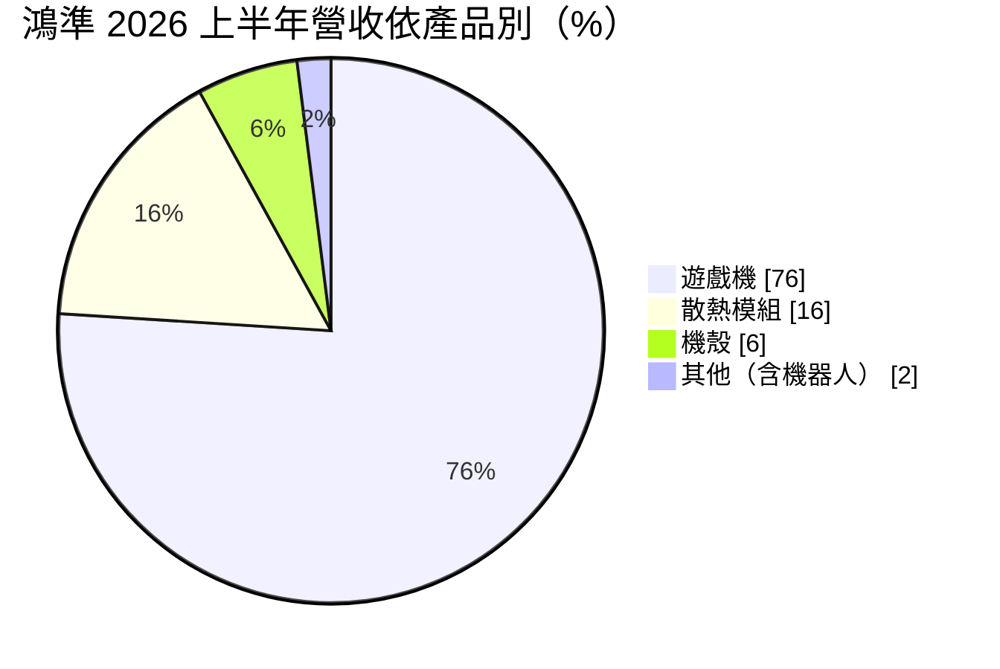
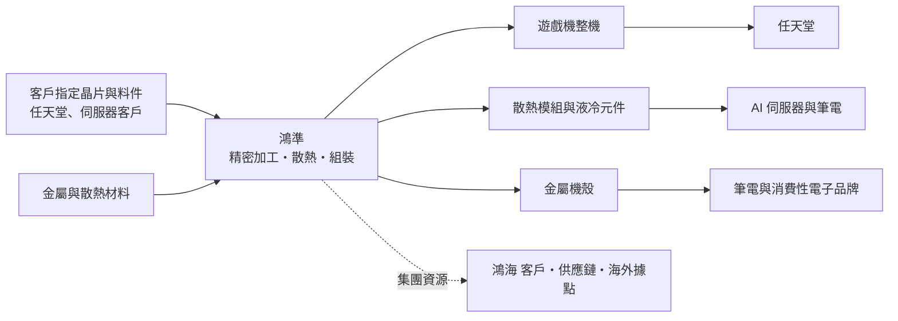
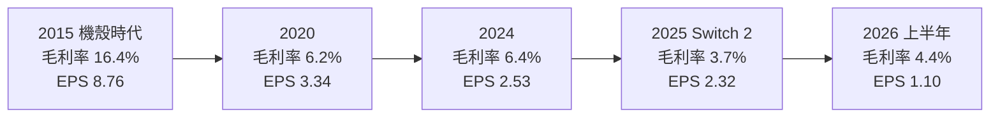
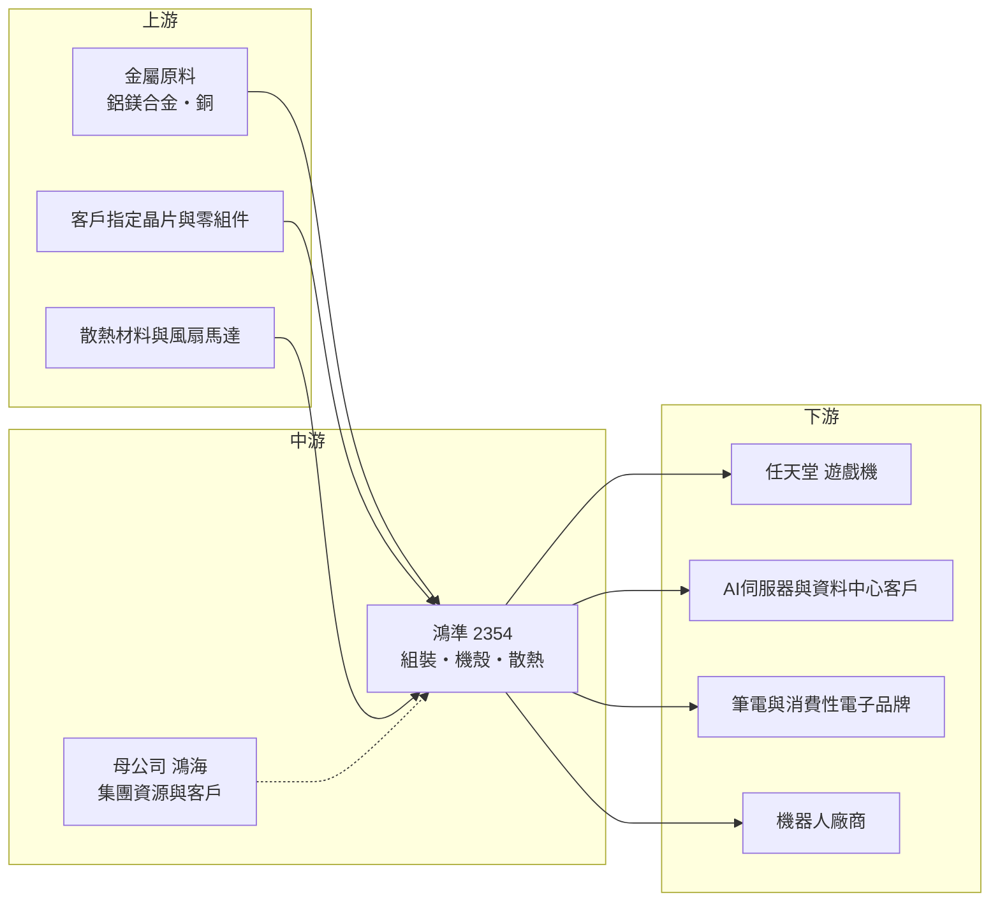

# 2354 鴻準

> 上市｜[[產業索引-其他電子業|其他電子業]]｜上市（櫃）日期 1996/10/08

# 第一章：企業模式與商業藍圖

> [!info] 撰寫說明
> 本文由 Claude 依公開資料整理，架構比照 [[2330台積電]] 的四章研究，資料截至 2026-10-08。財務數字來源：Goodinfo 經營績效、股利政策與現金流量頁（2014 至 2025 年度）、證交所開放資料快照（2026 年第二季資產負債與綜合損益、2025 年度股利、公司基本資料）、富果研究法說摘要（2025 年 12 月、2026 年 6 月與 9 月）、工商時報、優分析、CMoney（2014 年產品結構）；產業描述為整理性內容，尚未逐條比對原始文件。#待校對

在評估單一個股的長期投資價值時，首要步驟是拆解企業的底層獲利邏輯。本章針對鴻準精密（股票代號：2354，以下簡稱鴻準）的商業模式進行定性分析，說明一家以金屬機殼與[[散熱模組]]起家的 [[2317鴻海]] 集團子公司，如何在蘋果機殼業務退潮後，轉型為以遊戲機組裝為主體、並嘗試以 AI 散熱與機器人開拓下一階段的公司。

## 一、核心定位：鴻海集團的機構件與遊戲機組裝平台

鴻準成立於 1990 年 4 月，1996 年上市，實收資本額約 141 億元，是鴻海集團旗下的上市子公司。鴻準的歷史可以分成三個階段，理解這三個階段，就能理解它今天的財務性格。

* **第一階段：蘋果金屬機殼與遊戲機組裝（2010 年代前期）。** 依 CMoney 2014 年的整理，當時鴻準的產品中遊戲機約占六成、機殼約占兩至三成、散熱元件約一成五，機殼客戶以蘋果的 MacBook 與 iPhone 為主。鴻準以 [[CNC]] 精密加工與表面處理能力，成為蘋果金屬機殼的重要供應商，2014 至 2016 年[[毛利率]]約 16% 至 18%、[[ROE]] 約 11% 至 14%，是鴻準獲利能力最好的時期。
* **第二階段：機殼退潮、獲利能力下滑（約 2017 至 2024 年）。** 2017 年營收 1,478 億元，但毛利率降到 9.7%，時間點與第一代 Switch 上市、組裝營收比重提高吻合（推估，待校對）。之後智慧型手機金屬機殼的高峰過去，蘋果供應鏈競爭加劇，鴻準營收在 2023 年降到 745 億元，ROE 長期停留在 3% 至 7%。
* **第三階段：Switch 2 帶動營收倍增（2025 年起）。** 鴻準是任天堂新一代遊戲機 Switch 2 的機殼與整機組裝供應商。Switch 2 於 2025 年上市後，鴻準全年營收達 1,561 億元，是 2024 年的兩倍以上；但組裝業務附加價值低，毛利率降到 3.7%。

這段歷史說明，鴻準的營收規模主要由「當時最大客戶的產品週期」決定，而獲利能力則取決於高附加價值的機殼、散熱業務占比。

## 二、終端應用／產品板塊：遊戲機占近八成

依富果研究整理的法說資料，2026 年上半年的產品營收結構如下：

* **遊戲機：** 任天堂 Switch 2 的機殼與整機組裝。2025 年前三季遊戲機占營收 86.1%，2026 年上半年降到 76%，反映新機上市首年的拉貨高峰過後，出貨回到正常水準。遊戲機的生命週期通常超過五年，訂單在週期內相對穩定，但呈現「首年最高、逐年遞減」的節奏。
* **散熱模組：** 包括筆電與伺服器用的熱導管、均熱片、風扇與[[液冷]]元件。依法說會報導，2026 年第一季散熱模組年增超過四成，主要來自 [[AI伺服器]]需求。散熱是鴻準毛利率較高、也最有機會成為長期成長來源的業務。
* **機殼：** 筆電與消費性電子的金屬機殼，是鴻準的傳統本業，比重已大幅縮小。
* **其他與機器人：** 鴻準參與鴻海集團的工業機器人製造，並向國際機器人廠送樣，目前比重約 2%。

## 三、資本轉化邏輯（營運模式）：大量低毛利的組裝營收

* **營收大、毛利薄：** 整機組裝的料件多由客戶指定，鴻準主要賺取組裝加工費，但營收會把料件金額一併計入。因此 Switch 2 讓營收倍增，毛利率卻從過去的 6% 至 8% 降到 4% 左右。2026 年上半年營業利益率只有 1.3%。
* **產品組合決定毛利：** 散熱與機殼的毛利率高於組裝，遊戲機占比下降、散熱占比上升時，整體毛利率就會改善。觀察鴻準獲利能力最直接的指標，就是散熱模組的營收占比。
* **業外收益是獲利支柱：** 鴻準帳上長期保有大量現金與轉投資，2019 至 2025 年每年業外收益約 20 億至 39 億元。2023 年營業利益約 14.7 億元、業外約 38.8 億元，業外甚至超過本業。這讓鴻準的淨利率高於營業利益率，也代表它的本業獲利能力比 EPS 看起來更弱。

## 四、企業長期藍圖：散熱、機器人與美國布局

公司把未來發展歸納為「機、智、材、料、通」五大主軸，分別是機器人、智慧製造平台、散熱材料、資料中心與通訊元件。從長期投資角度看，真正有機會改變鴻準財務結構的是以下三項：

* **AI 散熱：** AI 伺服器的功耗快速提升，散熱從風扇氣冷轉向液冷，散熱模組的單價與技術門檻同步提高。鴻準背靠鴻海的 AI 伺服器組裝規模，有機會取得集團內外的散熱訂單；但液冷市場已由專業散熱廠領先，鴻準需要證明自己的技術與認證。
* **機器人：** 公司預期機器人業務在 3 至 5 年內成為核心產品，並發展機器人即服務（[[RaaS]]）模式。精密加工能力可以延伸到機器人關節與結構件，但人形機器人產業仍在早期。
* **美國設廠：** 依法說會報導，董事會批准約 10 億美元的美國戰略投資計畫，肯塔基州路易維爾工廠預計 2026 年第四季試產，主攻 AI 裝置與智慧自動化產品，公司目標投產後 1 至 2 年內損益兩平。這是鴻準近年最大的資本承諾，相對於一年約 30 億元的淨利，規模相當大。

# 第二章：護城河深度與競爭優勢

在長期價值投資中，「護城河」指企業抵禦競爭、維持超額利潤的保護機制。本章分析鴻準的護城河構成、主要競爭對手，以及這些優勢能否支撐它從組裝廠轉型。

## 一、鴻準護城河的核心組成要素

鴻準的護城河屬於「窄護城河」，而且大部分來自集團與客戶關係，而非獨有技術：

* **1. 精密金屬加工能力：** 過去替國際品牌大量生產 CNC 金屬機殼，累積了精密加工、表面處理與大量生產良率的經驗。這種能力可以延伸到散熱元件與機器人結構件，是鴻準少數可以跨產品轉移的核心能力。
* **2. 單一大客戶的深度綁定：** 鴻準連續多個世代參與任天堂遊戲機的製造（各世代參與程度依產業資料整理，待校對），在遊戲機生命週期內訂單相對穩定。大客戶更換組裝廠需要重新驗證整條產線，轉換成本不低。
* **3. 鴻海集團的規模與資源：** 背靠全球最大的 [[EMS]] 集團，在採購議價、海外設廠、客戶開發與 AI 伺服器生態系上都有支援。這讓鴻準可以用較低的成本進入新市場，例如美國設廠與 AI 散熱。

但這三項優勢都不足以支撐高報酬。組裝業務本身容易被同業取代，ROE 長期偏低就是護城河很淺的財務證據。

## 二、全球主要競爭對手格局

| 對手 | 定位 | 對鴻準的威脅 |
|---|---|---|
| [[3324雙鴻]] | AI 伺服器液冷散熱領導廠 | 在液冷水冷板與機櫃散熱領先，規模與認證優於鴻準 |
| [[3017奇鋐]] | 散熱模組大廠，氣冷與液冷並進 | 在 AI 伺服器散熱市占高 |
| [[2324仁寶]]、[[4938和碩]] | 大型 ODM 與 EMS | 在遊戲機與消費性電子組裝爭取訂單 |
| [[2474可成]] | 金屬機殼大廠 | 在筆電與手機金屬機殼長期與鴻準競爭 |
| [[2317鴻海]] 集團內其他事業 | 集團資源分配 | 集團內部的業務分工可能限制鴻準的接單範圍 |

## 三、優勢轉化：哪些市場守得住、哪些守不住

* **守得住：** 任天堂遊戲機組裝。在 Switch 2 生命週期內，客戶更換組裝廠的成本高，訂單相對穩定，但成長性會隨週期下滑。
* **守不住或需證明：** AI 伺服器散熱。液冷市場由雙鴻、奇鋐等專業散熱廠主導，鴻準屬後進者，散熱模組占營收約 16%。金屬機殼則已明顯退潮，比重只剩約 6%。
* **觀察重點：** 第一，散熱模組營收能否持續高速成長、讓毛利率回到 6% 以上；第二，肯塔基廠能否如期試產並轉盈；第三，機器人業務能否從送樣進入量產。這些新業務若無法放大，鴻準的獲利將持續隨遊戲機週期起伏，並依賴業外收益。

# 第三章：財務體質與盈利規模

資料日期：2026-10-08。年度數字取自 Goodinfo 經營績效、股利政策與現金流量頁，2026 年上半年與資產負債取自證交所開放資料快照，表格是撰寫當時的快照；最新月營收、毛利率、累計 EPS 由自動排程寫在本筆記的屬性欄位（月營收、毛利率、累計EPS 等）。#待校對

財務報表是檢驗護城河是否真實存在的最終標準。本章用多年度的三率、ROE、現金流與資本報酬，檢視鴻準從蘋果機殼時代到 Switch 2 時代的獲利品質。

## 一、獲利能力的基石：三率

| 年度 | 營收（億元） | [[毛利率]] | [[營業利益率]] | EPS（元） | [[ROE]] |
|---|---|---|---|---|---|
| 2020 | 1,048 | 6.2% | 2.5% | 3.34 | 4.3% |
| 2021 | 1,041 | 7.0% | 3.5% | 3.17 | 4.0% |
| 2022 | 905 | 7.6% | 3.2% | 3.02 | 3.9% |
| 2023 | 745 | 7.7% | 2.0% | 3.01 | 4.1% |
| 2024 | 758 | 6.4% | 2.1% | 2.53 | 3.2% |
| 2025 | 1,561 | 3.7% | 1.6% | 2.32 | 2.9% |
| 2026 上半年 | 556 | 4.4% | 1.3% | 1.10 | 未查得（半年約 1.4%，推算） |

對照更早期：2014 至 2016 年毛利率約 16% 至 18%、ROE 約 11% 至 14%，EPS 6.84 至 8.76 元（Goodinfo）。

* **營收：** 2020 至 2025 年年複合成長率約 8.3%（推算），但幾乎全部來自 2025 年 Switch 2 的一次跳升；2020 至 2024 年營收其實是下滑的。營收規模隨遊戲機週期大起大落，不代表獲利能力提升。
* **[[毛利率]]：** 從 2015 年的 16.4% 一路降到 2025 年的 3.7%，是鴻準十年來最重要的財務變化，反映產品組合從高毛利的金屬機殼轉向低毛利的組裝。
* **[[營業利益率]]：** 2020 年以來都在 1.6% 至 3.5% 之間，本業利潤很薄，對匯率、人工成本與產品組合的小幅變化非常敏感。
* **[[淨利率]]與業外：** 2023 年業外收益約 38.8 億元、營業利益約 14.7 億元，2025 年兩者分別約 23.4 億元與 24.4 億元。2026 年上半年營業利益約 7.2 億元、業外約 16.0 億元。鴻準的 EPS 約有一半以上來自業外，這部分主要是利息與投資收益，會隨利率與金融市場波動。

## 二、[[ROE]]：資本效率

鴻準 2021 至 2025 年平均 ROE 約 3.6%（推算），2019 至 2025 年每一年都低於 7%，並且呈現緩慢下滑。低 ROE 的原因有兩個：一是本業利潤很薄，二是股東權益中有大量現金與金融資產，這些資產的報酬率不高。2026 年第二季底股東權益約 1,138 億元、負債總額約 648 億元（其中流動負債約 633 億元，主要是組裝業務的應付帳款，推估），每股淨值 80.46 元。股價淨值比約 0.78 倍，市場評價低於淨值，與 ROE 長期低於股東要求報酬率的事實一致。

股利方面，鴻準 2019 至 2025 年度現金股利分別為 2.5、1.8、1.7、1.6、1.5、1.4、1.5 元，以當年 EPS 計算配息率約 50% 至 65%（推算）。配息金額逐年小幅下降、但從未中斷，屬於「穩定配息、金額隨獲利緩降」的類型。帳上累積未分配盈餘約 700 億元（2025 年度股利資料），代表公司保留了大量資金，而這些資金的運用效率正是 ROE 偏低的根源。

## 三、資本支出與自由現金流

| 年度 | 營業現金流（億元） | 投資現金流（億元） | 自由現金流（億元） |
|---|---|---|---|
| 2020 | 24.3 | 377 | 402 |
| 2021 | 45.5 | -119 | -73 |
| 2022 | 90.7 | 111 | 202 |
| 2023 | -35.5 | -254 | -289 |
| 2024 | 27.0 | -376 | -349 |
| 2025 | 35.1 | 28.6 | 63.7 |

（自由現金流依 Goodinfo 定義為營業現金流加投資現金流。鴻準的投資現金流包含大額定存與金融資產的進出，波動主要反映資金配置，而非資本支出。）

* **[[自由現金流]]：** 營業現金流規模不大，2020 至 2025 年平均每年約 31 億元（推算），2023 年甚至為負，主要是組裝業務的營運資金變化。投資現金流的大幅正負擺盪，多半是現金在定存與金融資產之間移動，評估時應以營業現金流為主。
* **[[CapEx]]：** 傳統上鴻準的資本支出不高；美國約 10 億美元的投資計畫若全數執行，將是過去少見的大規模支出（推估分多年執行）。

## 四、[[ROIC]] 與 [[WACC]]：價值創造利差

**ROIC（推算）：** 公開資料未揭露鴻準的 ROIC，本文以「稅後營業利益 ÷（股東權益＋有息負債）」推算。以 2026 年第二季非流動負債約 15 億元作為有息負債近似值，加上股東權益約 1,138 億元，投入資本約 1,153 億元。2025 年營業利益約 24.4 億元，稅率 20% 計算稅後約 19.5 億元，ROIC 約 1.7%（推算）；2026 年上半年營業利益年化約 14.3 億元，ROIC 約 1%（推算）。由於股東權益中有大量現金與金融資產，若只計算實際投入營運的資本，本業 ROIC 會較高，但現金明細本次未查得。

**WACC（推算）：** 以 CAPM 推估股東權益成本：無風險利率取台灣 10 年期公債約 1.75%，市場風險溢酬 6%，β 假設 0.9（電子組裝同業常見值約 0.8 至 1.0，非來源數字），權益成本約 7.15%。鴻準幾乎沒有長期負債，WACC 約等於權益成本，約 7.1%（推算）。

**結論：** 無論以 ROIC 或 ROE 衡量，鴻準近七年的資本報酬都明顯低於約 7% 的資金成本，代表整體而言並未為股東創造價值，股價淨值比低於 1 正是市場對此的反映。要扭轉這個局面，鴻準需要做到兩件事之一：讓散熱、機器人等高毛利業務把營業利益率拉回 5% 以上，或者更積極地把閒置資金以配息、買回等方式還給股東。

# 第四章：總體風險與地緣政治

任何企業都無法脫離宏觀環境獨立存在。本章分析鴻準未來必須面對的地緣政治、產業週期、營運與技術風險。

## 一、地緣政治風險

* **美國關稅與遊戲機產地：** 遊戲機大量銷往美國，美國對中國或東南亞產品的關稅變化，會影響任天堂的生產地分配與鴻準的組裝訂單。
* **美國設廠的機會與成本：** 肯塔基廠有助於爭取美國在地化訂單，但美國人力與營運成本高，損益兩平需要時間，對一家營業利益率約 1% 的公司而言，任何虧損都會明顯影響獲利。
* **中國產能集中：** 鴻準與鴻海集團在中國有大量生產基地，美中摩擦升溫時面臨轉移產能的壓力與成本。

## 二、產業週期與市場結構

* **遊戲機生命週期：** 遊戲機通常在上市首年出貨最高，之後逐年下滑，直到下一代機種推出。鴻準營收約四分之三來自遊戲機，未來幾年營收可能隨週期遞減。
* **[[長鞭效應]]：** 遊戲機與消費性電子的需求變化，透過品牌商的庫存調整放大到組裝廠，季度營收波動很大。
* **匯率與利率：** 營收以美元計價，營業利益率又只有約 1%，新台幣升值很容易讓本業轉為虧損；同時業外收益依賴利息收入，利率下降會直接壓低獲利。

## 三、營運環境的隱性風險

* **單一客戶集中：** 任天堂占營收比重極高，若客戶分散組裝訂單或遊戲機銷售不如預期，影響直接且巨大。
* **新業務執行：** 機器人、資料中心、通訊元件等新業務都還在早期，營收貢獻小，投入卻持續增加。
* **集團分工與關係人交易：** 作為鴻海子公司，業務範圍可能受到集團內部分工影響，與母公司及其他子公司的交易也需留意定價是否公允。

## 四、科技或法規演進

AI 伺服器的散熱技術正快速從氣冷轉向液冷，甚至[[浸沒式冷卻]]，散熱廠需要持續投資新技術並取得晶片商與雲端業者的認證。鴻準在液冷領域需要追趕領先者，若技術迭代速度太快，後進者可能來不及回收投資。人形機器人仍在早期，技術路線與商業模式尚未定型，提早投入的風險與機會並存。

# 專有名詞解析

## 應用

- **[[AI伺服器]]**：搭載 GPU 或 AI 加速器、用於訓練與推論的伺服器，功耗與散熱需求遠高於一般伺服器。

## 金融

- **[[毛利率]]**：毛利除以營收，代表產品扣除直接成本後的獲利空間；組裝業務的毛利率通常只有個位數。
- **[[營業利益率]]**：營業利益除以營收，反映本業扣除研發、管銷費用後的獲利能力。
- **[[淨利率]]**：稅後淨利除以營收，包含業外收支，代表每一元營收最後留給股東的獲利。
- **[[ROIC]]**：投入資本報酬率，稅後營業利益除以股東權益加有息負債，衡量公司投入營運的全部資本能賺多少。
- **[[WACC]]**：加權平均資金成本，股東與債權人要求報酬率的加權平均，是 ROIC 的比較基準。
- **[[長鞭效應]]**：終端需求的小幅變動，沿供應鏈往上游傳遞時被逐級放大，造成上游庫存與訂單劇烈波動。

## 產業

- **[[散熱模組]]**：由熱導管、均熱片、散熱鰭片與風扇組成，把晶片產生的熱帶走，是筆電與伺服器的必要零件。
- **[[液冷]]**：以液體流經貼在晶片上的冷板帶走熱量，散熱效率遠高於風扇氣冷，是高功耗 AI 伺服器的主流方案。
- **[[浸沒式冷卻]]**：把伺服器整個浸泡在不導電的冷卻液中散熱，效率更高，但系統改動大。
- **[[CNC]]**：電腦數值控制加工，以程式控制刀具切削金屬，用於生產精密的金屬機殼與零件。
- **[[EMS]]**：電子製造服務，替品牌客戶代工電路板組裝、測試與整機組裝的產業，代表廠商為鴻海、和碩。
- **[[RaaS]]**：機器人即服務，客戶以租用或按使用量付費的方式取得機器人與服務，而非一次買斷。

# 核心供應鏈

## 1. 上游：原材料與零組件
- 金屬與散熱材料：鋁鎂合金、銅材供應商（個別名稱未查得）
- 遊戲機晶片與零組件：由客戶指定，例如 [[NVDA輝達]] 提供 Switch 2 處理器（依產業常見資料，未逐一比對）

## 2. 中游：鴻準本身與集團
- 母公司：[[2317鴻海]]
- 散熱同業：[[3324雙鴻]]、[[3017奇鋐]]
- 機殼同業：[[2474可成]]

## 3. 下游：主要客戶
- 遊戲機：任天堂
- AI 伺服器：鴻海集團與其他伺服器客戶的散熱需求
- 筆電與消費性電子：[[AAPL蘋果]]（過去金屬機殼主要客戶，目前比重未查得）
- 機器人：鴻海集團與國際機器人廠

## 4. 組裝同業
- [[2324仁寶]]、[[4938和碩]]、[[2312金寶]]

## 最新新聞
<!-- news:start（自動產生，請勿手動編輯此範圍） -->
- 2026-10-12 🏛️ 重訊 15:38｜公告本公司從事衍生性金融商品交易達損失上限｜[觀測站](https://mops.twse.com.tw/mops/#/web/t05st01)

完整紀錄：[[2354鴻準 新聞]]
<!-- news:end -->

## 相關連結
- [公開資訊觀測站](https://mopsov.twse.com.tw/mops/web/t05st03?step=1&firstin=1&co_id=2354)
- [Goodinfo](https://goodinfo.tw/tw/StockDetail.asp?STOCK_ID=2354)
- [Yahoo 股市](https://tw.stock.yahoo.com/quote/2354)
- [鉅亨網新聞](https://www.cnyes.com/twstock/2354/news)
