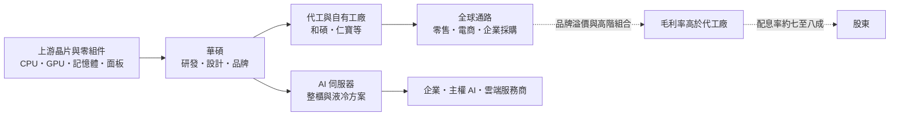
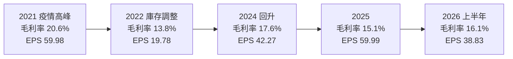
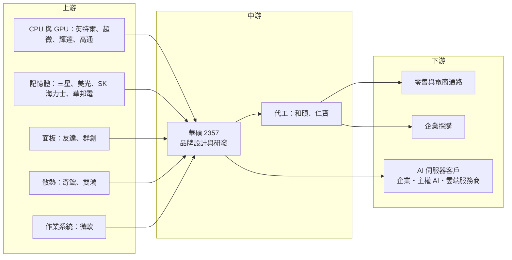

# 2357 華碩

> 上市｜[[產業索引-電腦及週邊設備業|電腦及週邊設備業]]｜上市（櫃）日期 1996/11/14

# 第一章：企業模式與商業藍圖

> [!info] 撰寫說明
> 本文由 Claude 依公開資料整理，架構比照 [[2330台積電]] 的四章研究，資料截至 2026-10-08。財務數字來源：Goodinfo 經營績效、股利政策與現金流量頁（2019 至 2025 年度，合併報表）、證交所開放資料快照（2026 年第二季資產負債與綜合損益、2025 年度股利、公司基本資料）、華碩 2025 年第四季與 2026 年第二季法說會報導（優分析、科技新報、富果研究）；產業描述為整理性內容，尚未逐條比對原始文件。#待校對

在評估單一個股的長期投資價值時，首要步驟是拆解企業的底層獲利邏輯。本章針對華碩電腦（股票代號：2357，以下簡稱華碩）的商業模式進行定性分析，說明一家以主機板起家的公司，如何把代工業務分拆出去、專注自有品牌，並在 PC 成熟市場中以電競與高階產品維持獲利，同時把 AI 伺服器發展為新的成長引擎。

## 一、核心定位：台灣最大的自有品牌電腦廠

華碩登記成立於 1990 年 4 月，1996 年上市，現任董事長為施崇棠。公司以主機板起家，後來擴展到顯示卡、筆記型電腦、桌上型電腦、顯示器、網通設備、手機與伺服器。創業初期由幾位前宏碁工程師共同創立，施崇棠於 1990 年代中期加入並出任董事長（創辦人與加入年份依公司沿革整理，待校對）。

華碩長期定位的關鍵轉折是「品牌與代工分家」。華碩過去同時經營自有品牌與替其他品牌代工，兩者存在客戶衝突；2008 年起華碩把代工業務分拆為 [[4938和碩]]，2010 年和碩獨立上市（時間依公司沿革整理，待校對），此後華碩專注自有品牌。這個決策讓華碩從「製造公司」轉為「品牌與研發公司」，也決定了它今天的財務性格：

* **[[品牌溢價]]：** 華碩 2019 至 2025 年的毛利率落在 13.8% 至 20.6%，明顯高於代工同業常見的 5% 至 10%。差距來自品牌、產品設計與高階產品組合，是華碩獲利能力的根本來源。
* **輕資產：** 生產多委由代工廠完成，華碩把資源集中在研發、行銷與通路，固定資產投資遠低於製造業。主要的資金需求是存貨與應收帳款，而不是蓋廠。

華碩在主機板與[[電競]]顯示卡市場長期居全球領先地位，電競品牌 ROG（Republic of Gamers）是品牌溢價最高的產品線。近年 AI 伺服器成為成長最快的事業，公司在 2026 年把原伺服器事業單位升格為獨立事業群。

## 二、產品板塊：系統、零組件、電競與伺服器

本次未查得華碩各事業群的營收比重數字，因此不繪製營收結構圖，改以各板塊的特性說明。另需注意，華碩法說會公布的是「華碩品牌」營收（2025 年約 6,894 億元），與合併財報營收（2025 年約 7,389 億元）不同，差額來自合併子公司（推估）；本文第三章採用合併財報數字。

* **系統產品（筆電、桌機）：** 營收最大宗，涵蓋消費型、[[商用 PC]]、電競筆電。依 2025 年第四季法說會報導，高階機種占系統事業約六成。PC 市場成熟、成長緩慢，華碩的策略是提高高階與商用比重，以平均售價而非出貨量成長。
* **零組件（主機板、顯示卡）：** 以 [[DIY]] 與電競玩家市場為主，與 [[NVDA輝達]]、[[AMD超微]]、[[INTC英特爾]] 的新世代晶片推出高度連動。這是華碩的起家業務，品牌地位最穩固。
* **電競產品（ROG）：** 橫跨筆電、主機板、顯示卡、顯示器與掌機，玩家對效能的要求高、價格敏感度相對低，是毛利率的重要支撐。
* **AI 伺服器與基礎架構：** 以輝達 GPU 平台的 AI 伺服器為主，客戶涵蓋企業、[[主權 AI]] 與二線雲端服務商。依 2025 年第四季法說會報導，公司預期 2026 年第一季 AI 伺服器營收年增 4 至 5 倍。

## 三、資本轉化邏輯：品牌、外包製造與全球通路

* **研發與品牌在台灣、生產外包：** 總部位於台北北投，研發集中在台灣，生產主要委由代工廠完成。這讓華碩可以把資本集中在產品開發與行銷，資本支出很低。
* **全球通路：** 銷售通路遍及歐洲、亞太、北美與中國，通路關係與售後服務網路是長期累積的資產。
* **存貨是主要風險來源：** 品牌廠不需要大量蓋廠，但必須承擔存貨。PC 需求轉弱、或零組件價格大跌時，通路與品牌廠的存貨會跌價。2022 年華碩營業利益率由前一年的 9.2% 降到 2.4%，就是 PC 庫存調整的結果。
* **高配息：** 由於資本支出低，華碩把大部分獲利以現金股利發放給股東，2019 至 2025 年度配息率約七至八成以上（推算），這是輕資產品牌公司的典型資本配置方式。

## 四、企業長期藍圖：高階化、AI 伺服器與 Physical AI

* **高階化：** 把產品組合往電競、商用、[[AI PC]] 推進，提升平均售價與毛利率。在 PC 出貨量難以大幅成長的環境下，這是維持獲利成長的主要方法。
* **AI 伺服器：** 以品牌伺服器廠的角色，提供從單機到整櫃與[[液冷]]的方案，鎖定企業、主權 AI 與二線雲端業者，避開與 ODM 正面爭奪超大型雲端業者的訂單。這塊業務的單價高、但料件成本也高，毛利率結構和 PC 不同，需要大量墊付 GPU 料件，對[[營運資金]]管理的要求更高。
* **[[Physical AI]]：** 董事長施崇棠在 2026 年股東會表示，公司對 Physical AI 與人形機器人已有長期布局，相關技術持續研發中。這是較長期的選擇權，目前尚無營收貢獻。

# 第二章：護城河深度與競爭優勢

在長期價值投資中，「護城河」指企業抵禦競爭、維持超額利潤的保護機制。本章分析華碩以品牌與通路為核心的護城河、各產品線的主要競爭對手，以及這些優勢在 PC 價格戰與 AI 伺服器競爭中能守住多少。

## 一、護城河的核心組成要素

華碩的護城河屬於「窄到中等」，在電競與零組件較深、在一般消費型筆電較淺，由四個要素組成：

* **1. 品牌力：** ROG 電競品牌在玩家族群中有高辨識度，能支撐高於代工廠的毛利率。品牌是需要長年投入才能建立的資產，新進者很難在短期內複製。
* **2. 主機板與顯示卡的領先地位：** 與輝達、AMD、英特爾關係密切，新平台推出時通常能第一時間上市。這種「第一時間上市」的能力，在產品週期短的電競市場特別重要。
* **3. 全球通路與服務網路：** 在零售、電商與企業採購等多種通路建立長期合作。通路關係與售後服務需要多年經營，是品牌廠相對於白牌與新進者的優勢。
* **4. 硬體整合研發能力：** 從主機板設計延伸出的硬體整合能力，可以轉用在伺服器、AI PC 與掌機等新產品，讓華碩能較快切入新市場。

## 二、全球主要競爭對手格局

| 對手 | 定位 | 對華碩的威脅 |
|---|---|---|
| 聯想、HP、Dell | 全球前三大 PC 品牌 | 規模與商用市場優勢明顯，主導 PC 市場 |
| [[2353宏碁]] | 台灣 PC 品牌 | 國內最直接的對手，消費與教育市場重疊 |
| [[AAPL蘋果]] Mac | 高階筆電 | 在高階消費與創作者市場競爭 |
| [[2376技嘉]]、[[2377微星]]、[[3515華擎]] | 主機板與顯示卡品牌 | 在 DIY 與電競市場正面競爭 |
| 美超微、Dell、HPE | 品牌伺服器廠 | 在企業與主權 AI 伺服器市場規模較大 |
| [[2382廣達]]、[[3231緯創]]、[[2317鴻海]] | 伺服器 ODM | 主攻大型雲端業者，規模經濟遠勝華碩 |

PC 市場是成熟的寡占市場，前三大品牌掌握大部分商用市場，華碩的優勢集中在消費、電競與零組件。AI 伺服器則是新戰場，華碩的規模遠小於 ODM 與美超微，主要靠品牌、服務與彈性爭取中型客戶。

## 三、優勢轉化：哪些守得住、哪些守不住

* **守得住：** 電競與 DIY 零組件市場仰賴品牌與玩家口碑，華碩的地位穩固。這塊業務讓華碩在 PC 景氣低迷的 2022 至 2023 年仍維持約 14% 至 15% 的毛利率與正的營業利益。
* **守不住：** 一般消費型筆電價格競爭激烈，華碩在商用市場仍是追趕者。PC 庫存調整時，品牌溢價擋不住存貨跌價，2022 至 2023 年營業利益率只有約 2.3% 至 2.4%。AI 伺服器方面，華碩規模遠小於 ODM 與美超微。
* **觀察重點：** 第一，伺服器營收占比能否持續提高並維持合理毛利；第二，記憶體等零組件成本上漲能否順利轉嫁；第三，商用 PC 與高階機種比重能否持續提升，讓毛利率中樞維持在 15% 以上。

# 第三章：財務體質與盈利規模

資料日期：2026-10-08。年度數字取自 Goodinfo 經營績效、股利政策與現金流量頁（合併報表），2026 年上半年與資產負債取自證交所開放資料快照，表格是撰寫當時的快照；最新月營收、毛利率、累計 EPS 由自動排程寫在本筆記的屬性欄位（月營收、毛利率、累計EPS 等）。#待校對

財務報表是檢驗護城河是否真實存在的最終標準。本章用多年度的三率、ROE、現金流與資本報酬，檢視華碩在一個完整 PC 週期（2020 至 2021 年疫情需求高峰、2022 至 2023 年庫存調整、2024 年起 AI 伺服器與高階化帶動回升）中的獲利品質。

## 一、獲利能力的基石：三率

| 年度 | 營收（億元，合併） | [[毛利率]] | [[營業利益率]] | EPS（元） | [[ROE]] |
|---|---|---|---|---|---|
| 2020 | 4,128 | 17.7% | 6.1% | 35.76 | 14.3% |
| 2021 | 5,352 | 20.6% | 9.2% | 59.98 | 20.2% |
| 2022 | 5,372 | 13.8% | 2.4% | 19.78 | 7.1% |
| 2023 | 4,823 | 15.0% | 2.3% | 21.44 | 7.4% |
| 2024 | 5,871 | 17.6% | 5.0% | 42.27 | 12.3% |
| 2025 | 7,389 | 15.1% | 5.4% | 59.99 | 16.2% |
| 2026 上半年 | 4,661 | 16.1% | 7.1% | 38.83 | 未查得（半年約 9.6%，推算） |

註：法說會公布的華碩品牌數字與合併報表不同，例如 2025 年品牌營收約 6,894 億元、毛利率 13.8%、營業利益率 4.9%；本表一律採合併報表。

* **營收：** 2020 至 2025 年合併營收從 4,128 億元增加到 7,389 億元，年複合成長率約 12.3%（推算），在成熟的 PC 產業中屬於相當好的成長，主要來自高階化與 AI 伺服器。
* **[[毛利率]]：** 2021 年 20.6% 是疫情期間需求暴增、供給短缺的特殊高點，2022 年隨庫存調整降到 13.8%。正常年份大致在 15% 至 18%，這個區間代表華碩品牌溢價的「常態水準」。
* **[[營業利益率]]：** 在 2.3% 至 9.2% 之間大幅擺盪。品牌廠的費用（研發、行銷、通路）相對固定，毛利率差幾個百分點，營業利益率就會倍數變化。
* **[[業外收益]]：** 華碩的業外收益很穩定且規模可觀，2019 至 2025 年每年約 77 億至 154 億元。2023 年營業利益約 112 億元、業外約 109 億元，業外幾乎與本業相當。業外來源包括轉投資收益、股利、利息與匯兌，評估本業時應以營業利益為準。

## 二、[[ROE]]：資本效率

華碩 2021 至 2025 年平均 ROE 約 12.6%（推算），2020 至 2024 年約 12.3%（推算），即使在 2022 至 2023 年的 PC 低谷也維持在 7% 以上。對照記憶體或代工等重資產產業，華碩 ROE 的波動相對溫和、從未出現年度虧損，這是輕資產品牌模式的財務優勢。2026 年第二季底股東權益約 3,300 億元（歸屬母公司約 3,014 億元）、負債總額約 5,386 億元，負債比約 62%（推算），其中流動負債約 5,111 億元，主要是應付帳款等營運負債，長期負債很少。

股利方面，華碩 2019 至 2025 年度現金股利分別為 14、26、42、15、17、34、42 元，以當年 EPS 計算配息率約 70% 至 86%（推算），每年都在七成以上。股利金額隨獲利大幅波動（最低 14 元、最高 42 元），但「把大部分盈餘發還股東」的政策非常一致，2025 年度可分配盈餘幾乎全數分配。

## 三、資本支出與自由現金流

| 年度 | 營業現金流（億元） | 投資現金流（億元） | 自由現金流（億元） |
|---|---|---|---|
| 2020 | -20.9 | -45.9 | -66.8 |
| 2021 | 327 | -17.8 | 309 |
| 2022 | -157 | 14.5 | -143 |
| 2023 | 521 | 22.1 | 543 |
| 2024 | 80.3 | -31.9 | 48.4 |
| 2025 | 303 | -81.8 | 221 |

（自由現金流依 Goodinfo 定義為營業現金流加投資現金流。）

* **[[自由現金流]]：** 2020 至 2025 年六年累計約 912 億元（推算），與同期發放的現金股利規模大致相當，說明華碩的高配息是有現金支撐的。但年度之間波動極大：2022 年營業現金流 -157 億元，2023 年又回升到 521 億元，原因是存貨在缺貨時大量備料、庫存調整時再去化，營運資金的擺盪主導了現金流。
* **[[CapEx]]：** 投資現金流每年只有數十億元，與數千億元營收相比非常小，證明華碩是典型的輕資產公司。AI 伺服器需要墊付昂貴的 GPU 料件，未來營運資金的需求可能比資本支出更重要。

## 四、[[ROIC]] 與 [[WACC]]：價值創造利差

**ROIC（推算）：** 公開資料未揭露華碩的 ROIC，本文以「稅後營業利益 ÷（股東權益＋有息負債）」推算。以 2026 年第二季非流動負債約 274 億元作為有息負債近似值，加上股東權益約 3,300 億元，投入資本約 3,574 億元。2025 年營業利益約 397 億元，稅率 20% 計算稅後約 318 億元，ROIC 約 8.9%（推算）；2026 年上半年營業利益約 329 億元，年化後 ROIC 約 14.7%（推算）。2021 年營業利益約 493 億元，以當時較小的資本基數估計 ROIC 約 15%；2022 至 2023 年營業利益只有 112 億至 130 億元，ROIC 約 3% 至 4%（推算）。股東權益中有大量轉投資與金融資產（其他權益約 775 億元），這些資產的報酬列在業外，若從投入資本中扣除，本業 ROIC 會更高。

**WACC（推算）：** 以 CAPM 推估股東權益成本：無風險利率取台灣 10 年期公債約 1.75%，市場風險溢酬 6%，β 假設 1.0（電腦品牌同業常見值約 0.9 至 1.1，非來源數字），權益成本約 7.75%。負債成本假設稅前 2%、稅率 20%，稅後 1.6%。以帳面資本結構（權益約 92%、有息負債約 8%）計算，WACC 約 7.3%；以市值計算（股價淨值比約 2.5 倍）約 7.6%（推算）。

**結論：** 華碩在 PC 景氣正常或偏好的年份（2020 至 2021、2024 至 2026 年），ROIC 高於約 7% 至 8% 的 WACC，持續創造價值；在 2022 至 2023 年的庫存調整期，ROIC 跌到 WACC 以下。以整個週期平均來看，華碩大致能賺到略高於資金成本的報酬（推估），而高配息政策讓股東能直接拿到這些現金。長期能否擴大利差，取決於 AI 伺服器能否在不大幅拉高營運資金的前提下貢獻獲利。

# 第四章：總體風險與地緣政治

任何企業都無法脫離宏觀環境獨立存在。本章分析華碩未來必須面對的地緣政治、PC 與零組件週期、營運與技術風險。

## 一、地緣政治風險

* **美國關稅：** 華碩筆電與零組件多在中國與東南亞生產，美國對進口電子產品的關稅變化會影響北美售價與毛利。品牌廠可以要求代工廠移轉產地，但移轉需要時間與成本。
* **中國市場：** 中國是重要銷售市場，但聯想等本土品牌與國產替代政策形成長期競爭壓力。
* **出口管制：** 高階 GPU 的出口管制會限制顯示卡與 AI 伺服器銷往特定地區，影響產品線的市場範圍。

## 二、產業週期與市場結構風險

* **PC 週期：** PC 市場成熟，需求由換機潮驅動。疫情帶來的換機高峰已在 2022 年反轉，下一次換機潮的時點與強度（例如作業系統更新、AI PC 普及）難以預測。
* **零組件成本：** 記憶體、面板與處理器價格的變化會直接影響品牌廠的毛利。零組件漲價時若無法轉嫁，毛利率會受壓；漲價也可能讓消費者延後購買。
* **[[長鞭效應]]：** 通路在缺貨時超額備貨、需求轉弱時急速去化，品牌廠的出貨波動常大於終端銷售。2022 年營業現金流轉負，就是這種效應的結果。
* **電競與顯示卡需求波動：** 顯示卡需求過去曾因加密貨幣挖礦熱潮大起大落，這類非核心需求的進出會擾動零組件事業的營收。

## 三、營運環境的隱性風險

* **庫存管理：** 品牌廠需承擔存貨風險，PC 庫存調整時存貨跌價會同時壓低利潤與現金流。
* **匯率：** 營收以美元、歐元計價，新台幣升值與歐元波動會影響營收與匯兌損益。
* **AI 伺服器執行：** 伺服器業務需要大量墊付 GPU 料件，若客戶延遲付款或專案取消，存貨與應收帳款的風險高；伺服器毛利率結構也可能拉低整體毛利率。
* **業外收益波動：** 業外收益占稅前獲利比重高，轉投資股價或匯率變動會讓 EPS 偏離本業表現。

## 四、科技演進風險

AI PC 的發展取決於晶片商（英特爾、AMD、[[QCOM高通]]、輝達）與 [[MSFT微軟]] 的軟體生態系，華碩較難主導規格，只能在產品設計與上市速度上競爭。若 AI 運算持續往雲端集中，AI PC 帶動的換機潮可能不如預期。AI 伺服器則面臨技術迭代快、液冷與整櫃設計門檻提高的挑戰，品牌伺服器廠需要持續投入研發才能跟上 GPU 平台的更新。Physical AI 與機器人仍處於早期，投入能否轉為營收尚待觀察。

# 專有名詞解析

## 應用

- **[[AI PC]]**：內建神經網路處理單元、能在本機執行 AI 運算的個人電腦。
- **[[主權 AI]]**：各國政府為確保資料與運算自主而自建的 AI 算力與模型。
- **[[Physical AI]]**：讓 AI 能感知並操作實體世界的技術，例如機器人、人形機器人與自動化設備。

## 金融

- **[[業外收益]]**：本業以外的收入，如利息、投資收益、股利與匯兌利益，持續性通常低於本業獲利。
- **[[營運資金]]**：流動資產減流動負債，主要是存貨與應收帳款，AI 伺服器料件昂貴使需求大增。
- **[[自由現金流]]**：營業活動現金流減去資本支出，代表企業可自由用於配息、還債或併購的現金。
- **[[ROIC]]**：投入資本報酬率，稅後營業利益除以股東權益加有息負債，衡量公司投入營運的全部資本能賺多少。
- **[[WACC]]**：加權平均資金成本，股東與債權人要求報酬率的加權平均，是 ROIC 的比較基準。
- **[[長鞭效應]]**：終端需求的小幅變動，沿供應鏈往上游傳遞時被逐級放大，造成上游庫存與訂單劇烈波動。

## 產業

- **[[品牌溢價]]**：消費者願意為知名品牌多付的價格，讓品牌公司毛利率高於代工廠。
- **[[電競]]**：電子競技與高效能遊戲市場，玩家願意為高規格硬體支付較高價格。
- **[[DIY]]**：玩家自行選購主機板、顯示卡等零組件組裝電腦的市場。
- **[[商用 PC]]**：企業採購的筆電與桌機，重視穩定性、資安與售後服務，換機週期與企業 IT 預算相關。
- **[[液冷]]**：以液體帶走晶片熱量的散熱方式，高功率 AI 機櫃已從氣冷轉向液冷。

# 核心供應鏈

## 1. 上游：晶片與零組件
- CPU 與 GPU：[[INTC英特爾]]、[[AMD超微]]、[[NVDA輝達]]、[[QCOM高通]]
- 記憶體：[[005930三星電子]]、美光、SK 海力士、[[2344華邦電]]
- 作業系統：[[MSFT微軟]]
- 面板：[[2409友達]]、[[3481群創]]
- 散熱：[[3017奇鋐]]、[[3324雙鴻]]

## 2. 中游：代工與集團
- 代工夥伴：[[4938和碩]]、[[2324仁寶]]
- 轉投資：[[4938和碩]]（2008 年起由華碩分拆，持股比例未查得）

## 3. 下游：通路與客戶
- 零售與電商通路、企業採購
- AI 伺服器：企業、主權 AI 與雲端服務商

## 4. 同業
- PC 品牌：[[2353宏碁]]、聯想、HP、Dell、[[AAPL蘋果]]
- 主機板與顯示卡：[[2376技嘉]]、[[2377微星]]、[[3515華擎]]
- 伺服器：美超微、Dell、HPE、[[2382廣達]]、[[3231緯創]]

## 最新新聞
<!-- news:start（自動產生，請勿手動編輯此範圍） -->
- 2026-10-16 📰 媒體 16:11｜鉅亨速報 - Factset 最新調查：華碩(2357-TW)EPS預估上修至76.55元，預估目標價為1100元｜[鉅亨網](https://news.cnyes.com/news/id/6632078)

完整紀錄：[[2357華碩 新聞]]
<!-- news:end -->

## 相關連結
- [公開資訊觀測站](https://mopsov.twse.com.tw/mops/web/t05st03?step=1&firstin=1&co_id=2357)
- [Goodinfo](https://goodinfo.tw/tw/StockDetail.asp?STOCK_ID=2357)
- [Yahoo 股市](https://tw.stock.yahoo.com/quote/2357)
- [鉅亨網新聞](https://www.cnyes.com/twstock/2357/news)
