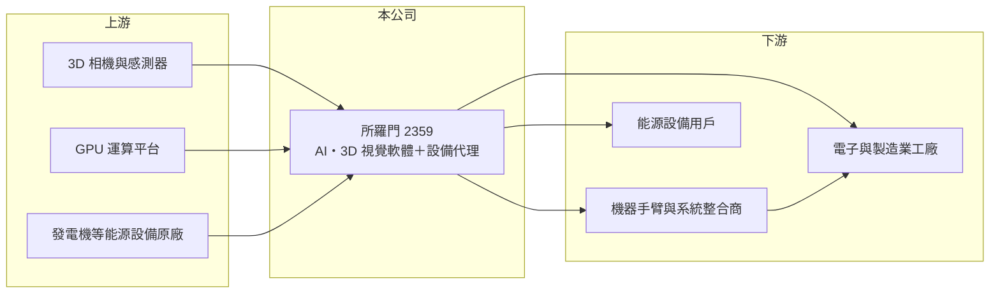

# 2359 所羅門

> 上市｜[[產業索引-其他電子業|其他電子業]]｜上市（櫃）日期 1996/12/19

# 第一章：企業模式與商業藍圖

> [!info] 撰寫說明
> 精簡版，由 Claude 依公開資料整理，架構比照 [[2330台積電]]，資料截至 2026-10-08。來源：證交所開放資料快照（基本資料、2026 年第二季資產負債與損益、股利）、Goodinfo 經營績效頁、工商時報 2026 年 6 月報導。各業務營收比重公開資料未查得。#待校對

所羅門是一家「兩種面貌」的公司：對外以 AI 與 3D [[機器視覺]]軟體著稱，但營收的大宗仍來自發電機等設備與零組件的代理銷售。要理解它的長期價值，必須把高毛利但規模尚小的軟體事業，和規模大但毛利薄的貿易事業分開看。

- **核心業務：** 所羅門成立於 1990 年、1996 年上市，董事長兼總經理為陳政隆。公司自行開發 3D 視覺辨識與 AI 軟體，讓機器手臂能在雜亂堆放中辨識並夾取物件（隨機取放），也用於瑕疵檢測；另經營發電機等能源設備與電子零組件代理（#待校對）。軟體可以搭配多家品牌的機器手臂使用，是它與手臂原廠內建方案的主要差異。
- **營收結構：** 公司未公開分部比重。整體[[毛利率]]長年在 20% 至 23% 之間，遠低於純軟體公司，可推知代理與設備銷售仍占營收多數（推估）。工商時報 2026 年報導指出，能源設備受 AI 資料中心帶動電力需求，出現供不應求、交期拉長的情形。
- **營運據點：** 總部在台灣。AI 與 3D 視覺的主要客戶在歐美，能源設備的主要市場是中國大陸與台灣。客戶數約 500 至 600 家、重購率接近四成，並已打入 [[2356英業達]] 等大型電子製造商。
- **長期方向：** 公司以 [[Physical AI]]（讓 AI 能操作實體世界）為主軸，從單純賣軟體轉向軟硬整合方案，並擴展到智慧與人形機器人的視覺系統。長期目標是提高高毛利 AI 視覺的營收占比，讓整體獲利結構脫離貿易商的樣貌。

# 第二章：護城河深度與競爭優勢

所羅門的護城河集中在視覺演算法與跨品牌整合能力，但目前規模仍小，尚不足以撐起整家公司的獲利。

- **競爭優勢：** 3D 視覺取放需要大量影像資料與現場調校經驗，所羅門累積多年案例，能在不同產業、不同手臂品牌之間移植方案，對系統整合商而言具吸引力。客戶重購率接近四成，代表導入後有一定黏著度。代理業務則提供現金流與客戶關係，支撐軟體研發。
- **主要對手：** 國際機器視覺大廠 Cognex、Keyence（基恩斯），以及 ABB、Fanuc 等機器手臂原廠自帶的視覺方案；中國也有大量 3D 視覺新創（#待校對）。在台灣，[[2049上銀]] 等手臂業者也發展自有視覺功能。
- **觀察重點：** 長期最該追蹤的是營業利益率能否穩定高於 5%。2019 至 2025 年營業利益率在 -1.4% 到 5% 之間，多數年度的獲利來自業外，代表 AI 視覺尚未成為獲利主力；若軟體營收規模放大，營業利益率應會明顯改善。

# 第三章：財務體質與盈利規模

資料日期：2026-10-08，表格是撰寫當時的快照；最新月營收、毛利率、累計 EPS 由自動排程寫在本筆記的屬性欄位（月營收、毛利率、累計EPS 等）。#待校對

所羅門的財務特徵是本業微利、業外貢獻大、負債極低，EPS 的高低主要反映業外項目而非本業。

| 年度 | 營收（億元） | [[毛利率]] | [[營業利益率]] | EPS（元） | [[ROE]] |
|---|---|---|---|---|---|
| 2019 | 37.4 | 20.5% | 0.89% | 1.86 | 7.39% |
| 2020 | 35.3 | 21.2% | 1.33% | 0.12 | 0.62% |
| 2021 | 39.0 | 20.4% | 1.26% | 1.16 | 4.40% |
| 2022 | 52.5 | 20.6% | 5.04% | 2.67 | 9.24% |
| 2023 | 42.2 | 23.0% | 3.39% | 3.11 | 10.2% |
| 2024 | 35.0 | 22.6% | -1.37% | 0.84 | 2.66% |
| 2025 | 42.5 | 22.7% | 1.61% | 1.23 | 3.81% |

（來源：Goodinfo 經營績效頁。2026 年上半年依證交所資料：營收 23.3 億元、毛利率 20.3%、營業利益率 -0.4%、業外收益約 9.1 億元、EPS 4.55 元。）

- **營收規模：** 2019 至 2025 年營收在 35 億至 52 億元之間起伏，年複合成長率約 2.2%（推算），沒有明顯的長期成長趨勢，起伏主要跟著代理設備的景氣走。
- **獲利：** 近五年（2021 至 2025）平均 ROE 約 6.1%（推算），偏低。2023 年營業利益率僅 3.4% 但 EPS 達 3.11 元，2026 年上半年本業小虧但 EPS 4.55 元，都顯示[[業外收益]]（推估為轉投資評價或處分利益，#待校對）才是獲利波動的主因，這類收益不具持續性。
- **財務特色：** 2026 年第二季總資產約 112.8 億元、負債 43.1 億元（非流動負債僅 2.8 億元）、權益總計 69.7 億元，長期借款很少。配息不穩定：Goodinfo 統計的歷年平均現金股利約 0.38 元，2025 年度配發 1 元，2026 年上半年決議不配息。自由現金流是否長期為正未查得。
- **[[ROIC]] 與 [[WACC]]：** 以 2025 年營業利益約 0.68 億元（42.5 億元 × 1.61%）、稅率 20% 計算，稅後營業利益約 0.55 億元，以權益總計 69.7 億元至權益加全部負債 112.8 億元為投入資本，ROIC 僅約 0.5% 至 0.8%（推算）。WACC 以 [[CAPM]] 推估：無風險利率 1.75%、市場風險溢酬 6%、β 假設 1.2（AI 題材中小型科技股常見值），權益成本約 8.95%；負債很少，WACC 約 8.5%（推算）。本業 ROIC 長期明顯低於 WACC，代表本業尚未創造經濟價值，股東報酬主要倚賴業外投資收益與 AI 視覺未來的放大。

# 第四章：總體風險與地緣政治

所羅門的風險在於題材期待與本業獲利之間的落差，以及獲利對業外項目的依賴。

- **產業週期：** 機器視覺與機器手臂的需求取決於製造業的自動化資本支出，景氣下行時工廠會先延後自動化投資。能源設備則跟著資料中心、工業與基礎建設的電力需求起伏。
- **營運風險：** AI 視覺事業規模仍小，研發與業務費用大，若營收無法放大，本業會持續微利或虧損。能源設備交期拉長可能使出貨與營收認列遞延；代理業務也有原廠調整代理權的風險。
- **其他風險：** 能源設備市場集中在中國與台灣，受中國景氣與政策影響。業外收益波動大，使 EPS 難以預測；機器人題材也讓股價波動遠大於基本面變化。

# 專有名詞解析

## 應用

- **[[機器視覺]]**：以相機與影像演算法讓機器辨識物體與檢測瑕疵，廣泛用於工廠自動化與檢測設備。
- **[[Physical AI]]**：讓 AI 能感知並操作實體世界的技術，例如機器人、人形機器人與自動化設備。
- **[[隨機取放]]**：機器手臂在物件雜亂堆放的情況下，靠 3D 視覺判斷位置與姿態後逐一夾取，又稱 bin picking。

## 金融

- **[[業外收益]]**：本業以外的收入，例如投資收益、處分資產利益或匯兌利益。
- **[[CAPM]]**：資本資產定價模型，以無風險利率加上 β 乘以市場風險溢酬估算股東要求報酬率。

# 核心供應鏈

- 上游：3D 相機、感測器與 GPU 運算平台供應商；能源設備與電子零組件原廠（推估）。
- 下游／客戶：機器手臂業者與系統整合商、電子與製造業工廠（如 [[2356英業達]]）、能源設備用戶。
- 同業：Cognex、Keyence 等國際機器視覺廠；機器手臂原廠的視覺方案；台灣自動化同業 [[2049上銀]]。

## 最新新聞
<!-- news:start -->
<!-- news:end -->

## 相關連結
- [公開資訊觀測站](https://mopsov.twse.com.tw/mops/web/t05st03?step=1&firstin=1&co_id=2359)
- [Goodinfo](https://goodinfo.tw/tw/StockDetail.asp?STOCK_ID=2359)
- [Yahoo 股市](https://tw.stock.yahoo.com/quote/2359)
- [鉅亨網新聞](https://www.cnyes.com/twstock/2359/news)
