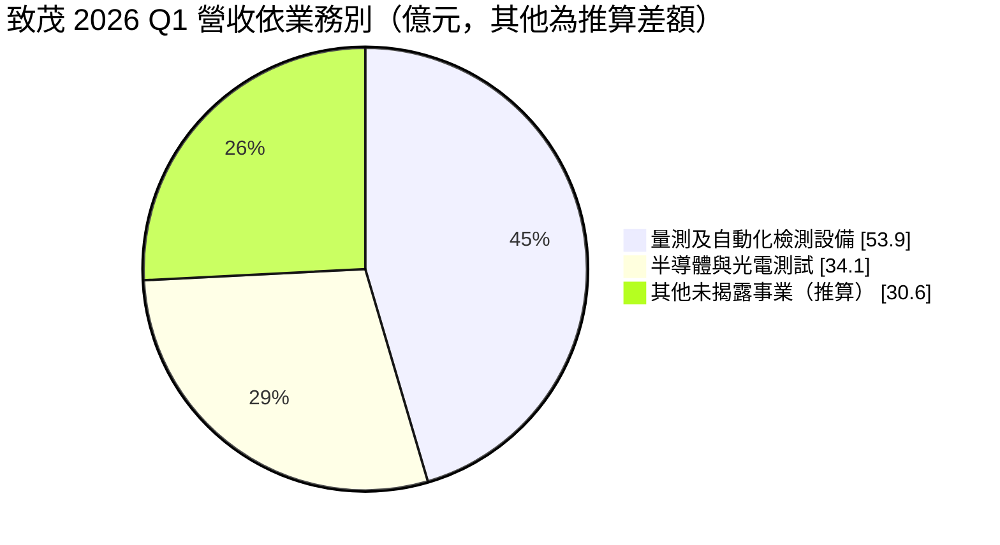
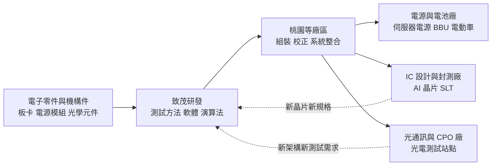
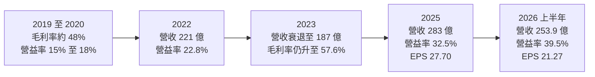
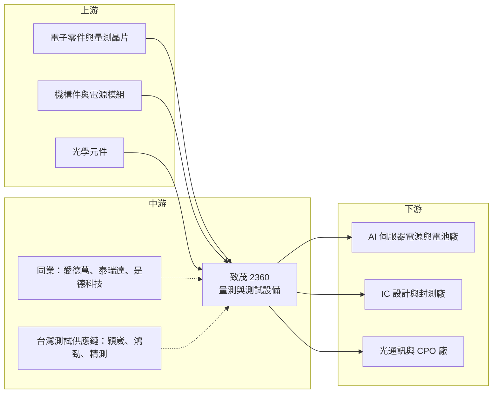

# 2360 致茂

> 上市｜[[產業索引-其他電子業|其他電子業]]｜上市（櫃）日期 1996/12/21

# 第一章：企業模式與商業藍圖

> [!info] 撰寫說明
> 本文由 Claude 依公開資料整理，架構比照 [[2330台積電]] 的四章研究，資料截至 2026-10-08。財務數字來源：Goodinfo 經營績效、股利政策與現金流量頁（2019 至 2025 年度）、證交所開放資料快照（2026 年第二季資產負債與綜合損益、2025 年度股利、公司基本資料）、科技新報 2026 年第一季財報報導、優分析與經濟日報財報報導；產業描述為整理性內容，尚未逐條比對原始文件。#待校對

在評估單一個股的長期投資價值時，首要步驟是拆解企業的底層獲利邏輯。本章針對致茂電子（股票代號：2360，以下簡稱致茂）的商業模式進行定性分析，說明一家以電源量測儀器起家的公司，如何靠四十年累積的量測技術，把業務從電源、電池延伸到半導體系統級測試與光通訊測試，並讓毛利率從四成多一路提升到六成以上。

## 一、核心定位：以量測技術為核心的測試設備平台

致茂成立於 1984 年 11 月，總部位於桃園龜山，1996 年 12 月上市，董事長為黃欽明、總經理為曾一士（證交所公司基本資料）。致茂的本業是「替別人的產品打分數」：電源供應器、電池、電動車動力系統、被動元件、光學元件與半導體晶片在出廠前，都必須經過電性、功能與可靠度測試，致茂提供的就是這些測試儀器與自動化測試系統。

這種定位的關鍵在於，致茂不參與終端產品的量產競爭，而是站在「賣鏟子」的位置。客戶的產品越複雜、規格越嚴格，測試時間就越長、需要的設備越多，測試設備的單價也越高。換句話說，致茂的成長不是來自單一終端市場的景氣，而是來自整個電子產業「規格往上走」的長期趨勢。從電源效率標準提高、電動車普及，到 AI 晶片功耗與複雜度大增，每一次技術升級都會帶來新的測試需求。

致茂的另一個特點是產品線很廣。它不是只做單一機種的設備商，而是在電源、電池、光學、半導體等多個領域都有產品，這讓它能在某一個市場景氣下滑時，靠其他市場撐住營收。這種「平台型」的結構，是致茂長期毛利率穩定上升的重要原因之一。

## 二、終端應用板塊：量測自動化與半導體光電測試兩大主軸

致茂的業務大致分為兩大主軸：一是量測及自動化檢測設備，涵蓋電源、電池、電動車與被動元件的測試儀器與系統；二是半導體與光電（Photonics）測試解決方案，涵蓋 AI 與 [[HPC]] 晶片的系統級測試（[[SLT]]）設備、[[矽光子]]與 [[CPO]] 的光電測試設備。依科技新報整理的 2026 年第一季資料，兩大主軸的營收與差額如下：

* **量測及自動化檢測設備：** 這是致茂起家的業務，客戶是電源供應器、電池與電動車零組件的製造商。AI 伺服器的電源功率不斷提高，加上備援電池（[[BBU]]）成為機櫃標配，帶動高功率電源與電池測試設備的需求。這個板塊的價值在於，電源與電池的安全與效率要求只會越來越嚴，測試是不能省的環節。
* **半導體與光電測試：** 包括 AI 晶片的 SLT 設備，以及 CPO 與矽光子的光電測試站點。AI 晶片在最終測試之後還要做長時間的系統級測試，測試時間拉長代表需要更多台設備；CPO 則是一個全新的測試領域，從光子晶片、[[光引擎]]到光訊號輸出入，每個環節都需要新的測試方法。這是致茂未來十年最重要的成長來源。
* **其他事業：** 包含光學檢測、智慧製造系統與其他量測產品，公開資料未細分比重。上圖的「其他」是以合併營收減去兩大主軸推算的差額，實際分類應以公司年報為準。

## 三、資本轉化邏輯（營運模式）：把測試知識寫進設備與軟體

* **價值在軟體與方法，而不是硬體：** 測試設備的硬體零件大多可以外購，真正的價值在於「怎麼測」：測試流程、演算法、軟體介面與客製化治具。這部分是長期研發的累積，也是致茂毛利率能從 2019 年的 47.3% 提升到 2025 年 61.5% 的原因。毛利率持續上升，代表產品組合越來越偏向高附加價值的系統與軟體，而不是單純的儀器。
* **與客戶同步開發：** 新一代 AI 晶片、電源或光通訊元件在研發階段，就要先決定量產時怎麼測。致茂越早參與客戶的研發，越能在量產時鎖定設備訂單。這種合作模式讓設備商與客戶形成綁定，也是測試設備業轉換成本高的根本原因。
* **輕資產與營運槓桿：** 致茂的生產以組裝與校正為主，不需要龐大的廠房與機器投資，費用主要是研發人力。當營收擴大時，研發與管理費用不會等比例增加，營業利益率因此快速上升，2025 年營業利益率 32.5%，2026 年上半年達 39.5%（證交所開放資料）。

## 四、企業長期藍圖：從電源測試走向 AI 與光通訊測試

致茂的長期方向可以歸納為「把量測能力跟著電子產業最難測的地方走」。過去最難測的是電源效率與電池安全，現在是 AI 晶片與光通訊。

* **CPO 與矽光子測試：** 共同封裝光學把光學元件與交換器晶片封在一起，測試必須同時處理電訊號與光訊號，是全新的技術門檻。依科技新報報導，致茂在 2026 年第一季已取得多個 CPO 測試站點的訂單，其中光訊號輸出入測試站點全數拿下，公司認為光引擎測試是規模最大的市場。如果 CPO 在 2027 年後成為資料中心的主流架構，這將是致茂最重要的長期成長引擎。
* **SLT 客戶擴大：** AI 晶片從 GPU 擴及雲端業者自研的 [[ASIC]]，SLT 設備的客戶基礎跟著變大。每一家自研晶片的雲端業者都需要自己的測試方案，對致茂而言是客戶分散、需求增加的長期利多。
* **電源與儲能測試：** AI 伺服器電源功率持續提高、資料中心配電架構朝高壓直流演進，電動車與儲能也需要大量電池測試。這些需求雖然不像 AI 晶片那麼受矚目，卻是致茂長期穩定的現金流來源。

# 第二章：護城河深度與競爭優勢

在長期價值投資中，「護城河」指企業抵禦競爭、維持超額利潤的保護機制。本章分析致茂的護城河構成、全球主要競爭對手，以及這些優勢在 AI 測試需求起伏中能守住多少。

## 一、致茂護城河的核心組成要素

致茂的護城河屬於「中寬護城河」，最直接的證據是毛利率：2019 至 2025 年毛利率從 47.3% 一路升到 61.5%，在景氣下滑的 2023 年營收衰退 15%，毛利率反而上升到 57.6%。能在營收下滑時守住甚至提升毛利率，代表它的產品有真正的定價能力。護城河由以下幾個要素組成：

* **1. 測試方法與量測技術的累積：** 電源、電池、光學與半導體測試各有專業標準與量測難點，致茂累積四十年經驗，產品線涵蓋多個領域。新進者即使能做出硬體，也需要多年時間才能累積各種測試情境的知識與資料庫，這是時間堆出來的門檻。
* **2. 早期參與帶來的轉換成本：** 測試程式與治具在客戶產品研發階段就共同開發，量產後若要更換設備商，客戶必須重寫測試流程、重新驗證，風險與成本都很高。因此一旦在某個產品世代被選用，往往能延續整個世代的訂單。
* **3. 多元產品線分散景氣風險：** 電源、電池、半導體與光通訊的景氣循環不完全同步，某一個市場下滑時，其他市場可以支撐營收。這種結構讓致茂在 2019 至 2025 年間除了 2023 年外每年都維持營收成長，也讓公司有餘力在新領域持續投資研發。
* **4. 貼近台灣供應鏈：** AI 伺服器電源、封測與光通訊的關鍵供應鏈大多在台灣，致茂能就近提供服務、快速客製與現場除錯。對新產品導入期的客戶而言，設備商的反應速度往往比價格更重要。

## 二、全球主要競爭對手格局

| 對手 | 定位 | 對致茂的威脅 |
|---|---|---|
| 愛德萬測試（Advantest） | 全球半導體測試機龍頭，也有 SLT 產品 | 在 AI 晶片測試市占高、產品線完整，是 SLT 領域最強對手 |
| 泰瑞達（Teradyne） | 美國半導體測試設備大廠 | 在 SoC 測試與 SLT 直接競爭，與大型晶片客戶關係深 |
| 是德科技（Keysight） | 全球電子量測儀器龍頭 | 在電源、通訊與光通訊量測與致茂重疊 |
| 中國量測儀器業者 | 政策扶植、價格低 | 在標準化電源與電池測試儀器以價格搶市 |
| [[6515穎崴]]、[[7769鴻勁]]、[[6510精測]] | 台灣測試介面、分選機與探針卡 | 在 AI 測試供應鏈中多為互補，部分產品與致茂相鄰 |

致茂的競爭位置可以分兩層看。在半導體 ATE（自動測試設備）主戰場，愛德萬與泰瑞達的規模遠大於致茂，致茂選擇從 SLT 與 CPO 這類「新興測試環節」切入，避開正面對決。在電源與電池量測領域，致茂則是全球主要供應商之一，對手是是德科技等國際儀器大廠與中國的低價業者。

## 三、優勢轉化：哪些市場守得住、哪些守不住

* **守得住：** AI 伺服器電源與電池測試、已取得訂單的 CPO 測試站點、AI 晶片 SLT。這些領域規格新、技術門檻高、與客戶共同開發，致茂具有先行者優勢，且客戶在同一世代內不容易更換供應商。
* **守不住：** 標準化的量測儀器。這類產品規格公開、功能相近，國際大廠以品牌競爭、中國廠商以價格競爭，致茂很難在這裡取得超額利潤。另外，SLT 與 ATE 的界線若因晶片測試流程改變而模糊，愛德萬與泰瑞達可能以整套方案的優勢擠壓致茂的空間。
* **觀察重點：** 第一，CPO 能否在 2027 年前後如期大量導入，以及致茂在光引擎測試的市占；第二，SLT 在 GPU 與雲端業者 ASIC 客戶的滲透率；第三，毛利率能否在營收高速成長後維持在 60% 以上，這是檢驗產品組合與定價能力是否持續的最直接指標。

# 第三章：財務體質與盈利規模

資料日期：2026-10-08。年度數字取自 Goodinfo 經營績效、股利政策與現金流量頁，2026 年上半年與資產負債取自證交所開放資料快照，表格是撰寫當時的快照；最新月營收、毛利率、累計 EPS 由自動排程寫在本筆記的屬性欄位（月營收、毛利率、累計EPS 等）。#待校對

財務報表是檢驗護城河是否真實存在的最終標準。本章用多年度的三率、ROE、現金流與資本報酬，檢視致茂從穩健的量測儀器廠，轉變為 AI 測試受惠股的過程，以及高成長期的獲利品質。

## 一、獲利能力的基石：三率

| 年度 | 營收（億元） | [[毛利率]] | [[營業利益率]] | EPS（元） | [[ROE]] |
|---|---|---|---|---|---|
| 2019 | 139 | 47.3% | 14.8% | 4.48 | 12.8% |
| 2020 | 155 | 48.6% | 18.0% | 5.56 | 15.3% |
| 2021 | 176 | 48.1% | 17.5% | 9.96 | 24.4% |
| 2022 | 221 | 51.5% | 22.8% | 12.14 | 25.6% |
| 2023 | 187 | 57.6% | 25.0% | 9.45 | 18.5% |
| 2024 | 216 | 59.0% | 25.4% | 12.49 | 22.5% |
| 2025 | 283 | 61.5% | 32.5% | 27.70 | 41.1% |
| 2026 上半年 | 253.9 | 61.5% | 39.5% | 21.27 | 未查得（年化約 54%，推算） |

* **營收成長：** 2020 至 2025 年營收從 155 億元增加到 283 億元，年複合成長率約 12.8%（推算）。成長並非直線：2023 年因電子產業庫存調整，營收年減約 15%，2024 年回升，2025 年起 AI 相關需求讓成長加速，2026 年上半年營收已接近 2024 年全年。
* **[[毛利率]]：** 七年間從 47.3% 升到 61.5%，而且在 2023 年營收衰退時仍然上升。這說明毛利率提升不是靠景氣，而是產品組合持續往高附加價值的系統與半導體測試移動，是護城河加深的財務證據。
* **[[營業利益率]]：** 從 2019 年的 14.8% 提高到 2025 年的 32.5%，2026 年上半年 39.5%。研發與管理費用相對固定，營收放大時費用被攤薄，形成明顯的[[營運槓桿]]。這也代表反方向的風險：營收下滑時，營業利益會以更大的幅度衰退。
* **業外收益的影響：** 2025 年稅後淨利率 42.1%，高於營業利益率 32.5%，代表當年有相當比例的獲利來自[[業外收益]]，帳面 EPS 與 ROE 因此偏高。評估長期獲利能力時，應以營業利益為準，2025 年的 41.1% ROE 不宜直接視為常態。

## 二、[[ROE]]：資本效率

致茂 2021 至 2025 年平均 ROE 約 26.4%（推算），即使排除 2025 年業外收益墊高的影響，2021 至 2024 年也穩定在 18% 至 26% 之間。這個 ROE 的品質相當好：2026 年第二季底，致茂負債總計約 300 億元、權益總計約 337 億元，負債多為應付帳款、合約負債等營運性負債，非流動負債僅約 54 億元（證交所開放資料）。換句話說，致茂的高 ROE 主要來自高利潤率，而不是靠借錢放大。

股利方面，2019 至 2025 年度每股現金股利分別為 3.0、4.5、6.98、8.0、6.6、9.0、19.5 元。以當年 EPS 計算，2021 至 2025 年度配息率都落在 66% 至 72% 之間（推算），屬於「固定比例、隨獲利浮動」的股利政策，股利金額會跟著景氣起伏，但配發比例相當穩定。

## 三、資本支出與自由現金流

| 年度 | 營業現金流（億元） | 投資現金流（億元） | 自由現金流（億元） |
|---|---|---|---|
| 2019 | 13.6 | -22.7 | -9.0 |
| 2020 | 27.1 | -15.5 | 11.7 |
| 2021 | 25.9 | 17.4 | 43.3 |
| 2022 | 53.0 | 9.0 | 62.0 |
| 2023 | 34.1 | -13.9 | 20.1 |
| 2024 | 47.8 | -18.9 | 28.9 |
| 2025 | 52.6 | 14.3 | 66.9 |

（自由現金流依 Goodinfo 定義為營業現金流加投資現金流；投資現金流為正的年份，推估含處分投資的收入。）

* **[[自由現金流]]：** 2020 至 2025 年每年都為正，只有 2019 年因投資支出較多而轉負。營業現金流從 13.6 億元增加到 52.6 億元，與獲利成長大致同步，代表帳面獲利有現金支撐。
* **[[CapEx]]：** 致茂屬輕資產設備商，生產以組裝與校正為主，資本支出相對營收比例低（逐年金額本次未查得）。主要的投入是研發人力，這讓公司能把大部分獲利以現金股利發放。
* **營運資金：** 營收快速成長時，存貨與應收帳款會同步增加，2025 年營業現金流只有稅後淨利的一半左右，推估與 2026 年訂單暴增前的備料有關。高成長期的現金轉換率，是觀察獲利品質的重點。

## 四、[[ROIC]] 與 [[WACC]]：價值創造利差

企業長期創造價值的條件，是投入資本報酬率（ROIC）高於加權平均資金成本（WACC）。

**ROIC（推算）：** 以「稅後營業利益 ÷（股東權益＋有息負債）」推算。2025 年營業利益約 283 億元 × 32.5% ≈ 92 億元，以稅率 20% 計算稅後營業利益約 74 億元。有息負債明細未查得，以 2026 年第二季非流動負債約 54 億元作為近似上限，加上權益總計約 337 億元，投入資本約 391 億元，ROIC 約 19%（推算）。以 2026 年上半年營業利益約 100 億元年化計算，稅後營業利益約 161 億元，ROIC 約 41%（推算）。2021 至 2024 年營業利益率約 17% 至 25%，推估當時 ROIC 約在 12% 至 18% 之間（推估）。

**WACC（推算）：** 以 CAPM 推估股東權益成本：無風險利率取台灣 10 年期公債約 1.75%，市場風險溢酬 6%，β 假設 1.1（半導體設備股常見值，非來源數字），權益成本約 8.4%。致茂幾乎沒有有息負債，假設負債成本稅前 2%、稅後 1.6%，負債權重以帳面計約 14%，WACC 約 7.4%；以市值計算（股價淨值比約 30 倍，權益權重接近百分之百），WACC 接近 8.4%（推算）。

**結論：** 致茂的 ROIC 在 2025 年約 19%、2026 年上半年年化約 41%，比 WACC 高出 10 至 30 個百分點以上，是明確創造價值的公司；即使在 AI 需求出現之前，推估 ROIC 也高於資金成本。需要注意的是，目前的利差有一部分來自 AI 測試需求的高峰，測試設備業的訂單向來比終端需求波動更大。長期來看，若毛利率能維持在六成附近、營業利益率維持在 25% 以上，ROIC 高於 WACC 的狀態應能延續。

# 第四章：總體風險與地緣政治

任何企業都無法脫離宏觀環境獨立存在。本章分析致茂未來必須面對的地緣政治、產業週期與營運風險，以及測試技術路線改變帶來的不確定性。

## 一、地緣政治風險

* **出口管制：** 半導體測試設備屬於高科技設備，可能受美國或台灣的出口管制規範。中國是電源、電池與電動車測試設備的重要市場，若管制範圍擴大到量測與測試設備，致茂對中國客戶的銷售可能受限。
* **客戶生產地轉移：** AI 伺服器組裝、晶片封測與電源生產逐步在美國、墨西哥與東南亞設點，致茂需要在當地建立服務與維修團隊。測試設備的售後服務是客戶黏著度的一部分，跟不上客戶的移動會削弱競爭力。
* **台灣集中風險：** 研發與主要生產據點在台灣，面臨與其他台灣科技廠相同的兩岸風險。

## 二、產業週期與市場結構風險

* **設備業的週期性：** 測試設備需求取決於客戶的擴產與新產品導入節奏。當 AI 資本支出放緩時，設備訂單通常比終端需求更早、更劇烈下滑，2023 年營收年減 15% 就是一次例證。
* **[[長鞭效應]]：** 2025 至 2026 年的高成長，有一部分來自客戶集中擴產與新平台導入。擴產高峰過後，訂單可能出現明顯回落，投資人不應把高峰期的獲利視為常態。
* **電動車與消費性需求：** 電動車與電池測試需求受電動車市場景氣影響，中國電動車產業的價格戰與產能過剩，也可能讓相關測試設備的價格承壓。

## 三、營運環境的隱性風險

* **高基期：** 2025 至 2026 年營收大幅成長，往後要維持成長，需要 CPO 等新業務接棒。如果 CPO 量產時程延後，營收可能出現高原期。
* **人才與交期：** 訂單暴增時，工程與應用人力、關鍵零件供應可能成為瓶頸。測試設備需要大量現場工程師支援，人才培養需要時間。
* **業外收益波動：** 2025 年的獲利有相當比例來自業外，業外收益不具持續性，會讓 EPS 與 ROE 在年度之間出現大幅波動。
* **匯率：** 外銷比重高，新台幣升值會壓縮以台幣計算的營收與毛利。

## 四、科技或法規演進

* **測試流程的轉移：** 晶片測試流程會隨架構改變。如果 AI 晶片把部分 SLT 項目前移到晶圓測試或[[先進封裝]]階段，SLT 設備的需求結構會改變，致茂需要重新開發對應設備。
* **CPO 架構標準未定：** CPO 仍在標準形成期，不同客戶採用的光引擎設計、封裝方式與測試站點可能不同。標準若朝致茂未布局的方向發展，先行者優勢會打折。反過來說，每一次架構變革也是爭取新訂單的機會。
* **能源與安全法規：** 電源效率、電池安全與電動車規範的提高，長期來看有利於測試設備需求，但各國標準不同，也增加產品開發的成本。

# 專有名詞解析

## 半導體

- **[[SLT]]**：系統級測試，把晶片放在接近實際使用環境的系統中長時間運作，檢查最終測試難以發現的缺陷。
- **[[ATE]]**：自動測試設備，在晶圓或封裝完成後以程式自動量測晶片電性與功能的設備，愛德萬與泰瑞達為龍頭。
- **[[矽光子]]**：在矽晶片上製作光學元件，以光取代電傳輸資料，可降低 AI 資料中心的傳輸耗電。
- **[[HPC]]**：高效能運算，泛指 AI 與資料中心等需要大量運算的應用。
- **[[ASIC]]**：特殊應用積體電路，為特定用途客製的晶片，例如雲端業者自研的 AI 加速器。
- **[[先進封裝]]**：把多顆晶片以中介層、混合鍵合等方式高密度整合的封裝技術，例如 CoWoS、SoIC。

## 應用

- **[[CPO]]**：共同封裝光學，把光學收發元件和交換器晶片封裝在一起，可降低高速傳輸的耗電。
- **[[光引擎]]**：CPO 或光模組中負責光電轉換的核心模組，由雷射、調變器與光偵測器組成。
- **[[BBU]]**：電池備援單元，在 AI 伺服器機櫃斷電時提供短時間電力，避免運算中斷。

## 金融

- **[[營運槓桿]]**：固定費用占比高時，營收小幅成長即可帶動營業利益大幅成長的現象。
- **[[業外收益]]**：本業以外的收入，例如投資處分利益、股利或匯兌收益，通常不具持續性。
- **[[ROE]]**：股東權益報酬率，稅後淨利除以股東權益，衡量公司運用股東資本賺錢的效率。
- **[[ROIC]]**：投入資本報酬率，稅後營業利益除以股東權益加有息負債，衡量公司投入營運的全部資本能賺多少。
- **[[WACC]]**：加權平均資金成本，股東與債權人要求報酬率的加權平均，是 ROIC 的比較基準。
- **[[自由現金流]]**：營業活動現金流減去資本支出，代表企業可自由用於配息、還債或併購的現金。
- **[[長鞭效應]]**：終端需求的小幅變動，沿供應鏈往上游傳遞時被逐級放大，造成上游庫存與訂單劇烈波動。

# 核心供應鏈

## 1. 上游：零件
- 電子零件、量測晶片、機構件與光學元件：個別供應商未揭露

## 2. 中游：測試設備同業與互補廠商
- 國外：愛德萬測試（Advantest）、泰瑞達（Teradyne）、是德科技（Keysight）
- 台灣測試介面與分選機：[[6515穎崴]]、[[7769鴻勁]]、[[6510精測]]

## 3. 下游：客戶類型
- AI 伺服器電源廠（推估，依產業結構）：[[2308台達電]]、[[2301光寶科]]
- 封測廠（推估）：[[3711日月光投控]]、[[2449京元電子]]
- AI 晶片設計（推估）：[[NVDA輝達]]、[[AVGO博通]]
- 晶圓代工：[[2330台積電]]

延伸閱讀：[[台積電供應鏈]]

## 供應鏈關係
- 供應給 [[2330台積電]]：半導體系統級測試設備 (SLT)（台積電供應鏈 › 下游：測試介面與檢測設備）

## 最新新聞
<!-- news:start（自動產生，請勿手動編輯此範圍） -->
- 2026-10-19 📰 媒體 18:33｜致茂(2360) 個股概覽 ／ 個股 - 股市｜[CMoney](https://news.google.com/rss/articles/CBMiU0FVX3lxTE4zckRsX3hYWnpOQlNIQ3ljckp5OVdKNnU4YjJXNWs1ZWRYb2RGTG1LMVJLaTJsejVFZWNyRWJTOHlrRjhSU3NfNWNCQzNMa0RkYlkw?oc=5)
- 2026-10-19 📰 媒體 11:50｜【11:48 即時新聞】致茂(2360)逆勢走強，AI測試設備與CPO題材受關注｜[CMoney](https://news.google.com/rss/articles/CBMiWEFVX3lxTE90UjBZSWtERmw2LW5PYi10cVpuM1BhcTdaS0lnRjc3UUZZdUVpa3RWVGJIZS0ycDdPd3VQODg3ZGhmT0lYVGJYbXMyR2FQd2dnTEJzbzlVWlI?oc=5)
- 2026-10-19 📰 媒體 00:58｜致茂、穎崴 衝測試設備｜[經濟日報](https://news.google.com/rss/articles/CBMiWkFVX3lxTE5aNTJSQS03WVdnYlIyVXdERnhFeEFuUGNGRmtHMFkwNGppckV4cE1Tb0hRbTN3UUo1V0x5UkY0WmtKTnZpZ2laREFGZGlUcXg1R2dlS0llU0hUd9IBX0FVX3lxTE5HWWhzdmY0TkFzQ21qV3dGOUUxOTJySTNZY3dCakZudGo5c2x4VExCSW5MUzNHVjBYeXJJS0pqVjdrbEZlZmh3RDJydTBTcWYtT292VXU1Zkt5ckdpVkFj?oc=5)
- 2026-10-18 📰 媒體 12:08｜CPO量產關鍵測試啟動 法人看致茂與鴻勁成最大受惠股｜[自由時報](https://news.google.com/rss/articles/CBMiWEFVX3lxTFB0X2lYYzMzMkEtN2tsSER4LUh1eExPZk5DRFVCdUsteDBQYkFsRFc5ZlV4dnctWWlWM041T3lMMWtvRzYxVWtNUnRJRHJtM190aFc2X1hBY1E?oc=5)
- 2026-10-18 📰 媒體 10:55｜致茂預計10月29日 召開線上法說會公布財報展望｜[UDN](https://news.google.com/rss/articles/CBMiUEFVX3lxTE5LaWxzVWJibktsV1pTS01jSHo0RTBzeUk3RkJBU05zdFMxRktHWHZYQXVVajZOVXJUaWpRSmNIdFc0WU9XUEN6alFrQ2hFREND0gFWQVVfeXFMT3FMdWRMTHpOSzFhcVNhaFowZ1dTOEVpdWRIOU5pLWVTUkxzYXFQa3F4OGo3SlNwWXg1ZDFFemc3RS15UHowUm4xeUFuZEQ3WXB1V2Zza3c?oc=5)

完整紀錄：[[2360致茂 新聞]]
<!-- news:end -->

## 相關連結
- [公開資訊觀測站](https://mopsov.twse.com.tw/mops/web/t05st03?step=1&firstin=1&co_id=2360)
- [Goodinfo](https://goodinfo.tw/tw/StockDetail.asp?STOCK_ID=2360)
- [Yahoo 股市](https://tw.stock.yahoo.com/quote/2360)
- [鉅亨網新聞](https://www.cnyes.com/twstock/2360/news)
