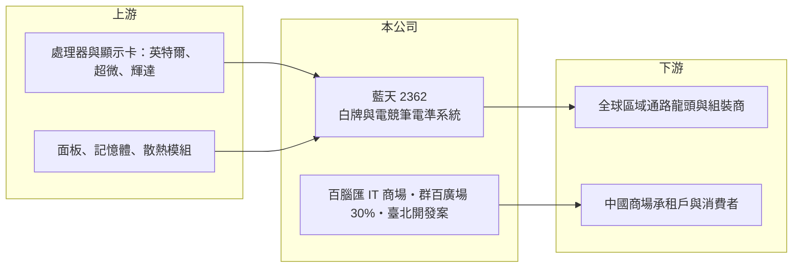

# 2362 藍天

> 上市｜[[產業索引-電腦及週邊設備業|電腦及週邊設備業]]｜上市（櫃）日期 1997/04/02

# 第一章：企業模式與商業藍圖

> [!info] 撰寫說明
> 精簡版，由 Claude 依公開資料整理，架構比照 [[2330台積電]]，資料截至 2026-10-08。來源：證交所開放資料快照（基本資料、2026 年第二季資產負債與損益、股利）、Goodinfo 經營績效頁、富果研究整理之 2025 年 6 月法說會備忘錄。#待校對

藍天電腦（以下簡稱藍天）是一家「筆電代工加不動產」的雙引擎公司，理解它的關鍵在於：筆電事業是全球白牌筆電的主要供應商，但公司資產的大頭其實是中國的 IT 商場、百貨與台北的大型開發案，兩者的獲利邏輯完全不同。

- **核心業務：** 藍天成立於 1983 年，1997 年在證交所上市，英文名稱 Clevo。依 2025 年 6 月法說會資料，筆電事業群聚焦[[白牌筆電]]市場，公司自稱為該市場第一大供應商，主攻中高階與電競機種。白牌筆電是指藍天設計並生產[[準系統]]，再由各國的區域通路商或組裝商掛上自己的品牌銷售，屬於 [[ODM]] 的一種，因此藍天的客戶是各地的通路龍頭（法說會稱為 Local King），而不是國際大品牌。
- **營收結構：** 各事業群的營收比重法說會未提供。2025 年第一季筆電事業群營收 33.75 億元，年減 29%。除筆電外，公司百分之百持有的百腦匯事業群在中國經營 18 個 IT 複合式商場與 10 個出租物業，並持有群百廣場 30% 股權（武漢、成都的百貨與高端酒店）。這些不動產事業提供租金與經營收入，波動較筆電小，但受中國消費與商用不動產景氣影響。
- **營運據點：** 台北負責研發與接單，製造在中國昆山廠。不動產集中在中國多個城市，另有台北的臺北雙星（C1／D1）與大埕公司（E1／E2）兩項大型開發案，依法說會資料分別預計 2027 年與 2033 年完工，屬於可分回產權的開發模式。
- **長期方向：** 筆電方面，公司以高度客製化與少量多樣的彈性生產，鞏固電競與高階機種的利基，並跟著 AI PC 與作業系統換機潮推出新平台。不動產方面，百腦匯績效較差的 4 家規劃資產活化，群百廣場已閉店的西安、汕頭店洽談出租；臺北雙星與大埕案完工後，會成為公司長期資產價值的重要來源。

# 第二章：護城河深度與競爭優勢

藍天筆電本業的護城河來自白牌市場的設計與彈性，屬於利基型；不動產則是資產型的價值來源。

- **競爭優勢：** 白牌筆電的客戶分散在全球各地，每家量不大但規格要求各異，大型代工廠（如 [[2382廣達]]、[[2324仁寶]]）的生產線是為國際品牌的大量訂單而設計，不願也不擅長接這種少量多樣的生意。藍天長期耕耘這個市場，累積了大量區域通路客戶與高階散熱、電競機構的設計經驗，客戶要換到其他供應商並不容易。這讓藍天的筆電毛利率長期維持在約兩成，高於一般筆電代工廠的個位數到一成。
- **主要對手：** 白牌筆電的直接對手是中國的白牌筆電設計與代工公司，以及願意承接中小訂單的其他代工廠（具體名單未查得），間接對手則是直接賣電競筆電的品牌 [[2377微星]]、[[2357華碩]]、[[2353宏碁]]。品牌廠在電競市場的行銷力道越強，白牌通路的空間就越受壓縮。不動產事業則與中國當地的商場與百貨經營者競爭。
- **觀察重點：** 長期最該追蹤的是筆電營收能否止跌回穩，以及中國不動產的租金收入與資產價值是否持續下滑。2025 年營收 204 億元，比 2024 年減少約兩成三，但毛利率升到 22.4%，顯示公司寧可縮量也維持獲利結構。臺北兩項開發案的完工與分回，則是未來十年最大的資產變化。

# 第三章：財務體質與盈利規模

資料日期：2026-10-08，表格是撰寫當時的快照；最新月營收、毛利率、累計 EPS 由自動排程寫在本筆記的屬性欄位（月營收、毛利率、累計EPS 等）。#待校對

藍天的財務特徵是本業獲利穩定、資產規模龐大，因此 ROE 長期偏低；它更像一家「有筆電本業的資產公司」。

| 年度 | 營收（億元） | [[毛利率]] | [[營業利益率]] | EPS（元） | [[ROE]] |
|---|---|---|---|---|---|
| 2020 | 202 | 21.5% | 7.29% | 1.12 | 1.67% |
| 2021 | 270 | 19.7% | 7.74% | 3.03 | 4.43% |
| 2022 | 222 | 22.3% | 8.64% | 1.41 | 1.98% |
| 2023 | 244 | 20.0% | 7.11% | 1.81 | 2.56% |
| 2024 | 266 | 19.8% | 8.21% | 3.02 | 4.13% |
| 2025 | 204 | 22.4% | 7.90% | 2.05 | 2.71% |

（來源：Goodinfo 經營績效頁。2026 年上半年依證交所資料：營收 114.7 億元、毛利率 18.8%、營業利益率 5.9%、EPS 4.05 元，其中稅前淨利率 23.0% 遠高於營業利益率，代表上半年有大額業外收益，項目未查得。）

- **營收規模：** 2020 至 2025 年營收在 200 億元至 270 億元之間波動，年複合成長率接近 0%（推算）。營收跟著筆電換機週期起伏，但毛利率與營業利益率在五年間都很穩定，分別約 20% 至 22% 與 7% 至 9%，顯示白牌利基市場的定價相對有紀律。
- **獲利：** 近五年（2021 至 2025）平均 ROE 只有約 3.2%（推算）。原因不在本業，而在分母：股東權益高達約 469 億元，每股淨值約 81 元，大部分是中國與台灣的不動產與長期投資，這些資產的帳面報酬率很低。營業利益每年約 15 億元至 22 億元，相對於如此大的資產規模顯得很小。
- **財務特色：** 依 2026 年第二季資料，總資產約 1,100.7 億元，其中非流動資產約 847.3 億元，占比近八成；負債約 631.5 億元，其中非流動負債約 410.2 億元，推估多為不動產相關的長期借款與租賃負債（#待校對）。2025 年度現金股利每股 2.0 元，對應 EPS 2.05 元，[[配息率]]約 98%；公司章程以「維持穩定股利」為目標，但 Goodinfo 統計的歷年平均現金股利只有約 0.81 元，顯示過去配息並不高。
- **[[ROIC]] 與 [[WACC]]：** 以 2025 年營業利益約 16.1 億元（204 億元 × 7.9%）、稅率 20% 計算，稅後營業利益約 12.9 億元。有息負債未查得，投入資本以股東權益 469.2 億元到「權益加全部負債」1,100.7 億元為區間，全公司 ROIC 約 1.2% 至 2.7%（推算）。WACC 以 [[CAPM]] 推估：無風險利率 1.75%、市場風險溢酬 6%、β 假設 0.8（資產型電腦股常見值），權益成本約 6.55%；稅後負債成本假設 2%、負債占五成，WACC 約 4.3%（推算）。全公司 ROIC 明顯低於 WACC，主要是不動產占用大量資本卻只產生低報酬；若單看筆電本業，投入資本小得多、報酬率應遠高於此（推估，數字未查得）。長期而言，藍天能否創造價值取決於不動產的活化與開發案的分回。

# 第四章：總體風險與地緣政治

藍天的風險同時來自筆電產業與中國不動產兩個完全不同的週期。

- **產業週期：** 筆電需求有明顯的換機週期，電競筆電又更依賴新顯示卡與處理器平台推出。2025 年營收年減約兩成三，就是需求轉弱與客戶庫存調整的結果，[[長鞭效應]]會從區域通路一路傳到藍天的接單。中國商用不動產則處於長期的調整期，商場租金、空置率與資產估值都可能持續承壓。
- **營運風險：** 白牌市場的規模受到品牌廠電競產品的擠壓，若品牌廠以更低價格搶攻，白牌通路的生存空間會縮小。百腦匯與群百廣場面臨電商取代實體 IT 商場的結構性壓力，已有門市閉店或轉為出租。臺北開發案的工期與完工時程長達數年，營建成本與市場變化都會影響最終價值。
- **其他風險：** 製造與不動產都集中在中國，面臨美中貿易、關稅與兩岸政治風險，人民幣匯率直接影響資產價值與租金收入的換算。大額業外損益（處分資產、匯兌、投資收益）讓 EPS 波動很大，不宜用單一年度判斷公司獲利能力。

# 專有名詞解析

## 金融

- **[[配息率]]**：現金股利占當年度每股盈餘的比例，反映公司把獲利分給股東的程度。
- **[[長鞭效應]]**：終端需求的小幅變動，沿供應鏈往上游傳遞時被逐級放大，造成上游庫存與訂單劇烈波動。

## 產業

- **[[白牌筆電]]**：由代工廠設計生產準系統，再由各地通路商或組裝商掛自有品牌銷售的筆電，訂單少量多樣。
- **[[準系統]]**：只差處理器、記憶體或硬碟等少數零件即可完成的半成品電腦，由下游通路依需求自行組裝。
- **[[ODM]]**：原廠委託設計製造，代工廠負責產品設計與生產，品牌商負責銷售。

# 核心供應鏈

- 上游：處理器與顯示晶片 [[INTC英特爾]]、[[AMD超微]]、[[NVDA輝達]]，以及面板、記憶體與散熱模組供應商。
- 下游／客戶：全球各地的區域通路龍頭與筆電組裝商（白牌客戶，掛自有品牌銷售），日韓市場為近年成長區域之一；不動產事業的客戶為中國商場承租戶與消費者。
- 同業：[[2377微星]]、[[2357華碩]]、[[2353宏碁]]（電競筆電品牌），[[2382廣達]]、[[2324仁寶]]、[[4938和碩]]（筆電代工）。

## 最新新聞
<!-- news:start -->
<!-- news:end -->

## 相關連結
- [公開資訊觀測站](https://mopsov.twse.com.tw/mops/web/t05st03?step=1&firstin=1&co_id=2362)
- [Goodinfo](https://goodinfo.tw/tw/StockDetail.asp?STOCK_ID=2362)
- [Yahoo 股市](https://tw.stock.yahoo.com/quote/2362)
- [鉅亨網新聞](https://www.cnyes.com/twstock/2362/news)
