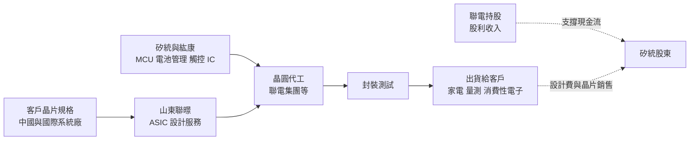
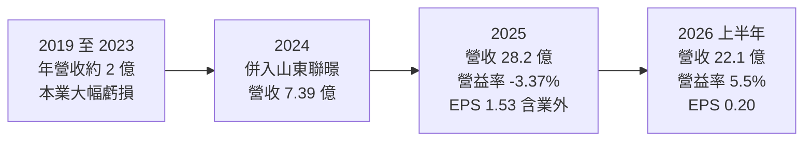
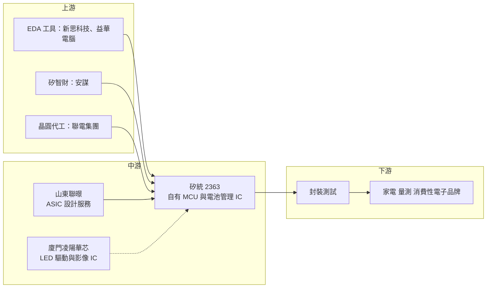

# 2363 矽統

> 上市｜[[產業索引-半導體業|半導體業]]｜上市（櫃）日期 1997/08/01

# 第一章：企業模式與商業藍圖

> [!info] 撰寫說明
> 本文由 Claude 依公開資料整理，架構比照 [[2330台積電]] 的四章研究，資料截至 2026-10-08。財務數字來源：Goodinfo 經營績效、股利政策與現金流量頁（2019 至 2025 年度）、證交所開放資料快照（2026 年第二季資產負債與綜合損益、2025 年度股利、公司基本資料）、工商時報（2024 年 10 月、2025 年 7 月）、理財周刊、聯合報與中央社財報報導；產業描述為整理性內容，尚未逐條比對原始文件。#待校對

在評估單一個股的長期投資價值時，首要步驟是拆解企業的底層獲利邏輯。本章針對矽統科技（股票代號：2363，以下簡稱矽統）的商業模式進行定性分析。矽統是一家特殊的公司：它曾是 PC 晶片組的重要廠商，之後沉寂將近二十年，帳上最大的資產是長期持有的 [[2303聯電]] 股票；2023 年起在聯電集團主導下，透過一連串併購重新組成「ASIC 設計服務加自有 IC」的業務結構。理解矽統，必須同時看它的本業與它的資產負債表。

## 一、核心定位：聯電集團旗下的 IC 設計整合平台

矽統成立於 1987 年 8 月，總部在新竹，1997 年上市。1990 年代到 2000 年代初，矽統以 PC 晶片組聞名，與 [[INTC英特爾]]、[[2388威盛]] 在主機板晶片組市場競爭。晶片組的功能後來被整合進 CPU，獨立晶片組市場消失，矽統的主要業務也跟著萎縮。依工商時報整理，轉型前矽統的主力產品是觸控晶片與 MEMS 麥克風晶片，2017 至 2022 年每年營收只有約 1.8 億至 2.5 億元，六年中有四年虧損；依理財周刊，2024 年以前矽統將近十年單季營收都不到 1 億元。

在這段期間，矽統的獲利主要靠持有的聯電股票配發的股利支撐。2026 年第二季底，矽統資產總計約 521 億元，其中非流動資產約 480 億元，股東權益中的「其他權益」高達約 373 億元（證交所開放資料），推估主要是聯電持股的未實現評價利益。換句話說，矽統的帳面淨值絕大部分是聯電股票的價值，本業規模相對很小。

轉折點在 2023 年 8 月，聯電董事長洪嘉聰親自兼任矽統董事長，之後展開一系列整併：

* **減資與瘦身（2024 年）：** 2024 年 2 月宣布減資約 26 億元、幅度 35%，把過大的股本縮小，讓每股盈餘更能反映實際獲利能力。減資後股本約 48.7 億元，之後因換股併購回升到約 51.5 億元。
* **接手山東聯暻（2024 年）：** 2024 年 4 月，聯電透過子公司和艦，把山東聯暻 100% 股權轉讓給矽統的孫公司，交易金額約 3.5 億元，矽統自 2024 年 9 月起合併其營收。山東聯暻位於濟南，專營 [[ASIC]] 與[[設計服務]]，客戶以中國市場為主。
* **換股併購紘康（2024 年）：** 2024 年 8 月以換股方式增資約 2.7 億元取得紘康 100% 股權，紘康擅長電池管理晶片與混合訊號 [[MCU]]。
* **收購廈門凌陽華芯（2025 年起）：** 2025 年 4 月透過聯暻啟動收購，投資金額約人民幣 3 億多元，凌陽華芯的核心業務是 [[LED驅動IC]] 與影像相關晶片；工商時報報導時投資案尚待投審會許可，持股比例與合併時點以公司公告為準。

經過這些整併，今天的矽統已不是單純的 [[Fabless]] 公司，而是聯電集團內負責 IC 設計與設計服務的整合平台，晶圓代工母集團是它的重要後盾（推估）。

## 二、終端應用／產品板塊：ASIC 設計服務與自有 IC 雙軸

矽統未公開具體的產品營收比重，因此本章不繪製圓餅圖。依工商時報與理財周刊整理，業務分為以下幾塊：

* **ASIC 設計服務（山東聯暻）：** 替客戶把晶片規格轉成可量產的設計，並代為安排投片、封裝與測試，屬於「[[Turnkey]]」式的一條龍服務。這塊是 2024 年後營收倍增的主要來源，依子公司所在地與報導推估客戶以中國系統廠為主。設計服務的收入包含一次性的設計費與量產後的晶片銷售，量產後營收規模可以快速放大。
* **自有 IC（矽統與紘康）：** 包含混合訊號 MCU、電池管理晶片（[[BMS]]）與觸控晶片。紘康的混合訊號 MCU 把高精度類比前端與微控制器整合在一起，常用在量測儀器、小家電與電池管理，這類產品講究類比精度與長期供貨，競爭比一般消費性晶片溫和。
* **驅動與影像晶片（凌陽華芯）：** LED 顯示驅動與影像相關晶片，若完成控制並合併報表，可再增加一條顯示相關產品線。

從規模推估，ASIC 設計服務的營收占比高於自有 IC；自有 IC 的毛利率則推估高於設計服務。2025 年第一季毛利率約 44%（工商時報），2026 年上半年降到 28.4%（證交所開放資料），推估與設計服務占比提高、產品組合改變有關。

## 三、資本轉化邏輯（營運模式）：以併購換規模、以設計服務帶量

* **兩種收入來源並存：** 矽統的股東價值來自兩個完全不同的來源。一是本業：設計服務與自有晶片的營業利益；二是資產：聯電持股的股利與評價變化。過去本業虧損時，聯電股利讓矽統仍能維持配息；未來若本業規模擴大，兩者的重要性才會逐漸翻轉。
* **ASIC 帶量、自有 IC 帶毛利：** 設計服務的營收容易放大，但每一案都要投入工程人力，毛利率通常低於自有 IC；自有 IC 量小，但一旦設計定案、進入量產，後續的邊際成本很低。兩者混合後的毛利率會隨產品組合變動，這是觀察矽統本業品質的關鍵。
* **輕資產：** 矽統沒有自有晶圓廠，資本支出主要是研發人力、光罩與 EDA 工具。本業能否賺錢，取決於研發投入能否轉成足夠多的量產案。

## 四、企業長期藍圖：從控股型公司走向真正的 IC 設計公司

矽統的長期藍圖可以概括為「用集團資源把空殼重新填滿」。具體方向有三個：

* **持續併購利基型 IC 設計公司：** 依工商時報，矽統表示將持續尋找併購標的，偏好在利基市場有市占率的中小型 IC 設計公司。這代表矽統的成長模式會以併購為主，而非單純靠內部研發。
* **集團協同：** 借重聯電的[[特殊製程]]，例如嵌入式非揮發性記憶體（[[eNVM]]）與高壓製程，開發 MCU、電源與驅動相關晶片（推估）。對規模小的設計公司而言，能穩定取得晶圓產能與製程支援本身就是競爭力。
* **本業獲利穩定化：** 2025 年第三季是 2010 年第四季之後首度單季本業獲利（聯合報），2026 年上半年營業利益約 1.2 億元、營業利益率 5.5%（證交所開放資料）。下一步要看本業能否連續多年維持正的營業利益，讓獲利不再依賴業外。

# 第二章：護城河深度與競爭優勢

在長期價值投資中，「護城河」指企業抵禦競爭、維持超額利潤的保護機制。本章分析矽統在整併後的競爭優勢、國內外主要對手，以及這些優勢能否轉成穩定的超額利潤。

## 一、護城河的核心組成要素

矽統目前的護城河偏窄，屬於「整併中、尚待驗證」的階段。本業 2019 至 2025 年每年營業利益都是負數（Goodinfo），代表過去並沒有真正的競爭優勢；整併後的潛在優勢主要有三項：

* **1. 集團資源與產能支援：** 聯電董事長兼任矽統董事長，代表矽統在晶圓產能、製程平台與客戶介紹上可取得集團支援。在晶圓產能緊俏的時期，小型 IC 設計公司常因拿不到產能而錯失訂單，有集團撐腰的設計公司在這方面有明顯優勢（推估）。
* **2. 設計服務的客戶黏著度：** ASIC 客戶一旦把晶片交給某家設計服務公司完成 [[Tape-out]] 與量產，後續的改版與衍生產品通常會沿用同一團隊，因為更換團隊需要重新熟悉設計資料與驗證流程。這種黏著度讓設計服務的營收具有延續性。
* **3. 混合訊號 MCU 的利基：** 紘康在量測類與電池管理晶片有既有客戶群，這類產品需要長期穩定供貨與類比設計經驗，價格競爭相對溫和，是自有 IC 中毛利較有保障的一塊（推估）。

另一方面，矽統的聯電持股雖不是傳統意義的護城河，但提供了財務緩衝：即使本業在整併期間虧損，公司也不至於面臨資金壓力，可以有耐心地投資新產品與併購。

## 二、全球主要競爭對手格局

| 對手 | 定位 | 對矽統的威脅 |
|---|---|---|
| [[3443創意]]、[[3661世芯-KY]] | 先進製程 ASIC 設計服務龍頭 | 主攻 AI 與先進製程，與矽統的成熟製程案源重疊有限 |
| [[3035智原]] | 聯電集團旗下 ASIC 設計服務 | 同集團，成熟製程 ASIC 客戶可能重疊，分工有待觀察 |
| [[6202盛群]]、[[4919新唐]] | 台灣 MCU 主要廠商 | 在家電、量測與工控 MCU 直接競爭，規模遠大於矽統 |
| 中國本土 MCU 與設計服務業者 | 政策扶植、報價低 | 山東聯暻的中國客戶可能轉向本土供應商 |
| 中國 LED 驅動 IC 業者 | 規模大、價格低 | 凌陽華芯的主要對手，顯示驅動晶片價格競爭激烈 |

矽統的處境是「每條產品線都有比它大的對手」。它的機會不在正面對決，而在集團資源與利基產品的組合：成熟製程的設計服務、量測類 MCU 與電池管理晶片，這些市場規模不大，但大廠投入意願較低。

## 三、優勢轉化：守得住／守不住／觀察重點

* **守得住：** 已導入量產的 ASIC 專案與量測類 MCU、電池管理晶片。只要客戶產品持續出貨，這些營收具延續性，而且客戶更換供應商的成本高。
* **守不住：** 一般消費性 MCU、觸控與 LED 驅動晶片，中國同業報價低、供給多，毛利率容易被壓縮。2026 年上半年毛利率 28.4%，相較 2025 年第一季的約 44% 明顯下降，說明產品組合與價格壓力對毛利的影響很大。
* **觀察重點：** 第一，本業營業利益能否連續多年為正；第二，凌陽華芯的整併進度與獲利貢獻；第三，與同集團智原的業務分工是否清楚。這三點決定矽統能否從「持有聯電股票的控股公司」轉變為「真正有競爭力的 IC 設計公司」。

# 第三章：財務體質與盈利規模

資料日期：2026-10-08。年度數字取自 Goodinfo 經營績效、股利政策與現金流量頁，2026 年上半年與資產負債取自證交所開放資料快照，表格是撰寫當時的快照；最新月營收、毛利率、累計 EPS 由自動排程寫在本筆記的屬性欄位（月營收、毛利率、累計EPS 等）。#待校對

財務報表是檢驗護城河是否真實存在的最終標準。矽統的財報有一個特點：本業規模很小、但帳上持有大量聯電股票，因此淨利、ROE 與現金流都受到業外與投資的強烈影響。本章用多年度資料拆開「本業」與「投資」兩條線。

## 一、獲利能力的基石：三率

| 年度 | 營收（億元） | [[毛利率]] | [[營業利益率]] | EPS（元） | [[ROE]] |
|---|---|---|---|---|---|
| 2019 | 2.23 | 39.0% | -159% | -0.42 | -3.21% |
| 2020 | 1.60 | 28.2% | -279% | -0.47 | -2.38% |
| 2021 | 2.52 | 33.5% | -141% | 0.29 | 0.91% |
| 2022 | 1.82 | 2.55% | -255% | 0.65 | 2.40% |
| 2023 | 1.87 | 30.3% | -241% | 0.76 | 3.25% |
| 2024 | 7.39 | 34.8% | -45.4% | 0.81 | 2.85% |
| 2025 | 28.2 | 31.1% | -3.37% | 1.53 | 4.64% |
| 2026 上半年 | 22.1 | 28.4% | 5.5% | 0.20 | 未查得（年化約 0.4%，推算） |

* **營收規模跳升：** 2023 年營收不到 2 億元，2025 年達 28.2 億元，2026 年上半年 22.1 億元。這幾乎全部來自併購，而不是原有業務的成長，因此不宜用年增率評估本業的競爭力。
* **[[營業利益率]]：** 2019 至 2025 年每年都是負數，2019 至 2023 年因營收太小，營業費用是營收的兩到三倍。2025 年虧損幅度縮小到 -3.37%，2026 年上半年轉為 5.5%，代表整併後規模終於大到能攤提費用，但利潤仍薄。
* **[[業外收益]]與 EPS：** 2021 至 2025 年本業虧損，EPS 卻是正數，差額主要來自聯電股利與投資收益。2025 年 EPS 1.53 元中，第二季單季 EPS 1.20 元而同季本業仍虧損逾 6 千萬元（理財周刊），推估與股利或投資相關認列有關。評估本業時應以營業利益為準。

## 二、[[ROE]]：資本效率

矽統 2021 至 2025 年平均 ROE 約 2.8%（推算），長期偏低。原因不在於獲利能力差到極點，而在於分母太大：2026 年第二季底股東權益約 490 億元，其中約 373 億元是「其他權益」，推估主要是聯電持股的未實現評價利益。帳面股東權益隨聯電股價波動，2026 年上半年其他綜合損益就增加約 310 億元，遠大於當期淨利約 1 億元（證交所開放資料）。因此，矽統的 ROE 比較像「聯電股利殖利率加上本業微利」，而不是本業資本效率的指標。市場同樣以資產角度評價矽統：2026 年 10 月初股價淨值比約 0.62 倍（證交所本益比殖利率資料），代表股價低於帳面淨值，反映控股折價與本業尚未證明自己。

股利方面，2019 至 2025 年度每股現金股利分別為 0.35、0.8、0.8、1.0、0.3、0.5、0.61 元。2020 至 2022 年度股利高於當年 EPS，推估是以累積盈餘與聯電股利收入支應；2024 年另有 35% 的現金減資，等於把一部分資產直接退還股東。矽統的股利政策屬於「資產收入驅動」，而非本業獲利驅動。

## 三、資本支出與自由現金流

| 年度 | 營業現金流（億元） | 投資現金流（億元） | 自由現金流（億元） |
|---|---|---|---|
| 2019 | -2.94 | 1.60 | -1.34 |
| 2020 | -3.47 | 1.97 | -1.50 |
| 2021 | -3.57 | 6.68 | 3.12 |
| 2022 | -4.32 | 17.8 | 13.4 |
| 2023 | -2.82 | 33.0 | 30.2 |
| 2024 | -5.01 | 11.5 | 6.49 |
| 2025 | 6.55 | 0.41 | 6.96 |

（自由現金流依 Goodinfo 定義為營業現金流加投資現金流。）

* **營業現金流：** 2019 至 2024 年連續六年為負，2025 年才首度轉正為 6.55 億元，與本業規模擴大、設計服務量產有關。這是矽統本業轉型最直接的現金證據。
* **投資現金流為正：** 2021 至 2024 年投資現金流持續為正，推估來自處分部分投資或收取的股利列入投資活動，這些資金支撐了減資與配息。
* **[[CapEx]]：** 矽統沒有晶圓廠，資本支出規模小，主要支出是研發人力、光罩與併購對價。設計服務在專案初期需墊付 NRE 與投片成本，營運資金需求會隨營收放大而增加（推估）。

## 四、[[ROIC]] 與 [[WACC]]：價值創造利差

**ROIC（推算）：** 以「稅後營業利益 ÷（股東權益＋有息負債）」推算。2025 年營業利益為負，ROIC 為負值。以 2026 年上半年營業利益約 1.22 億元年化為 2.44 億元，以稅率 20% 計算稅後營業利益約 1.95 億元；有息負債明細未查得，以非流動負債約 7.7 億元作為近似上限，加上權益總計約 490 億元，投入資本約 498 億元，ROIC 僅約 0.4%（推算）。若只看本業實際使用的營運資本（扣除聯電持股），ROIC 會高很多，但相關拆分資料未查得。

**WACC（推算）：** 以 CAPM 推估股東權益成本：無風險利率取台灣 10 年期公債約 1.75%，市場風險溢酬 6%，β 假設 1.0（中小型 IC 設計股常見值，非來源數字），權益成本約 7.75%。矽統幾乎沒有有息負債，WACC 約 7.7%（推算）。

**結論：** 以全部資本計算，矽統的 ROIC 遠低於 WACC，是典型「資產多、本業報酬低」的公司。不過這個結果主要反映聯電持股的龐大帳面價值，而聯電持股本身的報酬是股利與股價變化，不屬於營業利益。對長期投資人而言，比較有意義的問題是：本業的營業利益能否成長到足以讓「本業 ROIC」高於資金成本，以及公司是否會繼續以減資、配息等方式把聯電持股的價值回饋股東。

# 第四章：總體風險與地緣政治

任何企業都無法脫離宏觀環境獨立存在。本章分析矽統未來必須面對的地緣政治、產業週期、整併執行與技術演進風險。

## 一、地緣政治

* **中國營運比重高：** 山東聯暻與廈門凌陽華芯都在中國，整併後矽統的營收來源與研發團隊在中國的比重很高。兩岸關係、台灣對中國投資的審查，以及中國對台資企業的政策若改變，可能影響營運與併購進度。凌陽華芯投資案需經投審會許可，就是一個例子。
* **美國出口管制與中國本土化：** 若客戶產品涉及管制項目，ASIC 專案可能受限；中國本土化政策也可能讓中國客戶優先選擇本土設計服務業者。
* **聯電持股的連動：** 矽統的帳面淨值高度依賴聯電股價，聯電本身面臨的地緣政治風險（中國產能、美國關稅）也會間接影響矽統。

## 二、產業週期與市場結構

* **消費性電子週期：** MCU、觸控與 LED 驅動晶片主要用在家電與消費性產品，終端需求轉弱時，[[長鞭效應]]會放大上游晶片的庫存調整。小型設計公司的客戶集中度高，受影響的幅度通常更大。
* **紅海市場：** 中國 MCU 與設計服務業者數量多、報價低，屬於競爭激烈的市場，毛利率很難長期維持高檔。
* **聯電股利循環：** 晶圓代工產業有明顯週期，聯電的獲利與股利隨之波動，會直接影響矽統的業外收益與配息能力。

## 三、營運環境的隱性風險

* **整併執行風險：** 三家以上的公司要整合組織、研發流程與客戶管理。若人才流失或產品規劃重疊，綜效可能打折。
* **業外與一次性損益：** 過去獲利有相當比例來自業外，帳面 EPS 會隨股利與投資損益大幅波動，不利於評估本業。
* **股本偏大：** 依工商時報，減資後股本仍約 51 億元，相對本業獲利仍偏大，本業要對 EPS 有明顯貢獻需要更大的營業利益規模。
* **集團內分工：** 與同集團 [[3035智原]] 的業務邊界需要明確，否則可能出現客戶與資源重疊（推估）。

## 四、科技或法規演進

* **MCU 架構轉換：** 業界持續從 8 位元轉向 32 位元 Arm 架構與 RISC-V，若產品轉換不及，會失去新設計案。
* **邊緣 AI 整合：** 家電與量測產品開始要求簡單的 AI 功能，MCU 需要整合更多運算與連網能力，研發投入門檻提高，對小規模的設計公司是壓力。
* **顯示技術變化：** LED 驅動晶片受顯示技術演進影響，Mini LED、Micro LED 等新技術需要新的驅動架構，產品世代交替的速度會決定凌陽華芯的競爭力。

# 專有名詞解析

## 半導體

- **[[ASIC]]**：特殊應用積體電路，依特定客戶或用途量身設計的晶片，相對於通用晶片功能更精簡、效率更高。
- **[[設計服務]]**：替客戶完成晶片設計、驗證、投片與封測安排的服務，收入包括一次性設計費與量產晶片銷售。
- **[[Turnkey]]**：一條龍服務，設計服務公司代客戶處理從設計到量產出貨的所有環節，客戶只需提出規格。
- **[[Tape-out]]**：設計定案，晶片設計完成後交付晶圓廠製作光罩，是量產前的重要里程碑。
- **[[MCU]]**：微控制器，把處理器、記憶體與輸入輸出介面整合在一顆晶片上，用於家電、量測儀器與工控設備。
- **[[LED驅動IC]]**：控制 LED 亮度與電流的晶片，用於顯示看板、背光與照明。
- **[[Fabless]]**：無晶圓廠的 IC 設計公司，只負責設計，製造委外給晶圓代工廠。
- **[[特殊製程]]**：在成熟線寬上加入高壓、嵌入式記憶體、射頻等特殊功能的製程平台，差異化程度高於一般邏輯製程。
- **[[eNVM]]**：嵌入式非揮發性記憶體，把斷電後仍能保存資料的記憶體做進同一顆晶片，常見於 MCU 與智慧卡。

## 應用

- **[[BMS]]**：電池管理系統，監控電池電壓、溫度與電量，避免過充過放並延長電池壽命。

## 金融

- **[[業外收益]]**：本業以外的收入，例如投資處分利益、股利或匯兌收益，通常不具持續性。
- **[[ROE]]**：股東權益報酬率，稅後淨利除以股東權益，衡量公司運用股東資本賺錢的效率。
- **[[ROIC]]**：投入資本報酬率，稅後營業利益除以股東權益加有息負債，衡量公司投入營運的全部資本能賺多少。
- **[[WACC]]**：加權平均資金成本，股東與債權人要求報酬率的加權平均，是 ROIC 的比較基準。
- **[[長鞭效應]]**：終端需求的小幅變動，沿供應鏈往上游傳遞時被逐級放大，造成上游庫存與訂單劇烈波動。

# 核心供應鏈

## 1. 上游：設計工具、矽智財與晶圓代工
- EDA 工具：[[SNPS新思科技]]、[[CDNS益華電腦]]
- 處理器矽智財：[[ARM安謀]]
- 晶圓代工與集團資源：[[2303聯電]]

## 2. 中游：矽統本身與子公司
- 自有 IC：矽統、紘康（混合訊號 MCU、電池管理、觸控）
- ASIC 設計服務：山東聯暻
- 轉投資：廈門凌陽華芯（LED 驅動與影像 IC；名稱與 [[2401凌陽]] 相近，是否源自凌陽體系未查證）
- 同集團設計服務：[[3035智原]]

## 3. 下游：封測與終端
- 封裝測試：[[3711日月光投控]]、[[2441超豐]]（推估，未查得實際往來）
- 終端應用：家電、量測儀器、消費性電子品牌

## 4. 同業
- MCU：[[6202盛群]]、[[4919新唐]]
- ASIC 設計服務：[[3443創意]]、[[3661世芯-KY]]、[[3035智原]]

## 最新新聞
<!-- news:start -->
<!-- news:end -->

## 相關連結
- [公開資訊觀測站](https://mopsov.twse.com.tw/mops/web/t05st03?step=1&firstin=1&co_id=2363)
- [Goodinfo](https://goodinfo.tw/tw/StockDetail.asp?STOCK_ID=2363)
- [Yahoo 股市](https://tw.stock.yahoo.com/quote/2363)
- [鉅亨網新聞](https://www.cnyes.com/twstock/2363/news)
