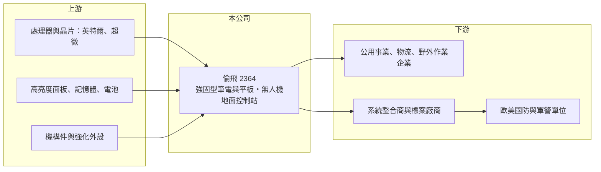

# 2364 倫飛

> 上市｜[[產業索引-電腦及週邊設備業|電腦及週邊設備業]]｜上市（櫃）日期 1997/08/11

# 第一章：企業模式與商業藍圖

> [!info] 撰寫說明
> 精簡版，由 Claude 依公開資料整理，架構比照 [[2330台積電]]，資料截至 2026-10-08。來源：證交所開放資料快照（基本資料、2026 年第二季資產負債與損益、股利）、Goodinfo 經營績效頁、工商時報 2026 年 6 月報導；品牌名稱與客戶型態依記憶整理，已標註待校對。公開資料有限。#待校對

倫飛電腦（以下簡稱倫飛）是一家專做[[強固型電腦]]的小型公司，理解它的關鍵在於：它從一般筆電市場退出後，轉進軍警、國防與戶外作業用的耐摔防水電腦，這個市場量小但單價與毛利都高，讓一家資本額只有 5 億多元的公司能賺到三成以上的 ROE。

- **核心業務：** 倫飛成立於 1984 年，1997 年在證交所上市，早年是台灣的筆電品牌與代工廠之一。現在的主力產品是強固型筆電與平板，品牌為 Durabook（#待校對），產品要能承受摔落、震動、雨水、沙塵與極端溫度，並通過美軍 [[MIL-STD-810]] 等規範。這類電腦的使用者是軍隊、警消、公用事業巡檢、物流與野外作業人員，對可靠度的要求遠高於一般消費者。
- **營收結構：** 各產品與地區的營收比重公開資料未查得。依工商時報 2026 年 6 月報導，歐美強化軍工國防部署帶動強固型電腦需求，公司 2026 年前五月累計營收為近 15 年同期新高。客戶以歐美的政府、國防與企業市場為主（#待校對），訂單常透過標案與系統整合商取得。
- **營運據點：** 總部位於台北市內湖。生產與海外行銷據點公開資料未查得；從 2026 年第二季資料中非控制權益為負數（約 -0.29 億元）判斷，旗下有非百分之百持有且曾虧損的子公司（推估）。
- **長期方向：** 依同篇報導，倫飛正布局無人機的地面控制站（GCS）與相關控制系統，相關專案已在歐美小量出貨。這個方向的意義在於把強固型電腦從「單一硬體」延伸到「國防系統中的一個控制節點」，若成功，產品附加價值與客戶黏著度都會提高。公司也對強固型電腦產業未來三年的成長表示樂觀。

# 第二章：護城河深度與競爭優勢

倫飛的護城河來自強固型產品的認證門檻與國防客戶的長期採購關係，屬於利基型護城河。

- **競爭優勢：** 強固型電腦必須通過軍規、防水防塵（IP 等級）與防爆等多項認證，開發週期長，進入政府與國防標案還需要長期的供貨與維修紀錄。一旦被某國軍警或大型企業採用，通常會連續採購並要求同一系列的長期供貨與維修，形成[[轉換成本]]。倫飛毛利率由 2020 年的約 30% 提升到 2025 年的 39.8%，反映產品組合往高單價、高規格移動。
- **主要對手：** 全球強固型筆電市場的龍頭是 Panasonic 的 Toughbook 與 Dell 的 Rugged 系列，另有台灣 [[3005神基]] 的 Getac 品牌（#待校對）等。台灣同業中，[[3213茂訊]] 也以強固型與國防電腦為主，[[6166凌華]]、[[8050廣積]]、[[6922宸曜]] 等工業電腦廠則在部分軍規與車載應用上競爭。倫飛的規模遠小於國際龍頭，競爭策略是在中型標案與客製化需求上提供彈性。
- **觀察重點：** 長期最該追蹤的是營收能否持續成長而毛利率維持在四成附近，以及無人機地面控制站等新產品能否從小量出貨進入正式量產。2022 至 2025 年 ROE 都在 25% 以上，但這部分是因為股東權益基數小；若營收規模無法持續擴大，高 ROE 難以長期維持。

# 第三章：財務體質與盈利規模

資料日期：2026-10-08，表格是撰寫當時的快照；最新月營收、毛利率、累計 EPS 由自動排程寫在本筆記的屬性欄位（月營收、毛利率、累計EPS 等）。#待校對

倫飛的財務呈現典型的「轉型成功」軌跡：營收穩定成長、毛利率與營業利益率逐年墊高，ROE 從個位數升到三成以上。

| 年度 | 營收（億元） | [[毛利率]] | [[營業利益率]] | EPS（元） | [[ROE]] |
|---|---|---|---|---|---|
| 2020 | 8.63 | 29.8% | 0.26% | 0.11 | 6.06% |
| 2021 | 8.68 | 29.9% | 1.07% | 1.14 | 9.51% |
| 2022 | 9.34 | 32.0% | 2.28% | 3.21 | 25.4% |
| 2023 | 10.8 | 36.7% | 6.68% | 3.51 | 27.4% |
| 2024 | 12.5 | 37.6% | 9.12% | 4.09 | 31.9% |
| 2025 | 15.1 | 39.8% | 13.3% | 4.20 | 31.1% |

（來源：Goodinfo 經營績效頁；2020 年 EPS 與 ROE 的對應關係不一致，可能與股本變動有關，#待校對。2026 年上半年依證交所資料：營收 8.58 億元、毛利率 41.6%、營業利益率 16.5%、EPS 3.06 元。）

- **營收規模：** 2020 至 2025 年營收由 8.63 億元增至 15.1 億元，年複合成長率約 12%（推算），2023 年起每年成長一至兩成。2026 年上半年營收已達 8.58 億元，延續成長趨勢。成長來自歐美國防與公共安全預算增加，以及產品往高單價機種移動。
- **獲利：** 近五年（2021 至 2025）平均 ROE 約 25%（推算），在台灣電腦硬體公司中屬於很高的水準。營業利益率從 2020 年的 0.26% 升到 2025 年的 13.3%，是[[營業槓桿]]的典型例子：研發與認證等固定成本已經投入，營收增加後多數毛利直接轉為營業利益。2022 年 EPS 高於營業利益率所能解釋的水準，推估有業外收益（#待校對）。
- **財務特色：** 依 2026 年第二季資料，總資產約 19.6 億元、股東權益約 8.7 億元（歸屬母公司約 9.0 億元）、負債約 10.9 億元，其中流動負債約 10.4 億元，推估包含客戶預收款與短期借款（#待校對）。股本約 5.76 億元，是小型公司。2025 年度配發現金股利 2.0 元與股票股利 1.0 元，現金[[配息率]]約 48%；公司過去長期虧損，Goodinfo 統計的歷年平均現金股利只有約 0.11 元，穩定配息是近年才開始的。
- **[[ROIC]] 與 [[WACC]]：** 以 2025 年營業利益約 2.0 億元（15.1 億元 × 13.3%）、稅率 20% 計算，稅後營業利益約 1.6 億元。有息負債未查得，投入資本以股東權益 8.7 億元到「權益加全部負債」19.6 億元為區間，ROIC 約 8% 至 18%（推算）；以 2026 年上半年營業利益 1.42 億元年化，約 12% 至 26%（推算）。WACC 以 [[CAPM]] 推估：無風險利率 1.75%、市場風險溢酬 6%、β 假設 1.0（中小型電腦股常見值），權益成本約 7.75%；稅後負債成本假設 2%、負債占兩成，WACC 約 6.6%（推算）。ROIC 明顯高於 WACC，代表倫飛近年的強固型電腦事業確實在創造經濟價值；但這是 2022 年以後才出現的狀況，能否跨越下一個國防預算週期仍需觀察。

# 第四章：總體風險與地緣政治

倫飛的風險來自國防預算週期、規模劣勢與零組件供應。

- **產業週期：** 強固型電腦的需求與各國國防、警政和公共安全預算高度相關，預算有其政治週期，地緣衝突升溫時採購增加，局勢緩和或財政緊縮時可能延後。標案金額大、時間點不確定，會讓單季營收起伏很大。
- **營運風險：** 公司規模小，與 Panasonic、Dell 等國際大廠相比，在採購議價、全球服務網與品牌知名度上都處於劣勢。大型標案若集中在少數客戶，單一標案的得失就會明顯影響全年營收。無人機控制站等新產品需要新的系統整合能力，開發與認證投入可能先於營收。
- **其他風險：** 處理器、記憶體與高亮度面板等關鍵零件由少數大廠供應，2026 年記憶體漲價等零件成本變動會壓縮毛利（#待校對）。產品主要銷往歐美，美元與歐元匯率影響換算後的營收；國防產品也可能受到出口管制與採購國產化政策的限制。

# 專有名詞解析

## 應用

- **[[強固型電腦]]**：能承受摔落、震動、防水防塵與極端溫度的筆電或平板，用於軍警、公用事業與野外作業。
- **[[MIL-STD-810]]**：美國國防部制定的環境測試標準，涵蓋摔落、震動、溫度、濕度等項目，是強固型產品的常見認證。

## 金融

- **[[轉換成本]]**：客戶更換供應商需付出的時間、驗證與風險成本，越高代表既有供應商的地位越穩固。
- **[[營業槓桿]]**：固定成本占比高的公司，營收增加時利潤增幅大於營收增幅，反之亦然。
- **[[配息率]]**：現金股利占當年度每股盈餘的比例，反映公司把獲利分給股東的程度。

# 核心供應鏈

- 上游：處理器 [[INTC英特爾]]、[[AMD超微]]，高亮度觸控面板、記憶體、電池與強化機構件供應商。
- 下游／客戶：歐美的國防、軍警與公共安全單位，公用事業與物流等外勤企業，以及承接政府標案的系統整合商（具體名單公開資料未點名，#待校對）。
- 同業：[[3213茂訊]]（強固型與國防電腦）、[[3005神基]]（Getac 強固型電腦，#待校對）、[[6166凌華]]、[[8050廣積]]、[[6922宸曜]]（工業與軍規電腦），以及國際的 Panasonic、Dell。

## 最新新聞
<!-- news:start -->
<!-- news:end -->

## 相關連結
- [公開資訊觀測站](https://mopsov.twse.com.tw/mops/web/t05st03?step=1&firstin=1&co_id=2364)
- [Goodinfo](https://goodinfo.tw/tw/StockDetail.asp?STOCK_ID=2364)
- [Yahoo 股市](https://tw.stock.yahoo.com/quote/2364)
- [鉅亨網新聞](https://www.cnyes.com/twstock/2364/news)
