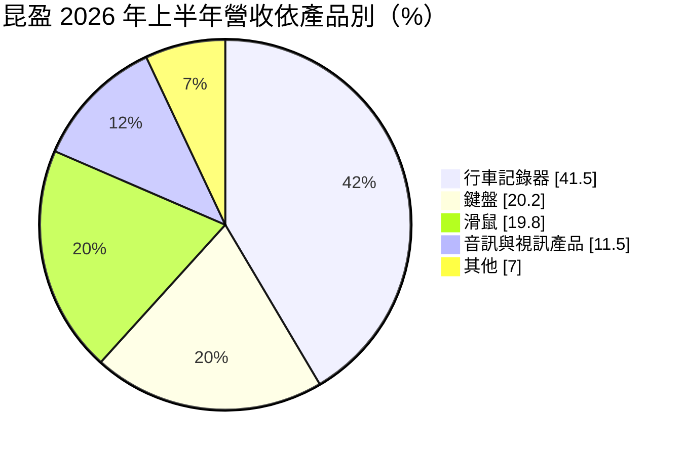
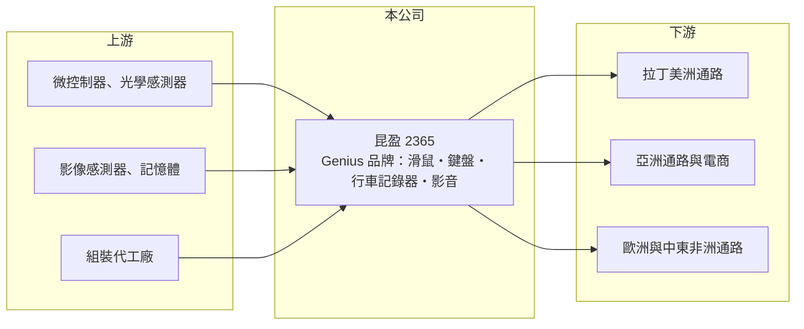

# 2365 昆盈

> 上市｜[[產業索引-電腦及週邊設備業|電腦及週邊設備業]]｜上市（櫃）日期 1997/11/03

# 第一章：企業模式與商業藍圖

> [!info] 撰寫說明
> 精簡版，由 Claude 依公開資料整理，架構比照 [[2330台積電]]，資料截至 2026-10-08。來源：證交所開放資料快照（基本資料、2026 年第二季資產負債與損益、股利）、Goodinfo 經營績效頁、富果研究整理之 2026 年 8 月法說會備忘錄。#待校對

昆盈企業（以下簡稱昆盈）是以 Genius 品牌行銷全球的電腦周邊公司，理解它的關鍵在於：它的滑鼠、鍵盤主要賣到新興市場的通路，而近年營收最大的產品已經變成行車記錄器，公司正從單純的 PC 周邊品牌轉向更廣的消費性電子品牌。

- **核心業務：** 昆盈成立於 1983 年，總部位於新北市三重，1997 年在證交所上市。公司以自有品牌 Genius 銷售滑鼠、鍵盤、喇叭、耳機、網路攝影機與行車記錄器，並推出 GX Gaming 電競系列。與替大品牌代工的周邊廠不同，昆盈自己經營品牌與海外通路，毛利率因此接近四成，但也必須自行承擔行銷與庫存風險。
- **營收結構：** 依 2026 年 8 月法說會資料，上半年營收中[[行車記錄器]]占 41.5%、鍵盤 20.2%、滑鼠 19.8%，喇叭、耳機與網路攝影機合計約 11.5%。行車記錄器、喇叭與耳機年增，滑鼠則因記憶體漲價壓抑 PC 需求而下滑。地區別方面，亞洲占 45.7%、拉丁美洲 32.8%、歐洲 18.5%、中東非洲 3.0%，以新興市場為主是昆盈與 羅技 等國際品牌最大的差異。
- **營運據點：** 總部在台灣三重，生產與海外子公司據點法說會資料未說明（#待校對）。依 2026 年第二季資料，非流動資產約 18.1 億元、占總資產一半，推估包含相當比重的長期投資與不動產；法說會也提到業外收入中有投資收益，但未列出被投資公司。
- **長期方向：** 新產品方面，公司推出搭載 AI Copilot 鍵的鍵盤、滑鼠組合，USB-C 耳機、藍牙 5.3 耳機與木箱喇叭，以及 GX Gaming 電競鍵盤與賽車方向盤。長期方向是以 Genius 品牌在拉美、亞洲等通路的布局為基礎，擴大到行車記錄器與影音產品，降低對 PC 換機週期的依賴。

# 第二章：護城河深度與競爭優勢

昆盈的護城河來自 Genius 品牌在新興市場的通路，屬於窄護城河；周邊產品本身技術門檻不高。

- **競爭優勢：** Genius 是經營數十年的老品牌，在拉丁美洲、亞洲部分國家的電腦賣場與通路有一定的知名度與鋪貨網絡。新興市場的通路分散、帳期與物流複雜，國際大品牌未必能深入每個角落，這讓昆盈能以中價位產品維持接近四成的[[毛利率]]。不過消費者對周邊產品的品牌忠誠度有限，通路關係需要持續投入維繫。
- **主要對手：** 電腦周邊的國際對手包括羅技、微軟、雷蛇等品牌，以及大量中國的白牌與網路品牌。行車記錄器則面對 [[3706神達]] 的 Mio 等品牌與中國廠商的競爭。中國網路品牌以極低價格透過電商銷售，是近年最大的價格壓力來源。
- **觀察重點：** 長期最該追蹤的是營收能否止跌回升，以及行車記錄器等新品能否撐起新的營收規模。營收由 2020 年的 16.5 億元降到 2023 年的 7.7 億元，之後回升到約 9.6 億元；毛利率則由約三成提升到四成以上，代表公司在縮小規模的同時改善了產品組合。營業利益率能否穩定在 5% 以上，是判斷品牌經營是否健康的關鍵。

# 第三章：財務體質與盈利規模

資料日期：2026-10-08，表格是撰寫當時的快照；最新月營收、毛利率、累計 EPS 由自動排程寫在本筆記的屬性欄位（月營收、毛利率、累計EPS 等）。#待校對

昆盈的財務特徵是本業規模縮小但毛利率提升、資產負債表很乾淨，獲利有相當比重來自業外。

| 年度 | 營收（億元） | [[毛利率]] | [[營業利益率]] | EPS（元） | [[ROE]] |
|---|---|---|---|---|---|
| 2020 | 16.5 | 31.2% | 9.79% | 0.64 | 4.69% |
| 2021 | 13.7 | 25.0% | 3.73% | 0.23 | 1.70% |
| 2022 | 10.2 | 28.3% | 1.09% | 0.25 | 1.82% |
| 2023 | 7.7 | 37.8% | 0.86% | 0.33 | 2.39% |
| 2024 | 9.79 | 40.3% | 7.57% | 0.64 | 4.65% |
| 2025 | 9.59 | 41.0% | 5.51% | 0.32 | 2.26% |

（來源：Goodinfo 經營績效頁。2026 年上半年依證交所資料：營收 4.88 億元、毛利率 38.9%、營業利益率 5.5%、稅前淨利率 13.6%、EPS 0.26 元。）

- **營收規模：** 2020 至 2025 年營收由 16.5 億元降至 9.59 億元，年複合成長率約 -10%（推算）。2020 年疫情帶動居家辦公需求是高點，之後 PC 周邊需求回落，公司也主動縮減低毛利產品。2024 年起營收止跌，行車記錄器成為新的主力。
- **獲利：** 近五年（2021 至 2025）平均 ROE 只有約 2.6%（推算）。原因有二：一是本業營業利益每年只有數千萬元；二是股東權益約 31 億元、股本約 22 億元，資本規模相對於營收偏大。2026 年上半年稅前淨利率 13.6% 遠高於營業利益率 5.5%，代表[[業外收入]]（投資收益等）是獲利的重要來源。
- **財務特色：** 依 2026 年第二季資料，總資產約 36.3 億元、股東權益約 31.2 億元、負債只有約 5.1 億元，負債比約 14%，財務非常保守。每股淨值約 13.9 元。公司章程允許按季分派盈餘，2025 年第四季配發現金股利每股 0.3 元，2026 年第一、二季則未配發；Goodinfo 統計的歷年平均現金股利約 0.68 元，配息隨獲利起伏。自由現金流是否長期為正未查得。
- **[[ROIC]] 與 [[WACC]]：** 以 2025 年營業利益約 0.53 億元（9.59 億元 × 5.51%）、稅率 20% 計算，稅後營業利益約 0.42 億元。有息負債未查得但負債總額很小，投入資本以股東權益 31.2 億元到「權益加全部負債」36.3 億元為區間，ROIC 約 1.2% 至 1.4%（推算）；本業較好的 2024 年約 1.6% 至 1.9%（推算）。WACC 以 [[CAPM]] 推估：無風險利率 1.75%、市場風險溢酬 6%、β 假設 0.8（電腦周邊股常見值），權益成本約 6.55%；稅後負債成本假設 2%、負債占一成，WACC 約 6.1%（推算）。ROIC 遠低於 WACC，但投入資本中有相當比重是長期投資，其報酬記在業外而非營業利益；即使計入業外，ROE 長期也只有 2% 至 5%，代表整體資本運用效率偏低，股東價值主要靠資產本身而非經營報酬。

# 第四章：總體風險與地緣政治

昆盈的風險來自 PC 周邊市場的成熟、新興市場的波動與低價競爭。

- **產業週期：** 滑鼠、鍵盤的需求跟著 PC 出貨週期走，2026 年上半年記憶體漲價壓抑 PC 需求，滑鼠營收就隨之下滑。行車記錄器則與新車銷售、車險與法規政策相關，各國情況不同。終端需求變化會沿通路放大成[[長鞭效應]]，品牌商必須小心管理通路庫存。
- **營運風險：** 營收集中在亞洲與拉丁美洲，這些市場的通路商財務體質不一，應收帳款與庫存跌價的風險高於成熟市場。品牌經營需要持續的行銷與產品開發支出，營收規模不夠大時，這些費用會壓低營業利益率。中國網路品牌的低價競爭可能讓毛利率難以維持在四成。
- **其他風險：** 拉美國家的匯率與通膨波動大，貨幣大幅貶值時會直接衝擊營收與獲利。生產據點若在中國（#待校對），面臨關稅與供應鏈轉移的成本。記憶體、影像感測器等零件價格上漲也會擠壓毛利。

# 專有名詞解析

## 應用

- **[[行車記錄器]]**：安裝在車內、持續錄下行車影像的裝置，用於事故舉證，近年整合 GPS、夜視與 ADAS 警示功能。

## 金融

- **[[業外收入]]**：本業營運以外的收入，例如利息、投資收益、處分資產利益，持續性通常低於本業獲利。
- **[[長鞭效應]]**：終端需求的小幅變動，沿供應鏈往上游傳遞時被逐級放大，造成上游庫存與訂單劇烈波動。
- **[[CAPM]]**：資本資產定價模型，以無風險利率加上 β 乘以市場風險溢酬估算股東要求報酬率。

# 核心供應鏈

- 上游：滑鼠與鍵盤用的微控制器、光學感測器，行車記錄器與網路攝影機用的影像感測器與記憶體，以及組裝代工廠（具體名單未查得）。
- 下游／客戶：亞洲（45.7%）、拉丁美洲（32.8%）、歐洲（18.5%）、中東非洲（3.0%）的電腦賣場、經銷商與電商通路。
- 同業：國際品牌羅技、微軟、雷蛇；台灣的 [[3706神達]]（Mio 行車記錄器）、[[2352佳世達]]（周邊與顯示器）。

## 最新新聞
<!-- news:start（自動產生，請勿手動編輯此範圍） -->
- 2026-10-06 📰 媒體 17:50｜營收速報 - 昆盈(2365)9月營收1.03億元年增率高達38.45％｜[鉅亨網](https://news.cnyes.com/news/id/6622821)

完整紀錄：[[2365昆盈 新聞]]
<!-- news:end -->

## 相關連結
- [公開資訊觀測站](https://mopsov.twse.com.tw/mops/web/t05st03?step=1&firstin=1&co_id=2365)
- [Goodinfo](https://goodinfo.tw/tw/StockDetail.asp?STOCK_ID=2365)
- [Yahoo 股市](https://tw.stock.yahoo.com/quote/2365)
- [鉅亨網新聞](https://www.cnyes.com/twstock/2365/news)
