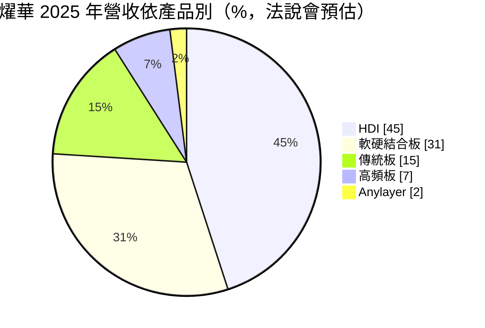
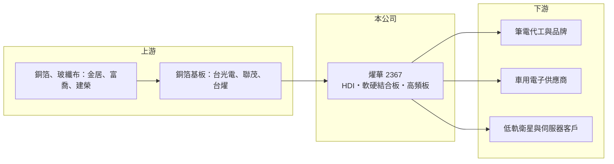

# 2367 燿華

> 上市｜[[產業索引-電子零組件業|電子零組件業]]｜上市（櫃）日期 1997/12/13

# 第一章：企業模式與商業藍圖

> [!info] 撰寫說明
> 精簡版，由 Claude 依公開資料整理，架構比照 [[2330台積電]]，資料截至 2026-10-08。來源：證交所開放資料快照（基本資料、2026 年第二季資產負債與損益、股利、月營收）、Goodinfo 經營績效頁、富果研究 2025 年 12 月法說會整理。#待校對

燿華電子（以下簡稱燿華）是台灣專攻[[HDI]]與[[軟硬結合板]]的 PCB 廠，理解它的關鍵在於：公司把產品集中在車用、筆電與低軌衛星等需要高可靠度的利基板，並以泰國新廠回應客戶分散產地的需求。

- **核心業務：** 燿華成立於 1984 年，1997 年上市，產品以 HDI 高密度連接板與軟硬結合板為主，另有傳統多層板、高頻板、任意層 HDI（Anylayer）、厚銅板與高散熱金屬基板。這些板子用在空間小、可靠度要求高的地方，例如車用電子、筆電主機板與衛星通訊設備。產品技術層次高於一般多層板，但也需要持續投資製程設備。
- **營收結構：** 依 2025 年 12 月法說會，2025 年 HDI 約占 45%、軟硬結合板約 31%、傳統板約 15%、高頻板約 7%。應用別方面，IT 產品（以筆電為主）約 35%、汽車電子約 35%、其他（含[[低軌衛星]]）約 24%，手機只剩約 1%。車用與衛星比重高，代表燿華已從過去的消費性電子轉向較長壽命的產品。
- **營運據點：** 台灣有土城與宜蘭廠，中國有江蘇南通廠，泰國廠於 2025 年 11 月開幕，2026 年起小量出貨，初期以低軌衛星與伺服器產品為主，之後導入汽車板。公司形容這個布局讓台灣、中國、東南亞三地都能供貨，符合客戶對非中國產能的要求。
- **長期方向：** 公司把資源集中在 AI 伺服器、AI PC、車用雷達板與低軌衛星等較高毛利產品，並開發 AR 眼鏡用的軟板，目標 2027 年該類產品營收比重提升到約一成。這些方向的共同點是需要高密度與高可靠度，正是 HDI 與軟硬結合板的強項。

# 第二章：護城河深度與競爭優勢

燿華的護城河來自高可靠度產品的認證與 HDI、軟硬結合板的製程經驗，但規模不如一線 PCB 大廠。

- **競爭優勢：** 車用與衛星電路板需要通過嚴格的可靠度驗證，認證期長，客戶一旦導入很少更換供應商，形成轉換成本。燿華同時具備 HDI 與軟硬結合板能力，能提供需要同時兼顧輕薄與彎折的設計方案。低軌衛星板是公司較早切入的領域，在這個利基市場有先發經驗。
- **主要對手：** HDI 領域的 [[3037欣興]]、[[2313華通]]、[[4958臻鼎-KY]] 規模都大得多；車用板有 [[2355敬鵬]]、[[3715定穎投控]]、[[3044健鼎]]；軟板與軟硬結合板則有 [[6153嘉聯益]]、臻鼎等。衛星板方面，[[2313華通]] 是最主要的競爭者。
- **觀察重點：** 長期應追蹤泰國廠的稼動率與獲利貢獻，以及車用、衛星、AI 相關產品能否讓毛利率穩定在 15% 以上。燿華過去多次出現毛利率接近零甚至為負的年份，獲利的穩定度是判斷護城河是否成形的關鍵。

# 第三章：財務體質與盈利規模

資料日期：2026-10-08，表格是撰寫當時的快照；最新月營收、毛利率、累計 EPS 由自動排程寫在本筆記的屬性欄位（月營收、毛利率、累計EPS 等）。#待校對

燿華的財務特徵是營收規模 130 億至 190 億元，但獲利波動極大，好年 ROE 可達 14%，差年則虧損。

| 年度 | 營收（億元） | [[毛利率]] | [[營業利益率]] | EPS（元） | [[ROE]] |
|---|---|---|---|---|---|
| 2020 | 144 | -0.02% | -16.1% | -2.32 | -13.7% |
| 2021 | 135 | -1.74% | -14.8% | -0.39 | -2.53% |
| 2022 | 174 | 12.5% | 1.76% | 0.65 | 4.09% |
| 2023 | 150 | 9.05% | -2.59% | -0.51 | -3.35% |
| 2024 | 185 | 19.3% | 8.41% | 2.36 | 14.1% |
| 2025 | 162 | 14.9% | 2.81% | 0.68 | 3.79% |

（來源：Goodinfo 經營績效頁。）

- **營收規模：** 2020 至 2025 年營收年複合成長率約 2.4%（推算），整體成長有限但波動大。2024 年營收 185 億元是近年高點，2025 年回落到 162 億元。
- **獲利：** 近五年（2021 至 2025）平均 ROE 約 3.2%（推算），六年中有三年虧損。2026 年上半年毛利率約 6.5%、營業損失約 5.2 億元、EPS -0.64 元，與泰國新廠初期成本有關。PCB 廠固定成本高，稼動率一降，毛利率就可能從近兩成掉到個位數。
- **財務特色：** 2026 年第二季總資產約 280 億元，股東權益約 123 億元，負債總計約 157 億元，負債比約 56%，在台灣 PCB 廠中偏高。股本約 70.6 億元、每股淨值約 17.4 元，股本大使每股獲利被稀釋。2025 年度現金股利 0.2 元，配息率約 29%（推算），章程規定現金股利至少占股利五成。自由現金流在擴廠期間是否為正未查得。
- **[[ROIC]] 與 [[WACC]]：** 以 2025 年營業利益約 4.55 億元（162 億元 × 2.81%）、稅率 20% 計算，稅後營業利益約 3.6 億元；有息負債未查得，投入資本以權益 123 億元到「權益加全部負債」280 億元為區間，ROIC 約 1.3% 至 3.0%（推算）；2024 年同法約 4.4% 至 10%（推算）。WACC 以 CAPM 推估：無風險利率 1.75%、市場風險溢酬 6%、β 假設 1.1（PCB 族群常見值），權益成本約 8.35%；稅後負債成本 2%、負債占四成，WACC 約 5.8%（推算）。除了 2024 年等少數好年，燿華的 ROIC 多數年度低於 WACC，長期來看尚未穩定創造價值，泰國廠與高毛利產品能否扭轉這個局面是關鍵。

# 第四章：總體風險與地緣政治

燿華的風險集中在 PCB 產業週期、擴廠執行與偏高的財務槓桿。

- **產業週期：** PCB 需求跟著筆電、汽車與通訊設備週期起伏，筆電占營收三成以上，PC 換機潮與庫存調整會直接反映在稼動率。車用與衛星訂單雖較穩定，但汽車景氣下滑或衛星業者調整發射計畫時，也會出現訂單波動。
- **營運風險：** 泰國新廠初期需經客戶認證與良率爬坡，折舊與人力成本會先壓低毛利，2026 年上半年的虧損即反映這個階段。負債比偏高，若虧損延續，財務彈性會受限。
- **其他風險：** 銅箔基板、銅、金等原物料價格上漲會壓縮毛利；營收以美元計價為主，新台幣升值不利獲利。南通廠位於中國，受美中貿易與關稅政策影響，也是公司建置泰國產能的原因之一。

# 專有名詞解析

## 應用

- **[[低軌衛星]]**：在距地面約 500 至 2,000 公里軌道運行的通訊衛星群，用於全球寬頻上網，帶動地面接收設備需求。

## 產業

- **[[PCB]]**：印刷電路板，用銅線路連接電子元件的基板，是所有電子產品的骨架。
- **[[HDI]]**：高密度連接板，用雷射鑽微小孔與細線路，讓更多元件擠進更小面積，常見於手機、筆電與車用電子。
- **[[軟硬結合板]]**：把可彎折的軟板與硬板壓合成一片，可省去連接器並節省空間，用於相機模組、車用與穿戴裝置。

# 核心供應鏈

- 上游：銅箔基板 [[2383台光電]]、[[6213聯茂]]、[[6274台燿]]；銅箔 [[8358金居]]；玻纖布 [[1815富喬]]、[[5340建榮]]。
- 下游／客戶：筆電代工廠與品牌、車用電子一階供應商、低軌衛星地面設備與 AI 伺服器客戶（具體客戶名稱法說會未揭露）。
- 同業：[[3037欣興]]、[[2313華通]]、[[4958臻鼎-KY]]、[[2355敬鵬]]、[[3715定穎投控]]、[[3044健鼎]]、[[6153嘉聯益]]、[[2316楠梓電]]。

## 最新新聞
<!-- news:start -->
<!-- news:end -->

## 相關連結
- [公開資訊觀測站](https://mopsov.twse.com.tw/mops/web/t05st03?step=1&firstin=1&co_id=2367)
- [Goodinfo](https://goodinfo.tw/tw/StockDetail.asp?STOCK_ID=2367)
- [Yahoo 股市](https://tw.stock.yahoo.com/quote/2367)
- [鉅亨網新聞](https://www.cnyes.com/twstock/2367/news)
