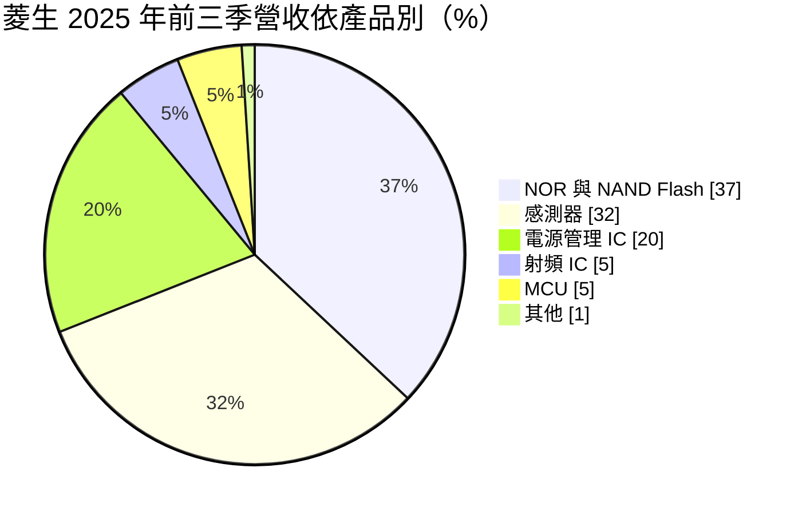
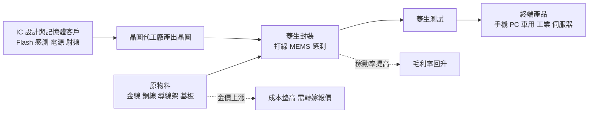
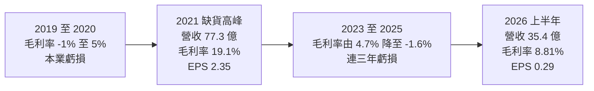
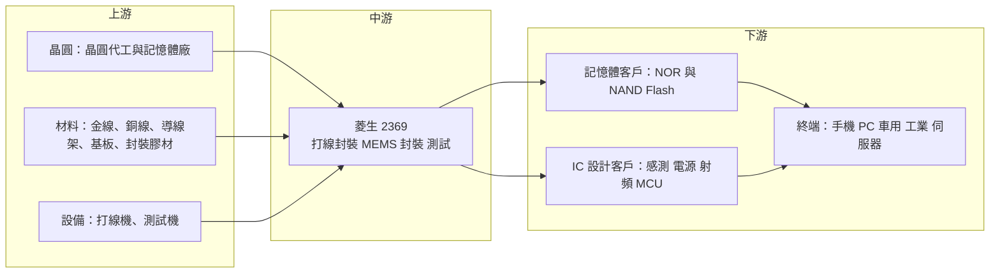

# 2369 菱生

> 上市｜[[產業索引-半導體業|半導體業]]｜上市（櫃）日期 1998/04/10

# 第一章：企業模式與商業藍圖

> [!info] 撰寫說明
> 本文由 Claude 依公開資料整理，架構比照 [[2330台積電]] 的四章研究，資料截至 2026-10-08。財務數字來源：Goodinfo 經營績效、股利政策與現金流量頁（2019 至 2025 年度）、證交所開放資料快照（2026 年第二季資產負債與綜合損益、2025 年度股利、公司基本資料）、中央社與富果研究的 2025 年 12 月 3 日法說會整理、理財周刊；2021 年毛利率與長約資訊取自舊版筆記引用的媒體報導，尚未重新查證；產業描述為整理性內容，尚未逐條比對原始文件。#待校對

在評估單一個股的長期投資價值時，首要步驟是拆解企業的底層獲利邏輯。本章針對菱生精密（股票代號：2369，以下簡稱菱生）的商業模式進行定性分析，說明這家以打線封裝為主的中型封測廠，為何營收長期停在 50 億元上下、獲利隨景氣與金價大幅擺盪，以及它在記憶體、感測與類比晶片封裝上的利基。

## 一、核心定位：以類比與記憶體為主的打線封裝廠

菱生成立於 1973 年 4 月，總部在台中潭子，1998 年上市，董事長為葉樹泉（證交所公司基本資料），是台灣歷史最久的半導體封測廠之一。主要業務是積體電路的封裝與測試，屬於專業封測代工（[[OSAT]]）。和 [[3711日月光投控]]、[[6239力成]] 這類大廠相比，菱生規模小得多，產品集中在[[打線封裝]]，客戶以快閃記憶體、感測器、電源管理與射頻晶片為主。

菱生的定位可以用三點概括：

* **小型、利基、類比為主：** 菱生不追逐最先進的晶圓級封裝與[[先進封裝]]，而是服務出貨量大、對成本敏感、腳數不多的類比與記憶體晶片。這類晶片不需要最先進的封裝技術，但數量龐大、規格多樣，是封測產業中規模最大、也最成熟的一塊市場。
* **[[MEMS]] 與感測封裝經驗：** 感測器晶片常需要開孔、氣密或特殊材料，封裝結構必須依產品客製，製程比一般封裝複雜。菱生在這個領域累積了長期經驗，是它與一般打線封裝廠最主要的差異。
* **對產能利用率與原料價格高度敏感：** 封測廠的機台折舊與人力屬於固定成本，[[稼動率]]決定獲利；打線封裝又需要金線或銅線，貴金屬價格上漲會直接墊高成本。這兩個因素讓菱生的毛利率在不同年度之間波動很大。

## 二、終端應用／產品板塊：快閃記憶體與感測器為兩大支柱

依 2025 年 12 月 3 日法說會（中央社、富果研究整理），2025 年前三季營收結構如下：

* **快閃記憶體（約 37%）：** 包括 [[NOR Flash]] 與 [[NAND Flash]] 的封裝，是最大業務。NOR Flash 常用來存放開機程式碼，應用在網通、車用與伺服器；公司在法說會表示，受 AI 帶動，現有產能不足以滿足記憶體客戶的長期需求。記憶體業務的好處是量大、客戶穩定，缺點是記憶體產業本身的週期非常劇烈。
* **感測器（約 32%）：** 包括 MEMS 麥克風、動作感測與光感測等元件的封裝，應用在手機、穿戴裝置與車用電子。這是菱生技術含量最高的業務，也是它與其他打線封裝廠差異化的主要來源。
* **電源管理（約 20%）：** [[電源管理IC]] 的封裝，應用在消費性電子、車用與工業。電源晶片幾乎所有電子產品都需要，需求穩定但價格競爭激烈。
* **射頻與 MCU（各約 5%）：** 射頻元件封裝受惠 [[Wi-Fi 7]] 世代交替，公司已為 Wi-Fi 7 客戶端應用準備封裝產能；MCU 封裝則應用在家電與工控。

## 三、資本轉化邏輯（營運模式）：稼動率與金價決定毛利

* **固定成本結構：** 封測廠的機台、廠房與人力屬於固定成本，產能利用率拉高時，每顆晶片分攤的成本大幅下降，毛利率會跳升。2021 年全產業缺貨時，菱生全產品線滿載並調漲報價，全年毛利率 19.1%、營業利益率 11.5%、EPS 2.35 元，是近年最好的一年；2024 至 2025 年需求不足，毛利率則掉到 0% 上下甚至轉負（Goodinfo）。
* **金價的影響：** 打線封裝使用金線，貴金屬價格上漲直接墊高成本。依富果研究整理，公司在法說會指出 2025 年前三季毛利率轉負的最主要原因是金價與其他貴金屬上漲。菱生的對策是和客戶協商調整報價，以及在可行的產品改用銅線，但改用銅線需要客戶重新驗證。
* **議價能力有限：** 菱生規模小，面對大型記憶體與 IC 設計客戶時議價能力有限，成本上漲往往要等到產業供需轉緊時才能轉嫁。這是它獲利波動大的結構性原因。

## 四、企業長期藍圖：記憶體產能、光通訊與扇出型封裝

依 2025 年 12 月法說會（中央社），菱生的長期方向有三個：

* **AI 帶動的記憶體封裝：** 依客戶需求彈性擴充記憶體封裝產能。記憶體是菱生最大的業務，AI 伺服器與邊緣裝置帶動 NOR Flash 等記憶體需求，是未來幾年最直接的成長來源。
* **光通訊元件與扇出型封裝：** 公司把 AI 光通訊傳輸元件的封裝，以及特殊的扇出型（[[Fan-out]]）封裝應用列為成長動能。這兩個方向技術門檻高於傳統打線封裝，若能放量，有助於提高產品組合與毛利率。
* **車用電子：** 車用晶片需求成長較慢但穩定，菱生持續擴大車用封測業務。車用產品需要長時間驗證，一旦導入，訂單能延續多年。

整體來看，菱生的策略是「守住打線封裝的利基、往高附加價值的封裝類型移動」。能否成功，取決於它是否有足夠的資金與技術投入新封裝製程。

# 第二章：護城河深度與競爭優勢

在長期價值投資中，「護城河」指企業抵禦競爭、維持超額利潤的保護機制。本章分析菱生的競爭優勢、國內外主要對手，以及這些優勢在成本上漲與價格競爭中能守住多少。

## 一、護城河的核心組成要素

菱生的護城河偏窄。最直接的證據是財務數字：2019 至 2025 年七年中，有四年營業利益為負，平均 ROE 接近零（Goodinfo）。這代表菱生在多數年度無法賺到超額利潤，只有在產業供不應求時才有明顯獲利。即便如此，它能在激烈的封測市場生存五十年，仍有幾個值得注意的優勢：

* **1. 感測器與 MEMS 封裝的製程經驗：** MEMS 元件需要依產品客製封裝結構，客戶導入一款產品往往要經過長時間驗證，量產後較少輕易更換封測廠（推估）。這是菱生業務中轉換成本最高的一塊。
* **2. 記憶體客戶的長期關係：** 快閃記憶體占營收近四成，依舊版筆記引用的 2021 年報導，菱生當年曾首度與客戶簽訂長期合約，代表部分客戶在缺貨時願意以長約鎖定產能（待校對）。長期合作關係讓菱生在記憶體景氣回升時能優先承接訂單。
* **3. 中小型客戶的服務彈性：** 大型封測廠優先服務大客戶，菱生可以承接量較小、規格多樣的訂單，對中小型 IC 設計公司具吸引力（推估）。

## 二、全球主要競爭對手格局

| 對手 | 定位 | 對菱生的威脅 |
|---|---|---|
| [[3711日月光投控]] | 全球最大封測廠，產品線完整 | 規模與議價能力遠大於菱生，可整包承接大客戶 |
| [[6239力成]]、[[2441超豐]] | 記憶體封測大廠與其打線封裝子公司 | 在記憶體與打線封裝直接競爭 |
| [[8150南茂]]、[[8110華東]] | 記憶體與驅動 IC 封測 | 在記憶體封測爭奪相同客戶 |
| 中國封測廠（長電科技、華天科技、通富微電） | 政策扶植、成本低 | 以低價爭取中國與國際中低階訂單 |

菱生在這個格局中屬於「小而專」的角色。在打線封裝這種成熟市場，規模經濟非常重要，大廠可以用更低的單位成本與更完整的產品線爭取客戶；中國封測廠則在政策支持下持續擴產，壓低全球價格。菱生的空間主要在大廠不願投入的利基產品。

## 三、優勢轉化：守得住／守不住／觀察重點

* **守得住：** MEMS 與感測封裝、需要長期驗證的車用與工業產品，以及記憶體缺貨期間的長約訂單。這些產品的客戶重視品質與穩定交貨，價格不是唯一考量。
* **守不住：** 標準化的打線封裝報價。在金價飆漲、稼動率不足的 2024 至 2025 年，菱生無法把成本完全轉嫁，毛利率從 2022 年的 8.67% 一路降到 2025 年的 -1.58%（Goodinfo）。這說明在供過於求時，小型封測廠幾乎沒有定價權。
* **觀察重點：** 第一，毛利率能否穩定站上兩位數，而不只是景氣回升時短暫反彈；第二，光通訊元件與扇出型封裝能否帶來實際營收；第三，金價走勢與報價調整的速度。2026 年上半年毛利率回升到 8.8%、營業利益率 3.2%（證交所開放資料），是轉機的開始，但距離 2021 年的水準仍有距離。

# 第三章：財務體質與盈利規模

資料日期：2026-10-08。年度數字取自 Goodinfo 經營績效、股利政策與現金流量頁，2026 年上半年與資產負債取自證交所開放資料快照，表格是撰寫當時的快照；最新月營收、毛利率、累計 EPS 由自動排程寫在本筆記的屬性欄位（月營收、毛利率、累計EPS 等）。#待校對

財務報表是檢驗護城河是否真實存在的最終標準。本章用多年度的三率、ROE、現金流與資本報酬，檢視菱生在封測景氣循環中的獲利模式。

## 一、獲利能力的基石：三率

| 年度 | 營收（億元） | [[毛利率]] | [[營業利益率]] | EPS（元） | [[ROE]] |
|---|---|---|---|---|---|
| 2019 | 47.2 | -1.35% | -12.3% | -1.47 | -9.81% |
| 2020 | 54.6 | 5.48% | -3.00% | -0.44 | -3.12% |
| 2021 | 77.3 | 19.1% | 11.5% | 2.35 | 16.6% |
| 2022 | 60.1 | 8.67% | 0.64% | 0.56 | 3.33% |
| 2023 | 55.5 | 4.69% | -2.50% | -0.42 | -2.75% |
| 2024 | 53.7 | 0.15% | -7.13% | -0.45 | -3.60% |
| 2025 | 55.6 | -1.58% | -8.18% | -1.05 | -8.00% |
| 2026 上半年 | 35.4 | 8.81% | 3.21% | 0.29 | 未查得（年化約 4.4%，推算） |

* **營收停滯：** 2019 至 2025 年營收在 47 億至 77 億元之間，2020 至 2025 年年複合成長率約 0.3%（推算），基本上沒有成長。只有 2021 年全球缺貨時營收跳升，之後又回到 55 億元上下。這反映菱生的產能規模多年沒有明顯擴大，也反映打線封裝市場本身成長有限。
* **[[毛利率]]：** 七年間在 -1.6% 到 19.1% 之間擺盪，平均不到 6%。封測廠的毛利率在產能利用率高時快速上升，低時則可能轉負，菱生的固定成本比重高，這個擺盪特別明顯。
* **[[營業利益率]]：** 七年中只有 2021 年、2022 年與 2026 年上半年為正。這說明菱生的損益兩平點相當高，必須在產能利用率相對高、價格合理時才能賺錢。
* **2026 年轉盈：** 2026 年上半年營收 35.4 億元，年增約三成，毛利率回升到 8.81%，營業利益約 1.13 億元。依法說會說法，轉盈主因是報價調整與記憶體封裝需求增加。

## 二、[[ROE]]：資本效率

菱生 2021 至 2025 年平均 ROE 約 1.1%（推算），2019 至 2025 年七年中有五年 ROE 為負。即使在 2021 年的景氣高峰，ROE 也只有 16.6%。長期來看，菱生沒有為股東創造足夠的報酬。2026 年第二季底股東權益約 51 億元，每股淨值約 13.1 元，保留盈餘只剩約 3 億元（證交所開放資料），連年虧損已大幅侵蝕累積盈餘。

股利方面，2018 至 2025 年度每股現金股利分別為 0.2、0、0、1.29、0.3、0.3、0.3、0 元。公司章程規定股東股息及紅利不低於可分配盈餘的 50%（證交所股利資料摘錄），2021 年度配息率約 55%（推算）；2023 與 2024 年度在虧損下仍配發 0.3 元，推估是動用累積盈餘；2025 年度因可分配盈餘為負而不配息。菱生的股利屬於「有賺才配、金額不穩定」的類型。

## 三、資本支出與自由現金流

| 年度 | 營業現金流（億元） | 投資現金流（億元） | 自由現金流（億元） |
|---|---|---|---|
| 2019 | 6.11 | -4.67 | 1.44 |
| 2020 | 5.42 | -4.34 | 1.08 |
| 2021 | 12.4 | -12.9 | -0.57 |
| 2022 | 11.2 | -8.21 | 2.97 |
| 2023 | 7.37 | -4.42 | 2.95 |
| 2024 | 6.22 | 0.72 | 6.94 |
| 2025 | 0.93 | -3.42 | -2.50 |

（自由現金流依 Goodinfo 定義為營業現金流加投資現金流。）

* **營業現金流長期為正：** 即使在帳面虧損的 2019、2020、2023、2024 年，營業現金流仍為正，因為封測廠的折舊金額大，折舊不需支付現金。這是封測廠與一般虧損公司最大的不同：帳面虧損不等於現金流出。
* **[[自由現金流]]：** 2019 至 2025 年有五年為正，但金額都不大，2025 年因營業現金流降到不到 1 億元而轉負。2024 年投資現金流為正，推估與處分資產有關。
* **[[CapEx]]：** 依法說會，2025 年前三季資本支出約 3.2 億元，策略是審慎投資、優先準備記憶體相關產能。資本支出長期偏低，是營收無法成長的原因之一；但若要擴充記憶體、光通訊與扇出型封裝產能，資本支出勢必提高，而菱生的現金流不足以支撐大規模擴產。

## 四、[[ROIC]] 與 [[WACC]]：價值創造利差

**ROIC（推算）：** 以「稅後營業利益 ÷（股東權益＋有息負債）」推算。2023 至 2025 年營業利益為負，ROIC 為負值。以 2026 年上半年營業利益約 1.13 億元年化為 2.27 億元，以稅率 20% 計算稅後營業利益約 1.82 億元；有息負債明細未查得，以非流動負債約 9.8 億元作為近似上限，加上權益總計約 50.9 億元，投入資本約 60.7 億元，ROIC 約 3.0%（推算）。2021 年景氣高峰時，營業利益約 8.9 億元，推估 ROIC 曾達一成以上（推估）。

**WACC（推算）：** 以 CAPM 推估股東權益成本：無風險利率取台灣 10 年期公債約 1.75%，市場風險溢酬 6%，β 假設 1.0（中小型封測股常見值，非來源數字），權益成本約 7.75%。負債成本假設稅前 2.5%、稅率 20%，稅後 2.0%；以帳面資本結構（權益約 84%、負債約 16%）計算，WACC 約 6.8%（推算）。

**結論：** 菱生的 ROIC 在 2019 至 2025 年多數年度低於 WACC，只有 2021 年這種產業缺貨的高峰期才超過資金成本。2026 年上半年轉盈後 ROIC 約 3%，仍低於 WACC。長期而言，菱生要成為創造價值的公司，需要毛利率穩定站上兩位數，並讓新增資本投入光通訊、扇出型封裝等報酬率較高的產品；若只在傳統打線封裝的循環中起伏，長期平均 ROIC 很難超過資金成本。

# 第四章：總體風險與地緣政治

任何企業都無法脫離宏觀環境獨立存在。本章分析菱生未來必須面對的地緣政治、產業週期、營運與技術演進風險。

## 一、地緣政治

* **轉單機會：** 國際客戶推動「非中國」供應鏈，台灣中小型封測廠可能承接從中國移出的訂單。這是菱生少數的結構性利多，但大廠同樣在爭取這些訂單。
* **台灣集中風險：** 菱生主要產能在台中，面臨與其他台灣半導體廠相同的兩岸風險。
* **關稅：** 封測位於供應鏈後段，美國對半導體或終端產品的關稅政策會影響客戶的下單節奏。法說會也提到全球關稅不確定性可能影響電子產品終端需求。

## 二、產業週期與市場結構

* **記憶體週期：** 快閃記憶體占營收近四成，記憶體價格與客戶庫存變化會直接影響封裝量。記憶體產業的循環向來劇烈，景氣好時產能不足，景氣差時訂單驟減。
* **[[長鞭效應]]：** 感測器與電源晶片多用於手機與消費性電子，終端需求轉弱時，庫存調整會沿供應鏈放大到封測端。2023 至 2025 年的連續虧損，部分就是這種庫存調整的結果。
* **成熟市場的價格競爭：** 打線封裝技術門檻相對低、供給者多，中國封測廠持續擴產，價格競爭激烈，小型封測廠的定價能力有限。

## 三、營運環境的隱性風險

* **貴金屬價格：** 金價是 2025 年毛利率轉負的主因。若金價持續上漲且報價無法同步調整，毛利率會再度受壓。改用銅線可以降低成本，但需要客戶重新驗證，轉換需要時間。
* **擴產兩難：** 公司表示現有產能不足以滿足記憶體客戶的長期需求。擴產太慢可能流失訂單，擴產太快又可能在週期反轉時承擔折舊；以菱生目前的現金流規模，大規模擴產的財務彈性有限。
* **人力與自動化：** 打線封裝屬勞力與設備密集產業，人力成本上升需靠自動化抵銷，而自動化本身也需要資本投入。

## 四、科技或法規演進

* **封裝技術演進：** 高階晶片逐漸轉向[[覆晶封裝]]、晶圓級封裝與先進封裝，打線封裝的應用範圍長期會縮小。若菱生無法在扇出型與光通訊封裝建立能力，可服務的市場會逐漸萎縮。
* **環保法規：** 封裝製程使用化學品與貴金屬，環保與碳排規範趨嚴會增加合規成本，對規模小的廠商負擔相對更重。

# 專有名詞解析

## 半導體

- **[[OSAT]]**：專業封裝測試代工，替 IC 設計公司與晶圓廠完成晶片封裝與測試的廠商。
- **[[打線封裝]]**：以金線或銅線把晶片上的接點連接到導線架或基板的傳統封裝方式，成本低，適合腳數不多的晶片。
- **[[覆晶封裝]]**：把晶片翻面，以凸塊直接接合到基板的封裝方式，訊號路徑短，適合高速與高腳數晶片。
- **[[MEMS]]**：微機電系統，在晶片上製作微小機械結構，用於麥克風、加速度計、壓力感測器等。
- **[[NOR Flash]]**：可隨機讀取的快閃記憶體，常用來存放開機程式碼，用於網通、車用與伺服器。
- **[[NAND Flash]]**：高容量的快閃記憶體，用於 SSD、記憶卡與手機儲存。
- **[[電源管理IC]]**：負責電壓轉換、穩壓與電源分配的晶片，幾乎所有電子產品都需要。
- **[[Fan-out]]**：扇出型封裝，把晶片的連接線路向外延伸到晶片面積以外，不需傳統基板，可做得更薄。
- **[[先進封裝]]**：把多顆晶片以中介層、混合鍵合等方式高密度整合的封裝技術，例如 CoWoS、SoIC。

## 金融

- **[[稼動率]]**：產線實際運轉產量占可運轉產能的比例，封測廠的毛利率高度取決於此。
- **[[ROE]]**：股東權益報酬率，稅後淨利除以股東權益，衡量公司運用股東資本賺錢的效率。
- **[[ROIC]]**：投入資本報酬率，稅後營業利益除以股東權益加有息負債，衡量公司投入營運的全部資本能賺多少。
- **[[WACC]]**：加權平均資金成本，股東與債權人要求報酬率的加權平均，是 ROIC 的比較基準。
- **[[自由現金流]]**：營業活動現金流減去資本支出，代表企業可自由用於配息、還債或併購的現金。
- **[[長鞭效應]]**：終端需求的小幅變動，沿供應鏈往上游傳遞時被逐級放大，造成上游庫存與訂單劇烈波動。

## 產業

- **[[Wi-Fi 7]]**：最新一代 Wi-Fi 標準，傳輸速度與頻寬大幅提升，帶動網通晶片與射頻元件換代。

# 核心供應鏈

## 1. 上游：晶圓、材料與設備
- 晶圓來源：晶圓代工廠如 [[2330台積電]]、[[2303聯電]]，以及記憶體廠（推估）
- 封裝材料：金線、銅線、導線架、IC 載板與封裝膠材（具體供應商未查得）

## 2. 中游：菱生本身
- 封裝：打線封裝、MEMS 與感測器封裝
- 測試：成品測試

## 3. 下游：主要客戶類型
- 快閃記憶體：[[2337旺宏]]、[[2344華邦電]]（推估，NOR Flash 主要台灣廠商，未查證為實際客戶）
- 感測器、電源、射頻與 MCU 設計公司（客戶名單未揭露）

## 4. 同業
- [[3711日月光投控]]、[[6239力成]]、[[2441超豐]]、[[8150南茂]]、[[8110華東]]

## 最新新聞
<!-- news:start -->
<!-- news:end -->

## 相關連結
- [公開資訊觀測站](https://mopsov.twse.com.tw/mops/web/t05st03?step=1&firstin=1&co_id=2369)
- [Goodinfo](https://goodinfo.tw/tw/StockDetail.asp?STOCK_ID=2369)
- [Yahoo 股市](https://tw.stock.yahoo.com/quote/2369)
- [鉅亨網新聞](https://www.cnyes.com/twstock/2369/news)
