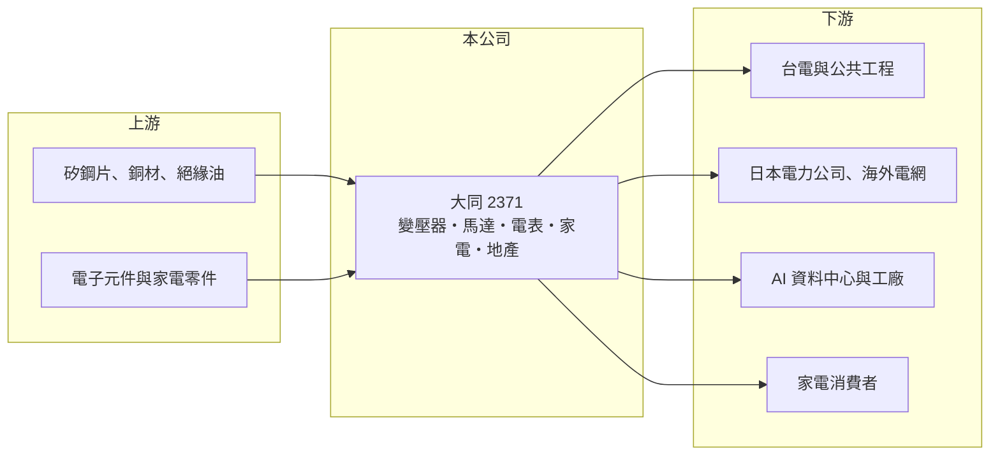

# 2371 大同

> 上市｜[[產業索引-電機機械|電機機械]]｜上市（櫃）日期 1962/02/09

# 第一章：企業模式與商業藍圖

> [!info] 撰寫說明
> 精簡版，由 Claude 依公開資料整理，架構比照 [[2330台積電]]，資料截至 2026-10-08。來源：證交所開放資料快照（基本資料、2026 年第二季資產負債與損益、營益分析、股利分派）、Goodinfo 經營績效頁、聯合新聞網 2026 年 5 月股東會報導。公司沿革部分憑記憶整理，已標「待校對」。#待校對

大同是台灣歷史最久的電機集團之一，從大同電鍋到變壓器、馬達、電表都有它的身影。理解它的關鍵在於：大同正從過去龐雜、轉投資拖累的集團，重新聚焦在[[重電]]本業，而全球電網升級帶來的變壓器缺貨，是它數十年來少見的結構性機會。

- **核心業務：** 大同的前身可追溯到 1918 年創立的協志商號，公司登記成立日為 1950 年，1962 年在證交所上市（創業年份待校對）。2026 年股東會揭示的三大核心事業為電力資訊、能源與科技家電、地產。電力資訊包含[[變壓器]]、配電盤、馬達與[[智慧電表]]，是集團的獲利主軸；家電則以大同電鍋等品牌產品為代表。
- **營收結構：** 2025 年合併營收 503.82 億元，年增 6.1%。各事業群營收比重未查得，但從經營層的表述可知重電已是重心。海外營收占比不到一成，公司目標是提高到雙位數。
- **營運據點：** 總部位於台北中山區，生產基地分布台灣各地與海外子公司（細節未查得）。2026 年公司成立資本額約 27 億元的全球控股公司，預計年底前完成海外子公司整併，以統一管理海外業務。
- **長期方向：** 2025 年中三立集團董事長張榮華接任大同董事長，2026 年 4 月新營運長上任，本業分為全球營運總部與台灣事業部。大同在日本是唯一打入當地十大電力公司的台灣外商，並計畫拓展儲能；2026 年 4 月與南亞塑膠簽署高效能節能變壓器合作備忘錄，也與美國 AI 資料中心電力設備業者合作。這些布局都指向「以變壓器出口吃下全球電網與 AI 用電需求」。

# 第二章：護城河深度與競爭優勢

大同的護城河在重電：百年品牌、台電標案資格、長期累積的變壓器製造經驗，以及少數取得日本電力公司認證的實績。

- **競爭優勢：** 變壓器屬於客製化、長交期的電力設備，電力公司採購前需要長時間認證，一旦合格就會長期合作。大同在台灣電網深耕數十年，加上日本電力公司的認證，形成新進者難以複製的信任門檻。依報導，全球變壓器交期已拉長至約兩年半，供不應求讓既有廠商的議價能力提高。
- **主要對手：** 國內重電同業包括 [[1519華城]]、[[1503士電]]、[[1513中興電]]、[[1514亞力]] 與 [[1504東元]]，國際上則有日立能源、西門子能源等大廠。華城、士電近年在美國與台電訂單上擴張快速，大同的海外布局相對起步較晚。
- **觀察重點：** 長期要看三件事：重電本業的營業利益率能否像同業一樣提升；集團是否持續處理非核心資產與轉投資；以及新經營團隊的海外接單成果。過去一年公司曾因公共標案資格限制而營運辛苦，子公司已重新取得政府標案。

# 第三章：財務體質與盈利規模

資料日期：2026-10-08，表格是撰寫當時的快照；最新月營收、毛利率、累計 EPS 由自動排程寫在本筆記的屬性欄位（月營收、毛利率、累計EPS 等）。#待校對

大同的財務特色是本業利潤率偏低、業外與一次性項目影響極大，因此 EPS 與 ROE 每年大起大落，很難直接用來判斷本業體質。

| 年度 | 營收（億元） | [[毛利率]] | [[營業利益率]] | EPS（元） | [[ROE]] |
|---|---|---|---|---|---|
| 2021 | 296 | 24.4% | 2.72% | 1.57 | 10.4% |
| 2022 | 345 | 21.1% | 0.86% | 4.02 | 15.9% |
| 2023 | 504 | 16.0% | 2.48% | 1.13 | 4.32% |
| 2024 | 475 | 15.4% | 24.8% | 6.46 | 20.1% |
| 2025 | 504 | 16.9% | 4.24% | −5.20 | −17.2% |

（來源：Goodinfo 經營績效頁，2024 年營業利益率明顯偏高，推估含處分資產等一次性收益，待校對。2026 年上半年依證交所資料，營收 245.0 億元、毛利率 16.93%、營業利益率 4.56%、EPS 0.91 元。）

- **營收規模：** 2016 至 2017 年營收約 750 億元以上，2019 年降到 354 億元，推估反映集團處分或分離部分事業（推估）。2020 至 2025 年由 316 億元回升到 504 億元，年複合成長率約 9.8%（推算），2023 年營收跳升推估與合併範圍變動有關（推估）。
- **獲利：** 2021 至 2025 年平均 ROE 約 6.7%（推算），但其中有兩年超過 15%、一年 −17%，大部分波動來自業外與一次性項目。依股利分派資料，2025 年下半年歸屬母公司淨損約 111 億元，造成年底待彌補虧損約 108 億元，詳細原因未查得（#待校對）。本業營業利益率長期只有 2% 至 5%，低於重電同業。
- **財務特色：** 依 2026 年第二季資料，總資產約 1,429 億元、負債約 867 億元、權益約 562 億元（歸屬母公司約 482 億元），負債比約 61%，每股淨值 23.57 元。由於帳上仍有待彌補虧損，2025 年下半年與 2026 年上半年都未配發股利；Goodinfo 統計的歷年平均現金股利僅約 0.23 元。大同持有大量土地資產，地產開發是集團價值的重要來源。
- **[[ROIC]] 與 [[WACC]]：** 以 2025 年營業利益約 21.4 億元（504 億元 × 4.24%）、稅率 20% 計算，稅後營業利益約 17.1 億元；有息負債未查得，投入資本以權益 562 億元到總資產 1,429 億元為區間，ROIC 約 1.2% 至 3.0%（推算）。WACC 以 CAPM 推估：無風險利率 1.75%、市場風險溢酬 6%、β 假設 1.0（大型電機股常見值），權益成本約 7.8%；稅後負債成本 2%、負債占五成，WACC 約 4.9%（推算）。本業 ROIC 長期低於 WACC，代表龐大的資產沒有產生相應報酬；重電景氣能否把營業利益率拉高，是大同能否開始創造價值的關鍵。

# 第四章：總體風險與地緣政治

大同的風險一半來自重電景氣，一半來自集團治理與資產負債表的歷史包袱。

- **產業週期：** 變壓器需求受電網投資、再生能源併網與 AI 資料中心用電帶動，目前處於擴張期。但電力設備也有週期，若全球同業大舉擴產，交期縮短後價格可能回落。銅、矽鋼片等原料價格上漲，也會壓縮固定價格合約的毛利。
- **營運風險：** 大同過去曾受轉投資虧損（例如中華映管）與經營權爭議影響，2018 至 2020 年連續虧損（待校對）。2025 年再度出現大額虧損，顯示資產負債表仍有未處理完的風險。新經營團隊的整併與轉型能否落地，需要時間驗證。
- **其他風險：** 公共標案資格曾受限，若再發生會直接影響台灣訂單。海外擴張面對日本、美國的法規與認證要求，以及匯率波動。家電事業面對國內外品牌的激烈競爭，獲利貢獻有限。

# 專有名詞解析

## 應用

- **[[智慧電表]]**：能雙向傳輸用電資料的電表，英文為 AMI，是電力公司推動需量管理與電網數位化的基礎。

## 產業

- **[[重電]]**：發電、輸電、配電所需的大型電力設備，包括變壓器、開關設備、配電盤與電纜。
- **[[變壓器]]**：改變交流電電壓的電力設備，是電網與大型用電場所不可或缺的核心設備，客製化程度高、交期長。

# 核心供應鏈

- 上游：變壓器用矽鋼片、銅線與絕緣材料供應商，例如 [[2002中鋼]]；家電零件與電子元件供應商。
- 下游／客戶：台電與公共工程、日本電力公司、AI 資料中心與工業用戶，以及家電消費者。合作夥伴包括 [[1303南亞]]（節能變壓器合作）。
- 同業：國內重電廠 [[1519華城]]、[[1503士電]]、[[1513中興電]]、[[1514亞力]]、[[1504東元]]。

## 最新新聞
<!-- news:start（自動產生，請勿手動編輯此範圍） -->
- 2026-10-15 🏛️ 重訊 11:36｜澄清媒體報導｜[觀測站](https://mops.twse.com.tw/mops/#/web/t05st01)
- 2026-10-14 📰 媒體 17:50｜〈智慧能源週〉大同電力設備及AIDC業務升溫 看好明年營收雙位數成長｜[鉅亨網](https://news.cnyes.com/news/id/6630277)
- 2026-10-12 📰 媒體 19:08｜大同受客戶交貨排程及部分訂單量影響 9月營收年減逾1成｜[鉅亨網](https://news.cnyes.com/news/id/6628371)

完整紀錄：[[2371大同 新聞]]
<!-- news:end -->

## 相關連結
- [公開資訊觀測站](https://mopsov.twse.com.tw/mops/web/t05st03?step=1&firstin=1&co_id=2371)
- [Goodinfo](https://goodinfo.tw/tw/StockDetail.asp?STOCK_ID=2371)
- [Yahoo 股市](https://tw.stock.yahoo.com/quote/2371)
- [鉅亨網新聞](https://www.cnyes.com/twstock/2371/news)
