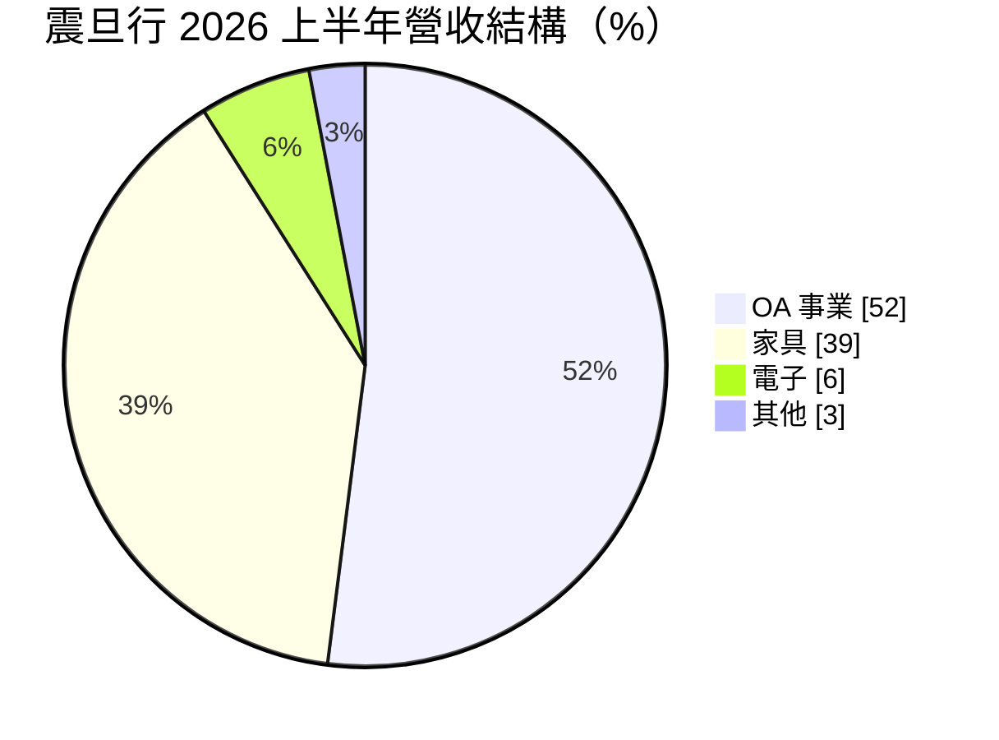
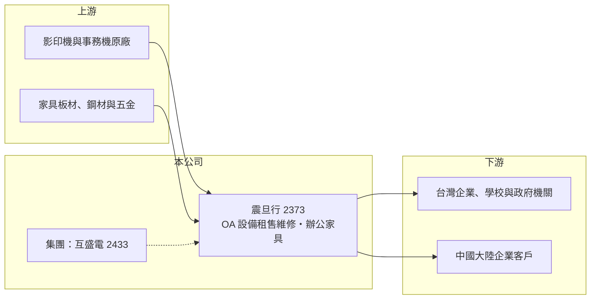

# 2373 震旦行

> 上市｜[[產業索引-其他電子業|其他電子業]]｜上市（櫃）日期 1991/08/01

# 第一章：企業模式與商業藍圖

> [!info] 撰寫說明
> 精簡版，由 Claude 依公開資料整理，架構比照 [[2330台積電]]，資料截至 2026-10-08。來源：證交所開放資料快照（基本資料、2026 年第二季資產負債與損益、股利）、Goodinfo 經營績效頁、震旦行 2026 年 8 月法說會簡報（營收結構）。代理品牌等細節未逐條核對。#待校對

震旦行是台灣歷史最久的辦公設備通路商之一，以辦公室自動化（OA）設備與辦公家具為兩大支柱，市場橫跨台灣與中國大陸。它的商業模式本質是「賣設備＋收服務費」：設備只賣一次，後續的租賃、維修與耗材合約則每月帶來收入。

- **核心業務：** 震旦行成立於 1963 年、1991 年上市，屬震旦集團。OA 事業銷售與租賃影印機、[[多功能事務機]]等設備並提供維修與耗材；家具事業提供辦公家具與辦公空間規劃；另有電子與 [[3D列印]]等新事業。同集團的 [[2433互盛電]] 也經營事務機業務。
- **營收結構：** 依 2026 年上半年法說會資料，OA 事業占 52%、家具 39%、電子 6%、其他 3%。依地區拆分，台灣 OA 31%、大陸 OA 23%、台灣家具 12%、大陸家具 27%，兩岸各約一半。

- **營運據點：** 在台灣與中國大陸都建有銷售與維修服務網，家具事業在中國的規模大於台灣。OA 維修需要技術人員定期到客戶端服務，據點密度本身就是競爭門檻。
- **長期方向：** 在列印量長期下滑的環境下，公司朝租賃、文件管理與整體辦公空間規劃發展，把一次性的設備銷售轉成長期合約，並培養 3D 列印等新事業（推估）。長期挑戰是營收自 2019 年以來緩步下滑，需要新業務接棒。

# 第二章：護城河深度與競爭優勢

震旦行的護城河來自綿密的服務網與長期合約，屬於成熟產業中的「窄護城河」。

- **競爭優勢：** 事務機以租賃加維修合約方式提供，合約期通常數年，帶來穩定的[[經常性收入]]，客戶換供應商需要重新議約、換機與教育訓練，轉換成本不低。毛利率長年維持在 44% 至 46%，遠高於一般貿易商，顯示服務與合約收入占有相當比重。家具則可與辦公室設計一併接案，提高單一客戶的貢獻。
- **主要對手：** OA 方面是富士軟片商業創新、理光、佳能、京瓷等品牌的直營與經銷體系；家具方面是台灣與中國眾多辦公家具業者，中國市場價格競爭尤其激烈。
- **觀察重點：** 營業利益率由 2020 年的 11.7% 降到 2025 年的 8.0%，是否止跌是長期觀察重點。另外要追蹤大陸家具與 OA 事業的營收變化，以及租賃合約數與新事業的貢獻。

# 第三章：財務體質與盈利規模

資料日期：2026-10-08，表格是撰寫當時的快照；最新月營收、毛利率、累計 EPS 由自動排程寫在本筆記的屬性欄位（月營收、毛利率、累計EPS 等）。#待校對

震旦行的財務是典型成熟型通路服務商：毛利率穩定、獲利溫和下滑、配息穩定。

| 年度 | 營收（億元） | [[毛利率]] | [[營業利益率]] | EPS（元） | [[ROE]] |
|---|---|---|---|---|---|
| 2019 | 136 | 44.8% | 10.1% | 6.12 | 17.6% |
| 2020 | 130 | 45.4% | 11.7% | 6.40 | 18.0% |
| 2021 | 136 | 44.5% | 10.8% | 6.19 | 17.1% |
| 2022 | 126 | 44.3% | 9.72% | 5.82 | 16.0% |
| 2023 | 115 | 46.2% | 8.94% | 4.86 | 13.4% |
| 2024 | 113 | 44.5% | 7.29% | 4.26 | 11.6% |
| 2025 | 107 | 45.4% | 8.04% | 3.87 | 10.6% |

（來源：Goodinfo 經營績效頁。2026 年上半年依證交所資料：營收 51.2 億元、毛利率 45.2%、營業利益率 5.2%、EPS 1.63 元。）

- **營收規模：** 2019 至 2025 年營收由 136 億元降到 107 億元，年複合成長率約 -3.9%（推算）。下滑主要反映辦公列印需求萎縮與中國市場轉弱（推估），但毛利率幾乎不變，代表公司在縮小規模的同時守住了定價。
- **獲利：** 近五年（2021 至 2025）平均 ROE 約 13.7%（推算），但呈逐年下降趨勢，由 17% 降到 10.6%。EPS 由 6 元以上降到 3.87 元，主因營收減少而人力與據點成本相對固定，營業槓桿反向作用。
- **財務特色：** 2026 年第二季總資產約 177.7 億元、負債 90.8 億元（非流動負債 19.4 億元）、權益總計 87.0 億元。租賃設備需要先投入資金購機，因此資產負債表比純貿易商重。2025 年度配發現金股利 3.7 元，以 EPS 3.87 元計算配息率約 96%（推算）；Goodinfo 統計的歷年平均現金股利約 2.09 元，屬高配息政策。自由現金流是否長期為正未查得。
- **[[ROIC]] 與 [[WACC]]：** 以 2025 年營業利益約 8.6 億元（107 億元 × 8.04%）、稅率 20% 計算，稅後營業利益約 6.9 億元。有息負債未查得，以權益總計 87.0 億元到權益加全部負債 177.7 億元為投入資本，ROIC 約 3.9% 至 7.9%（推算），實際值推估在 5% 至 6%。WACC 以 [[CAPM]] 推估：無風險利率 1.75%、市場風險溢酬 6%、β 假設 0.7（防禦型通路服務股常見值），權益成本約 5.95%；稅後負債成本假設 2%、負債占三成，WACC 約 4.8%（推算）。ROIC 仍略高於 WACC，但利差已比 2019 至 2021 年明顯收窄，若營收持續下滑，價值創造能力會進一步減弱。

# 第四章：總體風險與地緣政治

震旦行的風險在於本業需求的結構性萎縮，以及約一半營收來自中國大陸。

- **產業週期：** 企業的辦公設備與家具採購會在景氣差時延後，新辦公大樓完工與企業搬遷則帶動家具需求。長期來看，無紙化與雲端協作使列印量逐年下降，是比景氣循環更大的結構性壓力。
- **營運風險：** 大陸 OA 與家具合計約占營收一半，中國經濟、商辦空置率與當地價格競爭直接影響營收與獲利。若原廠調整代理條件或改為直營，通路商的角色也會受到擠壓。
- **其他風險：** 人民幣與日圓匯率影響進貨成本與換算後營收；兩岸政治關係變化可能影響在中國的經營。

# 專有名詞解析

## 金融

- **[[經常性收入]]**：租賃、維修合約或訂閱等每期穩定發生的收入，可預測性高於一次性銷售。
- **[[CAPM]]**：資本資產定價模型，以無風險利率加上 β 乘以市場風險溢酬估算股東要求報酬率。

## 產業

- **[[多功能事務機]]**：整合影印、列印、掃描與傳真的辦公設備，通常以租賃加維修合約方式提供給企業。
- **[[3D列印]]**：以逐層堆疊材料的方式成形零件，金屬 3D 列印可做出傳統加工難以完成的複雜結構。

# 核心供應鏈

- 上游：影印機與事務機原廠（具體代理品牌未逐一核對，#待校對）、家具板材、鋼材與五金供應商。
- 下游／客戶：台灣與中國大陸的企業、學校與政府機關。
- 同業：富士軟片商業創新、理光、佳能、京瓷等 OA 品牌通路；兩岸辦公家具業者；同集團 [[2433互盛電]]。

## 最新新聞
<!-- news:start -->
<!-- news:end -->

## 相關連結
- [公開資訊觀測站](https://mopsov.twse.com.tw/mops/web/t05st03?step=1&firstin=1&co_id=2373)
- [Goodinfo](https://goodinfo.tw/tw/StockDetail.asp?STOCK_ID=2373)
- [Yahoo 股市](https://tw.stock.yahoo.com/quote/2373)
- [鉅亨網新聞](https://www.cnyes.com/twstock/2373/news)
