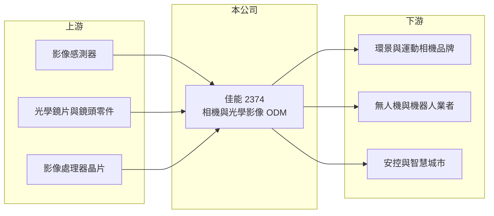

# 2374 佳能

> 上市｜[[產業索引-光電業|光電業]]｜上市（櫃）日期 1995/01/16

# 第一章：企業模式與商業藍圖

> [!info] 撰寫說明
> 精簡版，由 Claude 依公開資料整理，架構比照 [[2330台積電]]，資料截至 2026-10-08。來源：證交所開放資料快照（基本資料、2026 年第二季資產負債與損益、股利）、Goodinfo 經營績效頁、鉅亨號產業研究文章、優分析 2026 年 8 月財報報導。客戶名稱與生產據點公開資料有限。#待校對

佳能企業（英文 Ability Enterprise，與日本 Canon 無關）是台灣的相機與光學影像 [[ODM]] 廠。它的長期故事是一家傳統數位相機代工廠，在消費相機市場萎縮後，把光學設計能力轉往 360 度環景相機、運動攝影、無人機、機器人與安控等新應用。

- **核心業務：** 佳能成立於 1965 年、1995 年上市，董事長兼總經理為章孝祺。公司替品牌客戶設計並生產相機與影像產品，目前主力為 360 度環景攝影機、複合式相機與數位相機，並發展車用、安控與機器視覺模組。代工模式下公司負責光學、機構與影像系統設計，再以客戶品牌出貨。
- **營收結構：** 公司未公開產品別比重。依研究文章，公司設定「機器人視覺＋無人機」營收占比在 2026 年達 5% 至 10%、2027 年達 20% 的目標，代表目前仍以消費影像產品為主。無人機鏡頭模組已小量出貨，機器人方面與美國 Mantis Robotics、Agility Robotics 等合作開發視覺模組。
- **營運據點：** 總部在台灣，生產據點推估以中國大陸為主並布局其他地區（#待校對）。消費電子 ODM 通常需在亞洲大規模組裝，生產地點會隨客戶的關稅與供應鏈要求調整。
- **長期方向：** 公司目標是從鏡頭代工轉型為「智慧光學解決方案」供應商，結合多光軸光學校準、影像資料與[[邊緣運算]] AI 辨識，並轉投資佳捷智能切入[[智慧城市]]影像平台。管理層曾提出約三年內年營收達 100 億元的目標，2025 年已達 99.1 億元。

# 第二章：護城河深度與競爭優勢

佳能的護城河來自光學與影像系統整合的經驗，但代工模式讓它在客戶面前議價力有限。

- **競爭優勢：** 360 度環景與多鏡頭相機需要多顆鏡頭的精準校準與影像拼接，佳能累積數十年光學設計與量產經驗，能為不同用途（魚眼、廣角、近接感測）客製模組。這種能力可以在相機、無人機、機器人與車用之間移轉，是轉型的基礎。人形機器人每台需要多顆鏡頭，若打入量產，單台貢獻金額高於傳統相機。
- **主要對手：** 光學影像同業 [[3019亞光]]、[[3504揚明光]]、[[3059華晶科]]；安控影像則有晶睿等公司；中國大陸的影像模組廠在消費市場以低價競爭。
- **觀察重點：** 營收 2025 年大增 60%，但毛利率由 2024 年的 28.9% 降到 25.2%，2026 年上半年再降到 24.2%，代表成長部分來自毛利較低的產品或價格讓步（推估）。新應用占比能否達標、毛利率能否止跌，是判斷轉型品質的關鍵。

# 第三章：財務體質與盈利規模

資料日期：2026-10-08，表格是撰寫當時的快照；最新月營收、毛利率、累計 EPS 由自動排程寫在本筆記的屬性欄位（月營收、毛利率、累計EPS 等）。#待校對

佳能的財務是一條由虧轉盈的轉型曲線：2019 至 2020 年本業虧損，2023 年起營業利益率逐年改善，2025 年營收跳升。

| 年度 | 營收（億元） | [[毛利率]] | [[營業利益率]] | EPS（元） | [[ROE]] |
|---|---|---|---|---|---|
| 2019 | 65.9 | 13.3% | -6.45% | -1.41 | -5.31% |
| 2020 | 34.4 | 17.1% | -17.9% | -1.63 | -7.03% |
| 2021 | 35.8 | 24.5% | -9.27% | 2.42 | 11.5% |
| 2022 | 52.9 | 22.2% | -0.44% | 0.48 | 2.62% |
| 2023 | 49.3 | 26.5% | 2.48% | 0.96 | 3.63% |
| 2024 | 61.8 | 28.9% | 5.85% | 1.90 | 7.52% |
| 2025 | 99.1 | 25.2% | 8.88% | 2.44 | 9.61% |

（來源：Goodinfo 經營績效頁。2026 年上半年依證交所資料：營收 57.9 億元、毛利率 24.2%、營業利益率 9.8%、EPS 1.55 元。）

- **營收規模：** 2019 至 2025 年營收由 65.9 億元增至 99.1 億元，年複合成長率約 7.0%（推算），但中間 2020 年曾腰斬到 34.4 億元，波動極大，顯示對少數客戶與產品週期的依賴。
- **獲利：** 近五年（2021 至 2025）平均 ROE 約 7.0%（推算）。2021 年本業虧損 9.3% 但 EPS 2.42 元，應是[[業外收益]]（推估為處分資產或投資利益，#待校對）所致；真正的本業改善從 2023 年開始，營業利益率由 2.5% 升到 2025 年的 8.9%。
- **財務特色：** 2026 年第二季總資產約 148.4 億元、負債 56.2 億元（非流動負債僅 3.0 億元）、權益總計 92.2 億元，財務結構保守。2025 年度配發現金股利 2 元，以 EPS 2.44 元計算配息率約八成（推算）；Goodinfo 統計的歷年平均現金股利約 1.04 元，虧損年度曾停發。自由現金流是否長期為正未查得。
- **[[ROIC]] 與 [[WACC]]：** 以 2025 年營業利益約 8.8 億元（99.1 億元 × 8.88%）、稅率 20% 計算，稅後營業利益約 7.0 億元，以權益總計 92.2 億元到權益加全部負債 148.4 億元為投入資本，ROIC 約 4.7% 至 7.6%（推算）。WACC 以 [[CAPM]] 推估：無風險利率 1.75%、市場風險溢酬 6%、β 假設 1.1（消費電子 ODM 常見值），權益成本約 8.35%；負債以短期為主、占比約兩成、稅後成本 2%，WACC 約 7.1%（推算）。2025 年 ROIC 大致與 WACC 打平，過去多年則低於 WACC；佳能要成為長期創造價值的公司，需要讓營業利益率站穩 10% 以上。

# 第四章：總體風險與地緣政治

佳能的風險集中在代工模式的客戶集中、消費電子週期，以及新應用能否如期放量。

- **產業週期：** 環景與運動相機屬消費性電子，需求受景氣與產品生命週期影響，2020 年營收腰斬就是例子。無人機與機器人需求雖然成長快，但仍處早期，訂單量與時程不確定性高。
- **營運風險：** 代工廠的主要客戶集中度推估偏高，單一客戶換代或轉單會直接影響營收。毛利率在營收成長時反而下滑，若無法提高高附加價值產品比重，成長可能無法轉成獲利。
- **其他風險：** 生產據點與中國相關，美中關稅與供應鏈重組可能要求遷廠並增加成本；無人機與安控產品在美國面臨對中國供應鏈的限制，也可能成為非中國產能的機會。匯率影響代工毛利。

# 專有名詞解析

## 應用

- **[[邊緣運算]]**：在攝影機或終端裝置上直接處理資料，不必全部傳回雲端，可降低延遲與頻寬。
- **[[智慧城市]]**：以攝影機、感測器與資料平台管理交通、治安與公共設施的城市應用。

## 金融

- **[[業外收益]]**：本業以外的收入，例如投資收益、處分資產利益或匯兌利益。
- **[[CAPM]]**：資本資產定價模型，以無風險利率加上 β 乘以市場風險溢酬估算股東要求報酬率。

## 產業

- **[[ODM]]**：原廠委託設計製造，代工廠負責產品設計與生產，再貼上客戶品牌出貨。

# 核心供應鏈

- 上游：影像感測器（如 [[SONY索尼]]）、光學鏡片與鏡頭零件、影像處理器晶片。
- 下游／客戶：環景與運動相機品牌、無人機品牌、機器人業者（Mantis Robotics、Agility Robotics）、安控與智慧城市業者。
- 同業：[[3019亞光]]、[[3504揚明光]]、[[3059華晶科]]、晶睿。

## 最新新聞
<!-- news:start（自動產生，請勿手動編輯此範圍） -->
- 2026-10-16 🏛️ 重訊 16:37｜本公司收回已發行之限制員工權利新股註銷減資變更登記完成｜[觀測站](https://mops.twse.com.tw/mops/#/web/t05st01)

完整紀錄：[[2374佳能 新聞]]
<!-- news:end -->

## 相關連結
- [公開資訊觀測站](https://mopsov.twse.com.tw/mops/web/t05st03?step=1&firstin=1&co_id=2374)
- [Goodinfo](https://goodinfo.tw/tw/StockDetail.asp?STOCK_ID=2374)
- [Yahoo 股市](https://tw.stock.yahoo.com/quote/2374)
- [鉅亨網新聞](https://www.cnyes.com/twstock/2374/news)
