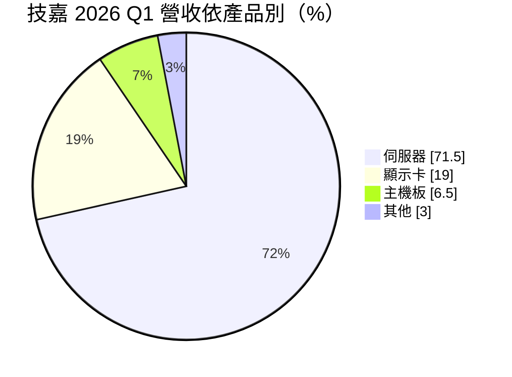
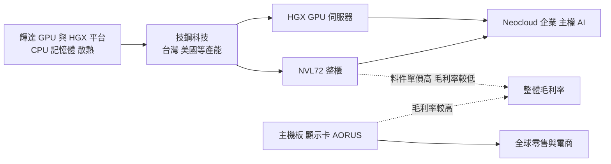
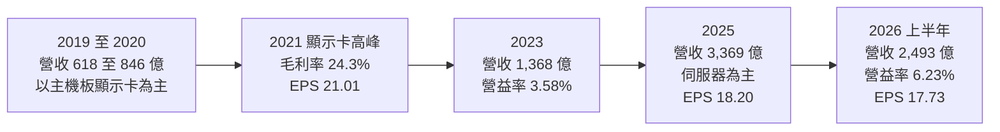
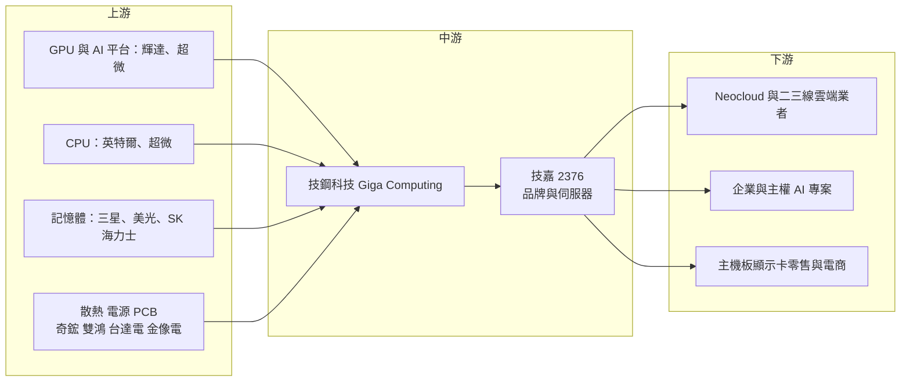

# 2376 技嘉

> 上市｜[[產業索引-電腦及週邊設備業|電腦及週邊設備業]]｜上市（櫃）日期 1998/09/24

# 第一章：企業模式與商業藍圖

> [!info] 撰寫說明
> 本文由 Claude 依公開資料整理，架構比照 [[2330台積電]] 的四章研究，資料截至 2026-10-08。財務數字來源：Goodinfo 經營績效、股利政策與現金流量頁（2019 至 2025 年度）、證交所開放資料快照（2026 年第二季資產負債與綜合損益、2025 年度股利、公司基本資料）、富果研究 2026 年 5 月 15 日法說會摘要、優分析與聯合新聞網財報報導；產業描述為整理性內容，尚未逐條比對原始文件。#待校對

在評估單一個股的長期投資價值時，首要步驟是拆解企業的底層獲利邏輯。本章針對技嘉科技（股票代號：2376，以下簡稱技嘉）的商業模式進行定性分析，說明這家以主機板起家的品牌廠，如何在短短幾年內把伺服器做成營收主力，以及它為什麼把目標放在新興雲端業者與企業客戶，而不是超大型雲端業者。

## 一、核心定位：從主機板品牌轉型為 AI 伺服器供應商

技嘉成立於 1986 年 4 月，總部在新北市新店，1998 年上市，董事長為葉培城（證交所公司基本資料）。技嘉以主機板起家，長期與 [[2357華碩]]、[[2377微星]] 並列台灣三大主機板與顯示卡品牌，旗下電競品牌 AORUS 在 [[DIY]] 玩家市場有一定知名度。

技嘉的轉型關鍵在伺服器。伺服器業務由子公司技鋼科技（Giga Computing）負責，提供從單機 GPU 伺服器、[[HGX]] 平台伺服器到 [[NVDA輝達]] GB 系列整櫃（[[NVL72]]）的方案。依富果研究整理的法說會資料，2026 年第一季伺服器已占營收 71.5%，其中 AI 伺服器占伺服器營收八成以上；而 2025 年伺服器占營收約 62%（舊版筆記引用的財報報導，待校對）。幾年之內，技嘉的身分已經從「主機板品牌」變成「AI 伺服器供應商」。

這個轉型有兩個長期意義：

* **鎖定非頂級雲端客戶：** 超大型雲端業者的伺服器訂單多由鴻海、廣達、緯創等 [[ODM]] 承接，技嘉的主要客戶是新興雲端服務商（[[Neocloud]]）、二三線雲端業者、企業與[[主權 AI]]專案。這些客戶規模較小、需要快速交機與一站式服務，正好適合技嘉這種有品牌、有設計能力、但沒有超大規模產能的廠商。
* **雙引擎結構：** 伺服器提供規模與成長，主機板、顯示卡等消費性產品提供較高毛利的穩定現金流。兩者的景氣循環不同，理論上可以互相平衡，但也代表技嘉同時暴露在 AI 資本支出與 PC 消費兩種週期之下。

## 二、產品板塊：伺服器已占七成

依富果研究整理的 2026 年第一季法說會資料，營收結構如下：

* **伺服器：** 以輝達 HGX 平台 GPU 伺服器與 GB300 NVL72 整櫃為主，並推出 GIGAPOD 叢集方案、管理軟體與 AI 工廠設計平台，試圖從賣硬體走向提供完整的 AI 基礎設施。客戶包括 Neocloud、企業、主權 AI 專案與部分雲端業者。
* **顯示卡：** 搭配輝達與 [[AMD超微]] 新世代 GPU，需求隨遊戲與個人 AI 應用起伏，也受 GPU 供貨與記憶體價格影響。
* **主機板：** 以 DIY 與[[電競]]市場為主，毛利率高於伺服器，但市場成熟、成長有限。2026 年第一季主機板只占營收 6.5%，比重的下降主要來自伺服器營收大增，而非主機板本身萎縮。
* **其他：** 電競筆電、顯示器與周邊產品。

## 三、資本轉化邏輯：產品組合決定毛利率

* **產品組合與毛利率：** 伺服器的料件中，GPU 占了絕大部分成本，技嘉能加值的空間有限，因此 AI 伺服器營收越大，整體毛利率越低。技嘉的毛利率從 2021 年的 24.3% 降到 2025 年的 10.4%（Goodinfo），主要就是伺服器占比提高的結果，並不代表各產品線的競爭力變差。
* **費用槓桿：** 毛利率下降的同時，營業費用率也大幅下降。依富果研究整理，技嘉的營業費用率從 2023 年的 8.54% 降到 2026 年第一季的 4.95%，讓營業利益率能維持在 5% 至 7%。這是「用低毛利換大規模」的典型模式。
* **營運資金密集：** AI 伺服器的料件昂貴，出貨前必須先備料。2026 年第一季底存貨約 1,316 億元、年增約 125%（富果研究），代表技嘉需要大量營運資金支撐成長。這是技嘉從輕資產品牌廠轉為資金密集型伺服器廠的最大改變。
* **產能布局：** 伺服器產能分布在台灣與美國，並與供應鏈夥伴在印度、馬來西亞、巴西擴充。依富果研究整理，美國廠預計 2026 年第二季底具備完整伺服器交付能力，台灣土城新廠預計 2026 年第三季完工，公司預期新據點全部到位後伺服器總產能約為 2025 年的兩倍。

## 四、企業長期藍圖：用彈性服務爭取第二梯隊雲端客戶

技嘉的長期策略可以概括為「做大型 ODM 不想做、品牌大廠做不快的生意」。具體方向包括：

* **跟上輝達平台世代：** 從 GB300 到下一代 Vera Rubin 平台，技嘉需要在每個世代快速推出產品。能否在新平台推出初期就交機，決定 Neocloud 客戶是否繼續下單。
* **從硬體走向 AI 基礎設施：** 透過 GIGAPOD、管理軟體與 AI 工廠設計平台，技嘉希望從賣單台伺服器，轉為協助客戶規劃整個 AI 資料中心，提高客戶黏著度與單一專案的價值。
* **在地交付：** 美國廠與海外產能讓技嘉能因應關稅與在地製造要求，也能提供客戶更快的交貨與服務。
* **消費性業務的穩定角色：** 主機板與顯示卡雖然占比下降，但仍是品牌與現金流的基礎，也讓技嘉在 AI 伺服器景氣反轉時有退路。

# 第二章：護城河深度與競爭優勢

在長期價值投資中，「護城河」指企業抵禦競爭、維持超額利潤的保護機制。本章分析技嘉的護城河構成、品牌伺服器與 ODM 兩群競爭對手，以及它在 Neocloud 與企業市場的優勢能守住多少。

## 一、護城河的核心組成要素

技嘉的護城河屬於「窄護城河」。主要由以下要素構成：

* **1. 快速交機與多樣機型：** 技嘉在 GPU 伺服器領域累積多年經驗，能在輝達新平台推出時快速提供多種機型。對需要快速上線算力的 Neocloud 客戶而言，早一季交機就代表早一季開始收租金，交期本身就是價值。
* **2. 主機板設計底子：** 伺服器主機板、散熱與電源設計能力，來自三十多年的主機板研發經驗。這讓技嘉能比一般品牌商更深入參與硬體設計，而不只是組裝。
* **3. 消費性品牌與通路：** 主機板與顯示卡在全球零售通路有品牌知名度，提供較高毛利的現金流，平衡伺服器業務的低毛利，也讓技嘉在全球有現成的銷售與服務網絡。

不過，技嘉的護城河有明顯的限制。它缺乏與超大型雲端業者的深度綁定，也缺乏大型 ODM 的規模經濟；主要客戶 Neocloud 本身多仰賴融資擴張，財務體質較不穩定。這些因素讓技嘉的優勢較依賴執行速度，而非難以複製的結構性門檻。

## 二、全球主要競爭對手格局

| 對手 | 定位 | 對技嘉的威脅 |
|---|---|---|
| 美超微（Supermicro） | 美國品牌伺服器廠，同樣以 Neocloud 與企業為主 | 最直接的對手，液冷與整櫃經驗豐富、在美國有大規模產能 |
| Dell、HPE | 美國品牌伺服器廠 | 在企業 AI 伺服器市場份額大，服務網絡完整 |
| [[2357華碩]] | 台灣品牌伺服器與主機板廠 | 在伺服器、主機板、顯示卡全面重疊 |
| [[2317鴻海]]、[[2382廣達]]、[[3231緯創]]、[[6669緯穎]] | 伺服器 ODM | 主攻超大型雲端業者，大型 Neocloud 規模擴大後也可能轉向 ODM |
| [[2377微星]]、華擎 | 主機板與顯示卡品牌 | 在 DIY 與電競市場競爭 |

技嘉同時在兩個戰場作戰：伺服器市場面對美超微、Dell 等品牌商與鴻海、廣達等 ODM；消費性市場面對華碩、微星。在伺服器市場，它的定位介於品牌商與 ODM 之間：比 ODM 更有彈性與服務，比美系品牌商更有成本與速度優勢。

## 三、優勢轉化：哪些守得住、哪些守不住

* **守得住：** 中小型 Neocloud、企業與主權 AI 專案。這些客戶重視交期、彈性與一站式服務，下單規模不足以讓大型 ODM 投入專屬資源，技嘉的定位在這個市場具競爭力。
* **守不住：** 大規模整櫃的生產與[[液冷]]整合，ODM 與美超微的經驗與產能更大；大型 Neocloud 若擴大到一定規模，可能直接向 ODM 下單。消費性市場則是成熟市場，主機板與顯示卡的品牌競爭激烈，很難取得明顯超越對手的利潤。
* **觀察重點：** 第一，美國廠與新產能的出貨與獲利表現；第二，整櫃與單機伺服器的比重變化對毛利率的影響；第三，Neocloud 客戶的財務狀況與付款能力，這直接影響技嘉的應收帳款與存貨風險。

# 第三章：財務體質與盈利規模

資料日期：2026-10-08。年度數字取自 Goodinfo 經營績效、股利政策與現金流量頁，2026 年上半年與資產負債取自證交所開放資料快照，表格是撰寫當時的快照；最新月營收、毛利率、累計 EPS 由自動排程寫在本筆記的屬性欄位（月營收、毛利率、累計EPS 等）。#待校對

財務報表是檢驗護城河是否真實存在的最終標準。本章用多年度的三率、ROE、現金流與資本報酬，檢視技嘉從品牌廠轉型為 AI 伺服器供應商的過程，特別是「毛利率下降、規模擴大」對資本效率的影響。

## 一、獲利能力的基石：三率

| 年度 | 營收（億元） | [[毛利率]] | [[營業利益率]] | EPS（元） | [[ROE]] |
|---|---|---|---|---|---|
| 2019 | 618 | 15.5% | 2.34% | 3.05 | 7.86% |
| 2020 | 846 | 17.1% | 4.99% | 6.88 | 16.7% |
| 2021 | 1,219 | 24.3% | 11.9% | 21.01 | 41.1% |
| 2022 | 1,073 | 15.5% | 5.45% | 10.29 | 17.8% |
| 2023 | 1,368 | 12.1% | 3.58% | 7.46 | 12.9% |
| 2024 | 2,651 | 10.6% | 4.82% | 15.03 | 23.1% |
| 2025 | 3,369 | 10.4% | 4.98% | 18.20 | 22.8% |
| 2026 上半年 | 2,493 | 10.6% | 6.23% | 17.73 | 未查得（年化約 36%，推算） |

* **營收成長：** 2020 至 2025 年營收從 846 億元增加到 3,369 億元，年複合成長率約 31.8%（推算），其中 2024 年營收幾乎翻倍，是 AI 伺服器開始大量出貨的一年。2026 年上半年營收已達 2,493 億元。
* **[[毛利率]]：** 2021 年因顯示卡需求暴增，毛利率達 24.3% 的高點，之後隨伺服器占比提高，降到 2024 至 2025 年的 10% 左右。毛利率下降是產品組合改變的結果，評估技嘉時應以營業利益的金額與營業利益率為主。
* **[[營業利益率]]：** 除了 2021 年的特殊高峰，技嘉的營業利益率多在 3.5% 至 6% 之間。2026 年上半年提升到 6.23%，反映營收規模擴大後的費用攤薄效果。營業利益金額則從 2023 年約 49 億元增加到 2025 年約 168 億元（推算）。
* **2021 年的啟示：** 2021 年的 EPS 21.01 元來自加密貨幣挖礦與疫情帶動的顯示卡需求，2022 年需求消失後 EPS 腰斬。這說明消費性業務同樣有劇烈週期，投資人不應把任何一年的高峰視為常態。

## 二、[[ROE]]：資本效率

技嘉 2021 至 2025 年平均 ROE 約 23.5%（推算），2024 與 2025 年都在 23% 上下。在毛利率只有一成的情況下仍能維持兩成以上的 ROE，靠的是高資產周轉率與一定程度的財務槓桿：2026 年第二季底技嘉資產總計約 2,713 億元，負債總計約 2,020 億元，權益總計約 693 億元（證交所開放資料），負債比約七成四。高負債主要來自 AI 伺服器的應付帳款與營運資金借款，這讓 ROE 在景氣好時放大，景氣反轉時也會放大虧損。

股利方面，2019 至 2025 年度每股現金股利分別為 2.2、5.0、12.0、6.2、6.36、10.0、12.0 元。以當年 EPS 計算，配息率大多落在 57% 至 73% 之間，2023 年度約 85%（推算）。技嘉的股利屬於「高配息比例、金額隨獲利浮動」的類型。

## 三、資本支出與自由現金流

| 年度 | 營業現金流（億元） | 投資現金流（億元） | 自由現金流（億元） |
|---|---|---|---|
| 2019 | 38.9 | -2.85 | 36.0 |
| 2020 | 79.0 | -10.8 | 68.2 |
| 2021 | 83.5 | -12.0 | 71.5 |
| 2022 | 58.2 | -9.15 | 49.0 |
| 2023 | 22.6 | -6.75 | 15.9 |
| 2024 | -162 | -30.8 | -193 |
| 2025 | 50.9 | -13.3 | 37.6 |

（自由現金流依 Goodinfo 定義為營業現金流加投資現金流。）

* **[[自由現金流]]：** 2019 至 2023 年每年都為正，2024 年因 AI 伺服器大量備料，營業現金流轉為 -162 億元，自由現金流 -193 億元。2025 年回到正數。這說明技嘉的現金流已經和伺服器的備料與收款節奏綁在一起，快速成長的年份可能出現大額負現金流。
* **[[CapEx]]：** 技嘉的資本支出相對營收規模很低，2019 至 2025 年投資現金流每年只有 3 億至 31 億元。依富果研究，2026 年資本支出預估約 25 億至 27 億元，主要用於辦公大樓與產能設備；舊版筆記引用的報導則提到上修至 28 億至 30 億元（待校對）。真正的資金需求不在資本支出，而在[[營運資金]]。

## 四、[[ROIC]] 與 [[WACC]]：價值創造利差

**ROIC（推算）：** 以「稅後營業利益 ÷（股東權益＋有息負債）」推算。2025 年營業利益約 3,369 億元 × 4.98% ≈ 168 億元，以稅率 20% 計算稅後營業利益約 134 億元。有息負債明細未查得，以 2026 年第二季非流動負債約 262 億元作為近似值，加上權益總計約 693 億元，投入資本約 955 億元，ROIC 約 14%（推算）。以 2026 年上半年營業利益約 155 億元年化計算，稅後營業利益約 249 億元，ROIC 約 26%（推算）。需要注意的是，技嘉的短期借款可能列在流動負債中而未納入上述計算，若計入，ROIC 會較低。

**WACC（推算）：** 以 CAPM 推估股東權益成本：無風險利率取台灣 10 年期公債約 1.75%，市場風險溢酬 6%，β 假設 1.2（AI 伺服器股波動較大的常見值，非來源數字），權益成本約 9.0%。負債成本假設稅前 2.5%、稅率 20%，稅後 2.0%。以帳面資本結構（權益約 73%、負債約 27%）計算，WACC 約 7.1%；以市值計算（股價淨值比約 3.8 倍，權益權重約九成一），WACC 約 8.4%（推算）。

**結論：** 技嘉在 2024 至 2026 年的 ROIC 推算約 14% 至 26%，高於 WACC，是創造價值的狀態；但在 2019、2023 年這類營業利益率只有 2% 至 4% 的年份，推估 ROIC 與 WACC 相當接近。技嘉的價值創造高度依賴兩件事：營業利益率能否維持在 5% 以上，以及存貨與應收帳款能否控制住。若 Neocloud 客戶付款延遲、存貨堆積，投入資本會快速膨脹，利差就會被壓縮，這比毛利率更值得追蹤。

# 第四章：總體風險與地緣政治

任何企業都無法脫離宏觀環境獨立存在。本章分析技嘉未來必須面對的地緣政治、AI 資本支出週期、客戶財務與技術風險。

## 一、地緣政治風險

* **美國關稅與在地生產：** AI 伺服器主要出貨到美國，美國的關稅政策直接影響成本與客戶的下單節奏。技嘉以美國廠因應，但美國的人力與營運成本較高，會壓縮利潤率。
* **出口管制：** 美國對高階 GPU 的出口限制，影響對中國及部分地區的 AI 伺服器與顯示卡銷售，也限制了主權 AI 專案的可服務市場。
* **生產據點分散：** 主機板與顯示卡的部分產能位於中國，面臨美中貿易摩擦的影響；技嘉正透過台灣、美國與東南亞等地分散生產。

## 二、產業週期與市場結構風險

* **Neocloud 的財務風險：** 技嘉的 AI 伺服器客戶以 Neocloud 與二三線雲端業者為主，這些客戶多仰賴融資擴張。若資金環境轉差或 GPU 算力租金下滑，可能延後或取消訂單，甚至出現付款問題。
* **AI 資本支出週期：** 伺服器占營收七成以上，AI 資本支出一旦放緩，技嘉的營收與獲利波動會很大。[[長鞭效應]]會放大組裝與品牌廠的訂單變化。
* **消費性需求週期：** 主機板與顯示卡受 PC 換機、遊戲與挖礦需求影響。2021 至 2022 年的顯示卡循環已經證明，這類需求可能在一年內急遽反轉。

## 三、營運環境的隱性風險

* **營運資金與存貨：** 伺服器料件單價高，2024 年營業現金流 -162 億元就是備料壓力的例證。客戶付款延遲或訂單取消時，存貨跌價與資金壓力會同時出現。
* **產品組合與毛利率：** 整櫃比重升高會壓低毛利率，季度之間的獲利波動大。
* **零組件供應：** GPU、記憶體與 CPU 若短缺或漲價，可能延誤出貨，也會影響消費性產品的需求。
* **匯率：** 營收以美元計價為主，匯率波動會影響損益。

## 四、科技演進風險

AI 機櫃的液冷、電源與高速互連設計門檻快速上升，技嘉需要持續投入研發，才能跟上輝達平台的世代交替。若在新平台的設計與量產進度落後，可能失去 Neocloud 客戶的優先供應地位。另一方面，若 AI 運算逐漸轉向雲端業者自研的 ASIC 晶片，這類專案多由大型 ODM 承接，技嘉以輝達平台為主的產品結構可能面臨市場縮小的風險。

# 專有名詞解析

## 應用

- **[[Neocloud]]**：新興雲端服務商，以出租 GPU 算力為主要業務，多仰賴融資快速擴張。
- **[[主權 AI]]**：各國政府為確保資料與運算自主而自建的 AI 算力與模型。

## 金融

- **[[營運資金]]**：流動資產減流動負債，主要是存貨與應收帳款，AI 伺服器料件昂貴使需求大增。
- **[[ROE]]**：股東權益報酬率，稅後淨利除以股東權益，衡量公司運用股東資本賺錢的效率。
- **[[ROIC]]**：投入資本報酬率，稅後營業利益除以股東權益加有息負債，衡量公司投入營運的全部資本能賺多少。
- **[[WACC]]**：加權平均資金成本，股東與債權人要求報酬率的加權平均，是 ROIC 的比較基準。
- **[[自由現金流]]**：營業活動現金流減去資本支出，代表企業可自由用於配息、還債或併購的現金。
- **[[長鞭效應]]**：終端需求的小幅變動，沿供應鏈往上游傳遞時被逐級放大，造成上游庫存與訂單劇烈波動。

## 產業

- **[[NVL72]]**：輝達 GB 系列整櫃方案，一座機櫃內以高速互連串接 72 顆 GPU，當作一台大型運算機使用。
- **[[HGX]]**：輝達提供給伺服器廠的 GPU 基板平台，一片基板通常搭載 8 顆 GPU。
- **[[ODM]]**：原廠委託設計製造，代工廠除了生產也負責產品設計，品牌商或雲端業者只提出規格。
- **[[DIY]]**：玩家自行選購主機板、顯示卡等零組件組裝電腦的市場。
- **[[電競]]**：電子競技與高效能遊戲市場，玩家願意為高規格硬體支付較高價格。
- **[[液冷]]**：以液體帶走晶片熱量的散熱方式，高功率 AI 機櫃已從氣冷轉向液冷。

# 核心供應鏈

## 1. 上游：晶片與零組件
- GPU 與 AI 平台：[[NVDA輝達]]、[[AMD超微]]
- CPU：[[INTC英特爾]]、[[AMD超微]]
- 記憶體：[[005930三星電子]]、美光、SK 海力士
- 散熱：[[3017奇鋐]]、[[3324雙鴻]]
- 電源：[[2308台達電]]、[[2301光寶科]]
- PCB：[[2368金像電]]

## 2. 中游：技嘉集團
- 伺服器子公司：技鋼科技（Giga Computing）

## 3. 下游：主要客戶
- Neocloud 與二三線雲端業者、企業與主權 AI 專案
- 主機板與顯示卡：全球零售與電商通路

## 4. 同業
- 品牌伺服器：美超微、Dell、HPE、[[2357華碩]]
- ODM：[[2317鴻海]]、[[2382廣達]]、[[3231緯創]]、[[6669緯穎]]
- 主機板與顯示卡：[[2357華碩]]、[[2377微星]]

## 最新新聞
<!-- news:start（自動產生，請勿手動編輯此範圍） -->
- 2026-10-22 📰 媒體 12:10｜鉅亨速報 - Factset 最新調查：技嘉(2376-TW)EPS預估上修至36.17元，預估目標價為500元｜[鉅亨網](https://news.cnyes.com/news/id/6635684)
- 2026-10-16 📰 媒體 16:11｜鉅亨速報 - Factset 最新調查：技嘉(2376-TW)EPS預估上修至35.54元，預估目標價為500元｜[鉅亨網](https://news.cnyes.com/news/id/6632079)
- 2026-10-07 📰 媒體 12:30｜技嘉(2376)9月營收衝631億元！超越市場預期8.2%，AI伺服器放量後獲利能跟上？｜[鉅亨網](https://news.cnyes.com/news/id/6623562)
- 2026-10-06 📰 媒體 18:50｜營收速報 - 技嘉(2376)9月營收630.99億元年增率高達125.45％｜[鉅亨網](https://news.cnyes.com/news/id/6622876)

完整紀錄：[[2376技嘉 新聞]]
<!-- news:end -->

## 相關連結
- [公開資訊觀測站](https://mopsov.twse.com.tw/mops/web/t05st03?step=1&firstin=1&co_id=2376)
- [Goodinfo](https://goodinfo.tw/tw/StockDetail.asp?STOCK_ID=2376)
- [Yahoo 股市](https://tw.stock.yahoo.com/quote/2376)
- [鉅亨網新聞](https://www.cnyes.com/twstock/2376/news)
