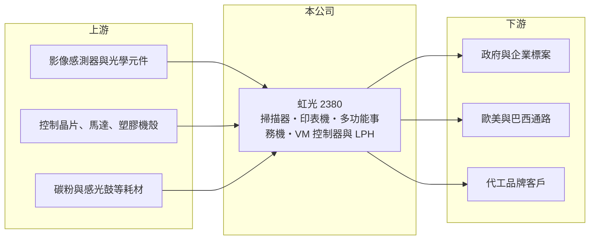

# 2380 虹光

> 上市｜[[產業索引-電腦及週邊設備業|電腦及週邊設備業]]｜上市（櫃）日期 1998/12/03

# 第一章：企業模式與商業藍圖

> [!info] 撰寫說明
> 精簡版，由 Claude 依公開資料整理，架構比照 [[2330台積電]]，資料截至 2026-10-08。來源：證交所開放資料快照（基本資料、2026 年第二季資產負債與損益、股利）、Goodinfo 經營績效頁、富果研究整理之 2025 年 12 月法說會備忘錄。#待校對

虹光精密（以下簡稱虹光）是台灣老牌的掃描器廠，理解它的關鍵在於：掃描器是一個成熟甚至萎縮的市場，虹光多年來試圖轉進印表機與多功能事務機，這段轉型拖了將近二十年並累積大量虧損，直到 2025 年才轉虧為盈，並在 2026 年以減資彌補虧損。

- **核心業務：** 虹光成立於 1991 年，總部位於新竹科學園區，1998 年在證交所上市。依 2025 年 12 月法說會資料，產品包括家用、中型與企業級的掃描器，以及政府標案與圖書館、律師事務所等專業用途，累計生產超過 2,200 萬台掃描器。自 2005 年起投入印表機與[[多功能事務機]]開發，產品涵蓋 A4 每分鐘 30 頁到 A3 每分鐘 50 頁的機種。
- **營收結構：** 各產品的營收比重與品牌、代工比例法說會未提供。虹光同時以自有品牌 Avision 銷售，並替其他品牌代工掃描器（#待校對）。掃描器技術成熟、市場規模有限，事務機則是由日系品牌主導的大市場，虹光的成長空間主要在事務機。
- **營運據點：** 總部與研發在新竹，生產以中國蘇州的兩個主要基地為主，海外子公司設於德國、美國與巴西。製造集中在中國、銷售分布在歐美與拉美，是典型的台商電子周邊配置。
- **長期方向：** 依法說會資料，虹光的長期方向是深化自有的事務機控制器（VM 系列）與 [[LED 列印頭]]（LPH）技術，並往彩色與高階商用機種發展。2024 年推出 A3 每分鐘 40 頁的多功能事務機與 A4 彩色印表機，2025 年規劃推出 A4 彩色多功能機與 A3 每分鐘 50 頁機種。掌握控制器與列印頭等關鍵零件，是從組裝廠走向有核心技術的事務機廠的關鍵。

# 第二章：護城河深度與競爭優勢

虹光的護城河集中在掃描器的技術累積與事務機的自主關鍵零件，但面對的事務機市場由日系巨頭把持。

- **競爭優勢：** 虹光在掃描器領域有三十多年的光學、影像處理與進紙機構經驗，產品線從家用到企業級完整，能承接政府標案與專業領域的客製需求。在事務機方面，自行開發控制器與 LED 列印頭，代表它不完全依賴日系大廠的關鍵零件，這是少數非日系事務機廠才有的能力。不過這些優勢尚未轉化為穩定的高獲利。
- **主要對手：** 掃描器市場的對手包括富士通（PFU）、佳能、愛普生、兄弟等日系品牌。事務機市場則由佳能、理光、京瓷、柯尼卡美能達、夏普、兄弟、HP 等大廠主導，規模都是虹光的數十倍以上。台灣同業中，[[2352佳世達]] 也有掃描器相關業務（#待校對），[[1336台翰]] 則是事務機機殼供應商。
- **觀察重點：** 長期最該追蹤的是毛利率能否維持在三成左右、營業利益能否穩定為正。2025 年毛利率由前一年的 12.6% 跳升到 30.5%，營業利益率由 -15% 轉為 2.2%，依法說會說明，改善來自高毛利產品比重提升、訂單組合調整與匯兌利益。2026 年上半年毛利率 29.0%、營業利益率 2.5%，延續但未擴大改善幅度。

# 第三章：財務體質與盈利規模

資料日期：2026-10-08，表格是撰寫當時的快照；最新月營收、毛利率、累計 EPS 由自動排程寫在本筆記的屬性欄位（月營收、毛利率、累計EPS 等）。#待校對

虹光的財務是長期虧損後剛轉盈的狀態：2020 至 2024 年連續五年虧損，股東權益大幅縮水，2025 年才首度轉為獲利。

| 年度 | 營收（億元） | [[毛利率]] | [[營業利益率]] | EPS（元） | [[ROE]] |
|---|---|---|---|---|---|
| 2020 | 18.4 | 17.8% | -19.8% | -2.36 | -32.2% |
| 2021 | 28.3 | 21.3% | -4.48% | -0.69 | -12.0% |
| 2022 | 28.3 | 26.1% | -2.08% | -0.17 | -3.34% |
| 2023 | 19.7 | 19.8% | -21.5% | -1.88 | -41.3% |
| 2024 | 25.5 | 12.6% | -15.0% | -1.94 | -72.4% |
| 2025 | 28.9 | 30.5% | 2.18% | 0.72 | 9.18% |

（來源：Goodinfo 經營績效頁；2025 年以前的 EPS 為 2026 年減資前的股數基礎，#待校對。2026 年上半年依證交所資料：營收 15.0 億元、毛利率 29.0%、營業利益率 2.5%、稅前淨利率 -1.2%，因所得稅利益而稅後轉正，EPS 0.43 元。）

- **營收規模：** 2020 至 2025 年營收由 18.4 億元增至 28.9 億元，年複合成長率約 9.5%（推算），但中間起伏很大，2023 年曾降到 19.7 億元。營收成長主要來自事務機與企業級產品，掃描器本身屬於成熟市場。
- **獲利：** 近五年（2021 至 2025）平均 ROE 約 -24%（推算），長期資本報酬非常差。2024 年 ROE -72.4% 的極端數字，反映的是連年虧損後股東權益已經很小，少量虧損就會換算成很高的負報酬。2025 年轉盈的原因依法說會包括產品組合改善與匯兌利益，其中匯兌利益不具持續性；2026 年上半年稅前仍小幅虧損，代表轉盈的基礎仍不穩固。
- **財務特色：** 依 2026 年第二季資料，總資產約 25.2 億元、股東權益約 5.9 億元、負債約 19.3 億元，負債比約 77%，其中流動負債約 16.8 億元，財務槓桿很高。公司在 2026 年第一季完成減資，實收資本額降為 6 億元、流通股數 6,000 萬股；2025 年底的[[累積虧損]]約 16.9 億元，減資後保留盈餘降為約 -0.9 億元，顯示這次是[[減資彌補虧損]]。在虧損彌補完畢前無法配發股利，2025 年下半年與 2026 年上半年都未分派。
- **[[ROIC]] 與 [[WACC]]：** 以 2025 年營業利益約 0.63 億元（28.9 億元 × 2.18%）、稅率 20% 計算，稅後營業利益約 0.50 億元。有息負債未查得，投入資本以股東權益 5.9 億元到「權益加全部負債」25.2 億元為區間，ROIC 約 2.0% 至 8.5%（推算）。2020 至 2024 年營業利益為負，ROIC 為負值。WACC 以 [[CAPM]] 推估：無風險利率 1.75%、市場風險溢酬 6%、β 假設 1.0（中小型電腦周邊股常見值），權益成本約 7.75%；稅後負債成本假設 2%、負債占五成，WACC 約 4.9%（推算）。目前 ROIC 仍低於 WACC，過去多年的連續虧損已大幅侵蝕股東權益，2025 年的轉盈只是讓公司回到損益兩平附近，尚未開始創造經濟價值。

# 第四章：總體風險與地緣政治

虹光的風險來自成熟市場的萎縮、與日系巨頭的競爭，以及高槓桿的財務結構。

- **產業週期：** 掃描器與事務機需求受辦公室無紙化、遠距工作與企業 IT 預算影響，長期趨勢平緩甚至下滑。政府與企業標案的時間點不固定，會讓營收在不同年度間大幅波動，2023 年營收驟降即是一例。
- **營運風險：** 事務機市場由少數日系與美系巨頭主導，它們擁有完整的耗材、維修與經銷體系，虹光要在規模、品牌與服務網上競爭非常困難。毛利率在 2024 至 2025 年間由 12.6% 跳到 30.5%，波動極大，顯示獲利高度依賴產品組合與單一訂單；若高毛利訂單減少，可能很快回到虧損。負債比高、股東權益薄，一旦再度虧損，財務壓力會迅速浮現。
- **其他風險：** 生產集中在中國蘇州，面臨美國關稅與供應鏈轉移壓力。營收以美元、歐元計價，2025 年轉盈有一部分來自匯兌利益，匯率反轉時獲利會被侵蝕。巴西等新興市場子公司的匯率與政治風險也較高。

# 專有名詞解析

## 應用

- **[[多功能事務機]]**：整合列印、影印、掃描與傳真功能的辦公設備，英文為 MFP，主要品牌集中在日本廠商。

## 金融

- **[[累積虧損]]**：歷年虧損累積後尚未彌補的金額，依公司法須先彌補完畢才能分配盈餘。
- **[[減資彌補虧損]]**：公司註銷部分股本，用股本金額抵銷帳上累積虧損，股東持股數減少但每股淨值不變，之後才有機會恢復配息。
- **[[CAPM]]**：資本資產定價模型，以無風險利率加上 β 乘以市場風險溢酬估算股東要求報酬率。

## 產業

- **[[LED 列印頭]]**：以 LED 陣列取代雷射掃描在感光鼓上成像的元件，結構較簡單、體積小，是事務機的關鍵零件之一。

# 核心供應鏈

- 上游：影像感測器與光學元件、控制晶片、馬達、塑膠機殼（例如 [[1336台翰]] 這類事務機機殼廠，#待校對），以及碳粉、感光鼓等耗材供應商。
- 下游／客戶：政府與企業標案、圖書館與律師事務所等專業用戶，德國、美國與巴西子公司經營的通路，以及代工品牌客戶（具體名單公開資料未點名，#待校對）。
- 同業：日系的佳能、理光、京瓷、兄弟、富士通（PFU）、愛普生；台灣的 [[2352佳世達]]。

## 最新新聞
<!-- news:start（自動產生，請勿手動編輯此範圍） -->
- 2026-10-06 🏛️ 重訊 17:17｜公告本公司115年9月合併營業收入｜[觀測站](https://mops.twse.com.tw/mops/#/web/t05st01)

完整紀錄：[[2380虹光 新聞]]
<!-- news:end -->

## 相關連結
- [公開資訊觀測站](https://mopsov.twse.com.tw/mops/web/t05st03?step=1&firstin=1&co_id=2380)
- [Goodinfo](https://goodinfo.tw/tw/StockDetail.asp?STOCK_ID=2380)
- [Yahoo 股市](https://tw.stock.yahoo.com/quote/2380)
- [鉅亨網新聞](https://www.cnyes.com/twstock/2380/news)
