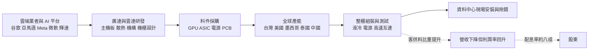
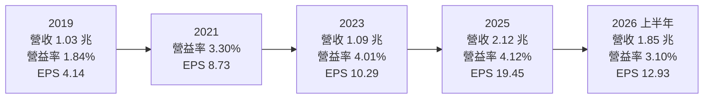
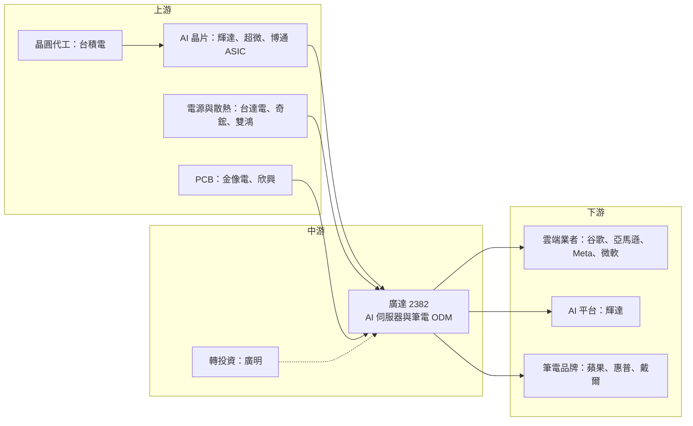

# 2382 廣達

> 上市｜[[產業索引-電腦及週邊設備業|電腦及週邊設備業]]｜上市（櫃）日期 1999/01/08

# 第一章：企業模式與商業藍圖

> [!info] 撰寫說明
> 本文由 Claude 依公開資料整理，架構比照 [[2330台積電]] 的四章研究，資料截至 2026-10-08。財務數字來源：Goodinfo 經營績效與現金流量頁（2019 至 2025 年度）、證交所開放資料快照（2026 年第二季資產負債與綜合損益、2025 年度股利、公司基本資料）、roo.cash 廣達歷年配息整理、廣達 2026 年第一、二季法說會內容（優分析、富果研究、DIGITIMES、自由時報整理，引自舊版筆記）；產業描述為整理性內容，尚未逐條比對原始文件。#待校對

在評估單一個股的長期投資價值時，首要步驟是拆解企業的底層獲利邏輯。本章針對廣達電腦（股票代號：2382，以下簡稱廣達）的商業模式進行定性分析，說明一家以筆電代工起家的公司，如何靠二十年前布局的雲端伺服器業務，在 AI 時代成為雲端業者最倚重的伺服器 [[ODM]] 之一，以及「低毛利、高周轉、高配息」的代工模式如何為股東創造報酬。

## 一、核心定位：從全球最大筆電代工廠轉型為 AI 伺服器龍頭

廣達由林百里與梁次震於 1988 年 5 月創立，總部在桃園龜山，1999 年上市，目前林百里任董事長、梁次震任總經理（證交所公司基本資料）。廣達以筆記型電腦代工起家，長年是全球出貨量最大的筆電 ODM 廠，客戶涵蓋 [[AAPL蘋果]]、惠普、戴爾等主要品牌。它的商業模式是替品牌客戶從設計、驗證到量產一手包辦，賺取設計與製造服務的利潤。

2000 年代中期起，廣達透過子公司雲達科技（QCT）切入資料中心伺服器，率先採用「直接替雲端業者設計與生產伺服器」的模式（[[ODM Direct]]），繞過傳統伺服器品牌商（年份細節待校對）。當時這個模式的規模不大，但它讓廣達很早就與美系雲端業者建立直接合作關係，熟悉它們的資料中心規格與營運方式。這個布局在 AI 時代成為關鍵優勢：

* **客戶關係早於 AI 浪潮：** 美系雲端業者大規模建置 AI 資料中心時，廣達已有長期合作的客戶關係與整櫃交付經驗，不需要從零開始爭取信任。在資料中心這種「出錯代價極高」的領域，過去的交付紀錄就是最好的業務。
* **身分徹底轉換：** 依 2026 年法說內容，伺服器營收已占廣達整體營收八成以上，其中 AI 伺服器占伺服器營收約七成五以上。廣達已從「筆電代工廠」轉為「AI 伺服器 ODM 龍頭」。

## 二、終端應用板塊：伺服器為主、筆電為輔

廣達未公開精確的產品營收比重，本章不繪製圓餅圖，以下依法說內容整理定性結構：

* **AI 伺服器：** 包含 [[NVDA輝達]] GB200、GB300 等 GPU 機櫃，以及雲端業者自研 [[ASIC]] 晶片的伺服器。這是廣達成長最快的業務，也是 2024 年以後營收倍增的主要來源。
* **通用伺服器：** 一般雲端運算與儲存伺服器。AI 建置的同時，雲端業者也需要更新傳統伺服器，這塊業務提供相對穩定的基礎訂單。
* **筆記型電腦：** 依舊版筆記引用的法說內容，2026 年第二季筆電出貨約 1,150 萬台，公司預期全年出貨雙位數年減，占比持續下降。筆電仍是廣達營收的第二大來源，但已不是成長動能。
* **其他：** 車用電子、智慧穿戴、雲端軟體服務等，目前占比小，屬於長期布局。

| 產品線 | 定位 | 長期方向 |
|---|---|---|
| 伺服器（含 AI） | 2026 年占總營收八成以上 | AI 伺服器與 ASIC 伺服器為主要成長來源 |
| 筆記型電腦 | 第二大業務 | 出貨量逐年減少，比重下降 |
| 車用與其他 | 占比小 | 德國擴產等長期布局 |

## 三、資本轉化邏輯：設計能力換取整櫃訂單

* **低毛利、高周轉：** 廣達的[[毛利率]]長期只有 5% 至 8%，營業利益率約 2% 至 4.5%（Goodinfo）。它賺錢的方式不是高利潤率，而是龐大的營收規模與快速的資產周轉：每年經手數兆元的料件，只要每一元營收賺到幾分錢，乘上規模後就是數百億元的營業利益。
* **[[客供料]]與帳面營收：** AI 機櫃中 GPU 等高價料件若由廣達採購，會灌大營收、稀釋毛利率；若改由客戶自行供應，營收下降但利潤率回升。因此評估廣達時，營業利益的金額比營收與毛利率更能反映實際賺錢能力。2025 年毛利率從 7.85% 降到 6.98%，主要就是高價料件比重提高的結果。
* **多地產能：** 廣達在台灣、中國、美國、墨西哥、泰國、德國等地設有生產據點。依舊版筆記引用的資料，擴產重心轉向美國與泰國：加州擴廠投資約 9.73 億美元，貼近美系雲端客戶並因應關稅；泰國擴建 AI 伺服器產能，作為中國以外的亞洲生產基地；台灣以約 197 億元取得宏碁旗下華亞園區廠房；德國投資約 1.95 億歐元擴充車用電子產能（以上金額待校對）。

## 四、企業長期藍圖：AI 伺服器、ASIC 與整櫃交付

廣達的長期方向可以歸納為「從組裝廠升級為資料中心系統整合商」：

* **跟著 AI 平台世代前進：** 廣達是輝達 GB200、GB300 機櫃的主要組裝廠之一，並持續承接下一代平台。AI 平台大約一到兩年換代一次，每次換代都考驗代工廠的工程能力與量產速度。
* **雲端業者自研 ASIC：** 廣達與 [[GOOGL谷歌]]、[[AMZN亞馬遜]]、[[META臉書]] 等雲端業者合作 ASIC 伺服器。這類專案由雲端業者主導設計，代工廠需要長期合作關係才能取得，一旦取得通常能延續多個世代，是比輝達 GPU 機櫃更穩定的業務。
* **整櫃與資料中心交付：** 從主機板、伺服器、整櫃組裝、[[液冷]]到現場安裝測試，廣達提供完整交付服務，讓客戶能縮短資料中心上線時間。
* **擴大資本支出：** 依舊版筆記引用的法說內容，2026 年資本支出由原預估 300 億元上修至約 400 億元，主要用於美國與泰國 AI 產能（待校對）。這代表廣達從過去的輕資產代工，逐步轉為需要較大規模固定資產投資的模式。

# 第二章：護城河深度與競爭優勢

在長期價值投資中，「護城河」指企業抵禦競爭、維持超額利潤的保護機制。廣達屬於低毛利的代工業，護城河來自客戶關係與工程能力，而不是定價權。本章分析這些優勢的構成、全球主要競爭對手，以及在 AI 伺服器多家分食的格局中，廣達能守住哪些市場。

## 一、廣達護城河的核心組成要素

代工業通常被認為沒有護城河，但廣達的財務紀錄說明它至少有「窄護城河」：2019 至 2025 年 ROE 從 11.5% 逐步升到 31.2%，七年中有六年超過 17%（Goodinfo），在毛利率只有 5% 至 8% 的情況下，能持續創造高於資金成本的報酬。這些優勢來自以下要素：

* **1. 與雲端業者的長期直接合作：** 廣達很早就以 ODM Direct 模式直接服務雲端業者，熟悉其資料中心規格、測試標準與營運需求。雲端業者自研 ASIC 伺服器時，往往優先找有長期合作紀錄的廠商，因為資料中心的可靠度比單價更重要。
* **2. 研發與系統設計能力：** 廣達擁有大規模研發團隊，能參與伺服器主機板、散熱、機構與機櫃的設計，而不只是組裝。AI 機櫃的電源、液冷與高速互連整合難度高，設計能力是重要門檻，也是 ODM 與單純組裝廠的區別。
* **3. 整櫃交付與現場服務：** AI 機櫃出貨前需要整櫃測試，交付到資料中心後還需要安裝與除錯。廣達在美國當地的據點與服務團隊，是新進者短期內難以複製的能力。
* **4. 多地產能與財務規模：** 台灣、美國、墨西哥、泰國等產能，讓客戶能分散地緣政治風險；龐大的資產規模與營運資金調度能力，讓廣達能承接數千億元等級的料件採購，這本身就是規模門檻。

## 二、全球主要競爭對手格局

| 對手 | 定位 | 對廣達的威脅 |
|---|---|---|
| [[2317鴻海]] | 規模最大的電子代工服務（[[EMS]]），垂直整合最深 | 在輝達 AI 機櫃組裝市占高，並積極爭取 ASIC 伺服器 |
| [[3231緯創]]、[[6669緯穎]] | 緯創做輝達 GPU 基板，緯穎專注美系雲端 | 在 ASIC 與通用伺服器直接競爭 |
| [[2356英業達]]、[[2376技嘉]]、[[3706神達]] | 伺服器代工與品牌伺服器 | 在中小型雲端與企業伺服器競爭 |
| Dell、美超微（Supermicro）、HPE | 美系伺服器品牌 | 企業與部分雲端客戶市場 |
| [[4938和碩]]、[[2324仁寶]]、華勤、龍旗 | 筆電代工 | 中國 ODM 以價格搶筆電訂單 |

AI 伺服器代工是「多強競爭」的格局。雲端業者與輝達都會刻意把訂單分給多家 ODM，避免依賴單一供應商。廣達的優勢在雲端業者自研的 ASIC 伺服器與長期客戶關係，鴻海的優勢在垂直整合與規模，緯穎則在特定雲端客戶有深厚基礎。

## 三、優勢轉化：哪些市場守得住、哪些守不住

* **守得住：** 雲端業者的 ASIC 伺服器與客製化資料中心專案。這類專案需要長期合作與深度設計參與，廣達的地位難以被快速取代。
* **守不住：** 輝達 GPU 機櫃的組裝訂單由多家 ODM 分食，廣達難以獨占，議價能力有限；高單價料件拉高營收卻稀釋毛利率。筆電則面臨中國 ODM 的價格競爭與市場萎縮，長期比重會持續下降。
* **觀察重點：** 第一，ASIC 伺服器在營收中的比重是否持續提高；第二，客供料比重變化後，營業利益率能否穩定在 4% 以上；第三，美國、泰國新產能的獲利表現，這是檢驗廣達從輕資產轉向重資產後，資本效率能否維持的關鍵。

# 第三章：財務體質與盈利規模

資料日期：2026-10-08。年度數字取自 Goodinfo 經營績效與現金流量頁，股利取自 roo.cash 歷年配息整理與證交所開放資料，2026 年上半年與資產負債取自證交所開放資料快照，表格是撰寫當時的快照；最新月營收、毛利率、累計 EPS 由自動排程寫在本筆記的屬性欄位（月營收、毛利率、累計EPS 等）。#待校對

財務報表是檢驗護城河是否真實存在的最終標準。本章用多年度的三率、ROE、現金流與資本報酬，檢視廣達在 AI 伺服器營收爆發下的獲利品質，特別是營收膨脹對三率的扭曲，以及營運資金對現金流的影響。

## 一、獲利能力的基石：三率

| 年度 | 營收（億元） | [[毛利率]] | [[營業利益率]] | EPS（元） | [[ROE]] |
|---|---|---|---|---|---|
| 2019 | 10,296 | 4.78% | 1.84% | 4.14 | 11.5% |
| 2020 | 10,909 | 5.86% | 2.97% | 6.57 | 17.4% |
| 2021 | 11,295 | 6.38% | 3.30% | 8.73 | 21.6% |
| 2022 | 12,804 | 5.54% | 2.44% | 7.51 | 17.2% |
| 2023 | 10,856 | 7.82% | 4.01% | 10.29 | 21.9% |
| 2024 | 14,108 | 7.85% | 4.37% | 15.49 | 28.4% |
| 2025 | 21,237 | 6.98% | 4.12% | 19.45 | 31.2% |
| 2026 上半年 | 18,458 | 4.92% | 3.10% | 12.93 | 未查得（年化約 41%，推算） |

* **營收成長：** 2019 至 2023 年營收在 1 兆至 1.3 兆元之間，成長平緩；2024 年起 AI 伺服器大量出貨，2025 年營收達 2.12 兆元，2020 至 2025 年年複合成長率約 14.3%（推算）。2026 年上半年營收已達 1.85 兆元。
* **[[毛利率]]：** 2019 年只有 4.78%，2023 至 2024 年提升到 7.8% 左右，主要是伺服器占比提高、筆電占比下降的結果；2025 年起 AI 機櫃中的高價料件稀釋毛利率，2026 年上半年降到 4.92%。毛利率的方向取決於料件由誰採購，不能單獨用來判斷競爭力。
* **[[營業利益率]]：** 從 2019 年的 1.84% 提升到 2023 至 2025 年的 4% 以上，代表廣達的業務組合確實變好了。營業利益金額從 2019 年約 189 億元增加到 2025 年約 875 億元（推算），六年成長超過四倍，這是比營收更能代表廣達實力的數字。
* **EPS 長期成長：** 2019 至 2025 年 EPS 從 4.14 元增加到 19.45 元，除了 2022 年小幅衰退外，每年都成長。

## 二、[[ROE]]：資本效率

廣達 2021 至 2025 年平均 ROE 約 24.1%（推算），而且呈現上升趨勢，2025 年達 31.2%。在毛利率不到一成的代工業能有這種 ROE，靠的是兩個因素：一是高資產周轉率，每一元資產能帶來大量營收；二是財務槓桿，2026 年第二季底廣達資產總計約 2.06 兆元，負債總計約 1.81 兆元，權益總計約 2,558 億元（證交所開放資料），負債比接近九成。高負債大部分是應付帳款等營運性負債，代表廣達用供應商的帳期支應客戶的備貨，但也使 ROE 對營收波動非常敏感。

股利方面，2019 至 2025 年度每股現金股利分別為 3.7、5.2、6.6、6.0、9.0、13.0、15.6 元。以當年 EPS 計算，配息率在 76% 至 89% 之間（推算），屬於「高配息比例、與獲利同步成長」的穩定股利政策。高配息讓股東權益累積較慢，這也是 ROE 能維持高檔的原因之一。

## 三、資本支出與自由現金流

| 年度 | 營業現金流（億元） | 投資現金流（億元） | 自由現金流（億元） |
|---|---|---|---|
| 2019 | 377 | 18.1 | 395 |
| 2020 | 780 | -219 | 561 |
| 2021 | -238 | 135 | -103 |
| 2022 | 114 | -141 | -27.3 |
| 2023 | 1,250 | -376 | 874 |
| 2024 | -395 | -123 | -518 |
| 2025 | -104 | -83.4 | -187 |

（自由現金流依 Goodinfo 定義為營業現金流加投資現金流。）

* **[[自由現金流]]：** 波動極大，七年中有四年為負。2023 年營業現金流高達 1,250 億元，2024 與 2025 年則轉為負數，原因是 AI 伺服器出貨放大，存貨與應收帳款大幅增加。代工廠的現金流取決於料件備貨與收款節奏，單一年度的正負意義不大，應看多年合計：2019 至 2025 年自由現金流合計約 995 億元（推算），同期稅後淨利合計遠高於此，代表有相當比例的獲利被營運資金吸收。
* **[[營運資金]]：** 這是廣達最主要的資金需求。客供料比重提高可以減少廣達需要墊付的料件金額，對現金流是直接的改善。
* **[[CapEx]]：** 過去投資現金流每年約 80 億至 380 億元，2026 年資本支出計畫上修到約 400 億元（待校對），加上華亞廠房購置，固定資產投資明顯增加。

## 四、[[ROIC]] 與 [[WACC]]：價值創造利差

**ROIC（推算）：** 以「稅後營業利益 ÷（股東權益＋有息負債）」推算。2025 年營業利益約 21,237 億元 × 4.12% ≈ 875 億元，以稅率 20% 計算稅後營業利益約 700 億元。有息負債明細未查得，以 2026 年第二季非流動負債約 1,014 億元作為近似值，加上權益總計約 2,558 億元，投入資本約 3,572 億元，ROIC 約 19.6%（推算）。以 2026 年上半年營業利益約 573 億元年化計算，稅後營業利益約 916 億元，ROIC 約 25.6%（推算）。需要注意的是，廣達的短期借款可能列在流動負債中而未納入上述計算，若計入，ROIC 會較低。

**WACC（推算）：** 以 CAPM 推估股東權益成本：無風險利率取台灣 10 年期公債約 1.75%，市場風險溢酬 6%，β 假設 1.0（大型電子代工股常見值，非來源數字），權益成本約 7.75%。負債成本假設稅前 2.5%、稅率 20%，稅後 2.0%。以帳面資本結構（權益約 72%、負債約 28%）計算，WACC 約 6.1%；以市值計算（股價淨值比約 5.3 倍，權益權重約九成三），WACC 約 7.4%（推算）。

**結論：** 廣達的 ROIC 在 2025 年約 20%、2026 年上半年年化約 26%，明顯高於 WACC，是創造價值的公司；以 2019 至 2025 年 ROE 長期維持在 11% 至 31% 推估，即使在 AI 浪潮之前，ROIC 也大致高於資金成本。未來的關鍵在於資本結構的變化：資本支出擴大、營運資金需求增加，會讓投入資本快速膨脹。只要營業利益率能維持在 4% 上下、客供料能降低營運資金占用，利差就能維持。

# 第四章：總體風險與地緣政治

任何企業都無法脫離宏觀環境獨立存在。本章分析廣達未來必須面對的地緣政治、AI 資本支出週期、營運風險，以及雲端業者主導設計所帶來的議價限制。

## 一、地緣政治風險

* **美國關稅與在地製造：** AI 伺服器主要出貨到美國，美國對進口伺服器與零組件的關稅政策會直接影響成本。廣達的加州擴廠與墨西哥產能是因應措施，但美國製造成本較高，可能壓縮利潤率。
* **中國產能：** 筆電與部分產品仍在中國生產，美中衝突可能影響出口與供應鏈。廣達正逐步把產能分散到泰國等地，但移轉需要時間與成本。
* **台灣集中風險：** 研發總部與部分伺服器產能在台灣，面臨兩岸風險。

## 二、產業週期與市場結構風險

* **AI 資本支出週期：** 伺服器營收占八成以上，若美系雲端業者放緩 AI 投資，廣達的營收與獲利會受到明顯影響。AI 資本支出的規模前所未見，一旦調整，幅度也可能超過過去的伺服器週期。
* **[[長鞭效應]]：** 雲端業者調整建置節奏時，訂單變化沿伺服器供應鏈放大，ODM 的存貨與產能利用率首當其衝。
* **客戶集中：** 主要營收來自少數雲端業者與輝達平台，任一客戶轉單或砍單影響大。
* **筆電市場萎縮：** 筆電出貨持續下滑，中國 ODM 以價格競爭，筆電業務的利潤空間有限。

## 三、營運環境的隱性風險

* **低毛利的容錯空間小：** 毛利率只有 5% 上下，任何[[良率]]、交期或料件跌價問題，都會快速吃掉利潤。
* **新平台量產調校：** AI 機櫃世代交替快，新平台量產初期的液冷、電源與高速互連問題可能延遲出貨，影響營收認列與客戶信任。
* **營運資金與匯率：** 存貨與應收帳款規模龐大，2024 與 2025 年營業現金流為負就是例證；營收以美元為主，匯率波動影響損益。
* **擴產執行：** 美國、泰國新產能若投產延遲或利用率不如預期，折舊會壓縮獲利。

## 四、科技演進風險

* **雲端業者設計主導：** ASIC 伺服器的規格由雲端業者主導，代工廠議價力有限，雲端業者也可能把訂單分散給多家 ODM。
* **AI 系統架構改變：** 若 AI 運算轉向更高整合度的機櫃、新的供電方式（例如高壓直流）或新的散熱方式，代工廠需要持續投入新產線與測試能力。能否跟上每一次架構轉換，決定廣達能否維持在雲端業者供應鏈中的地位。

# 專有名詞解析

## 半導體

- **[[ASIC]]**：特殊應用積體電路，為單一用途客製的晶片，例如雲端業者自研的 AI 加速器。
- **[[良率]]**：合格產品占總產出的比例，組裝業的良率直接影響重工成本與交期。

## 金融

- **[[營運資金]]**：支應存貨、應收帳款等日常營運所需的資金，出貨規模放大時占用會同步增加。
- **[[ROE]]**：股東權益報酬率，稅後淨利除以股東權益，衡量公司運用股東資本賺錢的效率。
- **[[ROIC]]**：投入資本報酬率，稅後營業利益除以股東權益加有息負債，衡量公司投入營運的全部資本能賺多少。
- **[[WACC]]**：加權平均資金成本，股東與債權人要求報酬率的加權平均，是 ROIC 的比較基準。
- **[[自由現金流]]**：營業活動現金流減去資本支出，代表企業可自由用於配息、還債或併購的現金。
- **[[長鞭效應]]**：終端需求的小幅變動，沿供應鏈往上游傳遞時被逐級放大，造成上游庫存與訂單劇烈波動。

## 產業

- **[[ODM]]**：原廠委託設計製造，代工廠除了生產也負責產品設計，品牌商只提出規格。
- **[[ODM Direct]]**：伺服器代工廠跳過品牌商，直接替雲端業者設計與生產伺服器的模式。
- **[[EMS]]**：電子代工服務，替品牌客戶進行零組件採購、組裝與測試，本身不賣自有品牌產品，代表廠商為鴻海。
- **[[客供料]]**：由客戶自行採購並提供給代工廠的料件，代工廠只收加工費，營收下降但毛利率上升。
- **[[液冷]]**：以冷卻液取代風扇帶走晶片熱量的散熱方式，AI 機櫃功耗動輒上百千瓦，逐漸成為標配。

# 核心供應鏈

## 1. 上游：晶片與關鍵零組件
- GPU 與 AI 晶片：[[NVDA輝達]]、[[AMD超微]]、[[AVGO博通]]（ASIC）
- 晶圓代工：[[2330台積電]]
- 電源與散熱：[[2308台達電]]、[[3017奇鋐]]、[[3324雙鴻]]
- PCB：[[2368金像電]]、[[3037欣興]]

## 2. 中游：廣達本身與同業
- 伺服器 ODM：[[2317鴻海]]、[[3231緯創]]、[[6669緯穎]]、[[2356英業達]]
- 筆電 ODM：[[4938和碩]]、[[2324仁寶]]
- 廣達轉投資：[[6188廣明]]

## 3. 下游：主要客戶
- 雲端服務業者：[[GOOGL谷歌]]、[[AMZN亞馬遜]]、[[META臉書]]、[[MSFT微軟]]
- AI 平台：[[NVDA輝達]]
- 筆電品牌：[[AAPL蘋果]]、惠普、戴爾

延伸閱讀：[[台積電供應鏈]]

## 最新新聞
<!-- news:start（自動產生，請勿手動編輯此範圍） -->
- 2026-10-19 📰 媒體 19:55｜宜進近3個月買進廣達940張 每股均價320.4元｜[鉅亨網](https://news.cnyes.com/news/id/6633604)
- 2026-10-17 📰 媒體 20:00｜美啟動337專利調查，廣達、鴻海、台達電危險了？法人：真正的利空根本不是專利！「這場危機」才可怕！｜[鉅亨網](https://news.cnyes.com/news/id/6632760)
- 2026-10-16 📰 媒體 19:14｜經濟部擬赴德州設立AI產業園區 童子賢：可借鏡廣達Q-Bus模式｜[鉅亨網](https://news.cnyes.com/news/id/6632275)
- 2026-10-11 📰 媒體 09:35｜美啟動337調查 鴻海、台達電、廣達、立訊精密等20家企業入列｜[鉅亨網](https://news.cnyes.com/news/id/6627468)
- 2026-10-07 📰 媒體 17:56｜〈電子五哥營收〉廣達Q3營收1.16兆元年增逾1倍創高 新世代伺服器產品明年Q1放量｜[鉅亨網](https://news.cnyes.com/news/id/6623757)

完整紀錄：[[2382廣達 新聞]]
<!-- news:end -->

## 相關連結
- [公開資訊觀測站](https://mopsov.twse.com.tw/mops/web/t05st03?step=1&firstin=1&co_id=2382)
- [Goodinfo](https://goodinfo.tw/tw/StockDetail.asp?STOCK_ID=2382)
- [Yahoo 股市](https://tw.stock.yahoo.com/quote/2382)
- [鉅亨網新聞](https://www.cnyes.com/twstock/2382/news)
