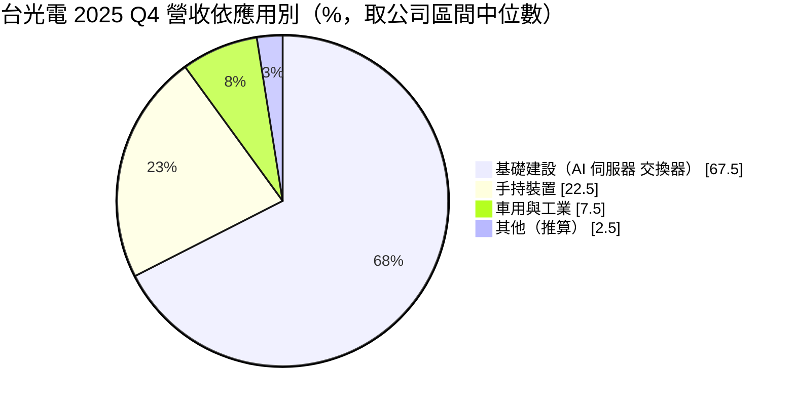
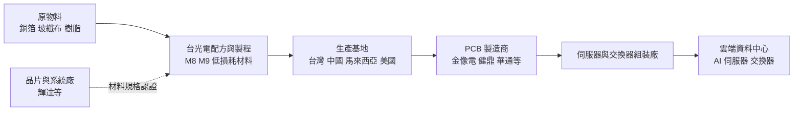
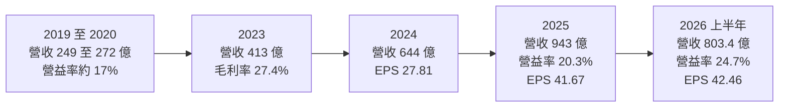
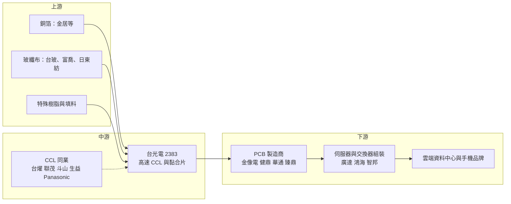

# 2383 台光電

> 上市｜[[產業索引-電子零組件業|電子零組件業]]｜上市（櫃）日期 1998/11/27

# 第一章：企業模式與商業藍圖

> [!info] 撰寫說明
> 本文由 Claude 依公開資料整理，架構比照 [[2330台積電]] 的四章研究，資料截至 2026-10-08。財務數字來源：Goodinfo 經營績效、股利政策與現金流量頁（2019 至 2025 年度）、證交所開放資料快照（2026 年第二季資產負債與綜合損益、2025 年度股利、公司基本資料）、工商時報 2026 年 1 月報導、科技新報 2025 年 8 月報導、富果研究法說會摘要與優分析財報報導（引自舊版筆記）；產業描述為整理性內容，尚未逐條比對原始文件。#待校對

在評估單一個股的長期投資價值時，首要步驟是拆解企業的底層獲利邏輯。本章針對台光電子材料（股票代號：2383，以下簡稱台光電）的商業模式進行定性分析，說明一家「賣板材」的材料廠，如何靠無鹵素與低損耗材料的技術累積，在 [[AI伺服器]] 與高速交換器的浪潮中成為全球[[CCL]]（銅箔基板）龍頭，並讓營業利益率長期維持在一成五以上。

## 一、核心定位：全球領先的高速、無鹵素 CCL 供應商

台光電成立於 1992 年 3 月，總部在桃園觀音工業區，1998 年上市，董事長兼總經理為董定宇（證交所公司基本資料）。公司專注生產[[CCL]]與黏合片（[[Prepreg]]）等印刷電路板（PCB）的基礎材料。CCL 由銅箔、玻纖布與樹脂壓合而成，PCB 廠在 CCL 上蝕刻線路、鑽孔、壓合，才做成電子產品裡的電路板。

過去 CCL 被視為大宗材料，價格競爭激烈、技術差異不大。台光電的轉折點在於它很早就押注兩個方向：一是[[無鹵素材料]]，二是低損耗的高速材料。無鹵素材料最早因手機品牌的環保要求而普及，台光電藉此打進高階手機主板市場；高速材料則隨著伺服器、交換器的傳輸速度不斷提升而變得關鍵。依舊版筆記引用的 Prismark 資料，台光電 2025 年 CCL 全球市占率約 16.2%，排名第一；公司自估在無鹵素高速材料市場的市占率超過五成（待校對）。

台光電的定位有三個長期特點：

* **高階材料專家：** 產品以低損耗、高速傳輸的材料為主，目前 [[M8]] 等級材料為出貨主力，更高階的 [[M9]] 等級材料逐步導入。材料等級越高，單價與毛利越高，而且能做的廠商越少。
* **AI 基礎建設為主：** 依法說會摘要，2025 年第四季基礎建設產品（伺服器、交換器、基地台）占營收約 65% 至 70%，其中 AI 伺服器與交換器約占九成。台光電的成長已經和 AI 資料中心的建置緊密綁在一起。
* **從大宗材料變成關鍵零件：** AI 伺服器的 GPU 板、加速卡與 800G、[[1.6T交換器]]都需要高層數、低損耗的 PCB，材料規格直接決定訊號能否高速傳輸。CCL 因此從「誰便宜買誰」變成「必須通過認證才能用」的關鍵材料，這是台光電長期獲利提升的根本原因。

## 二、終端應用板塊：營收結構

依法說會摘要（富果研究整理），2025 年第四季營收依應用別如下，比重取公司揭露區間的中位數：

* **基礎建設（約 65% 至 70%）：** AI 伺服器 GPU 主板、加速卡、交換器與網通設備，是成長最快、單價最高的板塊。每一代 AI 平台與交換器升級，都需要更低損耗的材料，帶動材料規格與價格往上走。
* **手持裝置（約 20% 至 25%）：** 智慧型手機與平板使用的 [[HDI]] 與類載板材料。台光電長期是高階手機主板材料的主要供應商，這是它在 AI 浪潮之前的主要獲利來源，也是無鹵素材料技術的起點。
* **車用與工業（約 5% 至 10%）：** 車用電子與工業控制，需要高可靠度的材料，成長穩定但規模較小。

## 三、資本轉化邏輯（營運模式）：材料規格認證換取定價權

* **認證機制形成門檻：** 高速材料必須先通過晶片廠與系統廠的平台認證，列入指定材料清單後，PCB 廠才能採用。也就是說，真正決定用誰的材料的，往往不是直接下單的 PCB 廠，而是更下游的晶片與系統廠。台光電在多個世代的 AI 平台都取得認證，因此能拿到大部分訂單。
* **配方與製程是核心：** CCL 的電氣特性取決於樹脂配方、玻纖布與銅箔的搭配，以及壓合製程的控制。這些配方屬於長期累積的技術訣竅，即使對手取得相同原料，也不容易做出相同的性能與穩定度。
* **產能滿載帶來定價權：** 依舊版筆記引用的法說會摘要，2026 年台光電產能全年滿載，第二季全產品至少調漲一成。在需求大於供給、又只有少數廠商通過認證的情況下，材料廠可以把原料上漲轉嫁給客戶，甚至主動漲價。
* **多地生產：** 台光電在台灣（觀音等地）、中國（昆山、中山、黃石）、馬來西亞（檳城）設有生產基地；2025 年科技新報報導，公司投資約 4,900 萬美元擴建美國加州子公司 Arlon EMD，預計 2026 年底在加州開始營運。多地生產讓台光電能因應客戶「中國以外產能」與在地供應的要求。

## 四、企業長期藍圖：產能擴張與新世代材料

* **持續擴產：** 依工商時報 2026 年 1 月報導，台光電 2025 年在黃石、中山與檳城擴產，總產能較 2024 年增加約三成；後續規劃台灣大園、中國昆山與中山新廠，完工後產能將再增加近三成。董事會也通過以約 27.8 億元向遠東新世紀購買觀音區土地與廠房，作為新廠用地。舊版筆記引用的法說會摘要則提到 2028 年月產能目標約 1,110 萬張（與工商時報數字口徑不同，待校對）。
* **新世代材料：** M9 等級材料搭配下一代 AI 平台與 1.6T 交換器，單價更高。每一代新材料的認證結果，決定台光電未來兩三年的市占與毛利率。

# 第二章：護城河深度與競爭優勢

在長期價值投資中，「護城河」指企業抵禦競爭、維持超額利潤的保護機制。本章分析台光電的護城河構成、全球主要競爭對手，以及這些優勢在對手積極追趕時能守住多少。

## 一、台光電護城河的核心組成要素

台光電的護城河屬於「中寬護城河」，最直接的證據是財務紀錄：2019 至 2025 年營業利益率每年都在 16% 至 20% 之間，ROE 每年都在 22% 以上（Goodinfo），在一般被視為大宗材料的 CCL 產業中，這是非常少見的穩定度。護城河由以下要素組成：

* **1. 平台認證與先行者優勢：** 高速材料的認證週期長，台光電在 AI 伺服器與交換器的多個世代平台都取得主要份額。客戶一旦設計定案，中途更換材料就要重新驗證整片電路板的訊號表現，轉換成本很高。先行者在每一代平台的認證中都比對手更早累積數據，形成正向循環。
* **2. 配方技術與無鹵素高速材料的領先：** 公司自估在無鹵素高速材料市占超過五成，代表在「低損耗」與「環保規格」兩個要求之間的平衡上具有技術領先。這是二十多年研發累積的結果，不是短期可以追上的。
* **3. 規模與多地產能：** 全球最大的 CCL 產能之一，加上台灣、中國、馬來西亞與美國的布局，讓台光電能同時滿足客戶的出貨量與產地要求。在 AI 需求暴增時，能否供得上貨本身就是競爭力。
* **4. 與 PCB 廠及系統廠的三方關係：** 台光電同時面對下單的 PCB 廠與決定規格的晶片、系統廠，長期與兩端合作，讓它能更早掌握下一代平台的規格需求。

## 二、全球主要競爭對手格局

| 對手 | 定位 | 對台光電的威脅 |
|---|---|---|
| [[6274台燿]] | 台灣高速 CCL 廠 | 積極爭取 AI 伺服器與交換器材料認證，是最直接的國內對手 |
| [[6213聯茂]] | 台灣 CCL 廠 | 在網通與伺服器材料競爭 |
| 斗山電子（Doosan） | 韓國 CCL 廠 | 在部分 AI 加速器平台與台光電競爭 |
| Panasonic | 日本高階材料廠（Megtron 系列） | 高階伺服器材料的傳統領導者，品牌與技術歷史悠久 |
| 生益科技 | 中國最大 CCL 廠 | 以規模與價格在中國市場競爭，逐步切入高階材料 |

CCL 產業的格局可以分成兩層：在中低階材料，全球有大量供應商，價格競爭激烈；在 AI 等級的高速材料，只有少數廠商能通過認證，台光電、Panasonic、斗山、台燿是主要競爭者。台光電的優勢是同時具備高階技術與大規模產能。

## 三、優勢轉化：哪些市場守得住、哪些守不住

* **守得住：** 現行 AI 伺服器與 800G、1.6T 交換器的高階材料。毛利率從 2019 年的 24.5% 提升到 2025 年的 29.8%，2026 年上半年再升到 32.0%（證交所開放資料），顯示定價能力隨產品升級持續擴大。
* **守不住：** 中低階材料與消費性產品，這些市場價格競爭激烈，毛利率較低。此外，客戶為分散風險會刻意培養第二供應商，台光電在單一平台的份額可能被分走一部分。
* **觀察重點：** 第一，M9 及下一代材料能否在新平台維持主要份額；第二，台燿、斗山的認證進度；第三，大規模擴產完成後，產能利用率能否維持在高檔。

# 第三章：財務體質與盈利規模

資料日期：2026-10-08。年度數字取自 Goodinfo 經營績效、股利政策與現金流量頁，2026 年上半年與資產負債取自證交所開放資料快照，表格是撰寫當時的快照；最新月營收、毛利率、累計 EPS 由自動排程寫在本筆記的屬性欄位（月營收、毛利率、累計EPS 等）。#待校對

財務報表是檢驗護城河是否真實存在的最終標準。本章用多年度的三率、ROE、現金流與資本報酬，檢視台光電在 AI 材料需求爆發前後的獲利品質，以及大規模擴產對資本效率的影響。

## 一、獲利能力的基石：三率

| 年度 | 營收（億元） | [[毛利率]] | [[營業利益率]] | EPS（元） | [[ROE]] |
|---|---|---|---|---|---|
| 2019 | 249 | 24.5% | 16.4% | 10.14 | 25.5% |
| 2020 | 272 | 25.9% | 17.2% | 11.33 | 24.4% |
| 2021 | 385 | 26.2% | 18.0% | 16.50 | 30.1% |
| 2022 | 387 | 25.1% | 16.1% | 15.24 | 24.3% |
| 2023 | 413 | 27.4% | 17.8% | 16.35 | 22.5% |
| 2024 | 644 | 27.9% | 18.9% | 27.81 | 30.9% |
| 2025 | 943 | 29.8% | 20.3% | 41.67 | 34.2% |
| 2026 上半年 | 803.4 | 32.0% | 24.7% | 42.46 | 未查得（年化約 52%，推算） |

* **營收成長：** 2020 至 2025 年營收從 272 億元增加到 943 億元，年複合成長率約 28.2%（推算）。2024 與 2025 年分別成長約 56% 與 46%，是 AI 伺服器材料需求爆發的兩年；2026 年上半年營收已接近 2025 年全年的八成五。
* **[[毛利率]]：** 七年間從 24.5% 穩定提升到 29.8%，2026 年上半年 32.0%。毛利率在營收倍增的同時持續上升，代表新增營收來自更高階的產品，而不是靠降價搶量。
* **[[營業利益率]]：** 2019 至 2023 年穩定在 16% 至 18%，2025 年升到 20.3%，2026 年上半年 24.7%。營業費用相對固定，營收放大時費用率下降，形成[[營運槓桿]]。
* **[[淨利率]]：** 2025 年稅後淨利率 15.5%，2026 年上半年約 18.9%（證交所開放資料），遠高於一般 PCB 材料廠的水準。

## 二、[[ROE]]：資本效率

台光電 2021 至 2025 年平均 ROE 約 28.4%（推算），2019 至 2025 年每年都在 22% 以上，景氣較弱的 2022 至 2023 年也維持在 22% 至 24%。這種穩定的高 ROE，是台光電護城河最有力的財務證據。2026 年第二季底，台光電資產總計約 1,586 億元，負債總計約 1,003 億元，權益總計約 583 億元，每股淨值約 162.8 元（證交所開放資料）。負債比約六成三，相較過去明顯上升，推估與擴產所需的營運資金與應付帳款增加有關。

股利方面，2019 至 2025 年度每股現金股利分別為 5.76、7.0、10.0、8.41、9.98、16.58、25.0 元。以當年 EPS 計算，配息率都落在 55% 至 62% 之間（推算）。公司章程說明股利政策會優先考量未來發展與資本支出，再以現金股利回饋股東（證交所股利資料摘錄）。台光電的股利屬於「固定比例約六成、金額隨獲利成長」的類型，保留約四成盈餘支應擴產。

## 三、資本支出與自由現金流

| 年度 | 營業現金流（億元） | 投資現金流（億元） | 自由現金流（億元） |
|---|---|---|---|
| 2019 | 24.7 | -11.8 | 12.9 |
| 2020 | 35.2 | -19.6 | 15.6 |
| 2021 | 40.2 | -26.2 | 14.0 |
| 2022 | 75.0 | -66.0 | 9.03 |
| 2023 | 28.9 | -40.6 | -11.7 |
| 2024 | 72.6 | -59.0 | 13.6 |
| 2025 | 120 | -98.9 | 20.8 |

（自由現金流依 Goodinfo 定義為營業現金流加投資現金流。）

* **[[自由現金流]]：** 2019 至 2025 年有六年為正，只有 2023 年因擴產支出較大而轉負。但自由現金流的金額遠小於淨利：2019 至 2025 年自由現金流合計約 74 億元（推算），同期稅後淨利合計約 470 億元（推算）。原因是台光電把大部分營業現金流投入擴產，這是高成長材料廠的典型特徵。
* **[[CapEx]]：** 投資現金流從 2019 年約 12 億元增加到 2025 年約 99 億元，擴產規模逐年擴大。加上觀音土地廠房購置與多地新廠，未來幾年資本支出仍會維持高檔。
* **股利與擴產的平衡：** 自由現金流不足以完全支應現金股利，代表配息部分仰賴累積現金或借款支應（推估）。這在高成長期是合理的，但若成長放緩，配息政策可能需要調整。

## 四、[[ROIC]] 與 [[WACC]]：價值創造利差

**ROIC（推算）：** 以「稅後營業利益 ÷（股東權益＋有息負債）」推算。2025 年營業利益約 943 億元 × 20.3% ≈ 191 億元，以稅率 20% 計算稅後營業利益約 153 億元。有息負債明細未查得，以 2026 年第二季非流動負債約 167 億元作為近似值，加上權益總計約 583 億元，投入資本約 750 億元，ROIC 約 20%（推算）。以 2026 年上半年營業利益約 199 億元年化計算，稅後營業利益約 318 億元，ROIC 約 42%（推算）。2019 至 2023 年營業利益率約 16% 至 18%、ROE 約 22% 至 30%，推估當時 ROIC 也在 15% 以上（推估）。

**WACC（推算）：** 以 CAPM 推估股東權益成本：無風險利率取台灣 10 年期公債約 1.75%，市場風險溢酬 6%，β 假設 1.2（AI 供應鏈零組件股常見值，非來源數字），權益成本約 9.0%。負債成本假設稅前 2.5%、稅率 20%，稅後 2.0%。以帳面資本結構（權益約 78%、負債約 22%）計算，WACC 約 7.4%；以市值計算（股價淨值比約 37 倍，權益權重接近百分之百），WACC 接近 9.0%（推算）。

**結論：** 台光電的 ROIC 在 2025 年約 20%、2026 年上半年年化約 42%，遠高於 WACC；而且在 AI 需求爆發之前，ROIC 也推估長期高於資金成本，是持續創造價值的公司。最大的風險在於大規模擴產：投入資本正在快速增加，如果 AI 需求放緩或對手在新世代材料取得認證，產能利用率下滑會讓 ROIC 快速回落。這也是為什麼新產能的利用率與新材料的認證結果，是長期追蹤台光電最重要的兩個指標。

# 第四章：總體風險與地緣政治

任何企業都無法脫離宏觀環境獨立存在。本章分析台光電未來必須面對的地緣政治、產業週期、營運與技術演進風險。

## 一、地緣政治風險

* **中國產能比重：** 台光電在中國昆山、中山、黃石等地有大型產能，美中貿易摩擦與關稅可能影響中國產品出口到美國客戶，也可能讓部分客戶要求非中國產地。馬來西亞、台灣與美國的擴產，是分散風險的布局。
* **美國關稅與在地化：** AI 伺服器最終多送往美國資料中心，美國對進口電子產品的關稅與在地製造要求會向上游傳導。美國加州子公司的擴建，是因應在地供應需求的措施。
* **台灣集中風險：** 研發與部分高階產能在台灣，面臨兩岸風險。

## 二、產業週期與市場結構風險

* **雲端資本支出循環：** 基礎建設產品占營收約七成，台光電的成長高度依賴 AI 資本支出。雲端業者一旦放緩投資，材料需求會比終端需求更早、更劇烈下滑。
* **[[長鞭效應]]：** CCL 位於 PCB 供應鏈上游，PCB 廠在旺季前會提前備料，需求轉弱時則快速去化庫存，讓材料廠的訂單波動大於終端需求。
* **擴產週期：** 台光電與台燿、斗山、生益等對手同時擴產，若需求成長不如預期，可能出現產能過剩與價格壓力。CCL 產業過去就曾多次出現擴產後的價格戰。

## 三、營運環境的隱性風險

* **原物料價格與供應：** 銅箔、玻纖布（特別是[[低介電玻纖布]]）與特殊樹脂的價格上漲，若無法即時轉嫁會壓縮毛利率。部分高階玻纖布供應集中在少數廠商，供應吃緊時可能限制出貨。
* **客戶與平台集中：** AI 伺服器與交換器平台集中在少數晶片廠與雲端客戶，平台換代時的認證結果會大幅影響營收。
* **擴產執行：** 多地同時擴產，若新廠良率爬升或投產時程不如預期，折舊與費用會先增加。
* **環保與製程安全：** 化學材料製程需符合嚴格的環保與安全規範，各國標準不同，增加合規成本。

## 四、科技演進風險

* **材料世代交替：** 每一代 AI 平台都要求更低的訊號損耗，若下一代材料由對手先取得認證，台光電的份額可能下降。材料業的領先地位需要在每一個世代重新爭取。
* **封裝與互連技術改變：** [[CPO]]、[[玻璃基板]]等新技術若改變 PCB 與載板在系統中的角色，CCL 的需求結構也會跟著改變。例如若更多高速訊號改走光纖或封裝內互連，對高階 PCB 材料的需求成長可能放緩；反之，若台光電能切入載板等新材料，則可能打開新市場。

# 專有名詞解析

## 半導體

- **[[CPO]]**：共同封裝光學，把光學收發元件與交換晶片封裝在一起，縮短電訊號距離以降低功耗。
- **[[玻璃基板]]**：以玻璃取代有機材料作為晶片封裝基板的技術，可提供更好的平整度與線路密度。

## 應用

- **[[AI伺服器]]**：搭載 GPU 或 AI 加速器、用於訓練與推論 AI 模型的伺服器，功耗遠高於一般伺服器。
- **[[1.6T交換器]]**：單一連接埠傳輸速率達每秒 1.6 Tb 的資料中心交換器，是 800G 之後的新世代規格。

## 金融

- **[[營運槓桿]]**：固定費用占比高時，營收小幅成長即可帶動營業利益大幅成長的現象。
- **[[ROIC]]**：投入資本報酬率，稅後營業利益除以股東權益加有息負債，衡量公司投入營運的全部資本能賺多少。
- **[[WACC]]**：加權平均資金成本，股東與債權人要求報酬率的加權平均，是 ROIC 的比較基準。
- **[[自由現金流]]**：營業活動現金流減去資本支出，代表企業可自由用於配息、還債或併購的現金。
- **[[長鞭效應]]**：終端需求的小幅變動，沿供應鏈往上游傳遞時被逐級放大，造成上游庫存與訂單劇烈波動。

## 產業

- **[[CCL]]**：銅箔基板，由銅箔、玻纖布與樹脂壓合而成，是製作印刷電路板的核心材料。
- **[[Prepreg]]**：黏合片（預浸材），玻纖布含浸樹脂後的半固化片，用來壓合多層電路板。
- **[[無鹵素材料]]**：不含鹵素阻燃劑的電路板材料，較環保，台光電在無鹵素高速材料市占居首。
- **[[M8]]**：業界對低損耗高速材料的等級稱呼之一，數字越大代表訊號損耗越低，M8 用於 800G 交換器與現行 AI 伺服器。
- **[[M9]]**：比 M8 更低損耗的新一代高速材料等級，用於 1.6T 交換器與下一代 AI 平台。
- **[[HDI]]**：高密度互連電路板，線路更細、層間以雷射鑽孔連接，主要用於智慧型手機主板。
- **[[低介電玻纖布]]**：介電常數與損耗較低的玻璃纖維布，是高速 CCL 的關鍵原料，供應集中在少數廠商。

# 核心供應鏈

## 1. 上游：銅箔、玻纖布與樹脂
- 銅箔：[[8358金居]]
- 玻纖布：[[1802台玻]]、[[1815富喬]]、日東紡
- 特殊樹脂與填料供應商（個別名單未查得）

## 2. 中游：台光電本身與同業
- 美國子公司：Arlon EMD
- CCL 同業：[[6274台燿]]、[[6213聯茂]]、斗山電子、Panasonic、生益科技

## 3. 下游：PCB 製造商
- 伺服器與交換器板：[[2368金像電]]、[[3044健鼎]]
- 手機 HDI 與類載板：[[2313華通]]、[[4958臻鼎-KY]]
（以上為 CCL 產業常見客戶類型，個別採購關係推估，待校對）

## 4. 下游：系統與終端
- 伺服器與交換器：[[2382廣達]]、[[2317鴻海]]、[[2345智邦]]
- 晶片平台：[[NVDA輝達]]
- 終端：雲端服務商資料中心、[[AAPL蘋果]] 等手機品牌（推估）

延伸閱讀：[[台積電供應鏈]]

## 最新新聞
<!-- news:start（自動產生，請勿手動編輯此範圍） -->
- 2026-10-15 📰 媒體 11:30｜台光電(2383) 高階材料布局解析：切入ABF載板CCL，挑戰日系材料供應鏈！｜[鉅亨網](https://news.cnyes.com/news/id/6631001)
- 2026-10-14 📰 媒體 18:00｜CCL三雄誰最會賺？台光電(2383)、台燿(6274)、聯茂(6213) 產品布局、漲價動能全解析｜[鉅亨網](https://news.cnyes.com/news/id/6630357)
- 2026-10-14 📰 媒體 17:00｜台光電(2383)、聯茂(6213)、台燿(6274) 誰最會賺？高階CCL漲價與獲利動能一次看！｜[鉅亨網](https://news.cnyes.com/news/id/6630305)
- 2026-10-14 📰 媒體 16:00｜台光電(2383)、聯茂(6213)、台燿(6274) 誰最會賺？高階CCL漲價潮、產品布局與獲利動能一次看！｜[鉅亨網](https://news.cnyes.com/news/id/6630251)
- 2026-10-14 📰 媒體 12:00｜台光電(2383)、聯茂(6213)、台燿(6274)CCL三雄擴產盤點！AI高階銅箔基板誰能先放量？｜[鉅亨網](https://news.cnyes.com/news/id/6630093)

完整紀錄：[[2383台光電 新聞]]
<!-- news:end -->

## 相關連結
- [公開資訊觀測站](https://mopsov.twse.com.tw/mops/web/t05st03?step=1&firstin=1&co_id=2383)
- [Goodinfo](https://goodinfo.tw/tw/StockDetail.asp?STOCK_ID=2383)
- [Yahoo 股市](https://tw.stock.yahoo.com/quote/2383)
- [鉅亨網新聞](https://www.cnyes.com/twstock/2383/news)
