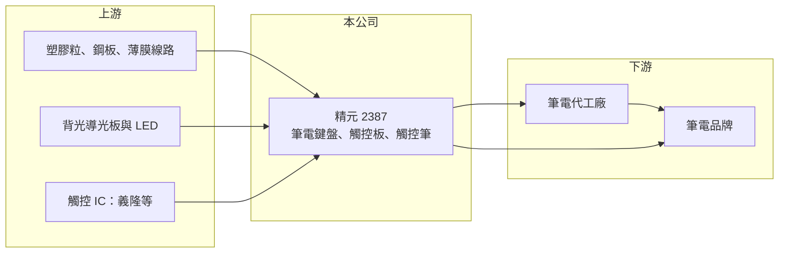

# 2387 精元

> 上市｜[[產業索引-電腦及週邊設備業|電腦及週邊設備業]]｜上市（櫃）日期 1999/01/25

# 第一章：企業模式與商業藍圖

> [!info] 撰寫說明
> 精簡版，由 Claude 依公開資料整理，架構比照 [[2330台積電]]，資料截至 2026-10-08。來源：證交所開放資料快照（基本資料、2026 年第二季財報、營益分析、股利、每月營收）、Goodinfo 經營績效年度表、富果研究 2025 年 12 月法說會摘要。法說會摘要為 AI 整理稿，數字需與公司簡報核對；客戶名單為整理性描述。#待校對

精元電腦是筆記型電腦鍵盤的主要供應商之一，本章說明它在筆電供應鏈中的位置，以及從單一鍵盤延伸到觸控板、背光與觸控筆的產品策略。

- **核心業務：** 精元成立於 1991 年、1999 年上市，總部在台中大雅，英文名稱 Sunrex。公司以[[ODM]]模式替筆電品牌與代工廠生產鍵盤，產品包括筆電鍵盤、平板用的保護套鍵盤、背光鍵盤、電競鍵盤與滑鼠。鍵盤看似簡單，但筆電越做越薄，鍵程、背光均勻度與耐用度的要求越來越高，需要模具、材料與自動化組裝的長期累積。
- **營收結構：** 依 2025 年 12 月法說會摘要，[[觸控板模組]]（Click Pad）約占營收 17% 至 23%，其餘以筆電鍵盤為主，客戶別與地區別比重未揭露。公司營收規模 2020 年以來大多在 190 億至 250 億元之間，與全球筆電出貨量高度連動。
- **營運據點：** 生產以中國大陸五座工廠為主，泰國廠負責後段製程並已量產一年以上，越南廠第一期完工、預計 2026 年 1 月量產；公司預估 2026 年東南亞產能最多約占總產能一成。前兩年東南亞建廠資本支出合計約 18 億元，這是因應客戶分散產地與美國關稅要求的結構性布局。
- **長期方向：** 精元的策略是在同一台筆電上提高單機內容，從鍵盤延伸到觸控板、背光模組與支援 EMR、MPP、USI 規格的[[主動式觸控筆]]，觸控筆歷經約十年開發，2024 年起出貨主要客戶。另一方面，[[AI PC]] 帶動的換機需求被公司視為未來幾年的主要需求來源。

# 第二章：護城河深度與競爭優勢

筆電鍵盤是少數由台廠主導的寡占市場，本章分析精元的競爭位置與它面對的結構性壓力。

- **競爭優勢：** 筆電鍵盤需要和機構、背光、觸控板一起設計，從開案到量產要跟品牌廠的研發團隊緊密配合，一旦導入新機種，整個產品週期通常不會換供應商。精元長期耕耘少數大客戶，加上中國與東南亞多地生產，能符合品牌廠對產能與產地分散的要求，這是新進者難以短期複製的條件。
- **主要對手：** 主要對手是 [[2385群光]] 與 [[8163達方]]，兩者同樣具備鍵盤、觸控板與背光的整合能力，群光規模更大並延伸到影像模組與電源。觸控板晶片端則由 [[2458義隆]] 等 IC 設計公司供應，精元負責模組化組裝。
- **觀察重點：** 精元毛利率長期落在 10% 至 16%，議價能力有限，獲利高度依賴產能利用率與匯率。長期要看觸控板與觸控筆能否拉高單機價值、東南亞廠能否在不犧牲成本下承接轉單，以及 AI PC 換機潮能否讓營收回到 2022 至 2024 年 230 億元以上的水準。

# 第三章：財務體質與盈利規模

資料日期：2026-10-08，表格是撰寫當時的快照；最新月營收、毛利率、累計 EPS 由自動排程寫在本筆記的屬性欄位（月營收、毛利率、累計EPS 等）。#待校對

精元的獲利跟著筆電週期起伏，2020 年疫情帶動的遠距需求把營收推上 200 億元以上，2025 年隨筆電需求轉弱而回落。

| 年度 | 營收（億元） | [[毛利率]] | [[營業利益率]] | EPS（元） | [[ROE]] |
|---|---|---|---|---|---|
| 2021 | 241 | 12.0% | 6.43% | 5.31 | 11.9% |
| 2022 | 246 | 13.6% | 6.56% | 7.48 | 16.3% |
| 2023 | 216 | 15.7% | 7.67% | 6.50 | 11.9% |
| 2024 | 235 | 16.2% | 8.42% | 7.81 | 13.4% |
| 2025 | 189 | 14.4% | 5.63% | 3.47 | 5.44% |

- **營收規模：** 2020 年營收 212 億元，2025 年 189 億元，五年年複合成長率約 −2.3%。2026 年上半年營收 85.1 億元，前 8 月累計 111.3 億元、年減約 13%，顯示筆電需求與匯率逆風仍在。
- **獲利：** 2021 至 2025 年平均 ROE 約 11.8%，在代工廠中屬中上。2026 年上半年毛利率降到 11.5%、營業利益率僅 1.6%，EPS 0.66 元，獲利有一半來自業外收入，反映營收下滑時固定成本攤提的壓力。
- **財務特色：** 2026 年第二季末母公司權益 103.8 億元、每股淨值 54.1 元，保留盈餘 85.2 億元，財務體質穩健。法說會提到配息率約 50% 至 60%；2025 年度實際配發現金股利 4 元，高於當年 EPS 3.47 元，動用了部分累積盈餘，顯示公司重視股利穩定。
- **[[ROIC]] 與 [[WACC]]：** 2025 年營業利益約 10.6 億元（189 億 × 5.63%），稅後約 8.5 億元；投入資本以權益總額 115.3 億元計 ROIC 約 7.4%，若把負債總額 85.7 億元也計入則約 4.2%（推算，有息負債細項未查得）。WACC 以 CAPM 推估：無風險利率 1.75%、市場風險溢酬 6%、β 取電腦周邊同業常見值 0.8，股東權益成本約 6.55%；負債以低比重計，WACC 約 6.3%（推算）。2022 至 2024 年 ROIC 明顯高於 WACC，2025 年利差收窄到 1 個百分點左右，若 2026 年本業獲利維持上半年水準，ROIC 可能短暫低於 WACC。

# 第四章：總體風險與地緣政治

精元的風險主要來自筆電市場的成熟與客戶集中，本章整理長期需要留意的項目。

- **產業週期：** 全球筆電出貨已是成熟市場，需求由換機週期與作業系統更新驅動，疫情時期提前消化的需求讓 2023 年後出現明顯庫存調整。AI PC 能否帶來新一輪換機仍有不確定性，鍵盤廠只能被動跟隨品牌廠的出貨節奏。
- **營運風險：** 毛利率只有一成多，原物料、人工或匯率稍有變化就會明顯影響獲利。客戶集中在少數筆電品牌，單一客戶調整供應商比重，就可能讓營收出現雙位數變動。
- **其他風險：** 產能仍以中國為主，美國關稅與地緣政治會影響客戶的下單地點，東南亞擴廠初期也會面臨良率與成本較高的問題。營收以美元計價，新台幣升值會直接壓縮毛利率，2025 年第二季就曾因此獲利下滑。

# 專有名詞解析

## 應用

- **[[AI PC]]**：內建 NPU 等 AI 加速單元、可在本機執行 AI 功能的個人電腦。

## 產業

- **[[ODM]]**：原廠委託設計製造，代工廠負責設計與生產，再以客戶的品牌出貨。
- **[[觸控板模組]]**：筆電上取代滑鼠的觸控輸入元件，由感測板、觸控 IC 與機構件組成。
- **[[主動式觸控筆]]**：內建電路、可與螢幕雙向溝通的觸控筆，常見 EMR、MPP、USI 等規格。

# 核心供應鏈

- 上游：塑膠粒、鋼板與薄膜線路等材料，背光用導光板與 LED，觸控板晶片由 [[2458義隆]] 等 IC 設計公司供應。
- 下游／客戶：筆電代工廠如 [[2382廣達]]、[[2324仁寶]]、[[3231緯創]]、[[4938和碩]]，以及國際筆電品牌（具體客戶名單待校對）。
- 同業：[[2385群光]]、[[8163達方]]。

## 最新新聞
<!-- news:start（自動產生，請勿手動編輯此範圍） -->
- 2026-10-15 🏛️ 重訊 15:25｜本公司公告取得有價證券｜[觀測站](https://mops.twse.com.tw/mops/#/web/t05st01)

完整紀錄：[[2387精元 新聞]]
<!-- news:end -->

## 相關連結
- [公開資訊觀測站](https://mopsov.twse.com.tw/mops/web/t05st03?step=1&firstin=1&co_id=2387)
- [Goodinfo](https://goodinfo.tw/tw/StockDetail.asp?STOCK_ID=2387)
- [Yahoo 股市](https://tw.stock.yahoo.com/quote/2387)
- [鉅亨網新聞](https://www.cnyes.com/twstock/2387/news)
