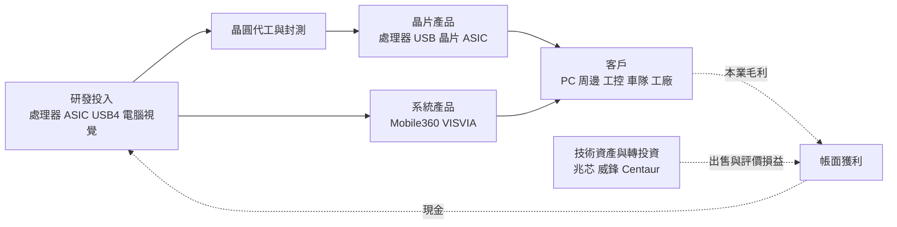
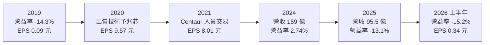
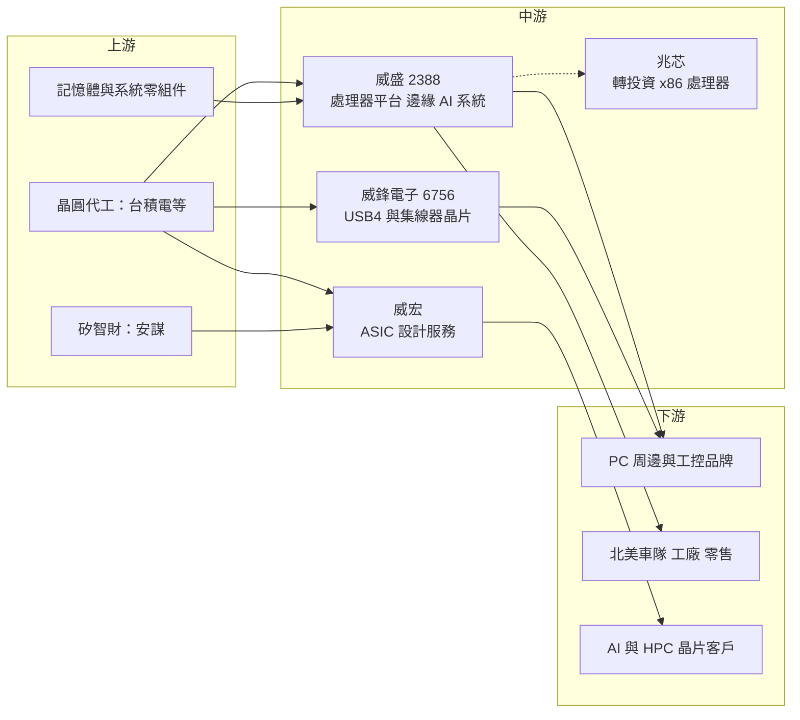

# 2388 威盛

> 上市｜[[產業索引-半導體業|半導體業]]｜上市（櫃）日期 1999/03/05

# 第一章：企業模式與商業藍圖

> [!info] 撰寫說明
> 本文由 Claude 依公開資料整理，架構比照 [[2330台積電]] 的四章研究，資料截至 2026-10-08。財務數字來源：證交所開放資料快照（基本資料、2026 年第二季資產負債與綜合損益、股利）、Goodinfo 經營績效頁與股利政策頁（2016 至 2025 年）、MoneyDJ 季資產負債表（2026 年第二季借款科目）、科技新報 2020 年 10 月報導（出售晶片組與部分 x86 技術予上海兆芯）、工商時報與數位時代 2021 年 11 月報導（Centaur 人員交易）、優分析 2025 年 11 月法說會整理；兆芯的成立年份與持股結構、Cyrix 與 Centaur 的取得細節係憑記憶整理，尚未逐條比對原始文件。#待校對

在評估一家公司的長期投資價值時，第一步是看懂它靠什麼賺錢、為什麼能一直賺下去。本章針對威盛電子（股票代號：2388，以下簡稱威盛）的商業模式進行定性分析，說明這家曾經與英特爾在 PC 晶片組與處理器市場正面交鋒的老牌 IC 設計公司，如何在晶片組時代結束後，一步步把技術資產轉成現金，再把剩下的本業重組成「處理器、介面晶片、ASIC 設計服務與邊緣 AI 系統」四個板塊。理解威盛最重要的一點是：它的帳面獲利長期由業外與轉投資決定，本業至今仍未證明能穩定賺錢。

## 一、核心定位：握有 x86 技術資產的 IC 設計與系統集團

威盛成立於 1992 年，1999 年在台灣證交所上市，董事長兼總經理為陳文琦。1990 年代末到 2000 年代初，威盛是全球最重要的 PC 晶片組供應商之一，晶片組負責連接處理器、記憶體與周邊，是當年主機板上僅次於 CPU 的關鍵晶片。同一時期，威盛透過收購 Cyrix 與 Centaur 取得 [[x86]] 處理器的設計能力（取得細節待校對），並在與 [[INTC英特爾]] 的專利訴訟和解後，成為全球少數能合法設計 x86 處理器的公司之一。

晶片組的黃金時代在 2000 年代後期結束。英特爾與 [[AMD超微]] 把記憶體控制器與繪圖功能陸續整合進 CPU，獨立晶片組的市場迅速萎縮，威盛的營收與獲利也隨之大幅下滑。之後的十多年，威盛的主軸是「把過去累積的技術資產變現，同時尋找新的本業」，這構成了今天威盛的兩層結構。

第一層是轉投資與技術資產。威盛與上海市政府相關資金合資成立兆芯集成電路（成立年份與持股比例待校對），以 x86 架構開發中國自主的桌面、伺服器與嵌入式處理器。2020 年 10 月，威盛子公司把晶片組相關技術與部分 x86 處理器技術出售給兆芯，交易總額約 2.57 億美元、獲利約 1.97 億美元（科技新報報導）；2021 年 11 月，威盛又與英特爾簽約，由英特爾延攬美國子公司 Centaur 的處理器研發人員，威盛取得約 1.25 億美元。這兩筆交易解釋了 2020 與 2021 年的高 EPS。2025 年 6 月，兆芯向上海科創板申請上市，兆芯的評價與上市進度成為威盛資產價值的重要變數。

第二層是仍在經營的本業，包括低功耗處理器與嵌入式平台、上市子公司 [[6756威鋒電子]] 的 [[USB4]] 與 USB 集線器晶片、ASIC 子公司威宏的[[設計服務]]，以及以 Mobile360 與 VISVIA 為品牌的[[邊緣AI]]系統產品。投資人看威盛時，必須把這兩層分開看：本業決定公司能否長期自立，轉投資則決定帳面淨值與一次性獲利。

## 二、終端應用／產品板塊：四個事業各有不同的商業邏輯

威盛沒有公開揭露各事業的營收比重，因此本章不繪製圓餅圖。依法說會內容，威盛的本業可以分成四塊，它們的客戶、毛利與成長邏輯都不同。

- **處理器與嵌入式平台：** 威盛自有的低功耗 x86 處理器與嵌入式主機板，主要用於工業電腦、資訊站與特定用途設備。這個市場規模不大，但產品生命週期長，客戶重視長期供貨與穩定性。對威盛而言，這是延續 x86 技術價值的基本盤，而不是成長引擎。
- **USB 與高速介面晶片（威鋒電子）：** 威鋒專注 USB 集線器、USB4 與 PD 控制晶片，客戶是 PC、筆電周邊與擴充基座品牌。USB 規格每幾年升級一次，每次升級都需要重新通過相容性認證，因此有經驗的廠商能累積驗證優勢。威鋒是威盛旗下最接近標準 IC 設計公司模式的事業。
- **ASIC 設計服務（威宏）：** 替客戶設計客製化晶片，收入包括一次性的設計費與後續量產晶片的銷售。法說會提到威宏的設計能力已延伸到 6 奈米以下，並以 3 奈米為下一個目標，同時加入 [[ARM安謀]] 的生態系。但 ASIC 設計服務是高度講究規模與晶圓廠關係的行業，威宏在這個市場仍屬小型參與者。
- **邊緣 AI 系統（Mobile360、VISVIA）：** 把攝影機、運算模組與電腦視覺演算法整合成完整系統，應用在商用車隊的駕駛安全、工廠工安、智慧零售與門禁。依法說會說明，Mobile360 已導入北美重型車隊。這塊業務賣的是「系統加服務」，毛利結構與晶片不同，但需要長期的客戶經營。

## 三、資本轉化邏輯：本業投入研發、轉投資實現價值

威盛的資本循環和一般 IC 設計公司不太一樣，可以從三個面向理解。

- **本業長期無法覆蓋研發費用：** 2016 至 2025 年的十年間，威盛的[[營業利益率]]只有 2022 年（約 0%）與 2024 年（2.74%）沒有虧損，其餘年份多在負 12% 到負 30% 之間。毛利率大致落在 22% 到 43%，低於主流 IC 設計公司，原因是產品組合中系統產品與中低價晶片占比較高。本業的毛利不足以支應處理器、ASIC 與 AI 的研發投入，這是威盛最根本的經營問題。
- **用技術資產交易補足現金：** 過去十年威盛最大的兩筆獲利，都是一次性出售技術資產。2020 年出售晶片組與部分 x86 技術給兆芯、2021 年 Centaur 人員交易，讓 2020、2021 年的 EPS 分別達到 9.57 元與 8.01 元，ROE 一度衝到 66.6% 與 35.2%。這類收益讓威盛累積了相當的現金與金融資產，但本質上是「賣家當」，不可重複。
- **[[權益法]]與金融資產評價：** 威盛持有兆芯等轉投資部位，2026 年第二季資產負債表上的透過損益與透過其他綜合損益按公允價值衡量之金融資產合計約 75.5 億元（MoneyDJ）。這些資產的評價變動與處分損益，會讓單季[[業外收益]]大幅波動。2026 年上半年本業營業損失 8.53 億元，但業外收入 10.12 億元，最後歸屬母公司淨利仍為 1.87 億元。

## 四、企業長期藍圖：從賣技術資產轉向邊緣 AI 與客製晶片

依 2025 年法說會與 2026 年股東會的說明，威盛的中長期方向有三條主線。

- **邊緣 AI 落地：** 陳文琦多次表示，AI 的價值不只在訓練大型模型，更在把 AI 部署到工廠、車隊、零售與辦公室等真實場景。威盛以 VISVIA 品牌整合影像辨識與生成式 AI，把多年累積的嵌入式系統經驗轉成可以收取經常性收入的解決方案。這條路的優點是客戶黏著度高，缺點是每個場景都需要長時間導入，規模化速度慢。
- **先進製程 ASIC：** 威宏爭取 AI 與 [[HPC]] 客製晶片案，設計節點往 3 奈米推進。這個市場由大型設計服務公司主導，威宏能否拿到量產案，決定研發投入能否回收。
- **光通訊與[[矽光子]]：** 威盛表示投資光通訊，並參與 [[2330台積電]] 的矽光子相關平台。這仍屬早期布局，對營收的影響需要多年才能看出。

長期來看，威盛的轉型能否成功，關鍵不在於轉投資價值有多高，而在於本業能否在可預見的時間內回到穩定的營業獲利。如果本業持續虧損，股東權益會一點一點被研發費用消耗，轉投資的價值終究要靠處分才能實現。

# 第二章：護城河深度與競爭優勢

在長期價值投資中，「護城河」指企業抵禦競爭、長期維持超額利潤的保護機制。本章分析威盛擁有哪些稀缺資產、面對哪些國內外對手，以及為什麼這些資產過去十年沒有轉化成穩定的本業獲利。

## 一、威盛護城河的核心組成要素

威盛擁有一些難以複製的資產，但這些資產轉成獲利的效率偏低，整體屬於「資產型、但獲利轉化弱」的窄護城河，主要由三個要素構成。

- **1. x86 技術與歷史授權地位：** x86 是 PC 與伺服器的主流指令集，能設計 x86 處理器的公司在全球屈指可數。這項地位讓威盛得以與兆芯合作，並在 2020 年把部分技術以約 2.57 億美元出售。它的價值在於稀缺，但限制也很清楚：x86 市場由英特爾與 AMD 主導，威盛自己無法在主流 PC 與伺服器市場與它們競爭，技術價值主要透過授權、合作或出售實現。
- **2. 從晶片到系統的整合經驗：** 威盛從晶片、主機板、軟體到電腦視覺演算法都有能力自己做，可以提供車隊與工廠完整的 AI 安全方案。對車隊經營者來說，一旦系統裝上車、與管理平台整合，更換供應商的成本不低。這是威盛在邊緣 AI 領域最實際的優勢，但規模仍小。
- **3. USB 介面的驗證累積：** 威鋒在 USB 集線器與 USB4 累積多年經驗，產品已通過多家主力品牌驗證。USB 規格升級時，相容性驗證是進入門檻，已在品牌客戶名單上的廠商通常能延續合作。

## 二、全球主要競爭對手格局

| 對手 | 定位 | 對威盛的影響 |
|---|---|---|
| [[INTC英特爾]]、[[AMD超微]] | x86 處理器的主導者 | 在 PC 與伺服器處理器市場占絕對優勢，威盛只能做嵌入式與利基市場 |
| [[3443創意]]、[[3661世芯-KY]] | 先進製程 ASIC 設計服務 | 規模、晶圓廠關係與 AI 案源遠勝威宏，是爭取客製晶片案的主要對手 |
| [[5269祥碩]]、[[2379瑞昱]] | 高速介面與 USB 晶片 | 與威鋒在 USB 與 PC 周邊晶片直接競爭，祥碩在 USB4 與 PCIe 規模較大 |
| Mobileye、Samsara 等車用與車隊方案商 | 駕駛輔助與車隊管理 | 在車隊安全與管理系統爭取同一批客戶，品牌與軟體平台規模較大 |
| 中國本土處理器業者 | 自主 CPU（龍芯、海光等） | 與兆芯在中國自主處理器市場競爭，間接影響威盛轉投資價值 |

## 三、優勢轉化：哪些守得住、哪些守不住

- **守得住：** 需要客製整合的系統訂單，例如北美重型車隊的駕駛安全系統與工廠工安系統。這類客戶看重系統穩定、在地服務與長期維護，價格不是唯一考量，威盛可以靠整合能力維持合理毛利。工業嵌入式處理器平台因生命週期長，也屬於穩定但規模有限的基本盤。
- **守不住：** 一般 PC 周邊與通用晶片的價格競爭，以及需要大規模研發投入的先進製程 ASIC。過去十年本業營業利益率多數年份為負，說明威盛的產品在主流市場缺乏定價能力；先進製程 ASIC 的光罩與研發成本極高，小型設計服務公司若拿不到大客戶，很難攤提。
- **觀察重點：** 長期而言可以追蹤三件事。第一是本業營業利益率能否連續數年轉正，這是威盛是否真正完成轉型的唯一判準；第二是兆芯上市後的評價與威盛的處分策略，決定股東能否實際拿到轉投資的價值；第三是威鋒與威宏能否各自建立穩定的獲利模式，而不是持續依賴母公司資源。

# 第三章：財務體質與盈利規模

資料日期：2026-10-08。數字取自 Goodinfo 經營績效頁與股利政策頁、證交所開放資料快照與 MoneyDJ 季資產負債表，表格是撰寫當時的快照；最新月營收、毛利率、累計 EPS 由自動排程寫在本筆記的屬性欄位（月營收、毛利率、累計EPS 等）。#待校對

財務報表是檢驗護城河是否真實存在的最終標準。本章用多年度的三率、ROE、現金流與資本報酬，把威盛的本業與業外分開檢視。

## 一、獲利能力的基石：三率

| 年度 | 營收（億元） | [[毛利率]] | [[營業利益率]] | EPS（元） | [[ROE]] |
|---|---|---|---|---|---|
| 2019 | 55.3 | 32.1% | -14.3% | 0.09 | 2.29% |
| 2020 | 65.0 | 31.6% | -12.0% | 9.57 | 66.6% |
| 2021 | 70.0 | 42.7% | -20.6% | 8.01 | 35.2% |
| 2022 | 93.0 | 35.7% | 0.04% | -0.17 | 1.55% |
| 2023 | 126 | 25.3% | -0.2% | 0.82 | 3.37% |
| 2024 | 159 | 24.7% | 2.74% | 2.07 | 6.12% |
| 2025 | 95.5 | 22.5% | -13.1% | 0.12 | 0.4% |

（來源：Goodinfo 經營績效頁，合併報表。2022 年 EPS 為負但 ROE 為正，推估與非控制權益損益有關，依原頁數字列出。2026 年上半年依證交所資料，營收 56.07 億元、毛利率 22.6%、營業利益率 -15.2%、EPS 0.34 元。）

- **本業的三率長期偏弱：** 七年之中只有 2022 至 2024 年營業利益率接近或略高於零，其餘年份都是兩位數虧損。2023 與 2024 年營收一度擴大到 126 億與 159 億元，但毛利率同步降到 25% 上下，顯示營收成長主要來自毛利較低的產品或系統出貨（推估）；2025 年營收回落到 95.5 億元後，費用無法同步縮減，營業利益率又回到負 13.1%。
- **EPS 由一次性項目決定：** 2020 與 2021 年的高 EPS 分別來自出售技術予兆芯與 Centaur 人員交易，不能視為常態獲利能力。若排除這兩年，2019 至 2025 年威盛的 EPS 大致在負 0.2 元到 2 元之間。
- **營收成長不穩定：** 2020 至 2025 年營收年複合成長率約 8.0%（推算），但期間先升到 159 億元再掉回 95.5 億元，波動遠大於成長。對威盛而言，營收規模不是重點，營收能否帶來正的營業利益才是重點。

## 二、[[ROE]]：資本效率

2021 至 2025 年威盛的平均 ROE 約 9.3%（推算），但其中 2021 年的 35.2% 來自一次性交易；若只看 2022 至 2025 年，平均 ROE 只有約 2.9%（推算），屬於偏低的水準。依 2026 年第二季證交所資料，威盛權益總計約 242.0 億元，其中歸屬母公司約 222.2 億元，每股淨值約 39.98 元，現金及約當現金約 127.1 億元、金融資產約 75.5 億元（MoneyDJ）。換句話說，威盛的淨值大部分是現金與投資部位，而不是產生營業利益的營運資產，這也是 ROE 長期偏低的結構性原因。

## 三、資本支出、自由現金流與股利

- **[[CapEx]]：** 威盛沒有晶圓廠，資本支出規模小，主要是研發設備與辦公設施，具體金額未查得。資本支出不是威盛的負擔，研發費用才是。
- **[[自由現金流]]：** 多年度自由現金流數字未查得。由於本業多數年份虧損，營業現金流長期承壓（推估），威盛的現金主要來自 2020 與 2021 年的技術資產交易，以及金融資產的處分與股利收入。
- **股利穩定度：** 依 Goodinfo 股利政策頁，2016 至 2019 年度威盛未發放現金股利；2020 年度起每股配發約 0.8 元（所屬年度依推估），2021 年度 1 元，之後 2022 至 2025 年度分別為 0.15、0.1、0.2 與 0.05 元。股利跟著一次性收益起落，並不穩定，也不構成投資威盛的主要理由。

## 四、[[ROIC]] 與 [[WACC]]：價值創造利差

- **ROIC（推算）：** 以 2025 年營收 95.5 億元乘以營業利益率 -13.1%，營業損失約 12.5 億元；虧損年度不計稅盾，稅後營業利益以 -12.5 億元計。投入資本以 2026 年第二季權益總計約 242.0 億元，加上有息負債約 14.4 億元（應付商業本票 5.82 億、長期借款 6.54 億、租賃負債 2.06 億），合計約 256.4 億元，ROIC 約 -4.9%（推算）。以 2026 年上半年營業損失 8.53 億元年化，ROIC 約 -6.7%（推算）。即使用本業表現最好的 2024 年（營業利益約 4.4 億元，稅後約 3.5 億元）計算，ROIC 也只有約 1.4%（推算）。
- **WACC（推算）：** 以 [[CAPM]] 估算股東權益成本：無風險利率取台灣 10 年期公債約 1.75%，市場風險溢酬 6%，β 假設 1.2（台灣中小型 IC 設計股常見值，未查得威盛實際數字），權益成本約 8.95%。稅前負債成本假設 2.5%、稅率 20%，稅後約 2.0%。以帳面價值計算，負債占投入資本約 6%、權益約 94%，WACC 約 8.6%（推算）。
- **價值創造判斷：** 威盛本業的 ROIC 長期低於 WACC，而且多數年份為負，代表本業並沒有替股東創造價值。威盛過去的價值創造幾乎全部來自技術資產的出售與轉投資的增值，這種價值是一次性的。評估威盛較適合採用「控股公司」的方法：分別估算兆芯持股、威鋒持股、現金與金融資產的價值，再扣除本業未來持續虧損的現值。只有在本業營業利益率能穩定轉正後，才適合用一般營運公司的方法評估。

# 第四章：總體風險與地緣政治

任何企業都無法脫離宏觀環境獨立存在。本章分析威盛未來必須面對的地緣政治、產業週期、營運與技術風險。

## 一、地緣政治風險

- **兆芯與美中科技競爭：** 兆芯是中國推動處理器自主化的一環，這讓它在中國享有政策需求，但也讓它暴露在美國出口管制與實體清單的風險中。2020 年威盛出售 x86 技術給兆芯時，科技新報就分析過可能引起美方關注。若兆芯受到更嚴格的管制，威盛持股的評價與後續處分都可能受影響。
- **ASIC 與 AI 晶片出口管制：** 法說會提到威宏部分 ASIC 業務受美中出口管制影響而出貨遞延。AI 與高效能運算晶片是美國管制的重點，若客戶位於受限地區，設計服務案源就會受限。
- **兩岸法規：** 台灣對赴中投資與關鍵技術輸出的審查逐步收緊，威盛與兆芯之間的技術合作、資金往來與持股處分，都可能需要更長的審批時間。

## 二、產業週期與市場結構風險

- **PC 與工控週期：** 處理器平台與 USB 晶片的需求跟著 PC、筆電與工業電腦的換機週期走。PC 市場在疫情後經歷明顯的庫存調整，威盛 2025 年營收從 159 億元掉到 95.5 億元，顯示它對下游需求波動相當敏感。
- **AI 投資週期：** 邊緣 AI 系統與 ASIC 案源都依賴企業對 AI 的投資意願。若 AI 投資在某段期間放緩，威盛的新事業可能面臨案源延後，而研發費用卻已經投入。
- **[[長鞭效應]]：** 威盛處於供應鏈中上游，終端需求的小幅變動往往被通路與系統廠的庫存調整放大，使單一年度營收出現大幅起落。

## 三、營運環境的隱性風險

- **業外主導獲利的不可預測性：** 威盛的 EPS 長期由轉投資損益決定，單季甚至可以在虧損與獲利之間大幅擺盪，投資人很難用本業趨勢推估未來獲利。
- **研發費用的回收風險：** 處理器、ASIC 與 AI 的研發都需要持續投入，若在數年內拿不到足夠的量產案，研發費用會持續侵蝕股東權益。
- **集團治理與關係人交易：** 威盛旗下子公司與轉投資眾多，跨台灣、美國與中國，關係人交易與資訊揭露的透明度，是投資人需要長期留意的地方。

## 四、科技與法規演進風險

- **處理器架構轉移：** Arm 與 RISC-V 在 PC、伺服器與嵌入式市場持續滲透，x86 的市占若長期下滑，威盛 x86 技術資產與兆芯的價值都會被稀釋。
- **車輛安全法規：** 全球車輛安全法規逐步要求[[DMS]]（駕駛監控）與盲點偵測，對 Mobile360 是長期需求來源，但每個市場都有不同的認證要求，進入新市場需要時間與成本。
- **隱私與 AI 法規：** 影像辨識用在零售、門禁與職場時，涉及個人資料與隱私規範。各國 AI 法規的發展，可能限制部分應用或增加合規成本。

# 專有名詞解析

## 半導體

- **[[x86]]**：英特爾開發的處理器指令集架構，是 PC 與伺服器的主流，能合法設計 x86 處理器的公司極少。
- **[[ASIC]]**：特殊應用積體電路，依特定客戶或用途量身設計的晶片，效率比通用晶片高，但前期開發成本大。
- **[[設計服務]]**：替客戶完成晶片設計、驗證、投片與封測安排的服務，收入包括一次性設計費與量產晶片銷售。
- **[[矽光子]]**：在矽晶片上製作光學元件，以光取代電傳輸資料，可降低 AI 資料中心的傳輸耗電。

## 應用

- **[[USB4]]**：新一代 USB 傳輸標準，頻寬可達 40Gbps 以上，整合資料、影像與充電功能。
- **[[HPC]]**：高效能運算，用於 AI 訓練、科學運算與資料中心的大量平行運算。
- **[[邊緣AI]]**：在終端裝置或現場設備上直接執行 AI 推論，不必把資料傳回雲端，延遲低、隱私較佳。
- **[[DMS]]**：駕駛監控系統，以攝影機偵測駕駛是否分心或疲勞，是車輛安全法規逐步要求的配備。

## 金融

- **[[業外收益]]**：本業以外的收入，例如投資處分利益、股利或匯兌收益，通常不具持續性。
- **[[權益法]]**：持股達重大影響時，依被投資公司損益按持股比例認列投資收益的會計方法。
- **[[ROIC]]**：投入資本報酬率，稅後營業利益除以股東權益加有息負債，衡量本業運用資本的效率。
- **[[WACC]]**：加權平均資金成本，依股東權益與負債的比重，加權計算公司取得資金的平均成本。
- **[[CAPM]]**：資本資產定價模型，以無風險利率加上 β 乘以市場風險溢酬估算股東要求報酬率。
- **[[長鞭效應]]**：終端需求的小幅變動，沿供應鏈往上游傳遞時被逐級放大，造成上游庫存與訂單劇烈波動。

# 核心供應鏈

## 1. 上游：晶圓代工、矽智財與零組件
- 晶圓代工與矽光子平台：[[2330台積電]]
- 處理器矽智財：[[ARM安謀]]
- 記憶體與系統零組件：供應商未揭露

## 2. 中游：威盛本身與子公司、轉投資
- USB4 與 USB 集線器晶片：[[6756威鋒電子]]
- ASIC 設計服務：威宏（未上市）
- 轉投資 x86 處理器：兆芯集成電路（中國上海）

## 3. 下游：主要客戶類型
- PC、筆電周邊與工業電腦品牌（名單未揭露）
- 北美重型車隊、工廠工安、零售與門禁場域
- AI 與高效能運算晶片的 ASIC 客戶

## 4. 同業
- x86 處理器：[[INTC英特爾]]、[[AMD超微]]
- ASIC 設計服務：[[3443創意]]、[[3661世芯-KY]]
- 介面晶片：[[5269祥碩]]、[[2379瑞昱]]

延伸閱讀：[[台積電供應鏈]]

## 最新新聞
<!-- news:start（自動產生，請勿手動編輯此範圍） -->
- 2026-10-15 🏛️ 重訊 14:30｜代子公司VIA CPU PLATFORM CO., LTD 公告取得 VIA CPU PLATFORM (HK) LIMITED股權｜[觀測站](https://mops.twse.com.tw/mops/#/web/t05st01)
- 2026-10-15 🏛️ 重訊 14:30｜代子公司VIA CPU PLATFORM CO., LTD.公告辦理現金增資｜[觀測站](https://mops.twse.com.tw/mops/#/web/t05st01)
- 2026-10-15 🏛️ 重訊 14:29｜代子公司VIABASE CO., LTD. 公告取得VIA CPU PLATFORM CO., LTD增資新股｜[觀測站](https://mops.twse.com.tw/mops/#/web/t05st01)

完整紀錄：[[2388威盛 新聞]]
<!-- news:end -->

## 相關連結
- [公開資訊觀測站](https://mopsov.twse.com.tw/mops/web/t05st03?step=1&firstin=1&co_id=2388)
- [Goodinfo](https://goodinfo.tw/tw/StockDetail.asp?STOCK_ID=2388)
- [Yahoo 股市](https://tw.stock.yahoo.com/quote/2388)
- [鉅亨網新聞](https://www.cnyes.com/twstock/2388/news)
