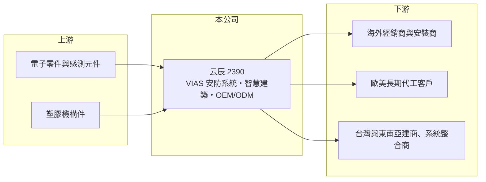

# 2390 云辰

> 上市｜[[產業索引-其他電子業|其他電子業]]｜上市（櫃）日期 1999/06/15

# 第一章：企業模式與商業藍圖

> [!info] 撰寫說明
> 精簡版，由 Claude 依公開資料整理，架構比照 [[2330台積電]]，資料截至 2026-10-08。來源：證交所開放資料快照（基本資料、2026 年第二季資產負債與損益、股利）、Goodinfo 經營績效頁、富果研究 2025 年 12 月法說會筆記。公開資料有限。#待校對

云辰電子是成立超過 45 年的安防設備廠，從替歐美客戶代工防盜感應器起家，近年嘗試以自有品牌 VIAS 轉型為安防系統與[[智慧建築]]方案供應商。它的關鍵問題很單純：營收規模只有 6 至 7 億元，本業長年虧損，轉型能否讓本業回到獲利。

- **核心業務：** 云辰成立於 1980 年、1999 年上市。業務分三塊：自有品牌 VIAS（Video IoT Alarm System）專業影像安防 AI 系統，包含具 AI 功能的主機、結合紅外線（[[PIR]]）與微波的雙鑑式防盜感應器及遠端監控軟體；台灣與東南亞的智慧建築系統，包括中央監控、建案弱電工程與工控設備；以及服務歐美長期客戶的 OEM/ODM 製造。
- **營收結構：** 各業務營收比重公開資料未查得。依法說會，2025 年前三季營收約 5.1 億元，與前一年持平，毛利約 1.1 億元，營業虧損約 2,083 萬元，獲利主要靠業外收入。
- **營運據點：** 總部在台灣，生產基地在中國廣東東莞。VIAS 品牌透過海外經銷商與系統整合商銷售，優先拓展歐洲，再到中南美與東南亞；智慧建築以台灣為主，逐步複製到東南亞。
- **長期方向：** 公司策略是從硬體代工轉向「系統品牌＋服務」，整合硬體、雲端與軟體，提高毛利與經常性收入。品牌與系統業務需要長期投入行銷與研發，在營收規模小的情況下，短期內費用負擔重。

# 第二章：護城河深度與競爭優勢

云辰屬於安防設備中的小型利基廠，護城河有限，主要依靠長期客戶關係與產品認證。

- **競爭優勢：** 防盜感應器與警報主機需要通過各國安規與保險業認證，云辰與歐美客戶合作多年，產品已在當地市場驗證，客戶不會輕易更換。結合影像與警報的 VIAS 系統則鎖定專業安裝商，若能建立裝機基礎，後續的軟體與服務可帶來黏著度。
- **主要對手：** 國際安防大廠如 Honeywell、Bosch、Johnson Controls 旗下品牌，以及以色列、歐洲的專業警報系統商（#待校對）；中國大陸的海康威視、大華等在影像安防具有極大規模與價格優勢。
- **觀察重點：** 長期最該追蹤的是營業利益率能否轉正。2019 至 2025 年營業利益率全部為負（-1.4% 至 -28.9%），毛利率雖由 18% 提升到 21% 至 25%，仍不足以支撐費用。

# 第三章：財務體質與盈利規模

資料日期：2026-10-08，表格是撰寫當時的快照；最新月營收、毛利率、累計 EPS 由自動排程寫在本筆記的屬性欄位（月營收、毛利率、累計EPS 等）。#待校對

云辰的財務特徵是本業連年虧損、獲利由業外決定，且資產遠大於營運規模。

| 年度 | 營收（億元） | [[毛利率]] | [[營業利益率]] | EPS（元） | [[ROE]] |
|---|---|---|---|---|---|
| 2019 | 6.21 | 18.8% | -23.8% | -0.84 | -8.29% |
| 2020 | 5.31 | 17.6% | -23.0% | 0.91 | 8.81% |
| 2021 | 5.91 | 17.9% | -28.9% | 6.67 | 45.6% |
| 2022 | 5.91 | 21.0% | -7.05% | -4.11 | -26.3% |
| 2023 | 6.48 | 25.1% | -2.19% | -0.42 | -3.07% |
| 2024 | 7.02 | 24.3% | -1.40% | -1.25 | -9.82% |
| 2025 | 6.79 | 21.1% | -4.94% | -0.14 | -1.17% |

（來源：Goodinfo 經營績效頁。2026 年上半年依證交所資料：營收 3.2 億元、毛利率 20.2%、營業利益率 -7.9%、EPS 0.11 元。）

- **營收規模：** 2019 至 2025 年營收在 5.3 億至 7.0 億元之間，年複合成長率約 1.5%（推算），規模停滯。以實收資本額 19.26 億元來看，每股營收只有約 3.5 元，營運規模相對股本偏小。
- **獲利：** 近五年 ROE 平均約 1%（推算），但這個平均沒有意義：2021 年 ROE 45.6%、2022 年 -26.3%，大起大落來自業外的投資或資產處分損益（推估，#待校對），而本業每年都在虧損。
- **財務特色：** 2026 年第二季總資產約 27.3 億元、負債僅 3.7 億元、權益 23.6 億元，保留盈餘為 -1.6 億元，每股淨值約 12.2 元。資產以流動資產（16.7 億元）與投資為主，遠超過營運所需，代表公司的價值主要在資產而非本業。2025 年度未配息，Goodinfo 統計的歷年平均現金股利僅約 0.17 元。
- **[[ROIC]] 與 [[WACC]]：** 以 2025 年營業損失約 0.34 億元（6.79 億元 × -4.94%）計算，稅後營業利益為負，以權益 23.6 億元至權益加負債 27.3 億元為投入資本，ROIC 約 -1%（推算）。WACC 以 [[CAPM]] 推估：無風險利率 1.75%、市場風險溢酬 6%、β 假設 1.0（小型電子股常見值），因幾乎沒有負債，WACC 約 7.75%（推算）。ROIC 長期為負且遠低於 WACC，代表本業持續消耗股東價值；若投入資本只算營運實際使用的部分，負報酬會更明顯。

# 第四章：總體風險與地緣政治

云辰的風險在於規模太小、本業無法自給，轉型需要的時間與資金可能超出現有營運的負擔。

- **產業週期：** 安防設備需求跟著住宅、商辦與營建景氣，以及企業資本支出起伏；智慧建築的弱電工程則依賴建案推案量。
- **營運風險：** 本業連年虧損，獲利仰賴業外收益，每年 EPS 難以預測。品牌轉型需要持續的研發與海外行銷費用，若營收無法放大，虧損可能延續。
- **其他風險：** 生產基地在中國東莞，面臨美中關稅與歐美市場對中國製安防設備的限制；中國大廠在影像安防的低價競爭；電子零件成本與匯率變動。

# 專有名詞解析

## 應用

- **[[智慧建築]]**：以感測器、控制器與網路整合建築的照明、空調、門禁與安防，達到節能與自動化管理。
- **[[PIR]]**：被動式紅外線感測器，偵測人體發出的紅外線變化來判斷有人移動，是防盜感應器的基本元件。

## 金融

- **[[業外收益]]**：本業以外的收入，例如投資收益、處分資產利益或匯兌利益。
- **[[CAPM]]**：資本資產定價模型，以無風險利率加上 β 乘以市場風險溢酬估算股東要求報酬率。

# 核心供應鏈

- 上游：電子零件、紅外線與微波感測元件、塑膠機構件供應商（推估）。
- 下游／客戶：海外品牌經銷商與安防安裝商、歐美 OEM/ODM 客戶、台灣與東南亞的建商與系統整合商。
- 同業：Honeywell、Bosch 等國際安防品牌；中國海康威視、大華；台灣安控同業晶睿。

## 最新新聞
<!-- news:start -->
<!-- news:end -->

## 相關連結
- [公開資訊觀測站](https://mopsov.twse.com.tw/mops/web/t05st03?step=1&firstin=1&co_id=2390)
- [Goodinfo](https://goodinfo.tw/tw/StockDetail.asp?STOCK_ID=2390)
- [Yahoo 股市](https://tw.stock.yahoo.com/quote/2390)
- [鉅亨網新聞](https://www.cnyes.com/twstock/2390/news)
