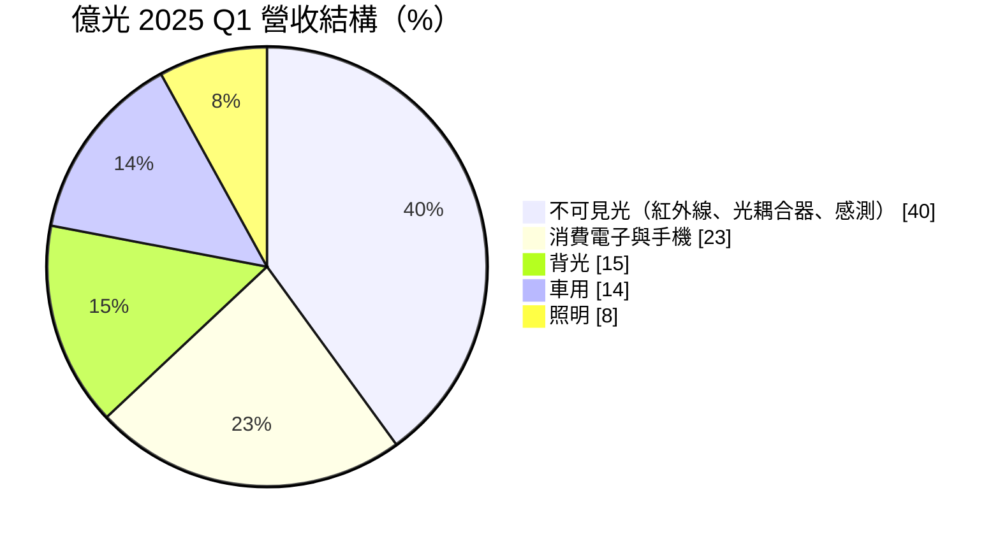
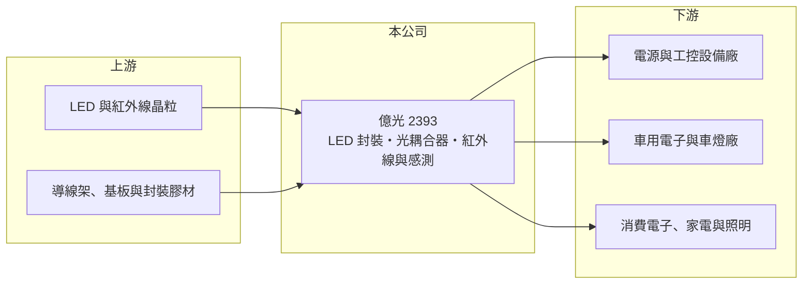

# 2393 億光

> 上市｜[[產業索引-光電業|光電業]]｜上市（櫃）日期 1999/11/04

# 第一章：企業模式與商業藍圖

> [!info] 撰寫說明
> 精簡版，由 Claude 依公開資料整理，架構比照 [[2330台積電]]，資料截至 2026-10-08。來源：證交所開放資料快照（基本資料、2026 年第二季資產負債與損益、股利）、Goodinfo 經營績效頁、富果研究 2025 年 5 月法說會筆記（營收結構、產能分布）。#待校對

億光是台灣最大的 [[LED封裝]]廠之一，但它的長期價值已不在一般照明 LED，而在紅外線、[[光耦合器]]、感測元件等「不可見光」產品與車用 LED。過去十年，億光的故事就是逐步退出殺價激烈的照明與背光市場，把產品組合移向毛利較高的利基應用。

- **核心業務：** 億光成立於 1983 年、1999 年上市，董事長兼總經理為葉寅夫。公司向上游購買 [[LED晶粒]]，封裝成可直接焊接使用的元件，產品涵蓋可見光 LED（照明、背光、車用、消費電子指示燈）與不可見光元件（紅外線、紫外線、光耦合器、光感測器）。
- **營收結構：** 依 2025 年第一季法說會資料，不可見光約 40%（其中光耦合器約占總營收兩成）、消費電子與手機約 23%、背光約 15%、車用約 14%、照明約 8%。不可見光與車用比重上升，背光與照明比重下降，這正是公司刻意調整的方向。

- **營運據點：** 生產基地在台灣與中國大陸，產能約各半，員工約 4,500 人。客戶要求在中國與台灣以外設立產能，公司曾規劃泰國廠作為第三基地，但因關稅不確定性而放緩。約 85% 營收以外幣計價。
- **長期方向：** 提高不可見光與車用比重、降低照明與背光；部分背光業務已移轉給策略聯盟的投資公司。另布局車用 Mini LED 顯示、AR/VR 與智慧眼鏡，以及伺服器與 AI 伺服器相關光電元件。公司也刻意壓低資本支出以減少折舊。

# 第二章：護城河深度與競爭優勢

億光的護城河來自規模、完整產品線與光耦合器的品質認證，屬於成熟產業中的中等護城河。

- **競爭優勢：** 光耦合器用於電源供應器、工控與電動車，負責隔離高低壓電路，安全認證嚴格、客戶不常更換，價格競爭遠比照明 LED 溫和。億光產品線完整，同一客戶的指示燈、紅外線與光耦合器可以一次採購，規模也讓它在原料採購上具成本優勢。毛利率由 2019 年的 24.5% 一路升到 2025 年的 31.1%，證明產品組合調整確實有效。
- **主要對手：** LED 封裝同業有 [[2301光寶科]]、隆達、東貝、[[6168宏齊]] 與中國大陸的木林森等；光耦合器則面對 [[AVGO博通]]、東芝、瑞薩等國際大廠。億光在德國與日亞化有專利訴訟，2025 年第一季提列約 190 萬歐元準備。
- **觀察重點：** 長期要追蹤不可見光與車用比重能否持續提高、毛利率能否維持在 30% 以上，以及非中國產能的布局進度。後者決定億光能否承接車用與伺服器客戶的供應鏈分散需求。

# 第三章：財務體質與盈利規模

資料日期：2026-10-08，表格是撰寫當時的快照；最新月營收、毛利率、累計 EPS 由自動排程寫在本筆記的屬性欄位（月營收、毛利率、累計EPS 等）。#待校對

億光的財務呈現「營收持平、利潤率逐年提升」的轉型成果，並維持高配息。

| 年度 | 營收（億元） | [[毛利率]] | [[營業利益率]] | EPS（元） | [[ROE]] |
|---|---|---|---|---|---|
| 2019 | 210 | 24.5% | 3.98% | 1.86 | 4.93% |
| 2020 | 216 | 25.0% | 6.26% | 2.79 | 7.11% |
| 2021 | 250 | 26.8% | 9.65% | 4.37 | 10.9% |
| 2022 | 199 | 28.2% | 7.39% | 2.78 | 7.01% |
| 2023 | 178 | 29.1% | 10.0% | 3.32 | 8.02% |
| 2024 | 210 | 30.3% | 11.7% | 6.64 | 15.7% |
| 2025 | 196 | 31.1% | 12.5% | 4.60 | 9.99% |

（來源：Goodinfo 經營績效頁。2026 年上半年依證交所資料：營收 104.0 億元、毛利率 24.4%、營業利益率 8.5%、EPS 2.14 元。）

- **營收規模：** 2019 至 2025 年營收在 178 億至 250 億元之間，年複合成長率約 -1.1%（推算），規模大致持平。這是主動退出低毛利產品的結果，營收減少的部分多來自照明與背光。
- **獲利：** 營業利益率由 2019 年的 4.0% 提升到 2025 年的 12.5%，提升三倍，是轉型最具體的成果。近五年（2021 至 2025）平均 ROE 約 10.3%（推算）；2024 年 EPS 6.64 元含較多業外收益（推估），2025 年回到 4.60 元。2026 年上半年毛利率降到 24.4%，需觀察是短期產品組合或價格變化，還是長期趨勢反轉。
- **財務特色：** 2026 年第二季總資產約 314.6 億元、負債 116.7 億元（非流動負債僅 9.1 億元）、權益總計 197.9 億元，財務保守。配息率高：2024 年配息率約八成，2025 年度配發現金股利 4.14 元加資本公積 0.36 元，接近全數發放（推算）；Goodinfo 統計的歷年平均現金股利約 2.12 元。低資本支出政策有利於自由現金流維持為正（推估）。
- **[[ROIC]] 與 [[WACC]]：** 以 2025 年營業利益約 24.5 億元（196 億元 × 12.5%）、稅率 20% 計算，稅後營業利益約 19.6 億元，以權益總計 197.9 億元到權益加全部負債 314.6 億元為投入資本，ROIC 約 6.2% 至 9.9%（推算），實際值推估在 8% 至 9%。WACC 以 [[CAPM]] 推估：無風險利率 1.75%、市場風險溢酬 6%、β 假設 0.9（光電元件股常見值），權益成本約 7.15%；負債占比低，WACC 約 6.6%（推算）。2019 年 ROIC 明顯低於 WACC，2023 年後轉為高於 WACC，代表產品組合調整讓億光由「消耗價值」轉為「小幅創造價值」。

# 第四章：總體風險與地緣政治

億光的風險來自成熟產業的價格競爭、生產集中在兩岸，以及高比例外幣營收。

- **產業週期：** 光耦合器與紅外線元件跟隨工控、電源、家電與車用景氣，2022 至 2023 年營收下滑就是工控與消費電子庫存調整的結果。車用與伺服器需求較穩定，但認證期長。
- **營運風險：** 中國大陸 LED 封裝廠在中低階市場大舉擴產，持續壓低價格；億光若無法在不可見光與車用維持技術差距，毛利率會被拉回。專利訴訟也可能帶來賠償或產品限制。
- **其他風險：** 約一半產能在中國，面臨美中關稅與客戶「中國以外產能」要求；直接出口美國約占 2%，直接關稅衝擊有限。約 85% 營收以外幣計價，新台幣升值會壓縮獲利。

# 專有名詞解析

## 半導體

- **[[LED封裝]]**：把 LED 晶粒固定在支架或基板上，接線並以膠體保護，做成可焊接使用的元件。
- **[[LED晶粒]]**：在磊晶片上切割出的發光二極體晶片，是 LED 封裝廠的主要原料。

## 應用

- **[[光耦合器]]**：以光傳遞訊號、讓兩端電路電氣隔離的元件，常用於電源供應器、工控與電動車。
- **[[Mini LED]]**：晶粒尺寸約 100 至 200 微米的 LED，用作液晶面板的分區背光或直接顯示，可提高對比與亮度。

## 金融

- **[[CAPM]]**：資本資產定價模型，以無風險利率加上 β 乘以市場風險溢酬估算股東要求報酬率。

# 核心供應鏈

- 上游：LED 與紅外線晶粒廠（如 [[3714富采]]）、導線架、基板與封裝材料。
- 下游／客戶：電源供應器與工控設備廠、車用電子與車燈廠、消費電子、家電與照明業者。
- 同業：[[2301光寶科]]、隆達、東貝、[[6168宏齊]]；光耦合器國際對手 [[AVGO博通]]、東芝、瑞薩；同樣生產光耦合器的 [[2466冠西電]]。

## 最新新聞
<!-- news:start（自動產生，請勿手動編輯此範圍） -->
- 2026-10-15 🏛️ 重訊 17:04｜公告本公司財務主管、會計主管及公司治理主管異動｜[觀測站](https://mops.twse.com.tw/mops/#/web/t05st01)

完整紀錄：[[2393億光 新聞]]
<!-- news:end -->

## 相關連結
- [公開資訊觀測站](https://mopsov.twse.com.tw/mops/web/t05st03?step=1&firstin=1&co_id=2393)
- [Goodinfo](https://goodinfo.tw/tw/StockDetail.asp?STOCK_ID=2393)
- [Yahoo 股市](https://tw.stock.yahoo.com/quote/2393)
- [鉅亨網新聞](https://www.cnyes.com/twstock/2393/news)
