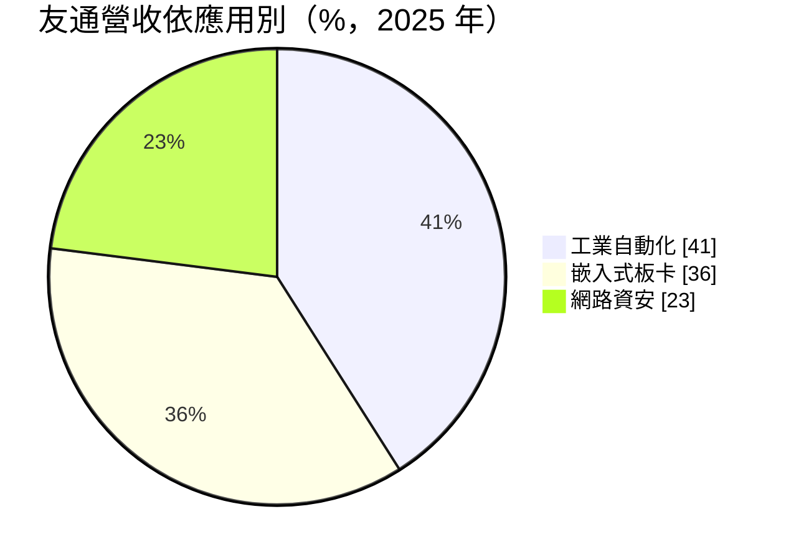
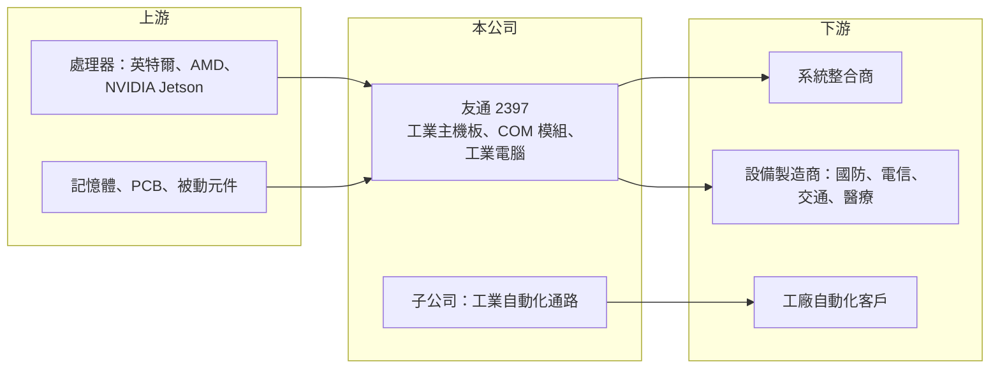

# 2397 友通

> 上市｜[[產業索引-電腦及週邊設備業|電腦及週邊設備業]]｜上市（櫃）日期 2000/01/15

# 第一章：企業模式與商業藍圖

> [!info] 撰寫說明
> 精簡版，由 Claude 依公開資料整理，架構比照 [[2330台積電]]，資料截至 2026-10-08。來源：證交所開放資料快照（基本資料、2026 年第二季財報、營益分析、股利、每月營收）、Goodinfo 經營績效年度表、富果研究 2026 年 3 月法說會摘要（2025 年全年資料）。法說會摘要為 AI 整理稿；集團關係與羅昇併入時點為整理性描述。#待校對

友通是以嵌入式板卡起家的[[工業電腦]]廠，近年透過子公司把業務延伸到工業自動化，本章說明它的產品結構與集團定位。

- **核心業務：** 友通成立於 1981 年，英文名稱 DFI，早年做 PC 主機板，後來轉向工業與嵌入式市場，產品包括工業主機板、[[COM 模組]]（Computer on Module）、無風扇工業電腦與平板電腦。工業電腦的特性是規格穩定、供貨期長達 7 至 15 年，客戶看重可靠度與長期供貨，而不是單純的價格。董事長陳其宏同時是 [[2352佳世達]] 董事長，友通被視為佳世達集團的工業電腦成員（集團持股比例待校對）。
- **營收結構：** 依 2025 年全年資料，應用別為工業自動化 41%、嵌入式板卡 36%、網路資安 23%；產品別為 OT 服務 42%、COM 模組 24%、AI 資安 22%、箱型電腦 9%、平板電腦 3%。地區別為亞太 52%、美洲 25%、歐洲 23%。工業自動化比重高，主要來自持股的自動化零組件通路子公司（推估為 [[8374羅昇]]，待校對）。
- **營運據點：** 總部在新北汐止，台灣有 SMT 與系統組裝產線，公司規劃 2026 年第二季新產線完工，以「台灣製造」滿足國防、電信等對供應鏈來源有要求的客戶。中國子公司負責當地工業自動化業務。
- **長期方向：** 友通 2026 年推出搭載 NVIDIA Jetson 的[[邊緣 AI]] 方案，鎖定交通、工廠自動化與[[AMR]]（自主移動機器人）；國防與電信需求帶動嵌入式板卡成長。產品設計導入資安，以符合歐盟網路韌性法（CRA）的要求，這會成為歐洲市場的長期門檻。

# 第二章：護城河深度與競爭優勢

工業電腦是台灣具全球領先地位的利基產業，本章分析友通在其中的護城河與主要對手。

- **競爭優勢：** 工業電腦客戶在導入一款板卡後，通常會在設備整個生命週期內持續採購，轉換成本很高。友通的維修退貨率約 0.1%，強調低總持有成本，加上佳世達集團在顯示器、醫療與系統整合的資源，可以提供從板卡到系統的整套方案。
- **主要對手：** 龍頭 [[2395研華]] 規模遠大於友通，其他同業包括 [[6414樺漢]]、[[6166凌華]]、[[3088艾訊]]、[[8234新漢]]、[[8050廣積]]、[[6579研揚]] 與 [[3022威強電]]。在 COM 模組與邊緣 AI 板卡上，各家都在搶 NVIDIA Jetson 與 Intel 平台的設計案，差異化主要在客製能力與垂直產業經驗。
- **觀察重點：** 友通的毛利率在 25% 至 28%，低於純板卡時期的 30% 以上，因為併入毛利較低的自動化通路業務。長期要看國防、電信與邊緣 AI 能否拉高板卡比重，以及中國子公司的應收帳款與景氣風險能否控制，2025 年第四季就因中國子公司提列呆帳而出現虧損。

# 第三章：財務體質與盈利規模

資料日期：2026-10-08，表格是撰寫當時的快照；最新月營收、毛利率、累計 EPS 由自動排程寫在本筆記的屬性欄位（月營收、毛利率、累計EPS 等）。#待校對

友通 2021 年營收大幅跳升，主要來自併入工業自動化子公司（推估），之後營收規模擴大但利潤率下降。

| 年度 | 營收（億元） | [[毛利率]] | [[營業利益率]] | EPS（元） | [[ROE]] |
|---|---|---|---|---|---|
| 2021 | 133 | 19.1% | 3.96% | 5.38 | 14.8% |
| 2022 | 110 | 24.9% | 7.64% | 4.61 | 10.8% |
| 2023 | 91.8 | 26.5% | 5.93% | 3.16 | 6.67% |
| 2024 | 94.9 | 28.2% | 6.93% | 3.46 | 9.11% |
| 2025 | 109 | 26.0% | 4.78% | 2.49 | 5.70% |

- **營收規模：** 2020 年營收 83.5 億元，2025 年 109 億元，五年年複合成長率約 5.5%。2026 年上半年營收 67.4 億元，前 8 月累計 92.6 億元、年增約 31%，2025 年第四季訂單出貨比達 1.38，顯示接單動能回升。
- **獲利：** 2021 至 2025 年平均 ROE 約 9.4%，但呈下滑趨勢。2026 年上半年毛利率 25.0%、營業利益率 6.75%、EPS 2.05 元，已接近 2025 年全年水準。
- **財務特色：** 2026 年第二季末權益總額 56.9 億元，其中[[非控制權益]] 23.2 億元，代表子公司有相當比例由外部股東持有，合併營收中有一大塊利潤不歸友通股東。負債總額 89.9 億元，高於權益，主要與通路業務的營運資金有關（細項未查得）。2025 年度配發現金股利 2.45 元，配息率接近 100%，股利政策偏向把盈餘幾乎全部發放。
- **[[ROIC]] 與 [[WACC]]：** 2025 年營業利益約 5.2 億元，稅後約 4.2 億元；以權益總額 56.9 億元計 ROIC 約 7.3%，把負債總額 89.9 億元也計入則約 2.8%（推算，有息負債細項未查得，實際值介於兩者之間）。WACC 以 CAPM 推估：無風險利率 1.75%、市場風險溢酬 6%、β 取工業電腦同業常見值 0.8，股東權益成本約 6.55%；負債成本 2.5%、稅後 2%，負債占資本約三成，WACC 約 5.2%（推算）。純板卡業務的報酬率應高於 WACC，但併入低毛利通路後整體利差變薄。

# 第四章：總體風險與地緣政治

友通的風險來自工業景氣、中國業務與零組件供應，本章整理長期需要注意的項目。

- **產業週期：** 工業電腦需求跟著全球製造業與企業資本支出起伏，2023 年客戶去化庫存時營收明顯下滑。工業自動化業務對中國製造業景氣尤其敏感，這部分的波動往往大於板卡本業。
- **營運風險：** CPU 與記憶體缺貨或漲價時，工業電腦廠需要提前備料，2025 年第四季存貨天數升到 121 天，庫存跌價與資金積壓是常見風險。中國子公司的客戶信用風險已經在 2025 年第四季造成呆帳提列。
- **其他風險：** 國防與電信訂單受各國政策影響，供應鏈來源要求可能改變；歐盟 CRA 等法規提高產品設計成本。營收以美元與歐元為主，匯率變動會影響毛利率。

# 專有名詞解析

## 應用

- **[[邊緣 AI]]**：在終端或靠近資料產生處（工廠、醫院、企業機房）執行 AI 運算，而非全部送到雲端資料中心。
- **[[AMR]]**：自主移動機器人，能自行規劃路徑、在工廠與倉庫中搬運物料。

## 金融

- **[[非控制權益]]**：子公司股權中不屬於母公司的部分，代表子公司的其他股東權益。

## 產業

- **[[工業電腦]]**：用於工廠自動化、交通、醫療等場域的電腦，強調長期供貨、耐用與穩定。
- **[[COM 模組]]**：把處理器、記憶體等核心功能做在一張小板上，再插到客戶自行設計的底板上使用的嵌入式模組。

# 核心供應鏈

- 上游：[[INTC英特爾]]、[[AMD超微]]、[[NVDA輝達]] 的嵌入式處理器平台，記憶體、PCB 與被動元件。
- 下游／客戶：國防、電信、交通、醫療設備商與系統整合商，工業自動化業務服務中國與台灣工廠；集團關係為 [[2352佳世達]]，自動化子公司推估為 [[8374羅昇]]（待校對）。
- 同業：[[2395研華]]、[[6414樺漢]]、[[6166凌華]]、[[3088艾訊]]、[[8234新漢]]、[[8050廣積]]、[[6579研揚]]、[[3022威強電]]。

## 最新新聞
<!-- news:start -->
<!-- news:end -->

## 相關連結
- [公開資訊觀測站](https://mopsov.twse.com.tw/mops/web/t05st03?step=1&firstin=1&co_id=2397)
- [Goodinfo](https://goodinfo.tw/tw/StockDetail.asp?STOCK_ID=2397)
- [Yahoo 股市](https://tw.stock.yahoo.com/quote/2397)
- [鉅亨網新聞](https://www.cnyes.com/twstock/2397/news)
