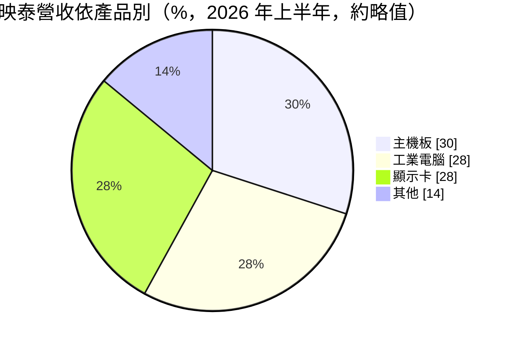
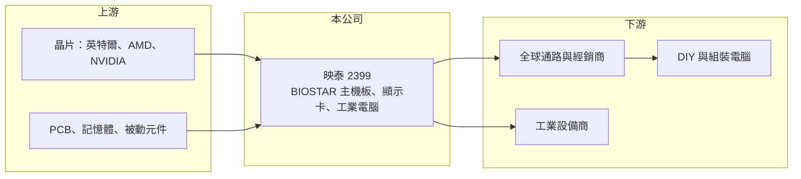

# 2399 映泰

> 上市｜[[產業索引-電腦及週邊設備業|電腦及週邊設備業]]｜上市（櫃）日期 1999/12/16

# 第一章：企業模式與商業藍圖

> [!info] 撰寫說明
> 精簡版，由 Claude 依公開資料整理，架構比照 [[2330台積電]]，資料截至 2026-10-08。來源：證交所開放資料快照（基本資料、2026 年第二季財報、營益分析、股利、每月營收）、Goodinfo 經營績效年度表、富果研究 2026 年 10 月法說會摘要（2026 年上半年資料）。法說會摘要為 AI 整理稿，數字需與公司簡報核對；公開資料有限。#待校對

映泰是以自有品牌 BIOSTAR 銷售主機板與顯示卡的中小型廠商，本章說明它在大廠寡占市場中的定位，以及近年獲利結構的變化。

- **核心業務：** 映泰成立於 1990 年、1999 年上市，總部在新北新店，三大業務是[[主機板]]、顯示卡與[[工業電腦]]。主機板與顯示卡以 BIOSTAR 品牌透過通路銷往全球的 [[DIY]] 與組裝電腦市場，工業電腦則提供嵌入式板卡給設備商。公司近年沒有跨入新事業，經營策略偏向守住既有三條產品線。
- **營收結構：** 依 2026 年上半年法說會摘要，主機板比重從約五成降到約三成，工業電腦與顯示卡各約 28%，其餘為其他產品。主機板比重下降的原因是記憶體價格上漲壓抑 DIY 與零售需求，而不是工業電腦大幅成長。
- **營運據點：** 公司總部負責研發與品牌行銷，生產與各地銷售據點配置在本次來源中未查得（待校對）。營收規模 2025 年約 17 億元，在主機板產業中屬小型品牌。
- **長期方向：** 映泰沒有揭露新的成長事業，但近年積極從事金融投資，金融投資占總資產比重從約一成提高到約 29%，2026 年上半年約 8 億元的[[業外收入]]主要來自投資收益。這代表公司的價值來源正在從本業轉向資產配置，是理解映泰時最重要的結構變化。

# 第二章：護城河深度與競爭優勢

主機板與顯示卡市場由少數台灣大廠主導，本章分析映泰這類小品牌的生存空間。

- **競爭優勢：** 映泰的優勢在於品牌歷史長、在新興市場與價格敏感的通路有一定知名度，產品線精簡、費用控制相對保守。工業電腦業務的客戶黏著度高於消費性產品，是本業中較穩定的部分。
- **主要對手：** 主機板由 [[2357華碩]]、[[2376技嘉]]、[[2377微星]] 三大品牌主導，[[3515華擎]] 也比映泰規模大；顯示卡同業有 [[6150撼訊]] 及多家品牌；工業電腦則面對 [[2395研華]] 等專業廠。大廠在研發、行銷與向晶片商取得資源上都有規模優勢。
- **觀察重點：** 映泰本業毛利率長期只有 6% 至 13%，營業利益率多數年度為負，代表品牌在主流市場缺乏定價能力。長期觀察重點在工業電腦能否成為穩定獲利來源，以及金融投資收益能否持續，而非主機板市占率的變化。

# 第三章：財務體質與盈利規模

資料日期：2026-10-08，表格是撰寫當時的快照；最新月營收、毛利率、累計 EPS 由自動排程寫在本筆記的屬性欄位（月營收、毛利率、累計EPS 等）。#待校對

映泰本業多數年度虧損，2026 年上半年的高 EPS 幾乎全部來自業外投資收益。

| 年度 | 營收（億元） | [[毛利率]] | [[營業利益率]] | EPS（元） | [[ROE]] |
|---|---|---|---|---|---|
| 2021 | 27.7 | 18.7% | 7.81% | 2.03 | 11.9% |
| 2022 | 22.4 | 12.0% | 0.07% | 0.07 | 0.42% |
| 2023 | 23.4 | 5.77% | −5.54% | −0.64 | −4.05% |
| 2024 | 20.2 | 8.22% | −5.30% | 0.04 | 0.24% |
| 2025 | 17.3 | 6.46% | −8.77% | 0.15 | 1.0% |

- **營收規模：** 2020 年營收 21 億元，2025 年 17.3 億元，五年年複合成長率約 −3.8%。2026 年上半年營收 9.6 億元，前 8 月累計 13.5 億元、年增約 7%。
- **獲利：** 2021 至 2025 年平均 ROE 只有約 1.9%，唯一明顯獲利的 2021 年是顯示卡與主機板缺貨潮。2026 年上半年毛利率回升到 13.1%，但營業利益率 −12.2%（含從投資收益提撥的員工與董事酬勞），業外收入 8.3 億元，EPS 3.54 元。
- **財務特色：** 2026 年第二季末負債總額 8.6 億元、母公司權益 28.3 億元，負債比約 23%，流動資產 30.3 億元，財務非常保守。2025 年度沒有配發股利，投資收益是否轉為配息政策仍待觀察。
- **[[ROIC]] 與 [[WACC]]：** 2025 年營業損失約 1.5 億元（17.3 億 × −8.77%），以權益 28.3 億元計本業 ROIC 約 −5%（推算），因為權益中約三成是金融投資，只計營運資產時虧損比率更高。WACC 以 CAPM 推估：無風險利率 1.75%、市場風險溢酬 6%、β 取同業常見值 0.9，股東權益成本約 7.2%；公司幾乎無有息負債，WACC 約 7%（推算）。本業長期無法賺回資金成本，股東報酬主要取決於投資收益。

# 第四章：總體風險與地緣政治

映泰的風險集中在本業缺乏規模，以及獲利對投資收益的依賴。

- **產業週期：** DIY 主機板與顯示卡需求受 PC 換機、遊戲與挖礦熱潮影響，波動劇烈；記憶體等零組件漲價時，組裝電腦需求會被壓抑。小品牌在需求下滑時通常最先被通路減少備貨。
- **營運風險：** 營收規模小，研發與行銷費用的固定成本占比高，營收稍微下滑就會出現營業虧損。晶片商的供貨與行銷資源傾向大品牌，映泰在新平台上市時的取得順序可能落後。
- **其他風險：** 金融投資占資產近三成，投資收益會隨市場波動，2026 年上半年的高獲利不代表可持續。營收以美元計價，匯率波動也會影響本就很薄的毛利。

# 專有名詞解析

## 應用

- **[[DIY]]**：消費者自行挑選零件組裝電腦的市場，主機板、顯示卡品牌透過通路銷售。

## 金融

- **[[業外收入]]**：本業以外的收益，例如投資收益、利息、匯兌利益與處分資產利益。

## 產業

- **[[主機板]]**：電腦中承載處理器、記憶體與各種介面的主電路板，是組裝電腦的核心零件。
- **[[工業電腦]]**：用於工廠自動化、交通、醫療等場域的電腦，強調長期供貨、耐用與穩定。

# 核心供應鏈

- 上游：[[INTC英特爾]]、[[AMD超微]] 的處理器與晶片組，[[NVDA輝達]]、[[AMD超微]] 的顯示晶片，PCB、記憶體與被動元件。
- 下游／客戶：全球電腦通路、經銷商與組裝電腦業者，工業電腦客戶為設備製造商。
- 同業：[[2357華碩]]、[[2376技嘉]]、[[2377微星]]、[[3515華擎]]、[[6150撼訊]]；工業電腦同業 [[2395研華]]。

## 最新新聞
<!-- news:start（自動產生，請勿手動編輯此範圍） -->
- 2026-10-12 📰 媒體 17:52｜營收速報 - 映泰(2399)9月營收2.04億元年增率高達37.09％｜[鉅亨網](https://news.cnyes.com/news/id/6628265)

完整紀錄：[[2399映泰 新聞]]
<!-- news:end -->

## 相關連結
- [公開資訊觀測站](https://mopsov.twse.com.tw/mops/web/t05st03?step=1&firstin=1&co_id=2399)
- [Goodinfo](https://goodinfo.tw/tw/StockDetail.asp?STOCK_ID=2399)
- [Yahoo 股市](https://tw.stock.yahoo.com/quote/2399)
- [鉅亨網新聞](https://www.cnyes.com/twstock/2399/news)
