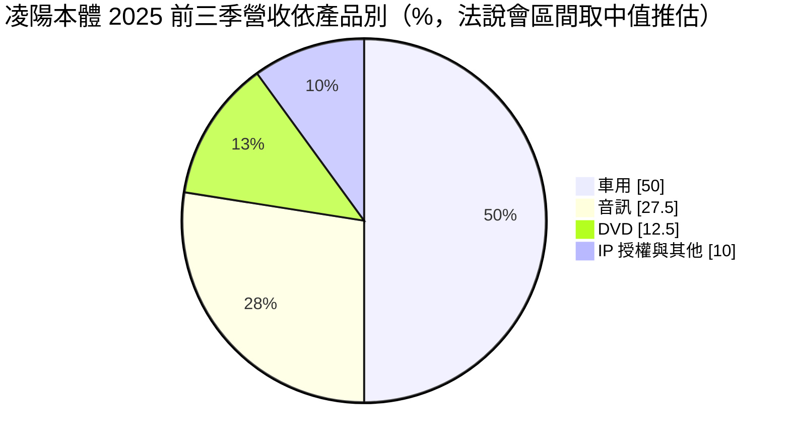
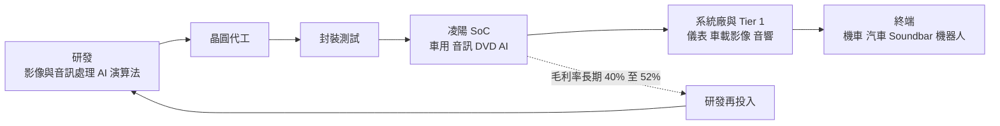
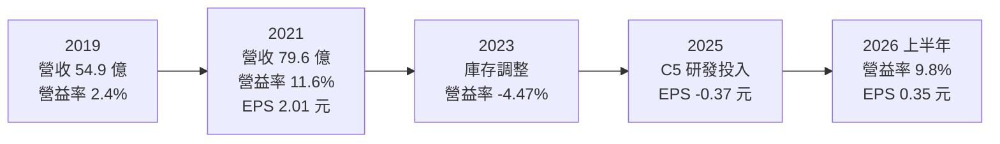
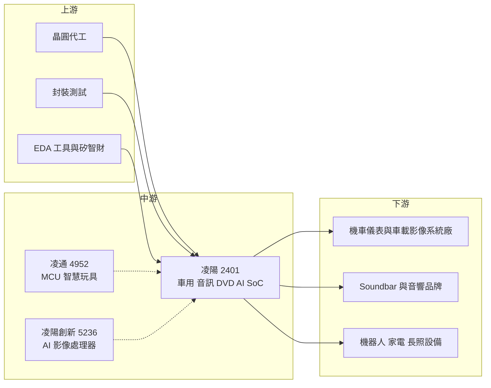

# 2401 凌陽

> 上市｜[[產業索引-半導體業|半導體業]]｜上市（櫃）日期 2000/01/27

# 第一章：企業模式與商業藍圖

> [!info] 撰寫說明
> 本文由 Claude 依公開資料整理，架構比照 [[2330台積電]] 的四章研究，資料截至 2026-10-08。財務數字來源：證交所開放資料快照（基本資料、2026 年第二季資產負債與綜合損益、股利）、Goodinfo 經營績效頁與股利政策頁（2016 至 2025 年）、MoneyDJ 季資產負債表（2026 年第二季借款科目）、富果研究 2025 年 12 月 3 日法說會整理（產品比重、子公司持股與營收占比、C5 晶片時程）、理財周刊 2026 年報導；凌陽早年 DVD 與消費性晶片的市場地位、集團分拆沿革係憑記憶整理，尚未逐條比對原始文件。#待校對

在評估一家公司的長期投資價值時，第一步是看懂它靠什麼賺錢、為什麼能一直賺下去。本章針對凌陽科技（股票代號：2401，以下簡稱凌陽）的商業模式進行定性分析，說明這家以 DVD 與消費性多媒體晶片起家的台灣老牌 IC 設計公司，如何在主力市場萎縮後，把重心移到車用影音與音訊晶片，並以多家子公司分攤不同的產品線。凌陽的故事是一個典型的「成熟 IC 設計公司如何轉型」的案例：毛利率一直很穩，難的是讓營收重新長大。

## 一、核心定位：以影音訊號處理為核心的 IC 設計集團

凌陽成立於 1990 年，2000 年在台灣證交所上市，董事長兼總經理為黃洲杰。凌陽是典型的 [[Fabless]] 公司，自己不擁有晶圓廠，專注設計晶片，製造委外給晶圓代工廠。它的核心能力是影像與聲音的訊號處理，也就是把影音資料解碼、壓縮、顯示與播放的技術，這套能力最早用在 DVD 播放器、數位相框與電子玩具上，讓凌陽在 2000 年代成為台灣重要的消費性 IC 設計公司（市場地位待校對）。

DVD 等光碟產品在串流影音普及後逐年萎縮，凌陽的營收也從高峰下滑。之後的十多年，凌陽走的是「同一套影音技術，換到新的應用市場」的路線，主要轉向兩個方向：車用與音訊。依 2025 年 12 月法說會，凌陽本體的營收約五成來自車用、約 25% 至 30% 來自音訊，DVD 剩下約 10% 至 15%。

凌陽同時是一個集團。依同場法說會，主要子公司與持股如下：

- **[[4952凌通]]（持股約 48%）：** 專注 [[MCU]]、智慧玩具與 AI 演算法加值，2025 年前三季約占合併營收 35%。
- **[[5236凌陽創新]]（持股約 57%）：** 開發 AI 影像處理器與高階 HPD 產品，約占合併營收 32%。
- **景象科技（持股 100%）：** 營收貢獻未揭露。
- **凌陽本體：** 車用、音訊、DVD 與 AI 晶片，約占合併營收 26%。

這個結構有一個投資人必須理解的含意：凌陽的合併營收有超過一半來自持股不到六成的子公司，合併報表上的淨利有相當比例屬於子公司的其他股東，歸屬母公司股東的 EPS 會明顯低於合併淨利的直觀印象。

## 二、終端應用／產品板塊：車用為主、音訊為輔、DVD 收尾

依 2025 年 12 月法說會，凌陽本體的產品比重以區間揭露，下圖以區間中值繪製：

- **車用（約 50%）：** 產品涵蓋智慧座艙（車載娛樂、手機投影、數位儀表）、駕駛輔助（環景系統、[[DMS]] 駕駛監控、[[ADAS]]、電子後照鏡）與兩輪車數位儀表。凌陽在兩輪車儀表著墨較深，並把 3D 環景與透明底盤技術延伸到卡車與巴士。車用晶片的設計導入期長、一旦量產會持續多年，是凌陽最重要的長期營收來源。
- **音訊（約 25% 至 30%）：** Soundbar、派對音響、電競音效與無線重低音，演算法也用在視訊會議設備。法說會提到產品正往無線後環繞與重低音發展，以提高平均售價與毛利。音訊屬消費性產品，需求隨景氣起伏，但凌陽在這個市場累積了長期的客戶關係。
- **DVD（約 10% 至 15%）：** 傳統產品，需求穩定、不再推出新產品。法說會指出目前市場上只剩凌陽與 [[2454聯發科]] 兩家供應商，這讓 DVD 業務成為一塊逐年縮小、但競爭不激烈的現金來源。
- **IP 授權與 AI 晶片：** IP 授權約 5% 至 10%；AI 晶片（Plus1 系列）目前占比極低，第一代 C3 晶片用在掃地機器人、割草機與長照監護，下一代 C5 晶片是凌陽押注的新成長來源。

## 三、資本轉化邏輯：高毛利、高研發的 SoC 模式

凌陽的資本循環可以從三個特徵來理解。

- **毛利率高而穩定：** 2016 至 2025 年凌陽合併[[毛利率]]介於 40% 到 52.3% 之間，近五年多在 45% 以上。高毛利來自[[SoC]]晶片中的軟體與演算法價值：客戶買的不只是一顆晶片，而是一套可以直接做出產品的參考設計，這讓凌陽能維持一定的定價能力。
- **研發費用吃掉大部分毛利：** IC 設計公司的主要成本是研發人員與光罩。凌陽 2025 年前三季研發費用 16.19 億元、年增 5%，主要用於 C5 晶片的 IP 採購與子公司的兩顆晶片投片。當營收停滯時，固定的研發費用會讓[[營業利益率]]掉到零附近甚至轉負，2023 與 2025 年都出現本業虧損。
- **[[營運槓桿]]明顯：** 反過來說，一旦營收成長而研發費用相對固定，增加的毛利大部分會轉成營業利益。2021 年營收 79.6 億元時，營業利益率達 11.6%；2026 年上半年營收回升到 38.82 億元，營業利益率也回到 9.8%。凌陽的獲利能力高度取決於營收規模能否撐過研發費用的門檻。

## 四、企業長期藍圖：C5 邊緣 AI 晶片與海外車市

- **C5 邊緣 AI 晶片：** 依法說會，C5 採 12 奈米製程，是全新設計，需要新光罩與新 IP，預計 2026 年第三季[[Tape-out]]、第四季推出產品，2027 年起才貢獻營收。目標應用包括機器人、掃地機器人、長照監護、無人機與車內語音與 DMS 互動，公司已與代工設計廠洽談機器人應用。C5 是凌陽從「影音晶片」走向「[[邊緣AI]]晶片」的關鍵產品，但能否成功取決於能否找到足夠大的終端市場。
- **車用市場的地理擴張：** 法說會指出車用成長主要來自中國出口車與東南亞市場，凌陽已在馬來西亞打入新的車廠供應鏈，並持續擴大兩輪車與商用車的應用。東南亞是全球最重要的機車市場之一，兩輪車數位化是凌陽可以長期經營的利基。
- **財務彈性：** 2025 年第三季底，凌陽可動用資金（現金、約當現金與按公允價值衡量之金融資產）約 56 億元，足以支應 C5 等研發投入，不需要對外大幅舉債。

# 第二章：護城河深度與競爭優勢

在長期價值投資中，「護城河」指企業抵禦競爭、長期維持超額利潤的保護機制。本章分析凌陽的護城河由哪些要素構成、在車用與音訊市場面對哪些對手，以及這些優勢能否轉化成穩定的獲利。

## 一、凌陽護城河的核心組成要素

凌陽的護城河屬於「窄而穩」：毛利率長期穩定說明它在利基市場有一定的定價能力，但規模不足以支撐持續成長。主要由三個要素構成：

- **1. [[車規驗證]]與長生命週期：** 車用晶片需要通過可靠度測試與車廠認證，流程往往需要 2 至 3 年。一款車型或機車儀表一旦採用某顆晶片，通常會量產多年，中途很少更換。凌陽在車載影像與兩輪車儀表累積的導入案，提供了數年的營收能見度，也提高了競爭者搶單的門檻。
- **2. 影音處理的軟硬整合：** 凌陽累積了三十多年的影像與音訊演算法，提供晶片加軟體的完整方案，降低系統廠的開發門檻。對中小型系統廠而言，換一家晶片供應商意味著重新開發軟體與驗證，這是凌陽客戶黏著度的來源。
- **3. 利基市場的低競爭密度：** 兩輪車數位儀表、DVD 與部分音訊產品，對國際大廠來說市場規模太小，不值得投入。凌陽在這些市場面對的競爭者較少，因此能維持較高的毛利率，但也因為市場小，營收成長的天花板較低。

## 二、全球主要競爭對手格局

| 對手 | 定位 | 對凌陽的影響 |
|---|---|---|
| [[2454聯發科]] | 車用座艙與多媒體 SoC 大廠 | 在高階智慧座艙以規模與先進製程競爭，也是 DVD 晶片市場僅存的另一家供應商 |
| 瑞薩、恩智浦、德州儀器 | 國際車用 MCU 與處理器大廠 | 車廠關係深、產品線完整，主導四輪車的核心控制與座艙晶片 |
| [[2379瑞昱]] | 音訊與網通晶片 | 在 Soundbar 與音訊晶片市場直接競爭 |
| 中國車用與音訊晶片業者 | 政策扶植、報價低 | 搶中國與東南亞中低階車用、音響與 AI 視覺晶片訂單 |
| [[6202盛群]]、[[4919新唐]] | MCU 業者 | 與子公司凌通在 MCU 市場競爭 |

## 三、優勢轉化：哪些守得住、哪些守不住

- **守得住：** 已經量產的兩輪車儀表與車載影像方案，以及中高階音訊產品。這些產品重視軟體成熟度與長期供貨，客戶換供應商的成本高，凌陽可以維持 45% 上下的毛利率。DVD 雖然在萎縮，但競爭者極少，仍能貢獻穩定的現金。
- **守不住：** 低階消費性晶片與一般 AI 視覺晶片。這些市場中國業者報價低、產品同質化，C3 晶片導入速度偏慢，也說明凌陽在新應用市場還沒有建立明確優勢。2016 至 2025 年凌陽合併營收大致在 55 億到 80 億元之間來回，沒有形成長期向上的趨勢。
- **觀察重點：** 長期可以追蹤三件事。第一是 C5 晶片在 2027 年後能否拿到量產訂單，並在機器人或車用找到穩定的客戶群；第二是車用營收能否隨東南亞與外銷車市持續成長，讓合併營收突破過去十年的區間；第三是營業利益率能否在研發費用持續投入下維持在雙位數，這決定凌陽能否恢復穩定配息。

# 第三章：財務體質與盈利規模

資料日期：2026-10-08。數字取自 Goodinfo 經營績效頁與股利政策頁、證交所開放資料快照與 MoneyDJ 季資產負債表，表格是撰寫當時的快照；最新月營收、毛利率、累計 EPS 由自動排程寫在本筆記的屬性欄位（月營收、毛利率、累計EPS 等）。#待校對

財務報表是檢驗護城河是否真實存在的最終標準。本章用多年度的三率、ROE、現金流與資本報酬，檢視凌陽在高毛利、高研發模式下的獲利品質。

## 一、獲利能力的基石：三率

| 年度 | 營收（億元） | [[毛利率]] | [[營業利益率]] | EPS（元） | [[ROE]] |
|---|---|---|---|---|---|
| 2019 | 54.9 | 42.8% | 2.4% | 0.03 | 1.8% |
| 2020 | 64.1 | 45.6% | 8.05% | 0.55 | 6.32% |
| 2021 | 79.6 | 52.3% | 11.6% | 2.01 | 15.5% |
| 2022 | 67.1 | 49.2% | 4.29% | 0.37 | 5.51% |
| 2023 | 55.4 | 45.6% | -4.47% | -0.84 | -1.96% |
| 2024 | 64.3 | 48.4% | 1.66% | 0.44 | 5.46% |
| 2025 | 63.0 | 46.6% | -1.51% | -0.37 | 0.62% |

（來源：Goodinfo 經營績效頁，合併報表。ROE 以合併淨利計算，因子公司獲利屬於少數股東的部分較大，2025 年出現 EPS 為負、ROE 為正的情況。2026 年上半年依證交所資料，營收 38.82 億元、毛利率 48.6%、營業利益率 9.8%、EPS 0.35 元。）

- **毛利率是凌陽最穩定的指標：** 七年之間毛利率在 42.8% 到 52.3% 之間，波動遠小於營收與營業利益。這說明凌陽的產品定價能力沒有被侵蝕，問題出在營收規模。
- **營業利益率跟著營收大幅擺盪：** 2021 年在疫情帶動的消費性與車用需求下，營收衝到 79.6 億元，營業利益率 11.6%；2023 年消費性電子庫存調整，營收掉回 55.4 億元，營業利益率轉為負 4.47%。2025 年營收持平，但 C5 研發投入增加，營業利益率又轉負。這是高研發、固定費用占比高的 IC 設計公司常見的獲利型態。
- **營收長期沒有成長：** 2020 至 2025 年營收年複合成長率約 -0.3%（推算），十年來營收在 55 億到 80 億元之間來回。凌陽的轉型到目前為止，主要成果是守住營收規模，而不是擴大規模。

## 二、[[ROE]]：資本效率

2021 至 2025 年凌陽的平均 ROE 約 5.0%（推算），只有 2021 年超過 10%。ROE 偏低有兩個原因：第一是營業利益率多數年份只有個位數甚至為負；第二是帳上現金與金融資產比重高，依 MoneyDJ，2026 年第二季現金及約當現金約 45.3 億元、金融資產約 26.9 億元，合計約占權益總計 108.1 億元的三分之二。這些資產提供財務安全，但報酬率低，會拉低整體 ROE。依證交所資料，2026 年第二季歸屬母公司權益約 84.6 億元，每股淨值約 14.37 元。

## 三、資本支出、自由現金流與股利

- **[[CapEx]]：** 凌陽沒有晶圓廠，資本支出主要是研發設備、光罩與辦公設施，金額不大，具體數字未查得。對凌陽而言，真正的「資本投入」是研發費用，2025 年前三季就達 16.19 億元。
- **[[自由現金流]]：** 多年度自由現金流數字未查得。由於資本支出低，自由現金流大致跟著營業利益起伏（推估），營收好的年份為正，本業虧損的年份則承壓。
- **股利穩定度：** 依 Goodinfo 股利政策頁，2016 至 2022 年度凌陽每年配發 0.3 至 2 元現金股利（其中 2021 年度 2 元為最高），部分年度以資本公積發放；2023 至 2025 年度連續三年未配發現金股利。配息跟著獲利起落，且近年中斷，說明凌陽目前把現金優先留給 C5 等研發投入，不適合當作穩定收息的標的。

## 四、[[ROIC]] 與 [[WACC]]：價值創造利差

- **ROIC（推算）：** 以 2026 年上半年營業利益 3.81 億元年化約 7.62 億元，扣除 20% 稅率後稅後營業利益約 6.1 億元。投入資本以 2026 年第二季權益總計約 108.1 億元，加上有息負債約 16.0 億元（短期借款 1.97 億、一年內到期長期負債 2.10 億、長期借款 10.03 億、租賃負債 1.92 億，MoneyDJ），合計約 124.1 億元，ROIC 約 4.9%（推算）。若以 2025 年營業損失約 0.95 億元計算，ROIC 約 -0.8%（推算）；以表現最好的 2021 年營業利益約 9.2 億元粗估，稅後營業利益約 7.4 億元，ROIC 約 6%（推算，投入資本以 2026 年水準近似）。
- **WACC（推算）：** 以 [[CAPM]] 估算股東權益成本：無風險利率取台灣 10 年期公債約 1.75%，市場風險溢酬 6%，β 假設 1.0（台灣成熟型 IC 設計股常見值，未查得凌陽實際數字），權益成本約 7.75%。稅前負債成本假設 2.5%、稅率 20%，稅後約 2.0%。以帳面價值計算，負債占投入資本約 13%、權益約 87%，WACC 約 7.0%（推算）。
- **價值創造判斷：** 即使在 2026 年上半年本業回升的情況下，凌陽的 ROIC 約 4.9% 仍低於約 7.0% 的資金成本，過去十年也只有營收高峰的少數年份接近或超過 WACC。這代表凌陽整體資本長期沒有創造超額價值，主要原因是帳上大量現金與金融資產拉低了報酬，以及營收規模不足以攤提研發費用。若 C5 與車用能讓營收穩定站上 80 億元以上、營業利益率維持雙位數，ROIC 才有機會長期超過 WACC。

# 第四章：總體風險與地緣政治

任何企業都無法脫離宏觀環境獨立存在。本章分析凌陽未來必須面對的地緣政治、產業週期、營運與技術風險。

## 一、地緣政治風險

- **中國市場的雙面性：** 法說會指出車用成長部分來自中國出口車，而中國同時是凌陽在音訊與車用晶片的主要價格競爭來源。中國推動晶片自主化，可能讓當地系統廠優先採用本土晶片，壓縮凌陽在中國市場的空間。
- **東南亞市場的機會與風險：** 東南亞機車與外銷車市是凌陽主打的成長方向，可以分散對單一市場的依賴，但當地經濟、匯率與產業政策的變化，也會直接影響車用出貨。
- **供應鏈分散需求：** 國際車廠推動「中國以外」的供應鏈布局時，台灣 IC 設計公司可能受惠（推估），但這種機會需要長時間的車規驗證才能轉成營收。

## 二、產業週期與市場結構風險

- **消費性電子週期：** 音訊產品與子公司的玩具、MCU 都屬消費性市場，需求受景氣與換機週期影響。2023 年營收下滑與本業虧損，就是消費性電子庫存調整的結果。
- **車用庫存週期：** 汽車與機車銷量受利率與景氣影響，車用晶片的庫存調整週期較長，一旦去化往往需要數季。
- **[[長鞭效應]]：** 凌陽處於供應鏈中上游，終端需求的小幅變動經過系統廠與通路的庫存調整後被放大，使營收在不同年度間大幅起伏。

## 三、營運環境的隱性風險

- **研發押注失敗風險：** C5 是全新設計，需要新的光罩與 IP 採購。若 C5 延後或市場接受度不佳，大量研發費用將無法回收，並持續拖累獲利與配息。第一代 C3 晶片導入慢、原本合作的系統廠倒閉，已經提醒投資人新產品推廣的難度。
- **記憶體與晶圓成本：** 法說會提到凌陽提前備妥 DRAM 庫存，並預期把記憶體漲價轉嫁給客戶。若記憶體或晶圓代工價格大幅上漲而無法轉嫁，高毛利率的優勢會被侵蝕。
- **子公司與少數股權：** 合併營收有超過一半來自凌通與凌陽創新，這兩家子公司的表現與持股比例變化，會直接影響凌陽歸屬母公司的獲利。

## 四、科技與法規演進風險

- **邊緣 AI 的技術門檻提高：** 終端裝置要求內建 AI 推論能力，晶片需要整合 [[NPU]]，演算法與軟體生態的投入越來越大。凌陽若無法跟上，影音晶片的價值可能被具備 AI 能力的大廠方案取代。
- **車輛安全法規：** 各國逐步要求 DMS 與駕駛輔助功能，對凌陽的車用影像產品是長期需求來源，但產品必須通過功能安全等更嚴格的認證，開發成本會跟著上升。
- **DVD 的終局：** DVD 業務遲早會隨市場消失，凌陽必須在這塊營收歸零前，讓車用與 AI 的營收補上缺口。

# 專有名詞解析

## 半導體

- **[[Fabless]]**：無晶圓廠的 IC 設計公司，只負責設計，製造委外給晶圓代工廠。
- **[[SoC]]**：系統單晶片，把處理器、記憶體控制、影音處理與介面等多種功能整合在一顆晶片上。
- **[[MCU]]**：微控制器，把處理器、記憶體與輸入輸出介面整合在一顆晶片上，用於家電、玩具與工控設備。
- **[[Tape-out]]**：設計定案，晶片設計完成後交付晶圓廠製作光罩，是量產前的重要里程碑。
- **[[NPU]]**：神經網路處理器，專門加速 AI 推論運算的處理單元。

## 應用

- **[[ADAS]]**：先進駕駛輔助系統，包括車道維持、自動緊急煞車、環景影像等功能。
- **[[DMS]]**：駕駛監控系統，以攝影機偵測駕駛是否分心或疲勞，是車輛安全法規逐步要求的配備。
- **[[車規驗證]]**：車用晶片須通過 AEC-Q100 等可靠度測試與車廠認證，流程常需 2 至 3 年，因此轉換成本高。
- **[[邊緣AI]]**：在終端裝置或現場設備上直接執行 AI 推論，不必把資料傳回雲端，延遲低、隱私較佳。

## 金融

- **[[營運槓桿]]**：固定成本占比高時，營收小幅變動會造成利潤較大幅度變動的現象。
- **[[ROIC]]**：投入資本報酬率，稅後營業利益除以股東權益加有息負債，衡量本業運用資本的效率。
- **[[WACC]]**：加權平均資金成本，依股東權益與負債的比重，加權計算公司取得資金的平均成本。
- **[[CAPM]]**：資本資產定價模型，以無風險利率加上 β 乘以市場風險溢酬估算股東要求報酬率。
- **[[長鞭效應]]**：終端需求的小幅變動，沿供應鏈往上游傳遞時被逐級放大，造成上游庫存與訂單劇烈波動。

# 核心供應鏈

## 1. 上游：晶圓代工、封測與設計工具
- 晶圓代工：[[2330台積電]]、[[2303聯電]]（推估，未查得實際比重）
- EDA 工具：[[SNPS新思科技]]、[[CDNS益華電腦]]
- 封裝測試：供應商未揭露

## 2. 中游：凌陽本身與子公司
- MCU 與智慧玩具：[[4952凌通]]
- AI 影像處理器：[[5236凌陽創新]]
- 景象科技（100% 持股）

## 3. 下游：主要客戶類型
- 兩輪車數位儀表、車載影像與 DMS 系統廠（台灣、中國、東南亞）
- Soundbar、派對音響、電競音效與視訊會議設備品牌
- C3 與 C5 目標客戶：掃地機器人、割草機、無人機、自走機器人與長照監護設備

## 4. 同業
- 車用與多媒體 SoC：[[2454聯發科]]
- 音訊晶片：[[2379瑞昱]]
- MCU：[[6202盛群]]、[[4919新唐]]

## 最新新聞
<!-- news:start -->
<!-- news:end -->

## 相關連結
- [公開資訊觀測站](https://mopsov.twse.com.tw/mops/web/t05st03?step=1&firstin=1&co_id=2401)
- [Goodinfo](https://goodinfo.tw/tw/StockDetail.asp?STOCK_ID=2401)
- [Yahoo 股市](https://tw.stock.yahoo.com/quote/2401)
- [鉅亨網新聞](https://www.cnyes.com/twstock/2401/news)
