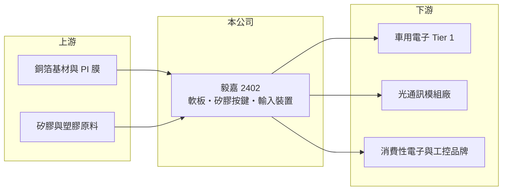

# 2402 毅嘉

> 上市｜[[產業索引-電子零組件業|電子零組件業]]｜上市（櫃）日期 2000/01/14

# 第一章：企業模式與商業藍圖

> [!info] 撰寫說明
> 精簡版，由 Claude 依公開資料整理，架構比照 [[2330台積電]]，資料截至 2026-10-08。來源：證交所開放資料（基本資料、2026 年上半年財報、股利）、Goodinfo 經營績效頁、nStock 公司簡介，以及財經媒體標題。產品比重與客戶公開資料有限，部分描述憑過往認知整理。#待校對

本章說明毅嘉科技（2402）靠什麼賺錢：它從手機按鍵起家，後來把重心移到[[軟板]]與車用、工控等利基零組件。

- **核心業務：** 毅嘉成立於 1989 年、2000 年上市，主要產品是導電矽膠按鍵、塑膠字鍵、鍵盤組合、輸入裝置與[[軟板]]（軟性印刷電路板）。這些零件都屬於「人機介面與內部連接」，單價不高，但必須配合客戶產品的外型與電路客製化設計。因此毅嘉的生意本質是接單生產的客製零組件廠，而不是賣標準品。
- **營收結構：** 公開資料沒有查到最新的產品別比重，只能確定營收由 2020 年約 55 億元成長到 2025 年約 108 億元。手機按鍵在智慧型手機普及後需求大幅萎縮，公司營收能成長，主要來自軟板與車用、光通訊等新應用（車用與光通訊為財經媒體標題所述方向，比重未查得）。
- **營運據點：** 總部在桃園龜山，生產據點以海外工廠為主（中國與東南亞，具體廠址待校對）。這種「台灣接單、海外生產」的模式是台灣零組件廠的典型做法，讓公司能就近供應組裝廠，但也讓成本受當地工資與匯率影響。
- **長期方向：** 公司近年的方向是把軟板從消費性電子推向[[車用電子]]與光通訊模組等驗證期較長、價格較穩的市場。2023 年起媒體報導公司取得車用新認證、2025 年後被歸入光通訊供應鏈（標題資訊，細節待校對）。這個轉型若成功，能降低過去依賴手機零件時的價格壓力。

# 第二章：護城河深度與競爭優勢

本章分析毅嘉的競爭位置：它不是規模最大的軟板廠，優勢在於客製化與利基市場的認證。

- **競爭優勢：** 毅嘉的優勢是長期累積的客製化設計與量產經驗，尤其是按鍵、矽膠與軟板整合的能力。車用零件需要通過 [[IATF 16949]] 等品質體系與客戶長時間驗證，一旦導入便不易被替換，這是毅嘉近年毛利率由 13% 左右提升到接近 19% 的主要原因之一（推估）。
- **主要對手：** 軟板領域的大廠是 [[4958臻鼎-KY]]、[[6269台郡]]、[[6153嘉聯益]]，它們以蘋果等大客戶的龐大訂單取得規模優勢。毅嘉規模遠小於這些對手，因此避開高階手機主板市場，改在車用、工業與光通訊等量少樣多的訂單競爭。
- **觀察重點：** 長期要觀察毛利率能否穩定維持在 15% 以上，以及車用與光通訊的營收比重是否持續提升。2026 年上半年毛利率回落到 13.6%、營業利益率 4.4%，顯示利基轉型的成果仍會受產品組合與景氣影響，還不算穩固。

# 第三章：財務體質與盈利規模

資料日期：2026-10-08，表格是撰寫當時的快照；最新月營收、毛利率、累計 EPS 由自動排程寫在本筆記的屬性欄位（月營收、毛利率、累計EPS 等）。#待校對

本章用多年度數字檢視毅嘉的轉型是否反映在獲利品質上。

| 年度 | 營收（億元） | [[毛利率]] | [[營業利益率]] | EPS（元） | [[ROE]] |
|---|---|---|---|---|---|
| 2020 | 55.0 | 13.5% | 3.6% | 0.40 | 2.1% |
| 2021 | 64.8 | 12.4% | 3.2% | 0.75 | 3.9% |
| 2022 | 76.5 | 13.6% | 4.8% | 1.20 | 6.1% |
| 2023 | 85.6 | 14.9% | 5.6% | 1.56 | 7.6% |
| 2024 | 95.3 | 17.9% | 8.1% | 2.36 | 10.8% |
| 2025 | 108.0 | 19.1% | 8.4% | 2.47 | 10.5% |

- **營收規模：** 2020 至 2025 年營收年複合成長率約 14%，而且每年都成長，在零組件廠中算是穩定。2026 年上半年營收 60.8 億元，年度規模已站上百億元。
- **獲利：** 毛利率從 12% 至 13% 一路提升到 19%，EPS 由 0.40 元升到 2.47 元，代表成長不只是量的增加，產品組合也在改善。不過 2026 年上半年毛利率 13.6%、EPS 0.46 元，明顯低於 2025 年，獲利能否回到前一年水準需要追蹤。
- **財務特色：** 近 5 年（2021 至 2025）平均 ROE 約 7.8%，前幾年偏低，2024 年後才站上 10%。2025 年度配發現金股利 2.0 元，約占 EPS 八成，配息意願提高。2026 年第二季負債總計 94.9 億元、股東權益 72.8 億元，負債比約 57%，財務槓桿不低。
- **[[ROIC]] 與 [[WACC]]：** 官方資料未拆出有息負債，因此用區間推算。2025 年營業利益約 9.1 億元（108 億 × 8.43%），稅後營業利益約 7.3 億元；若只以股東權益 72.8 億元為投入資本，ROIC 約 10%，若把全部負債 94.9 億元都算進去，約 4.3%，實際值落在兩者之間（推算）。WACC 以 [[CAPM]] 推估：無風險利率 1.75%、市場風險溢酬 6%、β 假設 1.1（中小型電子零組件常見值），股東權益成本約 8.4%；負債成本假設 2.5%、稅後 2.0%，負債占資本 30%（假設），WACC 約 6.4%（推算）。ROIC 與 WACC 大致打平到略高，代表毅嘉要到 2024 年後才開始創造些微經濟價值，更早幾年的低 ROE 時期其實沒有賺到資金成本。

# 第四章：總體風險與地緣政治

本章整理毅嘉長期要面對的產業與營運風險。

- **產業週期：** 軟板與按鍵需求跟著手機、筆電、汽車等終端市場起伏，屬於典型的電子零組件週期。終端庫存調整時，零件廠會比品牌廠更早、更劇烈地感受到訂單下滑，也就是[[長鞭效應]]。
- **營運風險：** 軟板產業規模經濟明顯，大廠可以用價格搶單，毅嘉若無法在車用、光通訊等利基市場持續取得新案，毛利率可能回到過去 12% 至 13% 的水準。客戶集中度未查得，但中小型零組件廠通常有少數大客戶占比高的情況。
- **其他風險：** 生產以海外為主、營收以外幣計價，新台幣升值與人民幣、東南亞貨幣波動都會影響毛利率。美中關稅與供應鏈移轉也可能迫使公司增加新產能投資，提高折舊負擔。

# 專有名詞解析

## 應用

- **[[車用電子]]**：汽車中的電子控制、感測、照明與資訊娛樂系統，驗證期長、品質要求高，零件一旦導入通常可供貨多年。
- **[[IATF 16949]]**：汽車產業的品質管理系統標準，車用零件供應商通常必須取得此認證才能進入車廠供應鏈。

## 金融

- **[[長鞭效應]]**：終端需求的小幅變動，沿供應鏈往上游傳遞時被逐級放大，造成上游庫存與訂單劇烈波動。
- **[[CAPM]]**：資本資產定價模型，以無風險利率加上 β 乘以市場風險溢酬，推估股東要求的報酬率。

## 產業

- **[[軟板]]**：軟性印刷電路板（FPC），可彎折的電路板，用於手機、筆電、車用面板與光通訊模組的內部連接。

# 核心供應鏈

- 上游：軟板用的銅箔基板與聚醯亞胺膜，例如 [[8039台虹]]；按鍵用的矽膠與塑膠原料。
- 下游／客戶：車用電子系統廠、光通訊模組廠與消費性電子品牌，具體客戶名稱公開資料未查得。
- 同業：軟板廠 [[4958臻鼎-KY]]、[[6269台郡]]、[[6153嘉聯益]]，以及其他中小型軟板廠；按鍵與輸入裝置同業公開資料未查得。

## 最新新聞
<!-- news:start（自動產生，請勿手動編輯此範圍） -->
- 2026-10-15 📰 媒體 17:44｜〈毅嘉法說〉Q3 EPS 0.33元季年雙減 馬來西亞新廠初期成本壓抑獲利｜[鉅亨網](https://news.cnyes.com/news/id/6631143)

完整紀錄：[[2402毅嘉 新聞]]
<!-- news:end -->

## 相關連結
- [公開資訊觀測站](https://mopsov.twse.com.tw/mops/web/t05st03?step=1&firstin=1&co_id=2402)
- [Goodinfo](https://goodinfo.tw/tw/StockDetail.asp?STOCK_ID=2402)
- [Yahoo 股市](https://tw.stock.yahoo.com/quote/2402)
- [鉅亨網新聞](https://www.cnyes.com/twstock/2402/news)
