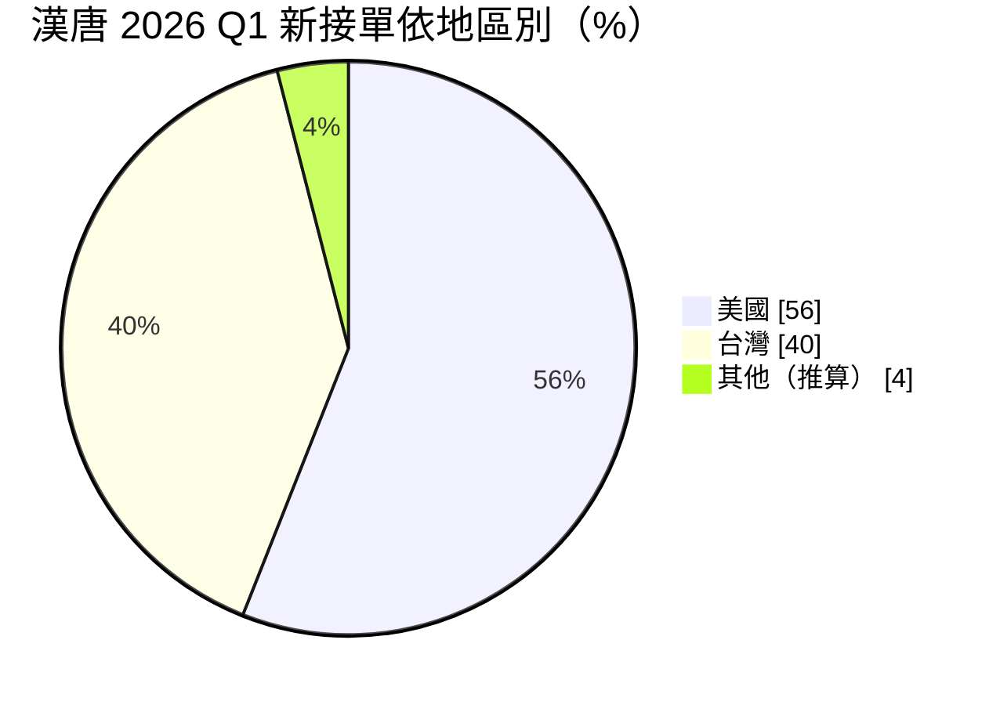
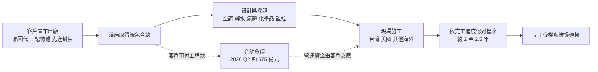
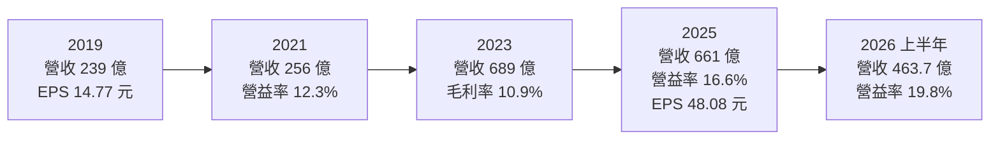
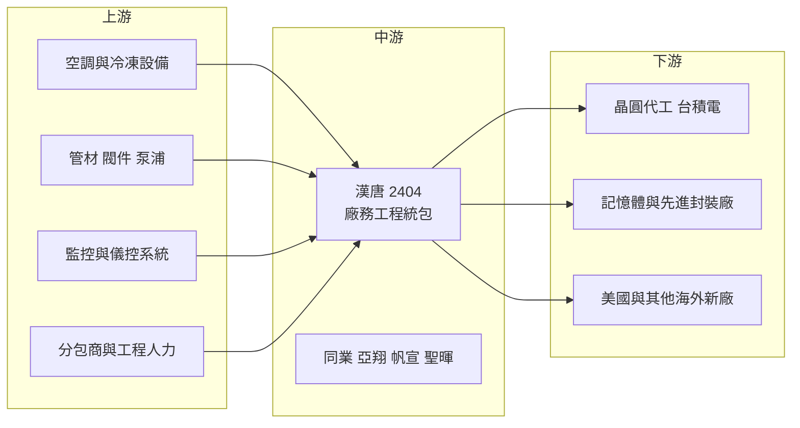

# 2404 漢唐

> 上市｜[[產業索引-其他電子業|其他電子業]]｜上市（櫃）日期 2000/03/14

# 第一章：企業模式與商業藍圖

> [!info] 撰寫說明
> 本文由 Claude 依公開資料整理，架構比照 [[2330台積電]] 的四章研究，資料截至 2026-10-08。財務數字來源：證交所開放資料快照（基本資料、2026 年第二季資產負債與綜合損益、股利）、Goodinfo 經營績效頁與股利政策頁（2016 至 2025 年）、MoneyDJ 季資產負債表（2026 年第二季現金、合約資產與合約負債）、方格子與富果研究 2026 年 6 月法說會整理、NOWnews 2026 年 6 月報導；漢唐與台積電合作的起始年代、早年中國與東南亞專案經驗係憑記憶整理，尚未逐條比對原始文件。#待校對

在評估一家公司的長期投資價值時，第一步是看懂它靠什麼賺錢、為什麼能一直賺下去。本章針對漢唐集成（股票代號：2404，以下簡稱漢唐）的商業模式進行定性分析，說明一家不生產任何晶片、也不賣任何設備的工程公司，為什麼能在台灣半導體產業中長期維持極高的股東權益報酬率，以及它的命運為何與晶圓廠的建廠週期緊緊綁在一起。

## 一、核心定位：半導體廠務工程的統包商

漢唐成立於 1982 年，2000 年在台灣證交所上市，董事長為李惠文、總經理為賴志明，實收資本額約 19.06 億元。漢唐承攬半導體與光電等高科技廠房的整廠規劃、[[無塵室]]、機電、空調、儀控、[[特殊氣體]]與化學品供應系統，以及完工後的維護運轉，另有小部分醫療器材業務。

要理解漢唐的角色，可以把一座晶圓廠拆成三層。最外層是建築結構，由營造廠負責；最內層是曝光機、蝕刻機等製程設備，由設備商提供；介於兩者之間的，是讓製程設備能穩定運作的整套環境系統，包括控制微粒與溫濕度的無塵室、供應[[超純水]]與各種氣體化學品的管路、排氣與廢水處理、電力與監控系統。這一層就是[[廠務工程]]，漢唐是台灣這個領域的主要統包商之一，也長期是 [[2330台積電]] 建廠時的重要承包商（合作起始年代待校對）。

漢唐的商業模式有兩個核心特徵。第一，它的營收來自客戶的建廠決策，客戶的資本支出就是漢唐的訂單來源，因此漢唐的業績落後客戶的擴產計畫約 1 至 2 年。第二，它以[[統包工程]]方式承攬，從設計、採購到施工整合都由漢唐負責，利潤取決於報價是否精準、成本與工期能否控管，而不是靠產品本身的技術專利。

## 二、終端應用板塊：先進製程、先進封裝與海外建廠

漢唐未揭露業務別的營收比重，但從法說會內容可以看出它的客戶結構與地區分布。漢唐的業務以晶圓代工與記憶體廠的無塵室與機電系統工程為主，近年再延伸到[[先進封裝]]廠房。依 NOWnews 報導，2026 年第一季新接單的地區分布如下（新接單比重，不是營收比重；其他為推算）：

- **台灣先進製程與先進封裝：** 台灣仍是漢唐最大的工程據點。先進製程與 [[CoWoS]] 等先進封裝廠房的潔淨度、震動控制與氣體化學品純度要求一代比一代高，廠務系統的複雜度隨之提升，這有利於經驗豐富的統包商。
- **美國建廠：** 隨著台積電在美國亞利桑那州擴廠，漢唐的美國專案在 2020 年代中期大幅成長。依 2026 年 6 月法說會，公司預期 2026 年美國營收占比約五成。美國專案的人工與材料成本較高、法規與工會環境不同，但報價也較高。
- **其他海外：** 包括新加坡等地的專案。海外專案的比重上升，代表漢唐的營運風險從單純的台灣工程管理，擴大為跨國的專案與人力管理。

## 三、資本轉化邏輯：客戶預付款驅動的輕資產模式

漢唐的資本循環和製造業幾乎相反，可以從三個面向理解。

- **[[在手訂單]]提供多年能見度：** 晶圓廠的廠務工程從簽約到完工通常需要 2 年以上。漢唐在 2026 年 6 月法說會揭露，截至 2026 年 5 月底未認列的在手合約約 1,939 億元，約為 2025 年營收的 2.9 倍，預計在 2 至 2.5 年內陸續認列。這種訂單結構讓漢唐的營收比多數電子公司更可預測，但也意味著新接單的變化要一兩年後才會反映在營收上。
- **客戶預付款支應營運資金：** 依 MoneyDJ，2026 年第二季漢唐的[[合約負債]]約 575 億元，[[合約資產]]約 86 億元，現金及約當現金約 412 億元，而有息負債只有約 1.7 億元的租賃負債。合約負債代表客戶已經預付、但漢唐尚未完工的工程款。換句話說，漢唐施工所需的資金大部分由客戶先付，公司本身幾乎不需要投入資本，這是它股東權益報酬率長期極高的根本原因。
- **利潤來自專案管理：** 工程公司的毛利率取決於報價時的成本估算是否準確、施工期間能否控制材料與人工成本。漢唐 2016 至 2025 年的[[毛利率]]在 10.9% 到 20% 之間，[[營業利益率]]在 8.8% 到 16.6% 之間；專案結算時的成本差異，會讓個別年度的利潤率出現明顯變化。

## 四、企業長期藍圖：跟著 AI 建廠潮走向全球

- **建廠循環的長度：** 漢唐在 2026 年 6 月法說會表示，AI 晶片與高頻寬記憶體需求帶動的建廠潮，預期延續到 2029 年。對漢唐而言，這一輪循環的規模與海外比重都超過過去任何一次。
- **人力是成長的天花板：** 依法說會，漢唐集團人力約 1,700 人，台灣 900 多人、海外 800 多人，公司坦言人力是最大的瓶頸。工程公司能同時承接多少專案，取決於有經驗的專案經理與工程師數量，這比資金更難擴充。
- **技術複雜度提升：** 先進製程與先進封裝廠房的廠務系統密度越來越高，對潔淨度、微震、溫控與氣體化學品純度的要求更嚴格，節能、節水與廢氣處理也成為新的設計重點。這些要求提高了新進者的門檻，有利於長期參與頂尖晶圓廠建廠的統包商。

# 第二章：護城河深度與競爭優勢

在長期價值投資中，「護城河」指企業抵禦競爭、長期維持超額利潤的保護機制。本章分析漢唐的護城河構成、主要競爭對手，以及這些優勢在建廠循環高峰與低谷時分別能守住多少。

## 一、漢唐護城河的核心組成要素

漢唐的護城河屬於「關係型的中等護城河」，主要建立在客戶信任與執行紀錄上，而不是專利或規模。主要由三個要素構成：

- **1. 與頂尖晶圓廠的長期合作紀錄：** 先進製程晶圓廠的廠務規格高度客製，一座新廠往往沿用前一座廠的設計標準與施工團隊。漢唐長年參與台積電建廠，熟悉其規格、流程與品質要求，對客戶而言，換一家不熟悉的統包商意味著工期延誤與良率風險，而一座先進晶圓廠每延後一個月投產的損失極大。這種轉換成本是漢唐最重要的護城河。
- **2. 多系統統包的整合能力：** 無塵室、空調、超純水、特殊氣體、化學品與監控系統必須同時施工、彼此協調，任何一個系統出問題都會影響整廠交機。能整合多個系統並準時交機的公司有限，這讓漢唐能以統包商的身分承接整廠合約，而不只是分包單一系統。
- **3. 海外專案的執行經驗：** 美國建廠的法規、工會、勞動成本與供應鏈環境與台灣截然不同。已經在美國完成專案的公司，累積了在地的分包商網路與法規經驗，在後續擴建中較有優勢，新進者則需要付出學習成本。

## 二、主要競爭對手格局

| 對手 | 定位 | 對漢唐的影響 |
|---|---|---|
| [[6139亞翔]] | 台灣無塵室與機電工程大廠 | 同樣承接半導體與光電廠務工程，在台灣與海外直接競爭 |
| [[6196帆宣]] | 半導體設備代理與廠務系統整合 | 在氣體、化學品供應系統與部分機電工程重疊 |
| [[5536聖暉]] | 無塵室與機電工程 | 在中小型專案與東南亞市場競爭 |
| 美國與日本在地工程公司 | 美日大型工程與機電承包商 | 在美國與日本的在地建廠專案爭取份額，熟悉當地法規與勞動市場 |
| 各類機電與空調分包商 | 單一系統工程 | 分包部分系統，客戶若改採分包模式會壓縮統包利潤 |

## 三、優勢轉化：哪些守得住、哪些守不住

- **守得住：** 頂尖晶圓代工廠先進製程與先進封裝廠的整廠廠務工程，以及已經在進行中的美國擴建專案。這些專案重視交期、品質與保密，客戶傾向沿用熟悉的團隊，漢唐的地位相對穩固。
- **守不住：** 一般性的機電與空調次系統工程，以及非頂尖客戶的中小型專案。這些市場進入門檻較低、價格競爭激烈。客戶在建廠潮高峰過後，也可能要求分享效率提升的成果，壓縮工程利潤。漢唐 2023 年營收雖達 689 億元，毛利率卻只有 10.9%，說明在專案組合不利時，工程公司的利潤率可能明顯下滑。
- **觀察重點：** 長期可以追蹤三件事。第一是新接單金額能否持續補上已認列的訂單，在手訂單相對營收的倍數是判斷未來兩年營收的最佳指標；第二是海外專案的毛利率是否穩定，避免單一專案的成本超支侵蝕整年獲利；第三是建廠循環在 2029 年前後是否轉弱，以及漢唐在下一個低谷期能維持多少營收。

# 第三章：財務體質與盈利規模

資料日期：2026-10-08。數字取自 Goodinfo 經營績效頁與股利政策頁、證交所開放資料快照與 MoneyDJ 季資產負債表，表格是撰寫當時的快照；最新月營收、毛利率、累計 EPS 由自動排程寫在本筆記的屬性欄位（月營收、毛利率、累計EPS 等）。#待校對

財務報表是檢驗護城河是否真實存在的最終標準。本章用多年度的三率、ROE、現金流與資本報酬，檢視漢唐在建廠循環中的獲利品質。

## 一、獲利能力的基石：三率

| 年度 | 營收（億元） | [[毛利率]] | [[營業利益率]] | EPS（元） | [[ROE]] |
|---|---|---|---|---|---|
| 2019 | 239 | 18.2% | 14.2% | 14.77 | 35.7% |
| 2020 | 358 | 15.9% | 12.9% | 21.16 | 43.3% |
| 2021 | 256 | 16.0% | 12.3% | 14.53 | 28.3% |
| 2022 | 482 | 13.9% | 11.3% | 21.25 | 40.3% |
| 2023 | 689 | 10.9% | 8.8% | 24.82 | 42.1% |
| 2024 | 474 | 18.0% | 14.5% | 32.94 | 45.8% |
| 2025 | 661 | 20.0% | 16.6% | 48.08 | 54.2% |

（來源：Goodinfo 經營績效頁，合併報表。2026 年上半年依證交所資料，營收 463.69 億元、毛利率 23.5%、營業利益率 19.8%、EPS 36.23 元。）

- **營收隨建廠循環大幅起伏：** 漢唐的營收在 2021 年 256 億元、2023 年 689 億元、2024 年 474 億元之間大幅擺盪，反映的是客戶建廠專案的認列時點，而不是需求的長期變化。2020 至 2025 年營收年複合成長率約 13.0%（推算），長期趨勢向上，但年度間的波動很大。
- **利潤率由專案組合決定：** 2023 年營收創新高，毛利率卻降到 10.9%，推估與當年認列的專案成本較高或利潤較薄有關；2024 年起毛利率回升到 18% 以上，2026 年上半年再升到 23.5%，法說會將其歸因於利潤率較高的美國專案占比提升。工程公司的利潤率不像製造業由產能利用率決定，而是由每一個專案的報價與成本控管決定。
- **費用結構輕：** 漢唐的營業利益率與毛利率的差距只有 3 至 4 個百分點，代表管理與行銷費用占營收比例很低。營收放大時，營業利益幾乎同步放大。

## 二、[[ROE]]：資本效率

2021 至 2025 年漢唐的平均 ROE 約 42.1%（推算），2016 年以來每一年都超過 20%，這在台股中屬於極少數。漢唐的高 ROE 不是靠財務槓桿：依 MoneyDJ，2026 年第二季有息負債只有約 1.7 億元的租賃負債。真正的來源是兩個：第一，客戶預付款支應了施工所需的營運資金，漢唐幾乎不需要自有資本；第二，公司把大部分盈餘以現金股利配出，股東權益不會無限累積。依證交所資料，2026 年第二季權益總計約 181.8 億元，每股淨值約 94.84 元，負債總計約 823.0 億元，其中大部分是合約負債而非借款。

## 三、資本支出、自由現金流與股利

- **[[CapEx]]：** 工程公司不需要大型廠房與機台，資本支出極低，具體金額未查得。漢唐的主要「資本」是人力與專案管理能力。
- **[[自由現金流]]：** 多年度自由現金流數字未查得。由於合約負債遠大於合約資產，漢唐的營業現金流在接單擴張期通常相當充裕（推估），2026 年第二季帳上現金約 412 億元。需要注意的是，這些現金有很大一部分對應的是客戶預付、尚未完工的工程款，並不全是可以自由分配的盈餘。當建廠循環轉弱、新接單減少時，預收款會隨專案完工而消化，現金部位可能明顯下降。
- **股利穩定度：** 依 Goodinfo 股利政策頁，漢唐 2016 年度以來每年都配發現金股利，金額從 2016 年度的 6 元逐步提高到 2023 年度的 21 元、2024 年度的 28 元與 2025 年度的 40 元。以各年度 EPS 計算，2021 至 2025 年度的配發率約在 71% 到 90% 之間（推算）。高且持續的配息是漢唐把高 ROE 轉成股東實際報酬的方式。

## 四、[[ROIC]] 與 [[WACC]]：價值創造利差

- **ROIC（推算）：** 以 2025 年營收 661 億元乘以營業利益率 16.6%，營業利益約 109.7 億元，扣除 20% 稅率後稅後營業利益約 87.8 億元。投入資本以 2026 年第二季權益總計約 181.8 億元，加上有息負債約 1.7 億元（僅租賃負債，MoneyDJ），合計約 183.5 億元，ROIC 約 48%（推算）。若進一步扣除約 412 億元的現金，漢唐的營運投入資本實際上為負值，代表本業是靠客戶的錢在運作，傳統 ROIC 的意義有限。
- **WACC（推算）：** 以 [[CAPM]] 估算股東權益成本：無風險利率取台灣 10 年期公債約 1.75%，市場風險溢酬 6%，β 假設 0.9（台灣工程與廠務股常見值，未查得漢唐實際數字），權益成本約 7.15%。有息負債幾乎為零，負債權重不到 1%，WACC 約 7.1%（推算）。
- **價值創造判斷：** 漢唐的 ROIC 遠高於 WACC，差距達 40 個百分點以上，屬於高度創造價值的商業模式。但這種價值創造的風險不在資本，而在專案與循環：一個大型專案若成本超支或工期延誤，就可能讓一整年的利潤率大幅下滑；建廠循環轉弱時，營收與獲利也會隨之縮小。投資人評估漢唐時，應把重點放在在手訂單、新接單與專案毛利率，而不是資本報酬本身。

# 第四章：總體風險與地緣政治

任何企業都無法脫離宏觀環境獨立存在。本章分析漢唐未來必須面對的地緣政治、產業週期、營運與法規風險。

## 一、地緣政治風險

- **美國產業政策：** 美國的半導體補助、關稅與在地生產要求，是台積電等客戶赴美建廠的主要推力，也帶動漢唐美國營收占比提升。若美國政策轉向、補助縮減，或客戶放慢美國擴廠，漢唐美國業務的成長會受影響。
- **兩岸風險：** 漢唐的總部、主要客戶的核心產能與大部分工程人力都在台灣，兩岸關係緊張會同時影響客戶的建廠決策與漢唐的營運。
- **供應鏈重組的雙面性：** 全球半導體產能分散到美國、日本、歐洲與東南亞，帶來新的海外專案機會，但每進入一個新國家，就要重新建立分包網路與法規經驗，執行風險也隨之上升。

## 二、產業週期與市場結構風險

- **客戶集中：** 漢唐的營收高度依賴少數半導體大廠的資本支出，尤其是台積電。單一客戶的擴產步調，幾乎決定漢唐未來兩三年的營收。
- **建廠循環的延遲反應：** 半導體資本支出具明顯週期性，工程業的營收落後客戶資本支出約 1 至 2 年。當 AI 帶動的建廠潮在某個時點退燒，漢唐的新接單會先下滑，營收則在一兩年後才反映，投資人可能在營收仍高時就面臨訂單轉弱。
- **[[長鞭效應]]：** 終端 AI 需求的變化，會沿著晶片設計、晶圓代工到建廠計畫一路放大，最後反映在廠務工程訂單的大起大落。

## 三、營運環境的隱性風險

- **人力短缺：** 法說會指出人力是最大痛點，台灣的缺工甚至比美國更嚴重。工程人力不足會限制可承接的專案數量，也可能推升人事成本。
- **工期延誤與成本超支：** 統包工程的利潤是在報價時就大致決定的，施工期間的材料漲價、工期延誤或設計變更，都會直接壓縮專案利潤。美國的人工與材料成本較高，報價失準的影響更大。
- **客戶議價能力：** 頂尖晶圓廠擁有強大的議價能力，在建廠潮高峰過後，可能要求降價或分享效率提升的成果，使工程利潤率回落。

## 四、科技與法規演進風險

- **製程演進帶來的設計要求：** 先進製程與先進封裝對無塵室潔淨度、微震控制、溫濕度與氣體化學品純度的要求逐代提高，廠務設計必須持續跟上，否則可能在下一代廠房中失去競爭力。
- **環保與淨零要求：** 晶圓廠是用電與用水大戶，淨零排放要求讓節能、節水、廢氣與廢水處理成為廠務設計的重點。這既是新的業務機會，也提高了設計與施工的複雜度。
- **各國法規差異：** 各國的建築、環保、職安與勞動法規不同，海外專案需要額外的合規成本，若違規也可能面臨罰款或工期延誤。

# 專有名詞解析

## 半導體

- **[[先進封裝]]**：把多顆晶片以中介層、混合鍵合等方式高密度整合的封裝技術，例如 CoWoS、SoIC。
- **[[CoWoS]]**：台積電的 2.5D 先進封裝技術，把 GPU 與 HBM 並排放在矽中介層上，是 AI 晶片的關鍵封裝。

## 金融

- **[[在手訂單]]**：已簽約但尚未認列為營收的工程金額，代表未來數年的營收能見度。
- **[[合約負債]]**：客戶已預付、但公司尚未完成工程的款項，在資產負債表上列為負債。
- **[[合約資產]]**：公司已完成部分工程、但尚未取得向客戶請款權利的金額，在資產負債表上列為資產。
- **[[ROIC]]**：投入資本報酬率，稅後營業利益除以股東權益加有息負債，衡量本業運用資本的效率。
- **[[WACC]]**：加權平均資金成本，依股東權益與負債的比重，加權計算公司取得資金的平均成本。
- **[[CAPM]]**：資本資產定價模型，以無風險利率加上 β 乘以市場風險溢酬估算股東要求報酬率。
- **[[長鞭效應]]**：終端需求的小幅變動，沿供應鏈往上游傳遞時被逐級放大，造成上游庫存與訂單劇烈波動。

## 產業

- **[[無塵室]]**：控制空氣中微粒、溫濕度與壓力的密閉空間，半導體製程必須在高等級無塵室中進行。
- **[[廠務工程]]**：晶圓廠內支援製程運作的基礎設施工程，包括空調、純水、氣體、化學品供應與電力。
- **[[統包工程]]**：由單一承包商負責設計、採購與施工整合的工程模式，英文常稱 EPC 或 Turnkey。
- **[[特殊氣體]]**：半導體製程使用的高純度或有毒、易燃氣體，需要專門的供應與監控系統。
- **[[超純水]]**：去除幾乎所有離子與微粒的水，用於晶圓清洗，晶圓廠用量龐大。

# 核心供應鏈

## 1. 上游：設備、材料與分包
- 空調、冷凍、管材、閥件、泵浦與監控系統：供應商未揭露
- 各專業分包商與現場工程人力（台灣、美國與其他海外）

## 2. 中游：廠務工程同業
- [[6139亞翔]]、[[6196帆宣]]、[[5536聖暉]]
- 美國與日本在地工程與機電承包商

## 3. 下游：客戶
- 晶圓代工：[[2330台積電]]（台灣與美國亞利桑那廠）
- 記憶體與先進封裝廠：客戶名稱未逐一揭露

延伸閱讀：[[台積電供應鏈]]

## 供應鏈關係
- 供應給 [[2330台積電]]：無塵室機電整合工程（台積電供應鏈 › 上游：台灣建廠、無塵室與廠務系統）

## 最新新聞
<!-- news:start（自動產生，請勿手動編輯此範圍） -->
- 2026-10-13 📰 媒體 12:00｜半導體遭血洗！「無塵室大廠」目標價上看1415元也翻黑 均華、華洋精機跌逾6%、漢唐重挫8.5%｜[FTNN 新聞網](https://news.google.com/rss/articles/CBMiS0FVX3lxTE43MUk1bVZpZDFvaE95RmQ3VHg4TGZMaktMUUdsa3dEYkthUXd2QXRRTThjRnBNeWpDYlZoVmVmcWFTeE5ybTVfR1NGdw?oc=5)
- 2026-10-13 📰 媒體 05:23｜漢唐集成 ／ 2404.TW 股價走勢與即時報價｜[BigGo 財經](https://news.google.com/rss/articles/CBMiVEFVX3lxTFBrM1E5Ti1aVFdIZFhRcXhrdXAwa3BqRU81c0pBWFA1UWVod1dWRy1OR0l0ak1MdTJxdjhPaW15bDFlc2xoRnlKSjR2MjdjVGdhQ2kyXw?oc=5)
- 2026-10-12 📰 媒體 21:45｜半導體兩極對決！「這檔」在手訂單看到明年Q3大漲105元飆漲停、萬潤同步亮燈漢唐挫逾5%、聖暉逼近跌停｜[FTNN 新聞網](https://news.google.com/rss/articles/CBMiS0FVX3lxTFAzc1AtMlpZc05VX2k0VmhlNmplMkZzLWdFQ25iRHNOQVpEWEVnNDJueTlILVozYjFjVU9xdUpKMWx6N09YWlQ5eFM0Zw?oc=5)
- 2026-10-12 📰 媒體 18:14｜漢唐9月營收月減13.0%｜[TechNews 科技新報](https://news.google.com/rss/articles/CBMifEFVX3lxTE9lR1BZWDY1LWJ6SUhqdzU3SFNBWUxCeTQ1a0NPRnhUbF9ab1JPdnAzM0lnUndFNUtnZkJ4VzVYSlhEV0Iya2R3Y21nY2Zhby14VVBLMktxQ1dWOE9tc3I1TGUtdDRDMjFDY0tYZVR2aTZBZXRza3FEa0E5RFk?oc=5)
- 2026-10-12 📰 媒體 17:23｜《業績-其他電》漢唐9月營收為81.69億元，年增12.56%｜[富聯網](https://news.google.com/rss/articles/CBMiiAFBVV95cUxNTzhlSkdZencwNWlFdDBTeGdXUE5OcW9PNG1SdVlLNU9vLTZnaG4wNktxLWFPOEhnWmtjWWh6aUlGSkRBWmhJYjZOeHUwQVZCeUJ2QkpsRnVjQUc0ZTdESEJzRG1jeG8ydWRRZUxaRk9DdVNGdGNndmxlWDJfN0hZSFZkbHBMNDFh?oc=5)

完整紀錄：[[2404漢唐 新聞]]
<!-- news:end -->

## 相關連結
- [公開資訊觀測站](https://mopsov.twse.com.tw/mops/web/t05st03?step=1&firstin=1&co_id=2404)
- [Goodinfo](https://goodinfo.tw/tw/StockDetail.asp?STOCK_ID=2404)
- [Yahoo 股市](https://tw.stock.yahoo.com/quote/2404)
- [鉅亨網新聞](https://www.cnyes.com/twstock/2404/news)
